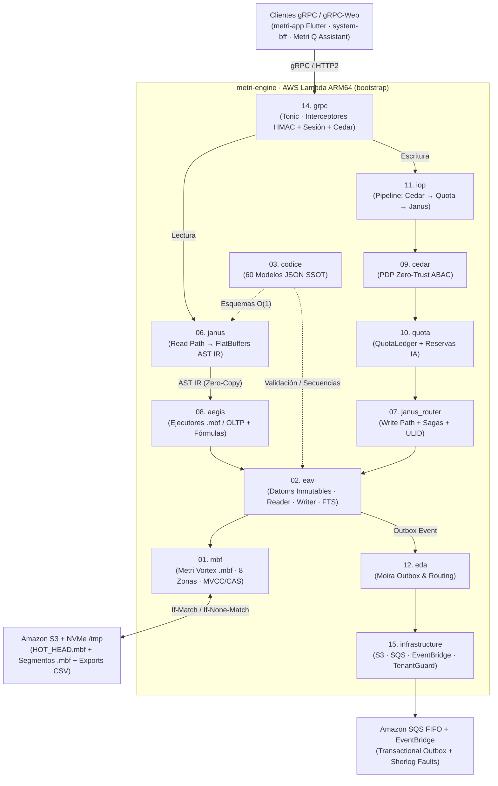

# `metri-engine` — Motor de Datos HTAP Unificado (`.mbf`)

> **Índice Maestro de Documentación (100% Cobertura):** [`docs/README.md`](docs/README.md) · **Quickstart Local:** [`docs/01-inicio/01-quickstart-local.md`](docs/01-inicio/01-quickstart-local.md)

**`metri-engine`** es el motor de datos **100 % Rust** de la plataforma **Metri** (CMMS / Business Intelligence / Telemetría IoT / Contabilidad Operativa multitenant). Se despliega como una única función **AWS Lambda ARM64 Graviton** (`provided.al2023`, binario `bootstrap`) que sirve un servidor **gRPC / gRPC-Web** (Tonic) detrás de Lambda Function URL + CloudFront + WAFv2.

Unifica en un solo binario sin motores externos:

1. **Motor Binario HTAP Metri Vortex (`.mbf`)** — combina transacciones ACID de datoms inmutables (EAVT/AEVT/AVET/VAET, MVCC bi-temporal, reclamaciones de unicidad y búsqueda híbrida) con ejecución analítica columnar vectorizada sobre **Amazon S3** (con protocolo CAS condicional `If-Match`, caché NVMe de 512 MB en `/tmp` y almacenamiento en memoria `MbfStorageClient`), estructurado en **8 zonas físicas alineadas a 64 bytes**.
2. **Seguridad Zero-Trust en Profundidad** — autenticación HMAC en tiempo constante, aislamiento estricto por tenant (`TenantGuard`), autorización ABAC embebida mediante **Cedar Policy 3** (*fail-closed*) y censura del tenant maestro (`system`).
3. **Gobernanza Atómica de Cuotas e Ingesta** — libro mayor atómico por tenant (`QuotaLedger`), tickets de reserva para consumo de IA y pipeline ferroviario (`IOP`: `Cedar` $\rightarrow$ `Quota` $\rightarrow$ `JanusRouter`).

---

## Arquitectura General en un Vistazo



---

## Mapa de los 16 Componentes de `src/`

Cada módulo cuenta con su especificación detallada (nivel C3/C4 y mapa del 100% de sus archivos) en [`docs/04-componentes/`](docs/README.md#4-componentes-detallados-docs04-componentes--modelo-c4-nivel-c3c4):

| # | Módulo (`src/`) | Rol Arquitectónico | Ficha Detallada |
| :---: | :--- | :--- | :--- |
| **01** | `mbf` | Motor binario HTAP unificado **Metri Vortex (`.mbf`)**: formato de 64B, 8 zonas físicas, transacciones MVCC/CAS y almacenamiento S3/memoria. | [`01-mbf.md`](docs/04-componentes/01-mbf.md) |
| **02** | `eav` | Motor de datoms inmutables sobre `.mbf`: `types`, `writer` ACID (`datom_plan`, `unique_claim`, `outbox`), `reader` (`pull`, `query`) y `fts`. | [`02-eav.md`](docs/04-componentes/02-eav.md) |
| **03** | `codice` | Registro SSOT de los 60 modelos JSON (`config/models/`): coerción, validación, perfiles matemáticos/difusos, secuencias y Base36. | [`03-codice.md`](docs/04-componentes/03-codice.md) |
| **04** | `domain` | Contratos puros del dominio: `DomainError`/`ErrorCode` (1:1 con TOML), eventos de dominio, puertos (`protocols.rs`) y patrón `Railway`. | [`04-domain.md`](docs/04-componentes/04-domain.md) |
| **05** | `application` | Puertos de aplicación segregados por consumidor (`ISP <= 5` métodos, Inversión de Dependencias — DIP). | [`05-application.md`](docs/04-componentes/05-application.md) |
| **06** | `janus` | Camino de lectura (*Read Path*): normalización, validación, selección de plan, inyección ABAC, compilación a AST IR en FlatBuffers y agregación. | [`06-janus.md`](docs/04-componentes/06-janus.md) |
| **07** | `janus_router` | Camino de escritura (*Write Path*): enrutamiento transaccional `.mbf`, proyección declarativa de sagas (`scheduled_job`) y ULIDs monotónicos. | [`07-janus-router.md`](docs/04-componentes/07-janus-router.md) |
| **08** | `aegis` | Ejecutores vectorizados `.mbf` y OLTP sobre AST IR + lenguaje de fórmulas matemáticas sandboxeado (`lexer` $\rightarrow$ `parser` $\rightarrow$ `evaluator`). | [`08-aegis.md`](docs/04-componentes/08-aegis.md) |
| **09** | `cedar` | Punto de Decisión de Políticas (PDP) Zero-Trust sobre Cedar Policy 3, hidratación de grafo de principal y cachés de sesión/principal. | [`09-cedar.md`](docs/04-componentes/09-cedar.md) |
| **10** | `quota` | Gobernanza atómica de cuotas por tenant: resolución (`QuotaResolver`), libro mayor (`QuotaLedger`), reservas de IA y `sweeper`. | [`10-quota.md`](docs/04-componentes/10-quota.md) |
| **11** | `iop` | Pipeline ferroviario de ingesta: ejecuta `CedarStep` $\rightarrow$ `QuotaStep` $\rightarrow$ `JanusStep` y reporta fallos forenses (`sherlog`). | [`11-iop.md`](docs/04-componentes/11-iop.md) |
| **12** | `eda` | Arquitectura orientada a eventos: drenaje del *Transactional Outbox* y evaluación de reglas de ruteo (`moira`). | [`12-eda.md`](docs/04-componentes/12-eda.md) |
| **13** | `temporal` | Primitivas temporales canónicas sin I/O conscientes de zona horaria IANA y transiciones DST (`chrono-tz`). | [`13-temporal.md`](docs/04-componentes/13-temporal.md) |
| **14** | `grpc` | Servidor Tonic / Tonic-Web, cadena de interceptores, traductores Protobuf y 4 servicios (`MetriService`, `MoiraRoutingService`, `QuotaService`, `AgentConfigService`). | [`14-grpc.md`](docs/04-componentes/14-grpc.md) |
| **15** | `infrastructure` | Adaptadores de salida AWS SDK (S3, SQS, EventBridge), almacén de sesiones HMAC, `TenantGuard` y auditoría. | [`15-infrastructure.md`](docs/04-componentes/15-infrastructure.md) |
| **16** | `otel` | Inicialización de trazas distribuidas OpenTelemetry (OTLP) y registro estructurado JSON para CloudWatch. | [`16-otel.md`](docs/04-componentes/16-otel.md) |

---

## Arranque Rápido y Verificación Local

El motor se ejecuta de forma 100 % autónoma en local utilizando almacenamiento `.mbf` en memoria sin requerir contenedores externos:

```bash
make run      # Levanta el servidor gRPC en localhost:9090 (modo stub autónomo)
make smoke    # Ejecuta smoke test gRPC vía tonic-reflection con grpcurl
make test     # Ejecuta la suite completa de pruebas unitarias e integración
make ci       # Espejo local de CI: fmt, gen_reference, check_docs --strict, patrón Result, Clean Code, cargo doc, clippy y tests
```

---

## Navegación Rápida de la Documentación (`docs/`)

La documentación sigue una arquitectura híbrida **Diátaxis + arc42 + Modelo C4 + MADR + Docs-as-Code**:

- **01. Inicio (Tutoriales):** [Quickstart Local](docs/01-inicio/01-quickstart-local.md) · [Recorrido Extremo a Extremo de Lectura y Escritura](docs/01-inicio/02-recorrido-lectura-y-escritura.md)
- **02. Guías Operativas (How-To):** [Desarrollo, Calidad y Pruebas](docs/02-guias/01-desarrollo-calidad-y-pruebas.md) · [Modelado de Entidades Códice](docs/02-guias/02-modelado-entidades-codice.md) · [Despliegue AWS SAM y CI/CD](docs/02-guias/03-despliegue-aws-y-ci-cd.md) · [Operación, Scripts y Observabilidad](docs/02-guias/04-operacion-scripts-y-observabilidad.md)
- **03. Arquitectura General (arc42 + C4 + ADRs):** [Visión General y Contexto C4](docs/03-arquitectura/01-vision-general-y-contexto-c4.md) · [Especificación del Motor Binario `.mbf`](docs/03-arquitectura/02-motor-binario-mbf-especificacion.md) · [Algoritmos y Fundamentos Matemáticos](docs/03-arquitectura/03-algoritmos-y-fundamentos-matematicos.md) · [Seguridad Zero-Trust y Multitenancy](docs/03-arquitectura/04-seguridad-zero-trust-y-multitenancy.md) · [Calidad, Clean Code y Patrón Result](docs/03-arquitectura/05-calidad-clean-code-y-patron-result.md) · [Infraestructura Serverless ARM64](docs/03-arquitectura/06-infraestructura-serverless-arm64.md)
- **04. Componentes Detallados:** [Ver las 16 fichas técnicas en `docs/README.md`](docs/README.md#4-componentes-detallados-docs04-componentes--modelo-c4-nivel-c3c4)
- **05. Referencia Canónica (SSOT):** [Contratos gRPC](docs/05-referencia/api-grpc.md) · [Catálogo de Códigos de Error](docs/05-referencia/codigos-error.md) · [Catálogo de Modelos Códice](docs/05-referencia/modelos-codice.md) · [Diagrama del Modelo de Datos](docs/05-referencia/diagrama-modelo-datos.md) · [Políticas Cedar, Prompts y Localización](docs/05-referencia/politicas-prompts-y-localizacion.md) · [Suites de Pruebas y Scripts](docs/05-referencia/suites-pruebas-y-scripts.md) · [Glosario](docs/05-referencia/glosario.md)
