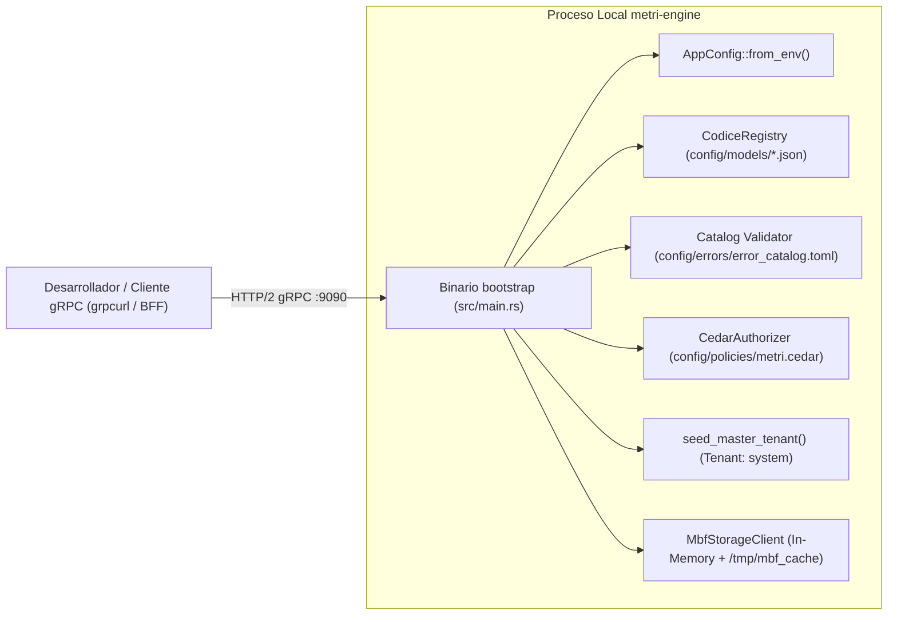

# Quickstart Local

> **Propósito:** Guía de inicio rápido para compilar, configurar y ejecutar `metri-engine` localmente en menos de 10 minutos utilizando el motor nativo en memoria `MbfStorageClient` y los adaptadores de infraestructura local sin dependencias externas de nube.

---

## 1. Visión General del Entorno Local

`metri-engine` es un motor de datos híbrido transaccional y analítico (**HTAP**) escrito en Rust (Edición 2021) bajo la arquitectura **Metri Vortex (`.mbf` — Metri Binary Format)**. A diferencia de arquitecturas tradicionales que exigen levantar contenedores pesados de bases de datos externas para el desarrollo diario, el binario `bootstrap` de `metri-engine` incorpora un motor `.mbf` determinista en memoria (`MbfStorageClient::new_in_memory`) respaldado por una caché local en `/tmp/mbf_cache` y adaptadores `stub` para almacenamiento de exportación y buses de eventos.



---

## 2. Prerrequisitos de Toolchain

Antes de compilar el proyecto, asegúrate de contar con las herramientas exactas requeridas por `Cargo.toml` y `build.rs`:

| Herramienta | Versión Requerida | Propósito en el Build (`build.rs` / `Makefile`) | Comando de Verificación |
| :--- | :--- | :--- | :--- |
| **Rust / Cargo** | Stable (`edition = "2021"`, `1.80+`) | Compilación del crate `metri_engine` y el binario `bootstrap`, más `rustfmt` y `clippy`. | `rustc --version && cargo --version` |
| **Protobuf (`protoc`)** | `libprotoc 3.20+` / `25+` | Compilación de `proto/metri.proto` y `proto/eda.proto` mediante `tonic-build` y generación de `metri_descriptor.bin`. | `protoc --version` |
| **FlatBuffers (`flatc`)** | **`25.12.19`** (Exacta) | Generación en `build.rs` del código Rust (`--rust --gen-object-api`) desde `src/janus/janus_ir_ast.fbs`, sincronizada con el crate `flatbuffers = "25.12.19"`. | `flatc --version` |
| **Python 3** | `3.11+` | Ejecución de los guardianes estáticos de calidad (`scripts/dev/*.py`) y generadores de documentación (`scripts/docs/gen_reference.py`). | `python3 --version` |
| **`grpcurl`** | `1.8+` (Opcional) | Inspección interactiva mediante reflexión gRPC (`tonic-reflection`) y pruebas manuales contra el puerto `9090`. | `grpcurl --version` |
| **Cargo Lambda / Zig** | Última estable (Solo para AWS) | Compilación cruzada hacia `aarch64-unknown-linux-gnu` (`provided.al2023`) cuando se empaqueta para AWS Lambda. | `cargo lambda --version` |

> [!IMPORTANT]
> **Sincronización estricta de `flatc`:** El script `build.rs` invoca el binario `flatc` del sistema para compilar `src/janus/janus_ir_ast.fbs` en `$OUT_DIR/janus_ir_ast_generated.rs`. La versión del CLI `flatc` debe coincidir con la dependencia `flatbuffers = "25.12.19"` declarada en `Cargo.toml`. Si necesitas reinstalar la versión exacta en macOS o Linux, consulta el workflow `.github/workflows/rust.yml` que compila el tag `v25.12.19` desde `google/flatbuffers`.

---

## 3. Variables de Entorno para Ejecución Local

El motor carga su configuración mediante `AppConfig::from_env()` (`src/domain/config.rs`) y el inicializador `run_grpc_server_from_env()` (`src/grpc/server.rs`). Sigue una política **Fail-Closed**: si `ENVIRONMENT` no está definido o toma un valor distinto de `development`, `dev`, `local` o `test`, el motor asume modo de producción estricto.

### 3.1 Tabla Completa de Variables de Entorno

| Variable | Valor por Defecto Local | Requerida en Prod | Descripción y Comportamiento |
| :--- | :--- | :--- | :--- |
| `ENVIRONMENT` | *(Sin default -> asume prod)* | Sí (`production`) | Define el perfil de seguridad. Usa `development`, `dev`, `local` o `test` en tu máquina local. |
| `GRPC_PORT` | `9090` | Sí (`9090`) | Puerto TCP donde escucha el servidor HTTP/2 de Tonic (`0.0.0.0:9090`). |
| `RUST_LOG` | `info` | Sí (`warn`) | Nivel de filtro para `tracing_subscriber` (ej. `info,metri_engine=debug`). |
| `CODICE_MODELS_DIR` | `config/models` | Sí (`models`) | Directorio que contiene los 28 archivos JSON de modelos y catálogos de **Codice**. |
| `ERROR_CATALOG_PATH` | `config/errors/error_catalog.toml` | Sí (`errors/error_catalog.toml`) | Ruta al catálogo canónico de errores validado al arranque por `init_error_catalog`. |
| `MASTER_TENANT_ID` | `system` | Sí (`system`) | Identificador del tenant maestro para operaciones globales y semilla inicial (alias: `METRI_MASTER_TENANT_ID`). |
| `HMAC_SECRET` | `secret-key-development-metri-256-bits!!!` (solo en dev) | **Sí (>= 32 bytes)** | Secreto maestro para verificar tokens `x-Calculated-Auth`, cursores opacos y derivación KDF de sellos `.mbf`. |
| `METRI_DEV_AUTH_BYPASS` | Desactivado | **Prohibido (`Err`)** | Si es `"1"` en entorno local, permite omitir la cabecera `x-Calculated-Auth` en pruebas manuales. En producción aborta el arranque. |
| `METRI_BOOTSTRAP_MASTER_EMAIL` | *(Opcional en local)* | Opcional | Email para sembrar la identidad `usr_master` en el arranque (`src/grpc/bootstrap.rs`). |
| `METRI_BOOTSTRAP_MASTER_USERNAME` | *(Opcional en local)* | Opcional | Username para sembrar la identidad `usr_master`. |
| `METRI_BOOTSTRAP_MASTER_PASSWORD` | *(Opcional en local)* | Opcional | Password en texto plano que se hashea con **Argon2id** en el arranque y luego se purga del entorno (`env::remove_var`). |
| `S3_MODE` | `real` (usa `stub` en local) | No (`real`) | Cuando se fija en `stub`, inyecta `StubExportStorage` en lugar del cliente S3 real para exportaciones. |
| `SQS_MODE` | `real` (usa `stub` en local) | No (`real`) | Cuando se fija en `stub`, inyecta `StubSqsBus` para la cola transaccional Outbox. |
| `EVENTBRIDGE_MODE` | `real` (usa `stub` en local) | No (`real`) | Cuando se fija en `stub`, inyecta `NoopFaultNotifier` para alertas de Sherlog (`src/iop/sherlog.rs`). |
| `MBF_CACHE_DIR` | `/tmp/mbf_cache` | Sí (`/tmp/mbf_cache`) | Directorio local donde el motor `.mbf` mantiene los bloques calientes y snapshots locales. |
| `MBF_TMP_CACHE_MAX_MB` | `450` | Sí (`450`) | Presupuesto máximo de caché local en disco NVMe/efímero (`450 MiB`). |
| `MBF_L0_MAX_ROWS` | `4096` | Sí (`4096`) | Capacidad máxima de filas por micro-bloque PAX en la zona L0 antes de compactar. |
| `MBF_GROUP_COMMIT_WINDOW_MS` | `15` | Sí (`15`) | Ventana en milisegundos del coordinador transaccional para agrupar commits concurrentes. |

---

## 4. Arranque Paso a Paso en Modo Desarrollo

### Paso 1: Verificar las guardas estáticas y compilar

El repositorio incluye un `Makefile` en la raíz con todos los atajos de desarrollo:

```bash
# 1. Ejecutar los guardianes de Clean Code, Patrón Result y Documentación
make verify-result-pattern
make verify-clean-code
make docs-check

# 2. Compilar el proyecto en modo debug
cargo build
```

### Paso 2: Iniciar el servidor gRPC local

Ejecuta el binario `bootstrap` configurando las variables de entorno en modo `development` y habilitando los adaptadores `stub` para no requerir credenciales de AWS activas:

```bash
ENVIRONMENT=development \
GRPC_PORT=9090 \
RUST_LOG=info,metri_engine=debug \
S3_MODE=stub \
SQS_MODE=stub \
EVENTBRIDGE_MODE=stub \
METRI_DEV_AUTH_BYPASS=1 \
METRI_BOOTSTRAP_MASTER_EMAIL="admin@metri.local" \
METRI_BOOTSTRAP_MASTER_USERNAME="admin" \
METRI_BOOTSTRAP_MASTER_PASSWORD="LocalDevPassword#2026" \
cargo run --bin bootstrap
```

### Paso 3: Secuencia de Inicialización en Consola

Al arrancar, `src/main.rs` y `src/grpc/server.rs` ejecutan la siguiente secuencia determinista:

1. **Inicialización de Telemetría (`otel::tracer::init_tracer`)**: Configura el suscriptor estructurado JSON con niveles controlados por `RUST_LOG`.
2. **Validación del Catálogo de Errores (`init_error_catalog`)**: Carga y valida `config/errors/error_catalog.toml`. Si falta o está corrupto, el proceso termina inmediatamente.
3. **Carga y Validación SSOT de Codice (`CodiceRegistry::load_from_dir`)**: Lee los 28 archivos JSON en `config/models`, verifica la convención `snake_case` de entidades y atributos, valida expresiones regulares, referencias foráneas (`refTarget`) y que toda entidad activa posea al menos un atributo con `isDisplayName: true`.
4. **Inicialización del Motor `.mbf` (`MbfStorageClient::new_in_memory`)**: Levanta el motor columnar/transaccional en memoria junto con `MbfSequenceGenerator` para secuencias monótonas y contadores atómicos.
5. **Semilla del Tenant Maestro (`seed_master_tenant`)**: Si se definieron las variables `METRI_BOOTSTRAP_MASTER_*`, crea de forma idempotente en el tenant `system` los roles `role_super_master` (`level = 0`) y `system-bff` (`level = 0`), además de los usuarios `usr_master` y `usr_system_bff`, borrando inmediatamente las credenciales de las variables de entorno del proceso.
6. **Apertura del Listener HTTP/2 (`0.0.0.0:9090`)**: Registra el servicio de reflexión gRPC (`FILE_DESCRIPTOR_SET`) y los 4 servicios de negocio (`MetriService`, `MoiraRoutingService`, `QuotaService` y `AgentConfigService`).

Verás en la salida estándar un registro JSON similar a:

```json
{"timestamp":"2026-10-19T23:00:00.120Z","level":"INFO","fields":{"message":"Bootstrapping Metri Core Engine (Rust / AL2023)..."}}
{"timestamp":"2026-10-19T23:00:00.145Z","level":"INFO","fields":{"message":"Loaded 97 entity schemas into Codice SSOT Registry"}}
{"timestamp":"2026-10-19T23:00:00.180Z","level":"INFO","fields":{"message":"Master tenant seed completed successfully for tenant 'system' (master + system-bff provisioned)."}}
{"timestamp":"2026-10-19T23:00:00.185Z","level":"INFO","fields":{"message":"gRPC Server listening on 0.0.0.0:9090"}}
```

---

## 5. Verificación Rápida con `grpcurl`

Con el servidor escuchando en `localhost:9090`, abre otra terminal para verificar los servicios expuestos mediante reflexión gRPC:

### 5.1 Listar los servicios gRPC registrados

```bash
grpcurl -plaintext localhost:9090 list
```

Salida esperada:

```text
grpc.reflection.v1.ServerReflection
grpc.reflection.v1alpha.ServerReflection
metri.eda.v1.AgentConfigService
metri.eda.v1.MoiraRoutingService
metri.eda.v1.QuotaService
metri.v1.MetriService
```

### 5.2 Consultar el Catálogo de Entidades (`Discovery`)

Como iniciamos con `METRI_DEV_AUTH_BYPASS=1` en `ENVIRONMENT=development`, podemos invocar `Discovery` pasando únicamente las cabeceras de contexto del tenant (`x-tenant-id` y `x-user-id`):

```bash
grpcurl -plaintext \
  -H 'x-tenant-id: system' \
  -H 'x-user-id: usr_master' \
  -H 'x-user-roles: role_super_master' \
  -d '{"tenant_id": "system"}' \
  localhost:9090 metri.v1.MetriService/Discovery
```

El motor devolverá el catálogo de entidades cargadas desde `config/models/` (como `user`, `role`, `customer`, `sales_order`, `journal_entry`, etc.) junto con sus perfiles de interfaz y definiciones de atributos.

---

## 6. Siguientes Pasos

- Sigue el [Recorrido de Lectura y Escritura](./02-recorrido-lectura-y-escritura.md) para ejecutar transacciones `Transact`, consultas analíticas `Query` con FlatBuffers (`JanusIR`) y explorar la arquitectura de código paso a paso.
- Revisa la [Guía de Desarrollo, Calidad y Pruebas](../02-guias/01-desarrollo-calidad-y-pruebas.md) para conocer los tests de integración y los guardianes arquitectónicos.
- Consulta la [Especificación del Motor Binario `.mbf`](../03-arquitectura/02-motor-binario-mbf-especificacion.md) para profundizar en el formato físico de 8 zonas.
