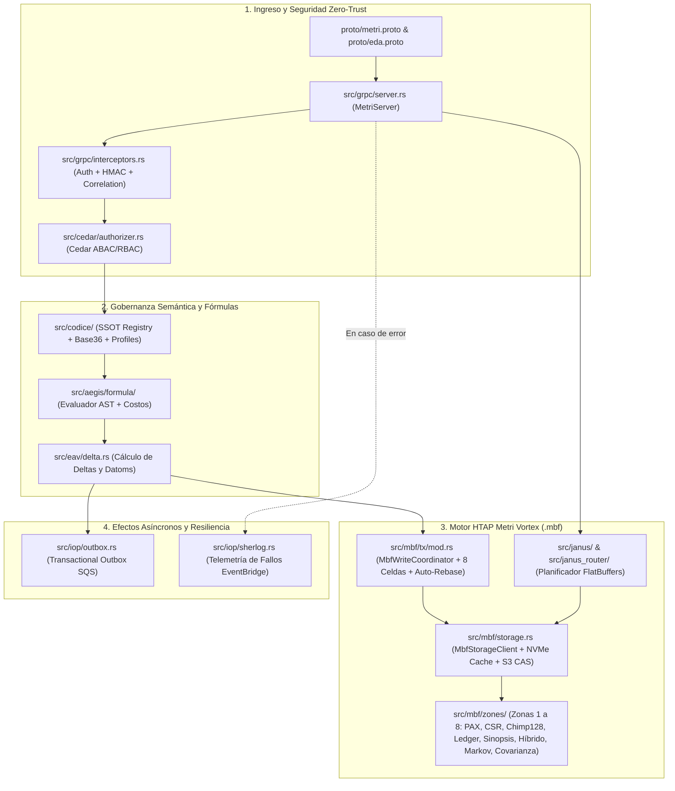
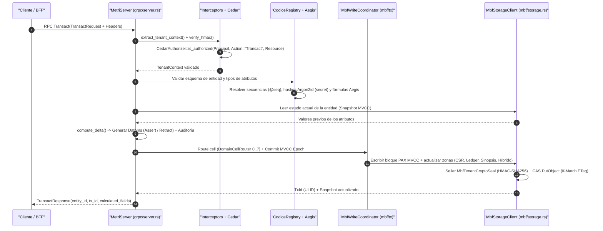
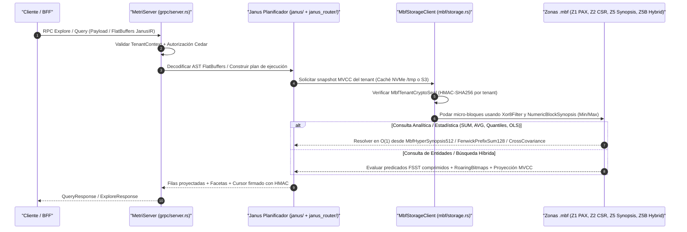

# Recorrido de Lectura y Escritura (End-to-End)

> **Propósito:** Guiar a desarrolladores y arquitectos a través del flujo completo de una operación de escritura transaccional (`Transact`) y una operación de lectura analítica/operacional (`Query` / `Explore`), trazando cada archivo fuente de `metri-engine` desde la interfaz gRPC hasta las 8 zonas del formato binario `.mbf`.

---

## 1. Mapa de Navegación del Código Fuente

Antes de ejecutar peticiones, este mapa resume qué módulo interviene en cada etapa del ciclo de vida de un dato dentro de `src/`:



| Etapa | Directorio / Archivo Clave | Responsabilidad Principal |
| :--- | :--- | :--- |
| **Contrato gRPC** | [`proto/metri.proto`](../../proto/metri.proto), [`src/grpc/server.rs`](../../src/grpc/server.rs) | Recepción del RPC, extracción de metadatos, traducción a tipos de dominio y serialización de respuesta. |
| **Autenticación e Identidad** | [`src/grpc/interceptors.rs`](../../src/grpc/interceptors.rs), [`src/infrastructure/tenant_guard.rs`](../../src/infrastructure/tenant_guard.rs) | Validación constante-tiempo de `x-Calculated-Auth` (HMAC-SHA256), ventana anti-replay ($\pm 300\text{ s}$) y construcción de `TenantContext`. |
| **Autorización ABAC/RBAC** | [`src/cedar/engine.rs`](../../src/cedar/engine.rs), [`config/policies/metri.cedar`](../../config/policies/metri.cedar) | Evaluación formal de políticas AWS Cedar (`Action::"Transact"`, `Action::"Query"`, `Action::"Discovery"`). |
| **Validación Semántica** | [`src/codice/registry.rs`](../../src/codice/registry.rs), [`src/codice/base36.rs`](../../src/codice/base36.rs) | Verificación de tipos (`string`, `int`, `float`, `decimal`, `ref`, `secret`, etc.), máscaras regex y codificación Base36 de atributos. |
| **Motor de Fórmulas** | [`src/aegis/formula/mod.rs`](../../src/aegis/formula/mod.rs) | Evaluación determinista de atributos calculados (`formula`) con límite de profundidad AST (`15`) y presupuesto de nodos (`150`). |
| **Coordinación MVCC y `.mbf`** | [`src/mbf/tx/mod.rs`](../../src/mbf/tx/mod.rs), [`src/mbf/storage.rs`](../../src/mbf/storage.rs) | Particionado por celdas (`HOT_HEAD_c0..c7.mbf`), firma de conflicto Bloom (`TxConflictSignature`), Auto-Rebase ante `HTTP 412` y persistencia en las 8 zonas. |

---

## 2. Anatomía de una Escritura Transaccional (`Transact`)

Cuando un cliente invoca `MetriService/Transact` (o `CompositeTransact` para sagas multi-entidad), el motor no sobrescribe registros en el lugar (*in-place update*). En su lugar, opera sobre un modelo de **Datoms inmutables** (`[Entidad, Atributo, Valor, Tx, Op]`) almacenados en bloques columnares híbridos **PAX MVCC** dentro del archivo `.mbf` del tenant.

### 2.1 Secuencia Detallada del Camino de Escritura



### 2.2 Ejemplo Práctico de Escritura (`Transact`)

Con el servidor corriendo localmente en el puerto `9090` (ver [Quickstart Local](./01-quickstart-local.md)), podemos crear o actualizar una entidad `customer` ejecutando:

```bash
grpcurl -plaintext \
  -H 'x-tenant-id: system' \
  -H 'x-user-id: usr_master' \
  -H 'x-user-roles: role_super_master' \
  -d '{
    "tenant_id": "system",
    "entity_type": "customer",
    "operation": "CREATE",
    "attributes": {
      "name": "Industrias Vortex S.A.",
      "tax_id": "20601234567",
      "email": "finanzas@vortex.pe",
      "credit_limit": "150000.0000",
      "is_active": "true"
    }
  }' \
  localhost:9090 metri.v1.MetriService/Transact
```

#### ¿Qué ocurre internamente durante esta llamada?

1. **Identidad de la Entidad (`src/domain/identity.rs`)**: Si `entity_id` no fue provisto en un `CREATE`, el motor genera un **ULID** lexicográficamente ordenable de 26 caracteres (o aplica una plantilla determinista si el modelo en Codice define `idTemplate`).
2. **Atributos Secuencia y Secretos**:
   - Si el esquema define una secuencia automática (`sequence`), `MbfSequenceGenerator` asigna el siguiente correlativo atómico sin huecos.
   - Si algún atributo tiene `type: "secret"` (por ejemplo, `password` en la entidad `user`), `src/infrastructure/crypto.rs` aplica automáticamente un hash **Argon2id** (`m=19456`, `t=2`, `p=1`) antes de que el valor toque cualquier estructura de memoria persistente.
3. **Motor de Cálculo (`src/eav/delta.rs`)**:
   - Calcula la diferencia exacta (*delta*) entre el estado anterior de la entidad y el nuevo payload.
   - Si el valor de un atributo no cambió (idempotencia de estado), no se emiten datoms redundantes.
   - Si un atributo muta de $V_{\text{old}}$ a $V_{\text{new}}$ en la época transaccional $e_k$, el bloque PAX MVCC (`src/mbf/zones/pax_mvcc.rs`) marca la versión anterior con `tx_retract_epoch` $= e_k$ e inserta la nueva versión con `tx_assert_epoch` $= e_k$ y `tx_retract_epoch = u64::MAX`.
4. **Sello Criptográfico y Zonas `.mbf`**:
   - Los atributos de texto se comprimen con **FSST** (`FsstSymbolTable`) y se indexan en el motor de búsqueda híbrida de 6 capas (`src/mbf/zones/hybrid_search.rs`).
   - Los atributos numéricos y monetarios actualizan en tiempo real las sinopsis estadísticas (`MbfHyperSynopsis512` en Zona 5) y, si pertenecen a un libro contable, actualizan el árbol de Fenwick de 128 bits (`FenwickPrefixSum128`) y la cadena Merkle SHA-256 en la Zona 4 (`src/mbf/zones/financial_ledger.rs`).

---

## 3. Anatomía de una Lectura (`Explore`, `ListEntities` y `Query`)

`metri-engine` ofrece tres puntos de entrada complementarios para lectura en `MetriService`, diseñados según la latencia y complejidad analítica requerida:

| Método RPC | Caso de Uso Ideal | Mecanismo Interno en `.mbf` |
| :--- | :--- | :--- |
| **`ListEntities`** | Listados rápidos paginados de una entidad con proyección de atributos y filtros de igualdad. | Directorio **Elias-Fano + MPHF** (`O(1)`) en Zona 1 + escaneo de bitmaps de visibilidad MVCC. |
| **`Explore`** | Búsqueda interactiva, autocompletado tolerante a errores tipográficos, facetas y navegación del catálogo. | Índice **Híbrido de 6 Capas** (FST + Levenshtein DFA $k \le 2$ + SymSpell + N-gramas + Fonética + BM25F/RRF) en Zona 5B. |
| **`Query`** | Consultas analíticas complejas, agregaciones grupales, cruces relacionales (grafos CSR) y predicados compuestos via **Janus IR** (FlatBuffers). | **Janus Router** + **Data Pruning** con filtros Xor8 / Roaring Bitmaps + resolución $O(1)$ desde `MbfHyperSynopsis512` y matrices de covarianza en Zona 6B. |

### 3.1 Secuencia Detallada del Camino de Lectura (`Query` / `Explore`)



### 3.2 Ejemplo Práctico: Listar Entidades (`ListEntities`)

Para recuperar los clientes creados en el paso anterior:

```bash
grpcurl -plaintext \
  -H 'x-tenant-id: system' \
  -H 'x-user-id: usr_master' \
  -H 'x-user-roles: role_super_master' \
  -d '{
    "tenant_id": "system",
    "entity_type": "customer",
    "limit": 10
  }' \
  localhost:9090 metri.v1.MetriService/ListEntities
```

### 3.3 Ejemplo Práctico: Exploración Híbrida (`Explore`)

Para realizar una búsqueda interactiva sobre las entidades del tenant con cálculo automático de facetas y paginación segura por cursor:

```bash
grpcurl -plaintext \
  -H 'x-tenant-id: system' \
  -H 'x-user-id: usr_master' \
  -H 'x-user-roles: role_super_master' \
  -d '{
    "tenant_id": "system",
    "entity_type": "customer",
    "search_term": "Vortex",
    "page_size": 20
  }' \
  localhost:9090 metri.v1.MetriService/Explore
```

> [!TIP]
> **Cursores Criptográficos Opacos:** Si el resultado supera `page_size`, la respuesta incluirá un `next_cursor`. En `metri-engine`, todo cursor de paginación es firmado con **HMAC-SHA256** vinculando el `tenant_id` y el offset de lectura (`src/infrastructure/crypto.rs`). Si un cliente altera un solo byte del cursor o intenta reutilizar el cursor de otro tenant, el motor rechaza la petición inmediatamente con un error tipado del catálogo.

---

## 4. Trazabilidad en el Código para Depuración

Si deseas colocar puntos de interrupción (*breakpoints*) o trazas adicionales durante tu recorrido:

1. **Punto de entrada de todos los RPCs de datos**: Abre [`src/grpc/server.rs`](../../src/grpc/server.rs) y busca la implementación `#[tonic::async_trait] impl MetriService for MetriServer`.
2. **Validación de esquemas y enriquecimiento de atributos**: Revisa [`src/codice/registry.rs`](../../src/codice/registry.rs) para observar cómo se validan los 28 archivos JSON cargados en memoria.
3. **Almacenamiento y consulta sobre `.mbf`**: Abre [`src/mbf/storage.rs`](../../src/mbf/storage.rs) para inspeccionar cómo `MbfStorageClient` coordina los bloques en memoria, la caché NVMe en `/tmp` y las lecturas/escrituras atómicas en S3.
4. **Pruebas de extremo a extremo**: Revisa [`tests/audit_e2e_test.rs`](../../tests/audit_e2e_test.rs) y [`tests/mbf_comprehensive_verification.rs`](../../tests/mbf_comprehensive_verification.rs), donde se ejercitan todos los caminos de escritura, lectura, viajes en el tiempo MVCC y consultas analíticas sin necesidad de levantar un cliente externo.
