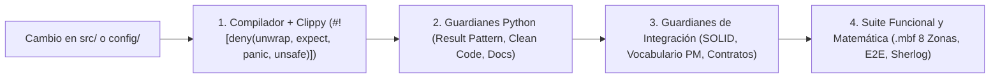

# Guía de Desarrollo, Calidad y Pruebas

> **Propósito:** Definir el flujo de trabajo de ingeniería diario en `metri-engine`, las puertas de calidad automatizadas (*Quality Gates*), el catálogo de suites de pruebas y los comandos del `Makefile` que garantizan cero deuda técnica antes de cada commit.

---

## 1. Filosofía de Calidad: Cero Pánicos y Verificación Estática

En `metri-engine`, la calidad arquitectónica no depende únicamente de revisiones manuales de código: es aplicada mecánicamente por el compilador de Rust, linters de Clippy, guardianes en Python y pruebas de arquitectura ejecutadas como parte de `cargo test`.



### Reglas Inquebrantables para todo Contribuidor

1. **Prohibido `unwrap()`, `expect()`, `panic!()`, `todo!()` y `unimplemented!()` en código de producción (`src/`)**: Tanto `src/lib.rs` como `src/main.rs` declaran directivas `#![cfg_attr(not(test), deny(...))]` y el script `scripts/dev/check_result_pattern.py` escanea el árbol fuente bloqueando cualquier infracción nueva.
2. **Prohibido `unsafe`**: `Cargo.toml` define `[lints.rust] unsafe_code = "deny"`. Todas las manipulaciones binarias del motor `.mbf` (cabeceras de 64B, SIMD por lotes y empaquetado de bits) se implementan en Rust 100% seguro.
3. **Complejidad Ciclomática y Cognitiva Controlada**: Ninguna función en `src/` puede superar **80 líneas**, **5 argumentos** o **4 niveles de anidación** de bloques (auditado por `scripts/dev/check_clean_code.py`).
4. **Fronteras Hexagonales Estrictas**: `src/domain/` no puede importar tipos de `tonic`, `aws_sdk_*`, `reqwest` ni `src/infrastructure/` (auditado por `tests/architecture_solid_guard.rs`).

---

## 2. Comandos del `Makefile`

El archivo [`Makefile`](../../Makefile) en la raíz del proyecto centraliza todas las tareas de verificación, compilación y documentación:

| Objetivo (`make <target>`) | Comando Subyacente | Cuándo Ejecutarlo |
| :--- | :--- | :--- |
| `make test` | `cargo test` | Ejecuta todas las pruebas unitarias (`src/`) y las 6 suites de integración (`tests/`). |
| `make verify-result-pattern` | `python3 scripts/dev/check_result_pattern.py` | Verifica que no existan `.unwrap()`, `.expect()` ni `panic!()` fuera del allowlist histórico congelado. |
| `make verify-clean-code` | `python3 scripts/dev/check_clean_code.py` | Audita longitud de funciones ($\le 80$ líneas), aridad ($\le 5$ parámetros) y anidación ($\le 4$ niveles) en `src/`. |
| `make docs-gen` | `python3 scripts/docs/gen_reference.py` | Regenera automáticamente los catálogos de referencia en `docs/05-referencia/` a partir de `proto/`, `config/models/` y `config/errors/`. |
| `make docs-check` | `python3 scripts/docs/gen_reference.py --check && python3 scripts/dev/check_docs.py` | Verifica que la documentación generada esté 100% sincronizada con el código, sin enlaces rotos ni cobertura Rustdoc inferior al umbral. |
| `make docs-rust` | `RUSTDOCFLAGS="-D warnings" cargo doc --no-deps --document-private-items` | Compila la documentación interna de crates validando que no existan enlaces intra-doc rotos. |
| `make build-lambda` | `cargo lambda build --release --arm64` | Compila el binario `bootstrap` optimizado para AWS Lambda Graviton (`aarch64-unknown-linux-gnu`). |
| `make package-lambda` | Empaquetado en `dist/lambda/` | Copia el binario `bootstrap`, `config/models/`, `config/errors/` y `config/policies/` listos para despliegue SAM/CloudFormation. |

---

## 3. Guardianes Estáticos en `scripts/dev/`

### 3.1 Guardián del Patrón Result (`check_result_pattern.py`)

Ubicado en [`scripts/dev/check_result_pattern.py`](../../scripts/dev/check_result_pattern.py), este analizador léxico recorre todos los archivos `.rs` dentro de `src/`:
- **Ignora automáticamente**: Comentarios (`//`, `/* */`), cadenas literales (incluyendo raw strings `r#"..."#`) y módulos anotados con `#[cfg(test)]`.
- **Detecta**: Llamadas a `.unwrap()`, `.expect(...)`, `panic!(...)`, `todo!(...)` y `unimplemented!(...)`.
- **Política de Ratchet (`result_pattern_allowlist.json`)**: Compara los hallazgos contra [`scripts/dev/result_pattern_allowlist.json`](../../scripts/dev/result_pattern_allowlist.json). Actualmente el allowlist está en **`0` excepciones permitidas** en todo el código de producción: cualquier intento de introducir un `.unwrap()` en `src/` rompe inmediatamente el build local y el pipeline de CI.

### 3.2 Guardián de Clean Code (`check_clean_code.py`)

Ubicado en [`scripts/dev/check_clean_code.py`](../../scripts/dev/check_clean_code.py), analiza la estructura sintáctica de cada función de producción en `src/` (excluyendo `#[cfg(test)]`):

| Métrica | Umbral Máximo | Cómo Resolver una Violación |
| :--- | :---: | :--- |
| `MAX_FUNCTION_LINES` | **80 líneas** | Extraer sub-rutinas semánticas privadas o mover lógica de transformación a structs auxiliares. |
| `MAX_FUNCTION_ARGS` | **5 argumentos** | Agrupar parámetros cohesionados en un struct de comando, contexto o configuración (`*Request`, `*Context`, `*Options`). |
| `MAX_NESTING_DEPTH` | **4 niveles** | Aplicar *Early Returns* con el operador `?`, cláusulas `let ... else { return Err(...); }` o extraer bloques `match` anidados en funciones dedicadas. |

### 3.3 Guardián de Integridad Documental (`check_docs.py`)

Ubicado en [`scripts/dev/check_docs.py`](../../scripts/dev/check_docs.py), ejecuta cuatro auditorías:
1. Verifica que todos los enlaces Markdown relativos entre archivos de `docs/` apunten a archivos existentes en el repositorio.
2. Verifica que no queden bloques Mermaid vacíos o mal cerrados.
3. Calcula el porcentaje de archivos en `src/` documentados con comentarios de módulo `//!` o `///` (exigiendo un mínimo del **80%**; actualmente en **100%**).
4. Ejecuta `cargo doc --no-deps` con `-D warnings` cuando se invoca con `--with-rustdoc`.

---

## 4. Arquitectura de Pruebas (`tests/` y Pruebas Unitarias)

El proyecto organiza sus pruebas en dos niveles: pruebas unitarias co-localizadas al final de cada módulo en `src/` (`#[cfg(test)] mod tests`) y **6 suites de integración** en el directorio [`tests/`](../../tests/):

| Suite en `tests/` | Qué Verifica | Invariantes Clave Auditados |
| :--- | :--- | :--- |
| [`architecture_solid_guard.rs`](../../tests/architecture_solid_guard.rs) | **Fronteras Hexagonales y SOLID** | Verifica que `src/domain/` no importe SDKs de infraestructura ni `tonic`, que los adaptadores gRPC no instancien clientes AWS directamente, y que ningún archivo `.rs` de producción supere las 900 líneas. |
| [`mbf_comprehensive_verification.rs`](../../tests/mbf_comprehensive_verification.rs) | **Certificación Matemática y Binaria de `.mbf`** | Verifica las 8 zonas del formato `.mbf`: cabeceras/footers alineados a 64B, CRC32C, sello criptográfico `MbfTenantCryptoSeal`, MVCC Snapshot Isolation, recorridos de grafos Euler/CSR, compresión Chimp128, ledger contable con árbol de Fenwick y redondeo bancario IEEE 754, sinopsis `MbfHyperSynopsis512`, búsqueda híbrida de 6 capas, cadenas de Markov y regresión OLS por Cholesky en $O(M^3)$. |
| [`contract_conformance.rs`](../../tests/contract_conformance.rs) | **Conformidad de Contratos Protobuf y Errores** | Garantiza que todos los mensajes de `proto/metri.proto` y `proto/eda.proto` estén presentes en el descriptor de reflexión y que cada variante de `EngineError` tenga su entrada exacta en `config/errors/error_catalog.toml`. |
| [`audit_e2e_test.rs`](../../tests/audit_e2e_test.rs) | **Flujo End-to-End Transaccional y Auditoría** | Prueba el ciclo completo `Transact` -> cálculo de deltas -> generación de registros inmutables de auditoría -> consultas MVCC por tenant y aislamiento estricto multi-tenant. |
| [`pm_vocabulary_guard.rs`](../../tests/pm_vocabulary_guard.rs) | **Gobernanza del Vocabulario de Dominio** | Verifica que los modelos JSON de Codice (`config/models/*.json`) respeten las convenciones de nombres (`snake_case`), tipos permitidos y reglas semánticas del dominio. |
| [`sherlog_test.rs`](../../tests/sherlog_test.rs) | **Telemetría de Fallos y Resiliencia (`Sherlog`)** | Verifica el formateo, enmascaramiento de PII/secretos y despacho de alertas estructuradas de fallos hacia el bus de eventos. |

---

## 5. Checklist Antes de Abrir un Pull Request

Antes de hacer `git push`, ejecuta la siguiente secuencia de validación completa:

```bash
# 1. Formateo estándar de Rust
cargo fmt --all -- --check

# 2. Linter estricto de Clippy (incluyendo tests y targets)
cargo clippy --all-targets -- -D warnings

# 3. Guardianes estáticos de código y documentación
make verify-result-pattern
make verify-clean-code
make docs-check

# 4. Ejecución completa de suites unitarias y de integración
cargo test
```

> [!WARNING]
> Si modificas cualquiera de los archivos en `proto/*.proto`, `config/models/*.json` o `config/errors/error_catalog.toml`, **debes ejecutar `make docs-gen`** antes de hacer commit. De lo contrario, el guardián `make docs-check` fallará en CI indicando que los catálogos de `docs/05-referencia/` están desincronizados respecto a la fuente de verdad.
