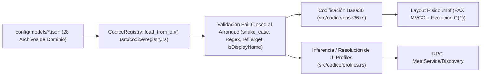

# Guía de Modelado de Entidades en Codice (SSOT)

> **Propósito:** Explicar paso a paso cómo diseñar, extender y validar esquemas de entidades de negocio dentro del motor semántico **Codice** (`config/models/*.json`), incluyendo tipos de datos, fórmulas **Aegis**, perfiles de interfaz (`uiProfile`) y codificación **Base36**.

---

## 1. Arquitectura de Codice como Fuente Única de Verdad (SSOT)

En `metri-engine`, no existen migraciones DDL tradicionales (`ALTER TABLE`) que bloqueen tablas ni esquemas dispersos entre el backend y el frontend. **Codice** (`src/codice/`) actúa como el registro declarativo único (**SSOT — Single Source of Truth**) que gobierna simultáneamente:

1. **Validación de Escritura (`Transact`)**: Tipos de datos, campos requeridos, expresiones regulares, longitudes máximas y relaciones foráneas (`refTarget`).
2. **Evaluación de Fórmulas (`Aegis`)**: Campos calculados declarativamente al momento de la transacción (`formula`).
3. **Indexación y Almacenamiento en `.mbf`**: Mapeo determinista de cada atributo a un identificador compacto **Base36** (`src/codice/base36.rs`) y evolución de esquema sin tiempo de inactividad (`MbfSchemaEvolutionDirectory`).
4. **Descubrimiento Dinámico de UI (`Discovery`)**: Generación automática de metadatos de interfaz (`EntityUiProfile`: `MASTER_GRID`, `TRANSACTION_DOCUMENT`, `KANBAN_BOARD`, `TREE_EXPLORER`, `SIMPLE_CATALOG`, `SETTINGS_FORM`) para que el BFF y el frontend rendericen formularios, grillas y tableros sin código acoplado.



---

## 2. Organización de los Modelos en `config/models/`

Los 97 esquemas de entidades del motor están organizados modularmente en **28 archivos JSON** dentro de [`config/models/`](../../config/models/):

| Categoría | Archivos JSON en `config/models/` | Ejemplos de Entidades |
| :--- | :--- | :--- |
| **Sistema, Identidad y Seguridad** | `01_system.json`, `22_security.json`, `23_privacy.json`, `24_audit.json`, `25_governance.json` | `user`, `role`, `tenant_config`, `api_key`, `consent_record`, `audit_log` |
| **Comercial, CRM y Ventas** | `02_commercial.json`, `03_sales.json`, `11_crm.json`, `12_marketing.json`, `28_ecommerce.json` | `customer`, `lead`, `opportunity`, `quote`, `sales_order`, `campaign` |
| **Cadena de Suministro e Inventario** | `04_inventory.json`, `05_procurement.json`, `13_logistics.json`, `19_manufacturing.json`, `20_quality.json` | `product`, `warehouse`, `stock_movement`, `purchase_order`, `bom`, `shipment` |
| **Finanzas, Contabilidad y Tesorería** | `06_finance.json`, `15_treasury.json`, `16_tax.json`, `17_budget.json`, `18_fixed_assets.json` | `journal_entry`, `account`, `invoice`, `payment`, `tax_rate`, `fixed_asset` |
| **Capital Humano y Operaciones** | `07_hr.json`, `08_payroll.json`, `09_projects.json`, `10_support.json`, `14_fleet.json`, `21_maintenance.json`, `26_iot.json`, `27_analytics.json` | `employee`, `payslip`, `project`, `ticket`, `vehicle`, `work_order`, `sensor_reading` |

> [!TIP]
> Para consultar el catálogo completo autogenerado con las 97 entidades y todos sus atributos, revisa [`docs/05-referencia/modelos-codice.md`](../05-referencia/modelos-codice.md).

---

## 3. Estructura de un Esquema de Entidad (`EntitySchema`)

Cada entrada en un archivo JSON de `config/models/` se deserializa en la estructura `EntitySchema` definida en [`src/codice/mod.rs`](../../src/codice/mod.rs):

```json
{
  "sales_order": {
    "label": "Orden de Venta",
    "pluralLabel": "Órdenes de Venta",
    "description": "Documento transaccional que formaliza un pedido comercial de un cliente.",
    "module": "sales",
    "icon": "shopping-cart",
    "active": true,
    "idPrefix": "SO",
    "idTemplate": "SO-{YYYY}-{SEQ:6}",
    "uiProfile": "TRANSACTION_DOCUMENT",
    "attributes": {
      "order_number": {
        "type": "sequence",
        "label": "Número de Orden",
        "required": true,
        "unique": true,
        "isDisplayName": true,
        "sequencePrefix": "SO-",
        "sequencePadding": 6
      },
      "customer_id": {
        "type": "ref",
        "label": "Cliente",
        "required": true,
        "refTarget": "customer",
        "indexed": true
      },
      "subtotal": {
        "type": "decimal",
        "label": "Subtotal",
        "required": true,
        "min": 0.0
      },
      "tax_amount": {
        "type": "decimal",
        "label": "Impuestos (IGV/IVA)",
        "required": false,
        "formula": "subtotal * 0.18"
      },
      "total_amount": {
        "type": "decimal",
        "label": "Total de la Orden",
        "required": false,
        "formula": "subtotal + tax_amount"
      },
      "status": {
        "type": "enum",
        "label": "Estado",
        "required": true,
        "enumValues": ["DRAFT", "APPROVED", "INVOICED", "CANCELLED"],
        "defaultValue": "DRAFT",
        "indexed": true
      }
    }
  }
}
```

---

## 4. Tipos de Atributos Soportados y su Representación en `.mbf`

El campo `type` de cada `AttributeSpec` determina tanto su validación de ingreso como las zonas físicas del archivo `.mbf` donde se indexa:

| Tipo en Codice (`type`) | Validación en `CodiceRegistry` | Almacenamiento e Indexación en `.mbf` |
| :--- | :--- | :--- |
| `string` / `text` | `maxLength`, `regex` (compilado al arranque), sanitización UTF-8. | Comprimido mediante tabla de símbolos **FSST** (Zona 1) e indexado en el **Índice Híbrido de 6 Capas** (Zona 5B) si es buscable. |
| `int` / `integer` | Parseo estricto `i64`, validación de rango `[min, max]`. | Columna entera en micro-bloque PAX (Zona 1) + sinopsis numérica y **KLL Sketch** (Zona 5). |
| `float` / `number` | Parseo `f64` finito (rechaza `NaN` e `Infinity`), rango `[min, max]`. | Columna `f64` en Zona 1 + compresión **Chimp128** si es serie temporal (Zona 3) + momentos de Pébay y covarianza (Zonas 5 y 6B). |
| `decimal` / `currency` | Punto fijo exacto de 128 bits (`FixedDecimal128`, escala $10^{-4}$). | Aritmética entera `i128` sin deriva IEEE 754 + **Árbol de Fenwick** $O(\log N)$ y cadena Merkle en Zona 4 (`financial_ledger.rs`). |
| `boolean` / `bool` | `"true"` / `"false"` / `"1"` / `"0"`. | Bitpack denso (1 bit por fila) en Zona 1 + Roaring Bitmap en Zona 5. |
| `date` / `datetime` / `timestamp` | Formato ISO-8601 (RFC 3339) o epoch en milisegundos (`i64`). | Timestamps con empaquetado **Delta-of-Delta** y poda por ventana temporal (`min_timestamp_ms` / `max_timestamp_ms` en cabecera `.mbf`). |
| `enum` | El valor debe pertenecer a la lista cerrada `enumValues`. | Codificación por diccionario de baja cardinalidad + **RoaringBitmap32** para filtrado bit a bit instantáneo. |
| `ref` | Debe definir `refTarget` apuntando a una entidad existente en el registro. | Arista en la **Zona 2 (Grafos CSR)** (`fwd_offsets`/`fwd_targets` y grafo inverso **VAET** `rev_offsets`/`rev_sources`) para joins y subárboles Euler en $O(1)$. |
| `sequence` | Generado automáticamente por `MbfSequenceGenerator`. | Correlativo atómico monótono formateado con `sequencePrefix` y `sequencePadding`. |
| `secret` | Nunca se devuelve en lecturas (`Explore`/`Query`/`ListEntities`). | Hasheado automáticamente con **Argon2id** en el ingreso antes de persistir el Datom. |
| `json` / `array` | Validación de sintaxis JSON estructurada. | Alocado en la celda documental (`Cell 4` del `DomainCellRouter`) con compresión LZ4. |

---

## 5. Perfiles de Interfaz (`EntityUiProfile`)

El módulo [`src/codice/profiles.rs`](../../src/codice/profiles.rs) clasifica cada entidad en uno de los 6 arquetipos de interfaz de usuario (`EntityUiProfile`), ya sea declarativamente mediante `"uiProfile"` en el JSON o por inferencia heurística basada en la topología de sus atributos:

| Perfil (`EntityUiProfile`) | Cuándo Usarlo | Comportamiento en `Discovery` |
| :--- | :--- | :--- |
| `MASTER_GRID` | Entidades maestras de alta densidad (`customer`, `product`, `employee`). | Prioriza columnas indexadas, filtros rápidos, búsqueda híbrida y exportación. |
| `TRANSACTION_DOCUMENT` | Documentos con cabecera/detalle o impacto contable (`sales_order`, `invoice`, `journal_entry`). | Agrupa campos en cabecera financiera, líneas de detalle, totales calculados por Aegis y barra de estados. |
| `KANBAN_BOARD` | Procesos guiados por etapas (`opportunity`, `ticket`, `work_order`). | Agrupa tarjetas automáticamente por el atributo `enum` de estado (`status` / `stage`). |
| `TREE_EXPLORER` | Estructuras jerárquicas autorreferenciadas (`account`, `category`, `department`). | Aprovecha el recorrido **Euler Tour (`tin`/`tout`)** de la Zona 2 para expandir/contraer subárboles en tiempo constante. |
| `SIMPLE_CATALOG` | Catálogos auxiliares de pocos atributos (`tax_rate`, `currency`, `unit_of_measure`). | Edición en línea simplificada y carga en caché del cliente. |
| `SETTINGS_FORM` | Configuraciones singleton por tenant (`tenant_config`, `security_policy`). | Renderiza un formulario de configuración agrupado por secciones sin tabla de listado. |

---

## 6. Fórmulas Declarativas con Aegis (`formula`)

Cualquier atributo numérico o decimal puede declarar una expresión `"formula"` que es evaluada por el motor **Aegis** ([`src/aegis/formula/mod.rs`](../../src/aegis/formula/mod.rs)) durante `Transact`:

- **Operadores soportados**: `+`, `-`, `*`, `/`, `%`, paréntesis `(...)` y funciones matemáticas seguras (`ROUND`, `MIN`, `MAX`, `ABS`, `IF`).
- **Seguridad anti-DoS (`src/aegis/formula/security.rs`)**:
  - Profundidad máxima del árbol sintáctico (`MAX_AST_DEPTH`): **15 niveles**.
  - Número máximo de nodos AST por fórmula (`MAX_AST_NODES`): **150 nodos**.
  - Protección contra división por cero y desbordamiento numérico (retorna `EngineError` tipado `AegisEvalDivZero` o `AegisComplexityExceeded`).

---

## 7. Reglas de Validación al Arranque (Fail-Closed)

Cuando agregues o modifiques una entidad en `config/models/*.json`, ten presente que `CodiceRegistry::load_from_dir` ([`src/codice/registry.rs`](../../src/codice/registry.rs)) aplicará las siguientes validaciones al iniciar el binario y en los tests (`tests/pm_vocabulary_guard.rs`):

1. **Nomenclatura `snake_case`**: Tanto el nombre de la entidad como las claves de todos sus atributos deben estar en `snake_case` válido (`^[a-z][a-z0-9_]*$`).
2. **Atributo de Visualización (`isDisplayName`)**: Toda entidad con `"active": true` **debe** tener al menos un atributo marcado con `"isDisplayName": true` para que las referencias foráneas y listas desplegables puedan mostrar una etiqueta legible.
3. **Integridad Referencial de Esquemas (`refTarget`)**: Todo atributo con `"type": "ref"` debe especificar un `"refTarget"` que exista como clave de entidad dentro del registro cargado.
4. **Expresiones Regulares Válidas**: Todo patrón definido en `"regex"` se compila con el crate `regex` durante el arranque. Un patrón inválido detiene el arranque con `CodiceInvalidRegex`.
5. **Sincronización Documental**: Tras editar cualquier archivo en `config/models/*.json`, ejecuta siempre:
   ```bash
   make docs-gen
   make docs-check
   cargo test --test pm_vocabulary_guard
   ```
