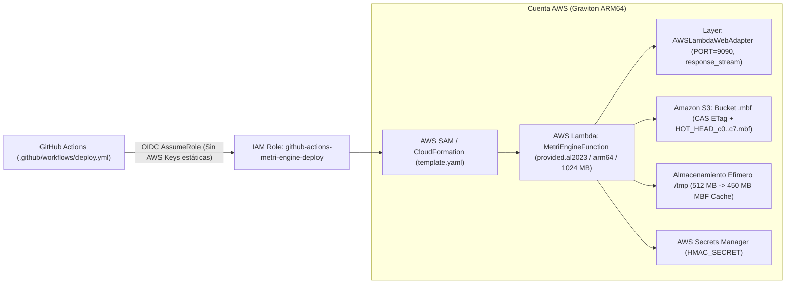
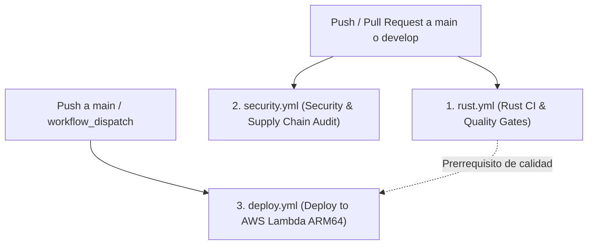

# Guía de Despliegue en AWS y Pipelines CI/CD

> **Propósito:** Documentar el proceso de compilación cruzada para **AWS Lambda ARM64 (Graviton3)** sobre `provided.al2023`, la infraestructura como código definida en `template.yaml`, el bootstrap de autenticación **GitHub OIDC** sin secretos estáticos y los 3 workflows de GitHub Actions.

---

## 1. Arquitectura de Despliegue Serverless (`template.yaml`)

`metri-engine` se despliega en producción como una función **AWS Lambda ARM64 (`provided.al2023`)** de ultra-baja latencia utilizando **AWS Lambda Web Adapter (LWA)** en modo `response_stream` para exponer tráfico HTTP/2 gRPC directamente desde el binario nativo `bootstrap`.



### 1.1 Parámetros Clave de `template.yaml`

El archivo [`template.yaml`](../../template.yaml) configura los siguientes recursos y límites operativos:

| Propiedad en `template.yaml` | Valor Configurado | Justificación Técnica |
| :--- | :--- | :--- |
| **`Runtime`** | `provided.al2023` | Runtime nativo mínimo sobre Amazon Linux 2023 para ejecutar el binario Rust compilado estáticamente. |
| **`Architectures`** | `[arm64]` | Ejecución sobre procesadores **AWS Graviton** con soporte nativo de instrucciones vectoriales NEON de 128 bits. |
| **`Handler`** | `run.sh` con `AWS_LAMBDA_EXEC_WRAPPER=/opt/bootstrap` | Delega el puente HTTP/2 gRPC al layer oficial `AWSLambdaWebAdapter:23` escuchando en `PORT=9090`. |
| **`MemorySize`** | `1024` MB | Otorga proporcionalmente ~0.6 vCPU Graviton y ancho de banda de red acelerado hacia Amazon S3. |
| **`EphemeralStorage`** | `512` MB | Monta `/tmp` sobre almacenamiento NVMe local; `MBF_TMP_CACHE_MAX_MB=450` reserva 450 MB para la caché de bloques `.mbf` calientes. |
| **`Timeout`** | `30` segundos | Tiempo máximo de ejecución por invocación para consultas analíticas o ingestas masivas (`BulkIngest`). |
| **`AutoPublishAlias`** | `live` | Publica versiones inmutables de la función con alias `live` para despliegues seguros y rollbacks instantáneos. |

---

## 2. Compilación Cruzada y Empaquetado Local (`Makefile`)

Si deseas compilar y verificar el paquete de distribución para AWS Lambda desde tu estación de trabajo (macOS o Linux), utiliza los targets del `Makefile`:

### Paso 1: Compilar el binario ARM64

```bash
make build-lambda
```

Internamente ejecuta `cargo lambda build --release --arm64`, generando el ejecutable optimizado (`opt-level = 3`, `lto = true`, `codegen-units = 1`, `strip = true` según `[profile.release]` en `Cargo.toml`) en `target/lambda/bootstrap/bootstrap`.

### Paso 2: Empaquetar activos de configuración

```bash
make package-lambda
```

Este comando ensambla el directorio `dist/lambda/` con la estructura exacta que espera `template.yaml` (`CodeUri: dist/lambda/`):

```text
dist/lambda/
├── bootstrap                      # Binario Rust ARM64 (strip + LTO)
├── models/                        # Copia de config/models/*.json (CODICE_MODELS_DIR=models)
├── errors/
│   └── error_catalog.toml         # Copia del catálogo (ERROR_CATALOG_PATH=errors/error_catalog.toml)
└── policies/
    └── metri.cedar                # Políticas de autorización AWS Cedar
```

---

## 3. Bootstrap de Seguridad OIDC (`bootstrap_github_oidc.py`)

Para eliminar por completo el uso de credenciales estáticas (`AWS_ACCESS_KEY_ID` / `AWS_SECRET_ACCESS_KEY`) en GitHub Actions, el repositorio incluye el script automatizado [`scripts/ops/bootstrap_github_oidc.py`](../../scripts/ops/bootstrap_github_oidc.py).

### ¿Qué provisiona este script en AWS?

1. **Proveedor de Identidad IAM OIDC**: Registra `https://token.actions.githubusercontent.com` con audiencia `sts.amazonaws.com` (idempotente).
2. **Rol IAM de Despliegue (`github-actions-metri-engine-deploy`)**: Configura una política de confianza (`AssumeRoleWithWebIdentity`) restringida criptográficamente al repositorio `repo:<owner>/<repo>:*`.
3. **Política IAM de Mínimo Privilegio (`GitHubActionsMetriDeployPolicy`)**: Otorga permisos exclusivamente sobre CloudFormation, Lambda, S3 (`metri-*` y buckets SAM), IAM PassRole y CloudWatch Logs necesarios para `sam deploy`.

### Ejecución única por cuenta AWS:

```bash
python3 scripts/ops/bootstrap_github_oidc.py \
  --github-org <tu-organizacion> \
  --github-repo metri-engine \
  --region us-east-1
```

El script imprimirá el ARN del rol generado, el cual se configura como secreto o variable `AWS_ROLE_ARN` en el repositorio de GitHub.

---

## 4. Pipelines de CI/CD en GitHub Actions (`.github/workflows/`)

El repositorio cuenta con **3 flujos de trabajo automatizados** en [`.github/workflows/`](../../.github/workflows/):



### 4.1 `rust.yml` — Integración Continua y Puertas de Calidad

Se ejecuta en cada `push` y `pull_request` hacia `main` y `develop`:
1. Instala `protoc` y compila e instala **`flatc v25.12.19`** (con caché de GitHub Actions para ejecuciones subsecuentes en segundos).
2. Ejecuta los guardianes estáticos en Python:
   - `python3 scripts/dev/check_result_pattern.py`
   - `python3 scripts/dev/check_clean_code.py`
   - `python3 scripts/docs/gen_reference.py --check`
   - `python3 scripts/dev/check_docs.py`
3. Verifica formato (`cargo fmt --all -- --check`) y linting estricto (`cargo clippy --all-targets -- -D warnings`).
4. Ejecuta la batería completa de pruebas (`cargo test`).

### 4.2 `security.yml` — Auditoría de Cadena de Suministro y Dependencias

Se ejecuta en cada cambio sobre `Cargo.toml` / `Cargo.lock` y de forma programada:
- Ejecuta **`cargo audit`** (`rustsec/audit-check`) contra la base de datos de vulnerabilidades RustSec para detectar CVEs en dependencias transitivas.
- Verifica que no existan secretos codificados ni permisos excesivos en los workflows.

### 4.3 `deploy.yml` — Despliegue Continuo a AWS Lambda Graviton

Se ejecuta al integrar cambios en `main` o manualmente mediante `workflow_dispatch`:
1. Instala Zig y `cargo-lambda`, más `flatc v25.12.19`.
2. Ejecuta `make build-lambda` y `make package-lambda` generando el artefacto ARM64 en `dist/lambda/`.
3. Se autentica contra AWS mediante **OIDC** (`aws-actions/configure-aws-credentials@v4`) asumiendo el rol `secrets.AWS_ROLE_ARN`.
4. Ejecuta `sam deploy --template-file template.yaml --stack-name metri-engine-prod --capabilities CAPABILITY_IAM --no-fail-on-empty-changeset`, inyectando los parámetros de producción (`Environment=production`, `HmacSecretArn`, `MbfS3BucketName` y credenciales opcionales de bootstrap inicial).

---

## 5. Verificación Post-Despliegue

Una vez completado `sam deploy`:

1. **Verificar estado de la función Lambda**:
   ```bash
   aws lambda get-function-configuration \
     --function-name metri-engine-prod \
     --query '{State:State,LastUpdateStatus:LastUpdateStatus,Architecture:Architectures[0],Memory:MemorySize}'
   ```
2. **Inspeccionar logs de arranque en CloudWatch**:
   Confirma que aparezca el evento `Loaded 97 entity schemas into Codice SSOT Registry` y que no existan alertas de configuración en el grupo de logs `/aws/lambda/metri-engine-prod`.
3. **Rotación y limpieza de variables de semilla**: Si utilizaste `BootstrapMasterPassword` durante el primer despliegue de una cuenta nueva, recuerda vaciar el parámetro en despliegues posteriores; una vez sembrado el usuario `usr_master` en el archivo `.mbf` del tenant `system`, el motor ignora re-semillas subsiguientes de forma idempotente.
