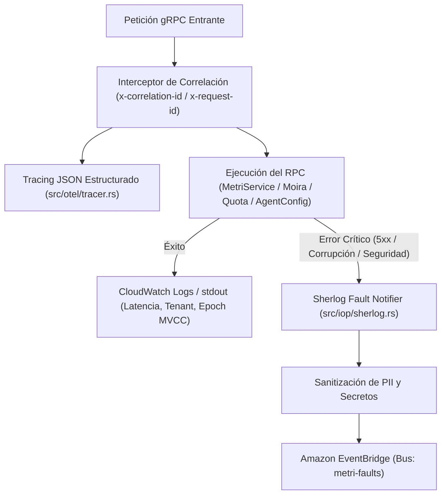

# Guía de Operación, Scripts y Observabilidad

> **Propósito:** Referencia operativa para administrar `metri-engine` en desarrollo y producción: catálogo de scripts en `scripts/`, trazabilidad distribuida OpenTelemetry (`src/otel/`), diagnóstico de fallos con **Sherlog** (`src/iop/sherlog.rs`) y runbook de respuesta ante incidentes.

---

## 1. Catálogo Completo de Scripts (`scripts/`)

El directorio [`scripts/`](../../scripts/) está organizado en tres subdirectorios especializados según su ciclo de vida:

```text
scripts/
├── dev/                           # Guardianes estáticos de calidad y validación local
│   ├── check_clean_code.py        # Audita complejidad, longitud (<=80 líneas), aridad (<=5) y anidación (<=4)
│   ├── check_docs.py              # Audita enlaces Markdown, bloques Mermaid y cobertura Rustdoc (>=80%)
│   ├── check_result_pattern.py    # Prohíbe unwrap(), expect(), panic!(), todo!(), unimplemented!() en src/
│   └── result_pattern_allowlist.json # Allowlist congelado en 0 excepciones permitidas
├── docs/                          # Generación documental determinista desde fuentes de verdad
│   └── gen_reference.py           # Genera docs/05-referencia/{api-grpc,modelos-codice,catalogo-errores}.md
└── ops/                           # Automatización de infraestructura y seguridad cloud
    └── bootstrap_github_oidc.py   # Provisiona el proveedor OIDC y rol IAM de mínimo privilegio en AWS
```

### 1.1 Uso Detallado de Cada Script

| Script | Modos de Ejecución | Código de Salida (`Exit Code`) |
| :--- | :--- | :--- |
| `scripts/dev/check_result_pattern.py` | `python3 scripts/dev/check_result_pattern.py` (auditar)<br>`python3 scripts/dev/check_result_pattern.py --update-allowlist` (solo mantenimiento autorizado) | `0` si no hay nuevas violaciones; `1` si detecta `.unwrap()`, `.expect()`, `panic!()`, etc. en `src/`. |
| `scripts/dev/check_clean_code.py` | `python3 scripts/dev/check_clean_code.py` | `0` si todas las funciones en `src/` cumplen los límites; `1` con reporte de archivo, línea y función infractora. |
| `scripts/dev/check_docs.py` | `python3 scripts/dev/check_docs.py`<br>`python3 scripts/dev/check_docs.py --with-rustdoc` | `0` si todos los enlaces, diagramas y cobertura Rustdoc son válidos; `1` ante enlaces rotos o baja cobertura. |
| `scripts/docs/gen_reference.py` | `python3 scripts/docs/gen_reference.py` (regenerar archivos)<br>`python3 scripts/docs/gen_reference.py --check` (verificar en CI sin modificar disco) | `0` si los archivos generados están sincronizados con `proto/`, `config/models/` y `config/errors/`; `1` si hay deriva. |
| `scripts/ops/bootstrap_github_oidc.py` | `python3 scripts/ops/bootstrap_github_oidc.py --github-org <ORG> --github-repo <REPO> [--region us-east-1]` | `0` tras crear o actualizar de forma idempotente el OIDC Provider y el IAM Role en AWS. |

---

## 2. Arquitectura de Observabilidad y Trazabilidad (`src/otel/` y `Sherlog`)

`metri-engine` implementa observabilidad estructurada en tres pilares complementarios:



### 2.1 Logs Estructurados JSON (`src/otel/tracer.rs`)

El módulo [`src/otel/tracer.rs`](../../src/otel/tracer.rs) inicializa un suscriptor `tracing_subscriber::fmt` configurado en formato **JSON compacto de una línea por evento**, diseñado específicamente para ser indexado sin costo de parseo por **Amazon CloudWatch Logs Insights** y recolectores OpenTelemetry:

- **Propagación de Correlación (`src/grpc/interceptors.rs`)**: Cada petición gRPC extrae (o genera si no viene presente) un `correlation_id` desde las cabeceras `x-correlation-id` o `x-request-id`.
- **Control Dinámico de Verbosidad**: A través de la variable `RUST_LOG`:
  - En producción (`template.yaml`): `RUST_LOG=warn` para minimizar costos de ingesta en CloudWatch y evitar ruido operativo.
  - En diagnóstico o desarrollo: `RUST_LOG=info,metri_engine::mbf=debug,metri_engine::grpc=debug`.

### 2.2 Diagnóstico Inteligente de Fallos con `Sherlog` (`src/iop/sherlog.rs`)

Cuando ocurre una anomalía crítica o un fallo de infraestructura, el componente **Sherlog** ([`src/iop/sherlog.rs`](../../src/iop/sherlog.rs)) construye un paquete forense estructurado (`FaultEvent`) y lo publica de forma asíncrona en Amazon EventBridge (`FAULT_BUS_NAME`, por defecto `metri-faults`):

- **Contenido del Evento Forense**:
  - `error_code`: Código canónico del catálogo (ej. `MBF-CAS-CONFLICT-001`, `SEC-AUTH-HMAC-INVALID`).
  - `tenant_id` y `correlation_id`: Contexto exacto de la petición afectada.
  - `component` y `operation`: Subsistema donde se originó el fallo.
  - `timestamp`: Marca temporal UTC en RFC 3339.
- **Protección contra Fuga de Datos**: Antes de emitir cualquier evento hacia los logs o hacia EventBridge, Sherlog filtra campos sensibles (`password`, `secret`, `token`, `x-calculated-auth`) garantizando que ningún secreto ni credencial aparezca jamás en la telemetría.

---

## 3. Monitoreo de la Caché NVMe y del Motor `.mbf`

El motor `MbfStorageClient` ([`src/mbf/storage.rs`](../../src/mbf/storage.rs)) gestiona de forma autónoma dos niveles de almacenamiento para cada tenant:

1. **Nivel L1/L2 Local (Memoria + `/tmp/mbf_cache`)**:
   - Controlado por `MBF_TMP_CACHE_MAX_MB` (por defecto `450` MB sobre los `512` MB de `/tmp` en Lambda).
   - Antes de descargar un archivo `HOT_HEAD_c0..c7.mbf` desde S3, el motor verifica si el archivo local en `/tmp/mbf_cache` coincide con el `ETag` / época conocida.
   - Si el presupuesto de disco local supera `MBF_NVME_CACHE_BUDGET_BYTES` (`450 * 1024 * 1024` bytes), el gestor de caché desaloja automáticamente los archivos temporales menos usados, previniendo errores `ENOSPC` (*No space left on device*) en contenedores Lambda de larga vida (*warm instances*).
2. **Nivel L3 Persistente (Amazon S3 CAS)**:
   - Cada commit escribe el bloque actualizado en `s3://<MBF_S3_BUCKET>/<MBF_S3_PREFIX>/tenants/<tenant_id>/HOT_HEAD_c<0..7>.mbf` utilizando cabeceras condicionales (`If-Match` / `If-None-Match`).

---

## 4. Runbook de Diagnóstico y Respuesta a Incidentes

La siguiente tabla resume los códigos de error operativos más frecuentes y el procedimiento exacto para resolverlos:

| Código de Error / Síntoma | Causa Raíz Probable | Procedimiento de Diagnóstico y Mitigación |
| :--- | :--- | :--- |
| **`SEC-AUTH-HMAC-INVALID`** / `UNAUTHENTICATED` | El secreto `HMAC_SECRET` entre el BFF y `metri-engine` no coincide, o el reloj del emisor tiene una deriva mayor a $\pm 300\text{ s}$. | 1. Verificar que el ARN en `HMAC_SECRET_ARN` contenga el mismo secreto de $\ge 32$ bytes que usa el BFF.<br>2. Verificar sincronización NTP del cliente (`x-auth-timestamp`). |
| **`SEC-CEDAR-DENY`** / `PERMISSION_DENIED` | La política en `config/policies/metri.cedar` deniega la acción para los roles enviados en `x-user-roles`, o una regla `forbid` se activó. | 1. Revisar el rol del usuario (`role_super_master`, `system-bff`, o rol de tenant).<br>2. Inspeccionar `config/policies/metri.cedar` y las pruebas en `src/cedar/authorizer.rs`. |
| **`MBF-CRYPTO-SEAL-001`** | El sello `MbfTenantCryptoSeal` de 64 bytes al final del archivo `.mbf` no coincide con el `tenant_id` solicitante o con el `HMAC_SECRET` actual. | **Alerta de Seguridad Zero-Trust**: Indica corrupción física en S3, intento de lectura cruzada entre tenants (*Cross-Tenant Tampering*) o rotación de `HMAC_SECRET` sin re-sellar snapshots. Verificar integridad de la versión del objeto en S3 Versioning. |
| **`MBF-CAS-CONFLICT-001`** | Alta contención de escrituras no conmutativas concurrentes sobre la misma entidad/celda que agotaron los reintentos de *Auto-Rebase*. | El coordinador `MbfWriteCoordinator` ya reintenta automáticamente transacciones conmutativas (ej. contadores o celdas disjuntas). Si el error llega al cliente, significa que dos peticiones modificaron exactamente el mismo atributo escalar de la misma entidad al mismo tiempo: el cliente debe refrescar la entidad y reintentar. |
| **`MBF-FISCAL-CLOSED-001`** | Intento de insertar o retractar un asiento contable con timestamp menor o igual a `fiscal_lock_epoch_ms` del `MbfFooterTrailer`. | Comportamiento esperado por cumplimiento normativo: un período contable cerrado es criptográficamente inmutable. Todo ajuste debe registrarse mediante un contra-asiento en el período contable abierto actual. |
| **`MBF-LEDGER-UNBALANCED-001`** | Intento de confirmar un bloque en la Zona 4 (`financial_ledger.rs`) donde la suma de débitos no iguala exactamente a la suma de créditos ($\sum D \ne \sum C$). | Revisar el payload de la transacción contable enviada por el cliente; el motor utiliza `FixedDecimal128` y rechaza asientos descuadrados incluso por $0.0001$. |

### Consultas Útiles para CloudWatch Logs Insights

Para listar las 20 peticiones con mayor latencia o con fallos reportados en la última hora:

```sql
fields @timestamp, level, fields.correlation_id, fields.tenant_id, fields.error_code, fields.message
| filter level in ["ERROR", "WARN"]
| sort @timestamp desc
| limit 20
```
