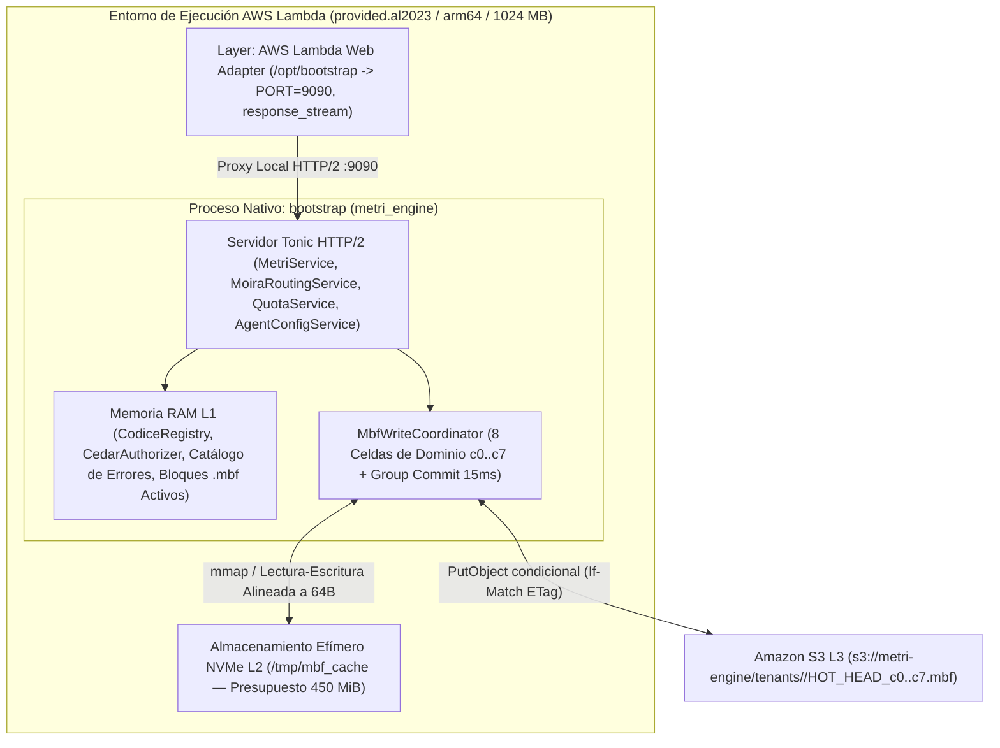
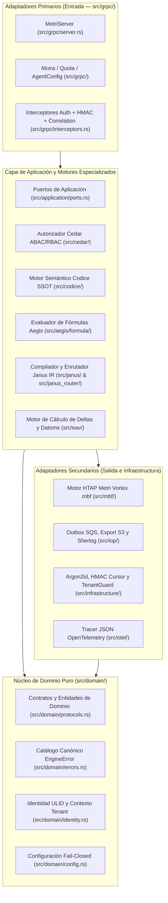

# Visión General de Arquitectura y Modelo C4

> **Propósito:** Describir la arquitectura integral de `metri-engine` mediante el modelo **C4 (Contexto, Contenedores y Componentes)** y la **Arquitectura Hexagonal (Puertos y Adaptadores)**, explicando cómo el motor unificado **Metri Vortex (`.mbf`)** converge el procesamiento transaccional (OLTP) y analítico (OLAP) en un único binario Rust sin estado.

---

## 1. Paradigma Arquitectónico: De Motores Fragmentados a HTAP Unificado (`.mbf`)

En sistemas empresariales convencionales, los datos transaccionales (OLTP) viven en bases de datos orientadas a filas, mientras que las consultas analíticas, búsquedas de texto completo, grafos jerárquicos y series temporales requieren pipelines ETL hacia almacenes columnares o motores de búsqueda externos. Esa fragmentación introduce latencia de replicación, costos fijos de infraestructura ociosa y pérdida de consistencia transaccional.

`metri-engine` resuelve este problema mediante la arquitectura **Metri Vortex**, un motor **HTAP (Hybrid Transactional/Analytical Processing)** compilado en un único binario Rust (`bootstrap`) para **AWS Lambda ARM64 (Graviton)**:

1. **Almacenamiento Unificado en Formato Binario `.mbf` (*Metri Binary Format*)**: Toda la información de un tenant —datoms transaccionales MVCC, grafos jerárquicos CSR, series temporales IoT, libros contables con árbol de Fenwick, sinopsis estadísticas de 512 bytes, índices de búsqueda híbrida de 6 capas, modelos de supervivencia/Markov y matrices de covarianza— reside en archivos binarios autocontenidos y sellados criptográficamente en **Amazon S3**, con aceleración local en disco NVMe efímero (`/tmp/mbf_cache`).
2. **Aislamiento Criptográfico y Físico por Tenant**: Cada tenant posee su propio espacio de archivos `.mbf` (`tenants/<tenant_id>/HOT_HEAD_c0..c7.mbf`), autenticado mediante un sello HMAC-SHA256 derivado exclusivamente para dicho tenant (`MbfTenantCryptoSeal`).
3. **Gobernanza Declarativa SSOT (`Codice`)**: Los 97 esquemas de entidades en `config/models/*.json` gobiernan la validación de escritura, las fórmulas calculadas (**Aegis**) y el descubrimiento de interfaz sin migraciones DDL bloqueantes.

---

## 2. Nivel C1: Diagrama de Contexto del Sistema

En el Nivel C1, `metri-engine` actúa como el núcleo transaccional, analítico y de enrutamiento de eventos de la plataforma Metri, comunicándose exclusivamente a través de contratos tipados HTTP/2 gRPC y servicios nativos serverless de AWS.

```mermaid
flowchart TB
    User["Usuario Empresarial / Operador"] -->|"HTTPS / JSON / WebSockets"| BFF["Metri BFF / API Gateway (Firmante HMAC-SHA256)"]
    IoT["Dispositivos IoT / Agentes Externos"] -->|"Ingesta a través de BFF"| BFF

    BFF -->|"HTTP/2 gRPC + x-Calculated-Auth + FlatBuffers JanusIR"| Engine["metri-engine (Motor HTAP Metri Vortex en Rust / ARM64)"]

    subgraph AWSStorage["Almacenamiento y Eventos Serverless AWS"]
        S3["Amazon S3 (Archivos .mbf con CAS If-Match ETag)"]
        SQS["Amazon SQS (Cola Transactional Outbox)"]
        EB["Amazon EventBridge (Bus de Fallos Sherlog: metri-faults)"]
        Secrets["AWS Secrets Manager (HMAC_SECRET Maestro)"]
    end

    Engine <-->|"GetObject / PutObject CAS (HTTP 412 Auto-Rebase)"| S3
    Engine -->|"Publicación de Eventos de Dominio"| SQS
    Engine -->|"Alertas Forenses Sanitizadas"| EB
    Engine <--|"Lectura de Secreto al Arranque"| Secrets
```

---

## 3. Nivel C2: Diagrama de Contenedores y Ejecución en Tiempo de Ejecución

Dentro del entorno de ejecución de AWS Lambda (`provided.al2023` sobre Graviton ARM64), el contenedor combina el puente HTTP/2 **AWS Lambda Web Adapter (LWA)** con el proceso nativo `bootstrap` y su jerarquía de memoria de tres niveles (RAM L1 -> NVMe `/tmp` L2 -> S3 CAS L3):



---

## 4. Nivel C3: Componentes Internos y Arquitectura Hexagonal

El código fuente dentro de [`src/`](../../src/) está organizado siguiendo los principios de **Arquitectura Hexagonal (Puertos y Adaptadores)** y **Diseño Guiado por el Dominio (DDD)**, garantizando que el núcleo de dominio (`src/domain/`) sea 100% independiente de frameworks de red y SDKs de nube.



### 4.1 Mapa Completo de los 16 Módulos de `src/`

| Módulo en `src/` | Capa Arquitectónica | Responsabilidad y Componentes Clave | Referencia Detallada |
| :--- | :--- | :--- | :--- |
| [`src/mbf/`](../../src/mbf/mod.rs) | Motor de Almacenamiento HTAP | Formato binario `.mbf` de 8 zonas, `MbfStorageClient`, manifiesto MVCC/CAS y proyecciones SIMD. | [01-mbf.md](../04-componentes/01-mbf.md) |
| [`src/eav/`](../../src/eav/mod.rs) | Motor Transaccional de Datoms | Planificador de datoms (`writer/datom_plan.rs`), mutaciones atómicas, `CompositeTransact`, lector y FTS. | [02-eav.md](../04-componentes/02-eav.md) |
| [`src/codice/`](../../src/codice/mod.rs) | Gobernanza Semántica (SSOT) | Registro de los 60 modelos (`registry.rs`), perfiles (`profiles.rs`), secuencias (`sequence.rs`) y Base36 (`base36.rs`). | [03-codice.md](../04-componentes/03-codice.md) |
| [`src/domain/`](../../src/domain/mod.rs) | Núcleo de Dominio Puro | Tipos universales (`protocols.rs`), errores tipados (`errors.rs`), catálogo (`error_catalog.rs`), configuración (`config.rs`) y eventos (`events/`). | [04-domain.md](../04-componentes/04-domain.md) |
| [`src/application/`](../../src/application/mod.rs) | Puertos de Aplicación | Traits asíncronos de inversión de dependencias (`ports.rs`). | [05-application.md](../04-componentes/05-application.md) |
| [`src/janus/`](../../src/janus/mod.rs) | Camino de Lectura (Read Path) | Normalizadores, validador, selección de plan y compilación de AST **FlatBuffers** (`janus_ir_ast.fbs`). | [06-janus.md](../04-componentes/06-janus.md) |
| [`src/janus_router/`](../../src/janus_router/mod.rs) | Camino de Escritura (Write Path) | Enrutamiento transaccional `OltpChannel`, proyección declarativa de sagas (`saga.rs`) y generador ULID (`ulid.rs`). | [07-janus-router.md](../04-componentes/07-janus-router.md) |
| [`src/aegis/`](../../src/aegis/mod.rs) | Ejecutores y Motor de Fórmulas | Ejecutor vectorizado `.mbf`, ejecutor `oltp` y evaluador de fórmulas matemáticas sandboxeado (`aegis/formula/`). | [08-aegis.md](../04-componentes/08-aegis.md) |
| [`src/cedar/`](../../src/cedar/mod.rs) | Autorización Zero-Trust | Evaluación de políticas declarativas **AWS Cedar** (`config/policies/metri.cedar`) con precedencia `forbid > permit`. | [09-cedar.md](../04-componentes/09-cedar.md) |
| [`src/quota/`](../../src/quota/mod.rs) | Gobernanza Atómica de Cuotas | Resolución (`resolver.rs`), libro mayor condicional (`ledger.rs`), reservas de IA (`reservations.rs`) y `sweeper.rs`. | [10-quota.md](../04-componentes/10-quota.md) |
| [`src/iop/`](../../src/iop/mod.rs) | Pipeline de Ingesta | Orquestación por pasos (`CedarStep` → `QuotaStep` → `JanusStep`) y diagnóstico forense `Sherlog` (`sherlog.rs`). | [11-iop.md](../04-componentes/11-iop.md) |
| [`src/eda/`](../../src/eda/mod.rs) | Arquitectura de Eventos | Drenaje de Transactional Outbox y evaluación de reglas de enrutamiento en `moira.rs`. | [12-eda.md](../04-componentes/12-eda.md) |
| [`src/temporal/`](../../src/temporal/mod.rs) | Primitivas Temporales | Resolución de 29 ventanas de tiempo (`time_frame.rs`) y periodos comparativos (`comparison.rs`) conscientes de zona horaria. | [13-temporal.md](../04-componentes/13-temporal.md) |
| [`src/grpc/`](../../src/grpc/mod.rs) | Adaptador Primario de Red | Servidor Tonic HTTP/2 (`server.rs`), interceptores (`interceptors.rs`), `bootstrap.rs` y `handlers/`. | [14-grpc.md](../04-componentes/14-grpc.md) |
| [`src/infrastructure/`](../../src/infrastructure/mod.rs) | Adaptadores AWS y Seguridad | `TenantGuard` (`tenant_guard.rs`), almacén de sesiones (`session_store.rs`), S3, SQS, EventBridge y auditoría. | [15-infrastructure.md](../04-componentes/15-infrastructure.md) |
| [`src/otel/`](../../src/otel/mod.rs) | Observabilidad | Inicialización del exportador OTLP y suscriptor JSON estructurado (`tracer.rs`). | [16-otel.md](../04-componentes/16-otel.md) |

---

## 5. Garantías Arquitectónicas Verificadas por Pruebas

La integridad de esta arquitectura no es solo documental; es verificada en cada ejecución de `cargo test` mediante [`tests/architecture_solid_guard.rs`](../../tests/architecture_solid_guard.rs):

1. **Independencia del Dominio (`domain_layer_must_ remain_pure`)**: Garantiza que ningún archivo en `src/domain/` contenga importaciones hacia `aws_sdk_*`, `tonic`, `reqwest` o `crate::infrastructure`.
2. **Separación de Adaptadores (`grpc_layer_must_not_bypass_ports`)**: Garantiza que la capa de transporte gRPC interactúe con el almacenamiento y los buses externos únicamente a través de las abstracciones inyectadas en `MetriServer`.
3. **Cohesión Modular (`source_files_must_respect_line_budget`)**: Garantiza que ningún módulo crezca descontroladamente en complejidad, manteniendo cada archivo `.rs` dentro de los presupuestos de mantenibilidad.
