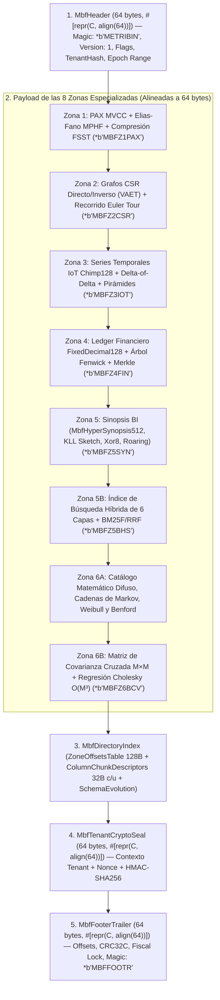
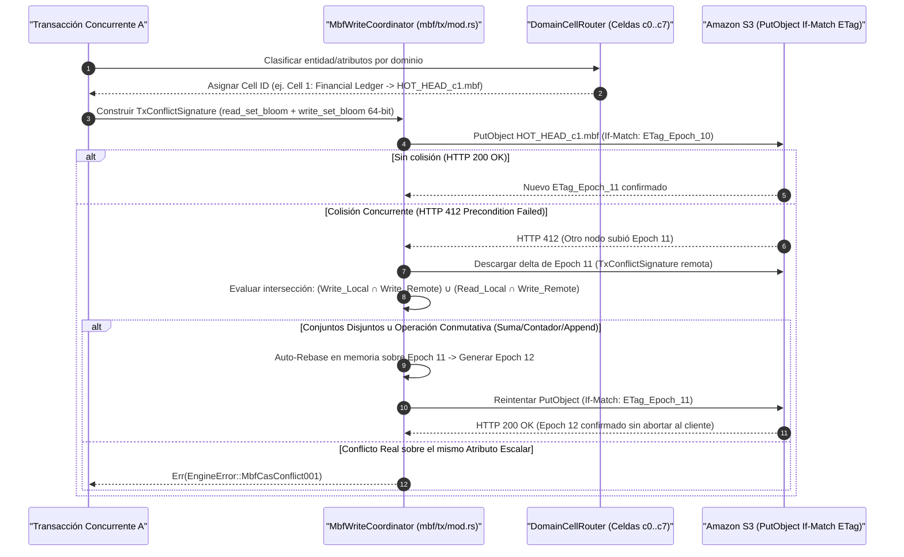

# Especificación del Motor Binario `.mbf` (Metri Binary Format)

> **Propósito:** Especificar a nivel de byte el diseño físico del formato binario **`.mbf` (Metri Binary Format v1)** implementado en `src/mbf/`, incluyendo la cabecera y el trailer alineados a líneas de caché L1 (64 bytes), el directorio de 8 zonas especializadas, el sello criptográfico por tenant (`MbfTenantCryptoSeal`), la evolución de esquemas en $O(1)$ y el protocolo transaccional MVCC sobre Amazon S3 con **Auto-Rebase**.

---

## 1. Layout Físico de un Archivo `.mbf`

Un archivo `.mbf` (así como sus archivos de índice `.mbf.idx`) es un contenedor binario inmutable por época transaccional, diseñado para lecturas vectorizadas SIMD y *memory-mapping* (`mmap`) con **alineación estricta a 64 bytes** (tamaño exacto de una línea de caché L1 en arquitecturas ARM64 Graviton y x86_64).

---

## 2. Estructuras de Control Binarias (`src/mbf/format/mod.rs`)

### 2.1 Cabecera Principal: `MbfHeader` (64 Bytes Exactos)

Definida en [`src/mbf/format/mod.rs`](../../src/mbf/format/mod.rs) con `#[repr(C, align(64))]`, ocupa exactamente los primeros 64 bytes del archivo (`offset 0..64`):

| Offset (Bytes) | Campo | Tipo Rust | Tamaño | Descripción |
| :---: | :--- | :--- | :---: | :--- |
| `0..8` | `magic` | `[u8; 8]` | 8 B | Firma mágica: `*b"METRIBIN"` para archivos de datos `.mbf` o `*b"MBFINDEX"` para archivos de índice `.mbf.idx`. |
| `8..10` | `version` | `u16` (LE) | 2 B | Versión del protocolo binario (`MBF_FORMAT_VERSION = 1`). |
| `10..12` | `flags` | `u16` (LE) | 2 B | Bit 0: `MBF_FLAG_HOT_HEAD` (`0x0001`), Bit 1: `MBF_FLAG_CRYPTO_SEALED` (`0x0002`), Bits `2..9`: máscara de zonas activas, Bits `10..15`: `cell_id` (`0..7`). |
| `12..16` | `row_count` | `u32` (LE) | 4 B | Número total de filas/versiones de datoms contenidas en el archivo. |
| `16..32` | `tenant_hash` | `[u8; 16]` | 16 B | Huella truncada de 128 bits del `tenant_id` propietario del archivo. |
| `32..40` | `min_tx_id` | `u64` (LE) | 8 B | Época transaccional mínima (`epoch_id`) presente en el bloque. |
| `40..48` | `max_tx_id` | `u64` (LE) | 8 B | Época transaccional máxima (`epoch_id` actual del snapshot). |
| `48..56` | `min_timestamp_ms` | `i64` (LE) | 8 B | Marca temporal UTC mínima en milisegundos (para *Time-Window Pruning* en $O(1)$). |
| `56..64` | `max_timestamp_ms` | `i64` (LE) | 8 B | Marca temporal UTC máxima en milisegundos. |

### 2.2 Trailer Final: `MbfFooterTrailer` (64 Bytes Exactos)

Ubicado en los últimos 64 bytes del archivo (`EOF - 64..EOF`), permite validar la integridad del archivo y localizar el directorio de zonas mediante una única lectura desde el final:

| Offset Relativo | Campo | Tipo Rust | Tamaño | Descripción |
| :---: | :--- | :--- | :---: | :--- |
| `0..8` | `directory_offset` | `u64` (LE) | 8 B | Offset absoluto en bytes donde inicia `MbfDirectoryIndex`. |
| `8..12` | `directory_len` | `u32` (LE) | 4 B | Longitud en bytes del `MbfDirectoryIndex` serializado. |
| `12..16` | `header_crc32c` | `u32` (LE) | 4 B | Checksum **CRC32C** (acelerado por hardware) de los 64 bytes del `MbfHeader`. |
| `16..20` | `directory_crc32c` | `u32` (LE) | 4 B | Checksum **CRC32C** de los bytes del directorio de zonas y descriptores de columnas. |
| `20..24` | `schema_fingerprint_hi` | `u32` (LE) | 4 B | Parte alta del hash del esquema Codice activo al momento de sellar el bloque. |
| `24..32` | `fiscal_lock_epoch_ms` | `i64` (LE) | 8 B | Marca temporal de cierre contable. Ninguna transacción puede mutar ni insertar hechos con fecha $\le$ a este valor (`MbfFiscalClosed001`). |
| `32..56` | `hmac_tag_truncated` | `[u8; 24]` | 24 B | Primeros 192 bits del tag de autenticación criptográfica del archivo. |
| `56..64` | `footer_magic` | `[u8; 8]` | 8 B | Firma mágica de cierre: `*b"MBFFOOTR"`. |

### 2.3 Directorio de Zonas y Descriptores de Columnas (`MbfDirectoryIndex`)

El `MbfDirectoryIndex` contiene:
1. **`ZoneOffsetsTable` (128 bytes, `#[repr(C, align(64))]`)**: Almacena los pares `(offset: u64, length: u64)` para cada una de las zonas del archivo, garantizando que todos los offsets de inicio sean múltiplos exactos de 64 bytes (`offset % 64 == 0`).
2. **`Vec<ColumnChunkDescriptor>` (32 bytes por columna)**: Describe cada columna física mediante `attribute_base36_id: u32`, `physical_type: u8`, `encoding_flags: u8`, `compression_codec: u8`, `null_count: u32`, `data_offset: u64`, `data_len: u32` y `chunk_crc32c: u32`.
3. **`MbfSchemaEvolutionDirectory`**: Mapa de evolución de esquema en $O(1)$ que permite agregar atributos nuevos en Codice sin reescribir archivos `.mbf` históricos (`EvolvedColumnProjection::Physical` cuando la columna existe físicamente en el bloque, o `EvolvedColumnProjection::VirtualConstantDefault` cuando la columna fue añadida en una época posterior).

---

## 3. Catálogo de las 8 Zonas Especializadas (`src/mbf/zones/`)

Cada archivo `.mbf` integra hasta 8 zonas especializadas de almacenamiento e indexación que se actualizan atómicamente durante el commit transaccional:

| Zona | Archivo Fuente en `src/mbf/zones/` | Magic Bytes | Estructuras Clave y Capacidades |
| :--- | :--- | :---: | :--- |
| **Zona 1: PAX MVCC** | [`pax_mvcc.rs`](../../src/mbf/zones/pax_mvcc.rs) | `*b"MBFZ1PAX"` | Micro-bloques híbridos **PAX** de hasta 4,096 filas (`MBF_L0_MAX_ROWS`), vectores de época MVCC (`tx_assert_epoch`, `tx_retract_epoch`), bitmaps de visibilidad activa (512B), directorio de entidades **Elias-Fano + MPHF `xxh64`** en $O(1)$, compresión de strings **FSST** (`FsstSymbolTable`) con evaluación de predicados sobre bytes comprimidos e índice secundario `avet_secondary_index`. |
| **Zona 2: Grafos CSR** | [`csr_graph.rs`](../../src/mbf/zones/csr_graph.rs) | `*b"MBFZ2CSR"` | Grafos **Compressed Sparse Row (CSR)** directo (`fwd_offsets`, `fwd_targets`) e inverso **VAET** (`rev_offsets`, `rev_sources`), más nodos **Euler Tour (`tin`/`tout`)** de 16 bytes (`EulerTreeNode`) con filtrado vectorizado de subárboles en lotes de 16 lanes (`filter_rows_in_subtree_vectorized`). |
| **Zona 3: Series Temporales IoT** | [`iot_timeseries.rs`](../../src/mbf/zones/iot_timeseries.rs) | `*b"MBFZ3IOT"` | Bloques `Chimp128SeriesBlock`: normalización afín canónica de unidades ($y = a \cdot x + b$), timestamps con empaquetado de bits **Delta-of-Delta**, compresión sin pérdida de punto flotante **Chimp128** + **LZ4**, y pirámides multi-resolución pre-agregadas (`1m`, `1h`, `1d`). |
| **Zona 4: Ledger Financiero** | [`financial_ledger.rs`](../../src/mbf/zones/financial_ledger.rs) | `*b"MBFZ4FIN"` | Aritmética decimal exacta de 128 bits (`FixedDecimal128`), redondeo bancario IEEE 754-2008 Half-to-Even, reparto de centavos por método de Hamilton, **Árbol de Fenwick** de 128 bits (`FenwickPrefixSum128`) para saldos acumulados en $O(\log N)$, valoración de inventarios **FIFO / LIFO / WAC / FEFO**, amortización lineal y cadena de auditoría Merkle SHA-256 con invariante $\sum D = \sum C$. |
| **Zona 5: Sinopsis BI** | [`bi_synopses.rs`](../../src/mbf/zones/bi_synopses.rs) | `*b"MBFZ5SYN"` | `NumericBlockSynopsis` (64B), `CompactKllSketch` (256B, 29 cuantiles), `Xor8Filter` (< 0.39% FPR), `RoaringBitmap32`, y la hiper-sinopsis `MbfHyperSynopsis512` (512B = 8 líneas de caché L1 con 32 estadísticos pre-computados para respuestas OLAP en $O(1)$). |
| **Zona 5B: Búsqueda Híbrida** | [`hybrid_search.rs`](../../src/mbf/zones/hybrid_search.rs) | `*b"MBFZ5BHS"` | Índice `MbfHybridSearchIndex` de **6 capas**: (1) Léxico FST + autómata Levenshtein DFA $k \le 2$, (2) SymSpell $O(1)$, (3) N-gramas (2/3-gramas), (4) Fonética Romance + Double Metaphone + Sinónimos, (5) Vectores binarios **RaBitQ** + grafo **HNSW**, y (6) Índice espacial jerárquico **Uber H3** + Morton Z-Order + R-Tree MBR + DBSCAN, fusionados con **BM25F** y **Reciprocal Rank Fusion (RRF)**. |
| **Zona 6A: Catálogo Matemático y Markov** | [`fuzzy_math_catalog.rs`](../../src/mbf/zones/fuzzy_math_catalog.rs) | *(Integrado)* | Transformaciones afines dimensionales FMA, cadenas de Markov en tiempo discreto (`DiscreteMarkovChain<N>`), análisis de supervivencia **Kaplan-Meier** con censura por la derecha, confiabilidad industrial (`MTTR`, `MTBF`, `MTTF`, Weibull 3P), optimización estocástica de lotes (**EOQ**, buffer de seguridad gaussiano, Fill Rate) y detección de fraude contable mediante **Ley de Benford** ($\chi^2$). |
| **Zona 6B: Covarianza Cruzada** | [`cross_covariance.rs`](../../src/mbf/zones/cross_covariance.rs) | `*b"MBFZ6BCV"` | Matriz simétrica `MbfCrossCovarianceMatrix` ($M \times M$ co-momentos centrados $C_{i,j}$), correlación de Pearson en $O(1)$, correlación de rangos de Spearman (identidad de Kruskal), **Regresión Lineal Múltiple (OLS)** en $O(M^3)$ mediante descomposición de **Cholesky ($L L^T$)** sin escanear filas, Primera Componente Principal (**PCA**) y **Distancia de Mahalanobis**. |

---

## 4. Coordinador Transaccional, 8 Celdas y Auto-Rebase (`src/mbf/tx/mod.rs`)

Para maximizar el throughput de escritura concurrente sobre Amazon S3 sin requerir un servidor de bloqueos externo, [`src/mbf/tx/mod.rs`](../../src/mbf/tx/mod.rs) implementa un protocolo de concurrencia optimista basado en **particionado celular**, **firmas de conflicto Bloom** y **Auto-Rebase conmutativo**:

### 4.1 Las 8 Celdas de Dominio (`DomainCellRouter`)

En lugar de serializar todas las escrituras de un tenant sobre un único objeto en S3, `DomainCellRouter` distribuye las entidades en **8 archivos cabeza independientes (`HOT_HEAD_c0.mbf` .. `HOT_HEAD_c7.mbf`)**:

- **Celda 0 (`c0`)**: Entidades operativas generales, análisis de supervivencia y catálogos maestros.
- **Celda 1 (`c1`)**: Asientos contables (`journal_entry`), facturas, pagos y estructuras con árbol de Fenwick.
- **Celda 2 (`c2`)**: Jerarquías organizacionales, árboles de cuentas y grafos con recorrido Euler Tour.
- **Celda 3 (`c3`)**: Sagas distribuidas, colas de eventos EDA y estados de flujos de trabajo.
- **Celda 4 (`c4`)**: Documentos JSON extensos, embeddings vectoriales RaBitQ e índices de texto pesado.
- **Celda 5 (`c5`)**: Identidades de sistema (`user`, `role`), políticas de seguridad y registros de auditoría inmutables.
- **Celdas 6 y 7 (`c6`, `c7`)**: Flujos de alta frecuencia de telemetría IoT y series temporales (`Chimp128`).

### 4.2 Ordenamiento Espacial 3D de Hilbert (`hilbert_cluster_key_3d`)

Durante la compactación de micro-bloques, el coordinador ordena las filas siguiendo una **curva fractal de llenado de espacio 3D de Hilbert** sobre las coordenadas normalizadas `(entity_hash, attribute_id, timestamp_bucket)`. Esto preserva la localidad espacial tridimensional mucho mejor que un ordenamiento lexicográfico simple, maximizando la tasa de descarte de bloques (*Data Skipping*) tanto en consultas por entidad como por atributo o ventana de tiempo.
