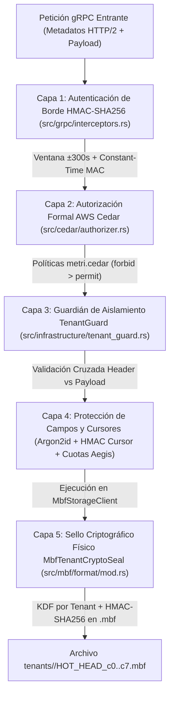

# Seguridad Zero-Trust y Multitenancy

> **Propósito:** Documentar la arquitectura de defensa en profundidad (*Defense-in-Depth*) de `metri-engine`: autenticación de borde con **HMAC-SHA256** constante-tiempo, autorización declarativa **AWS Cedar** (ABAC/RBAC), aislamiento de contexto con `TenantGuard`, sellado criptográfico por archivo `.mbf` (`MbfTenantCryptoSeal`) y protección de secretos con **Argon2id**.

---

## 1. Arquitectura de Defensa en Profundidad (5 Capas Zero-Trust)

En `metri-engine`, ninguna capa confía implícitamente en la anterior. Incluso si una petición supera el API Gateway o el BFF, el motor valida criptográfica y semánticamente el contexto del tenant en **cinco barreras sucesivas** antes de leer o escribir un solo byte en `.mbf`:

---

## 2. Capa 1: Autenticación Criptográfica de Borde (`src/grpc/interceptors.rs`)

Toda llamada gRPC hacia `MetriService`, `MoiraRoutingService`, `QuotaService` o `AgentConfigService` es interceptada por `extract_and_verify_tenant_context` ([`src/grpc/interceptors.rs`](../../src/grpc/interceptors.rs)):

### 2.1 Cabeceras de Seguridad Requeridas

| Cabecera HTTP/2 gRPC | Obligatoria | Propósito y Validación |
| :--- | :---: | :--- |
| `x-tenant-id` | **Sí** | Identificador canónico del tenant propietario de la operación (ej. `system`, `tnt_01H...`). |
| `x-user-id` | **Sí** | Identificador del principal que ejecuta la acción (`usr_master`, `usr_system_bff`, etc.). |
| `x-user-roles` | **Sí** | Lista separada por comas de roles asignados al principal (ej. `role_super_master`). |
| `x-auth-timestamp` | **Sí** (en prod) | Marca temporal Unix en segundos de emisión de la firma. |
| `x-calculated-auth` | **Sí** (en prod) | Firma hexadecimal **HMAC-SHA256** calculada sobre el mensaje canónico de identidad. |
| `x-correlation-id` | Opcional | Identificador de trazabilidad distribuida (generado automáticamente si se omite). |

### 2.2 Verificación Anti-Replay y Comparación en Tiempo Constante

1. **Política Fail-Closed de Configuración (`src/domain/config.rs`)**:
   - En cualquier entorno distinto de `development`, `dev`, `local` o `test`, `resolve_hmac_secret` exige que `HMAC_SECRET` esté definido y tenga al menos **32 bytes (256 bits)** de longitud.
   - Si alguien intenta fijar `METRI_DEV_AUTH_BYPASS=1` en producción, `resolve_dev_auth_bypass` aborta inmediatamente el arranque del servidor.
2. **Ventana Temporal Anti-Replay ($\pm 300\text{ segundos}$)**:
   - El interceptor compara `x-auth-timestamp` contra el reloj UTC actual del sistema (`MAX_TIMESTAMP_SKEW_SECS = 300`). Cualquier petición fuera de la ventana de 5 minutos es rechazada con `UNAUTHENTICATED`.
3. **Firma Canónica HMAC-SHA256**:
   - Se calcula $\text{HMAC-SHA256}(\text{HMAC\_SECRET}, \text{tenant\_id} \mathbin{\Vert} \text{":"} \mathbin{\Vert} \text{user\_id} \mathbin{\Vert} \text{":"} \mathbin{\Vert} \text{timestamp})$ y se compara en **tiempo constante** (`subtle` / XOR acumulador de longitud fija) para neutralizar ataques de temporización (*timing attacks*).

---

## 3. Capa 2: Autorización Declarativa con AWS Cedar (`src/cedar/`)

Una vez autenticada la identidad, el módulo [`src/cedar/engine.rs`](../../src/cedar/engine.rs) evalúa si el principal tiene permiso para ejecutar la acción solicitada sobre el recurso utilizando el motor oficial **`cedar-policy` (v3.x)** y las políticas definidas en [`config/policies/metri.cedar`](../../config/policies/metri.cedar).

### 3.1 Modelo Formal PARC (Principal, Action, Resource, Context)

| Elemento Cedar | Representación en `metri-engine` | Atributos Evaluados en la Política |
| :--- | :--- | :--- |
| **`Principal`** | `User::"<user_id>"` | `tenant_id: String`, `roles: Set<Role>`, `clearance_level: Long` |
| **`Action`** | `Action::"Discovery"`, `Action::"Explore"`, `Action::"Query"`, `Action::"Transact"`, `Action::"BulkIngest"` | Tipo de operación invocada en el servicio gRPC. |
| **`Resource`** | `Entity::"<entity_type>/<entity_id>"` | `tenant_id: String`, `entity_type: String`, `classification: String` |
| **`Context`** | Atributos dinámicos de la petición | Metadatos de invocación y alcance de la operación. |

### 3.2 Reglas Fundamentales en `config/policies/metri.cedar`

1. **Aislamiento de Tenant por Defecto**: Una regla `permit` autoriza operaciones cuando `principal.tenant_id == resource.tenant_id`.
2. **Gobernanza del Tenant Maestro (`system`)**: Los principales con rol `Role::"role_super_master"` o `Role::"system-bff"` dentro del tenant `system` cuentan con reglas explícitas para tareas de aprovisionamiento y enrutamiento administrativo.
3. **Precedencia `forbid` Inquebrantable**: Una regla `forbid` explícita bloquea cualquier intento de que un principal cuyo `tenant_id` no sea `"system"` y no coincida con `resource.tenant_id` acceda a datos ajenos, incluso si poseyera un rol administrativo local.

---

## 4. Capa 3: Aislamiento en Tiempo de Ejecución con `TenantGuard`

El componente [`src/infrastructure/tenant_guard.rs`](../../src/infrastructure/tenant_guard.rs) actúa como una barrera criptográfica y lógica entre el adaptador gRPC y el motor `.mbf`:

- **Verificación de Coherencia Cabecera-Payload**: Si el mensaje Protobuf (por ejemplo, `TransactRequest.tenant_id` o `QueryRequest.tenant_id`) especifica un `tenant_id` que difiere del `tenant_id` autenticado en la cabecera HMAC (salvo operaciones delegadas autorizadas del tenant maestro `system`), `TenantGuard` rechaza la operación antes de tocar el almacenamiento.
- **Particionado Físico de Rutas**: Todas las claves de S3 y rutas de caché local en `/tmp/mbf_cache` se construyen a partir del `tenant_id` validado y sanitizado (`tenants/<tenant_id>/HOT_HEAD_c0..c7.mbf`), impidiendo ataques de *Path Traversal*.

---

## 5. Capa 4: Criptografía de Campos, Cursores y Cuotas Anti-DoS

1. **Hashing de Secretos con Argon2id (`src/infrastructure/crypto.rs`)**:
   - Todo atributo declarado con `"type": "secret"` en Codice se hashea con **Argon2id** (v0x13, memoria `19456 KiB`, `2` iteraciones, paralelismo `1`, sal criptográfica aleatoria de 128 bits) antes de generar el Datom.
   - Si un valor ya tiene el prefijo `$argon2id$`, no se re-hashea accidentalmente.
   - Los atributos `secret` son filtrados en las proyecciones de lectura para no exponerse jamás en respuestas gRPC.
2. **Cursores de Paginación Firmados con HMAC-SHA256 (`src/infrastructure/crypto.rs`)**:
   - Cada cursor devuelto en `Explore` o `ListEntities` empaqueta el `tenant_id` y el offset de paginación junto con una firma HMAC-SHA256. Un cursor emitido para `tenant_a` falla criptográficamente si es enviado por `tenant_b`.
3. **Higiene de Memoria en el Bootstrap (`src/grpc/bootstrap.rs`)**:
   - Tras sembrar las identidades iniciales del tenant `system` al arranque, las variables `METRI_BOOTSTRAP_MASTER_EMAIL`, `METRI_BOOTSTRAP_MASTER_USERNAME` y `METRI_BOOTSTRAP_MASTER_PASSWORD` son eliminadas inmediatamente del entorno del proceso con `std::env::remove_var`.

---

## 6. Capa 5: Sello Criptográfico Físico en Archivos `.mbf` (`MbfTenantCryptoSeal`)

Incluso en el escenario extremo de que un archivo `.mbf` en disco o en Amazon S3 fuera copiado o renombrado hacia el prefijo de otro tenant, el motor `.mbf` incluye el sello físico `MbfTenantCryptoSeal` de **64 bytes** ([`src/mbf/format/mod.rs`](../../src/mbf/format/mod.rs)):

1. **Derivación de Clave por Tenant (KDF)**:
   Para cada `tenant_id`, el motor deriva una sub-clave criptográfica exclusiva:

   $$K_{\text{tenant}} = \text{HMAC-SHA256}\left(\text{HMAC\_SECRET}, \texttt{"METRI\_MBF\_V1\_TENANT\_KDF:"} \mathbin{\Vert} \text{tenant\_id}\right)$$

2. **Cálculo y Verificación del Sello**:
   Al escribir el archivo `.mbf`, el motor calcula el MAC sobre la cabecera `MbfHeader`, el `MbfDirectoryIndex`, el hash de contexto del tenant (`tenant_context_hash: [u8; 16]`) y el `nonce: [u8; 12]` usando $K_{\text{tenant}}$.
3. **Rechazo Inmediato ante Suplantación (`MbfCryptoSeal001`)**:
   Al abrir cualquier archivo `.mbf`, `MbfTenantCryptoSeal::verify` recalcula el MAC con la clave derivada del tenant solicitante y lo compara en tiempo constante. Si no coincide bit a bit, la lectura se aborta con `EngineError::MbfCryptoSeal001`.
