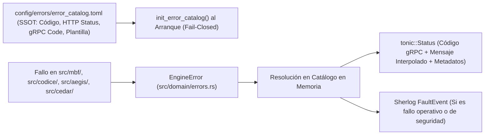

# Calidad, Clean Code y Patrón `Result`

> **Propósito:** Explicar la arquitectura de confiabilidad de software de `metri-engine`: erradicación total de pánicos en tiempo de ejecución mediante el patrón `Result<T, EngineError>`, el catálogo canónico de errores (`error_catalog.toml`), y las reglas estáticas de Clean Code y SOLID verificadas en CI.

---

## 1. Erradicación de Pánicos: Política de Cero `unwrap()` y Cero `unsafe`

En un motor HTAP multi-tenant donde un solo proceso sirve peticiones concurrentes sobre canales HTTP/2 multiplexados, un `panic!()` en un hilo de trabajo puede abortar conexiones activas, dejar transacciones en vuelo sin respuesta y degradar la disponibilidad del servicio.

Por ello, `metri-engine` aplica tres barreras simultáneas contra el manejo inseguro de errores y memoria:

1. **Nivel Compilador (`Cargo.toml`)**:
   ```toml
   [lints.rust]
   unsafe_code = "deny"

   [lints.rustdoc]
   broken_intra_doc_links = "deny"
   private_intra_doc_links = "deny"
   ```
2. **Nivel Linter (`src/lib.rs` y `src/main.rs`)**:
   ```rust
   #![cfg_attr(
       not(test),
       deny(
           clippy::unwrap_used,
           clippy::expect_used,
           clippy::panic,
           clippy::todo,
           clippy::unimplemented
       )
   )]
   ```
3. **Nivel Guardián AST/Léxico (`scripts/dev/check_result_pattern.py`)**:
   Escanea todo el directorio `src/` verificando que el contador de excepciones en [`scripts/dev/result_pattern_allowlist.json`](../../scripts/dev/result_pattern_allowlist.json) se mantenga exactamente en **`0`**.

---

## 2. Arquitectura del Patrón `Result` y Catálogo Canónico (`src/domain/errors.rs`)

Toda función falible en el dominio, la capa de aplicación, el motor `.mbf` y los adaptadores retorna `Result<T, EngineError>` (o su alias `EngineResult<T>`), donde `EngineError` está definido en [`src/domain/errors.rs`](../../src/domain/errors.rs) y respaldado por la fuente única de verdad en [`config/errors/error_catalog.toml`](../../config/errors/error_catalog.toml).



### 2.1 Anatomía de una Entrada en `error_catalog.toml`

Cada error del sistema está tipificado con un código alfanumérico único por dominio (`CODICE-*`, `AEGIS-*`, `JANUS-*`, `SEC-*`, `EAV-*`, `MBF-*`, `INFRA-*`, `SYS-*`):

```toml
[errors.MBF_CAS_CONFLICT_001]
code = "MBF-CAS-CONFLICT-001"
http_status = 409
grpc_status = "ABORTED"
category = "CONCURRENCY"
retryable = true
message_template = "Conflicto de concurrencia optimista (CAS) en el motor MBF para el tenant '{tenant_id}' en la época '{epoch}': {detail}"
```

### 2.2 Beneficios del Catálogo Canónico Validado al Arranque

1. **Consistencia en Contratos con el Cliente**: El BFF y los clientes gRPC no dependen de parsear cadenas de texto frágiles; reciben códigos deterministas (`MBF-CAS-CONFLICT-001`, `MBF-FISCAL-CLOSED-001`, `SEC-CEDAR-DENY`) mapeados al `tonic::Code` exacto (`INVALID_ARGUMENT`, `PERMISSION_DENIED`, `ABORTED`, `FAILED_PRECONDITION`, `INTERNAL`).
2. **Validación de Conformidad en Tests (`tests/contract_conformance.rs`)**: Una prueba de integración verifica que cada variante del enum `EngineError` en Rust exista en `config/errors/error_catalog.toml` y viceversa, impidiendo errores huérfanos.

---

## 3. Estándares de Clean Code Aplicados Mecánicamente

El script [`scripts/dev/check_clean_code.py`](../../scripts/dev/check_clean_code.py) audita cada archivo `.rs` de producción en `src/` bajo tres invariantes cuantitativos:

| Regla de Clean Code | Límite Estricto | Razón de Ingeniería |
| :--- | :---: | :--- |
| **Longitud Máxima por Función** | **$\le 80$ líneas** | Garantiza que toda función quepa en una pantalla vertical y tenga una única responsabilidad clara (*Single Responsibility Principle*). |
| **Aridad Máxima de Parámetros** | **$\le 5$ argumentos** | Evita firmas propensas a errores posicionales y fomenta el uso de objetos de valor y structs de comando cohesivos. |
| **Profundidad Máxima de Anidación** | **$\le 4$ niveles** | Elimina el antipatrón *Arrow Code* (`if -> match -> for -> if -> match`), obligando al uso de cláusulas de guarda (*Guard Clauses*) y el operador `?`. |
| **Tamaño Máximo de Archivo Fuente** | **$\le 900$ líneas** | Auditado por `tests/architecture_solid_guard.rs` para evitar módulos monolíticos (*God Objects*). |

### Ejemplo de Refactorización Idiomática en `metri-engine`

En lugar de anidar bloques condicionales profundos o usar `.unwrap()`:

```rust
// INCORRECTO (Viola check_result_pattern.py y check_clean_code.py)
pub fn process_record(input: Option<&str>) -> String {
    if input.is_some() {
        let val = input.unwrap();
        if !val.is_empty() {
            // ... múltiples niveles de anidación ...
        }
    }
    panic!("invalid input");
}

// CORRECTO (Patrón Result + Guard Clauses de baja anidación)
pub fn process_record(input: Option<&str>) -> Result<String, EngineError> {
    let raw = input.ok_or_else(|| EngineError::ValidationMissingField {
        field: "input".to_string(),
    })?;
    if raw.trim().is_empty() {
        return Err(EngineError::ValidationEmptyField {
            field: "input".to_string(),
        });
    }
    Ok(raw.trim().to_uppercase())
}
```

---

## 4. Gobernanza Documental Continua (`check_docs.py` y `gen_reference.py`)

La documentación de `metri-engine` se trata con el mismo rigor que el código ejecutable:

1. **Cobertura Rustdoc del 100%**: Todos los módulos en `src/` incluyen documentación de nivel de módulo (`//!`) e ítem (`///`), auditada con `RUSTDOCFLAGS="-D warnings" cargo doc --no-deps` para prohibir enlaces intra-doc rotos.
2. **Catálogos de Referencia Autogenerados (`scripts/docs/gen_reference.py`)**:
   - [`docs/05-referencia/api-grpc.md`](../05-referencia/api-grpc.md) se genera directamente desde `proto/metri.proto` y `proto/eda.proto`.
   - [`docs/05-referencia/modelos-codice.md`](../05-referencia/modelos-codice.md) se genera desde los 28 archivos JSON en `config/models/`.
   - [`docs/05-referencia/codigos-error.md`](../05-referencia/codigos-error.md) se genera desde `config/errors/error_catalog.toml`.
   En el pipeline de CI (`rust.yml`), `python3 scripts/docs/gen_reference.py --check` falla si algún desarrollador modificó un `.proto`, modelo o error sin actualizar la referencia generada.
