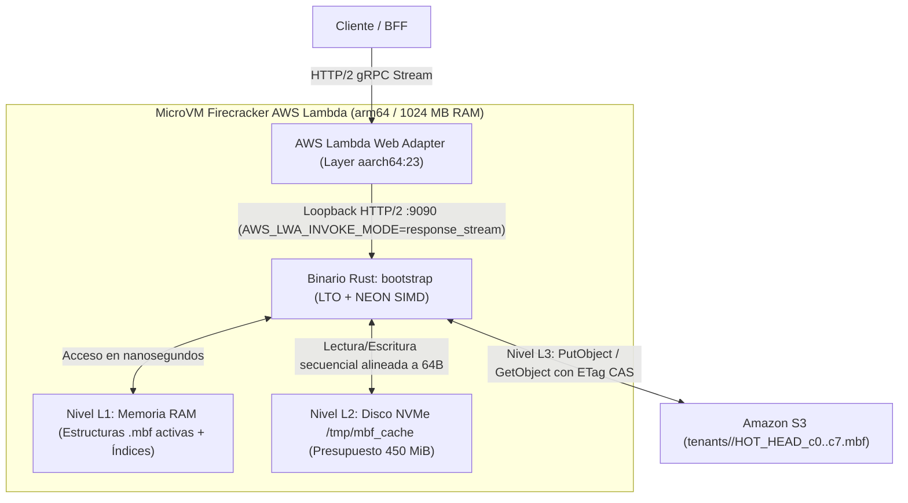

# Infraestructura Serverless ARM64 (Graviton y S3 CAS)

> **Propósito:** Explicar la arquitectura física de ejecución de `metri-engine` en AWS: el modelo de cómputo **AWS Lambda ARM64 (`provided.al2023`)**, el puente HTTP/2 mediante **AWS Lambda Web Adapter**, la jerarquía de almacenamiento de tres niveles (RAM L1, NVMe `/tmp` L2 y Amazon S3 CAS L3) y el perfil de optimización del compilador para instrucciones vectoriales NEON.

---

## 1. Modelo de Ejecución Serverless sin Estado Persistente Externo

A diferencia de motores tradicionales que requieren clústeres de bases de datos encendidos 24/7 (instancias RDS, nodos de búsqueda dedicados o clústeres de caché), `metri-engine` opera con **costo fijo cero en reposo** combinando tres primitivas nativas de AWS:

1. **Cómputo Efímero de Alta Densidad**: Función **AWS Lambda** sobre procesadores **AWS Graviton (ARM64)** ejecutando el runtime nativo `provided.al2023`.
2. **Almacenamiento Local de Velocidad NVMe**: `512 MB` de almacenamiento efímero montado en `/tmp`, donde `MbfStorageClient` gestiona un presupuesto estricto de **`450 MiB`** (`MBF_TMP_CACHE_MAX_MB=450`) para retener los bloques `.mbf` calientes entre invocaciones consecutivas (*Warm Starts*).
3. **Persistencia Duradera y Atómica en Amazon S3**: Los archivos `.mbf` viven en Amazon S3 (`11 nueves` de durabilidad) y utilizan escrituras condicionales (`If-Match` / `If-None-Match` sobre `ETag`) como primitiva de consenso atómico **Compare-And-Swap (CAS)**.



---

## 2. Puente HTTP/2 gRPC con AWS Lambda Web Adapter (`template.yaml`)

El archivo [`template.yaml`](../../template.yaml) configura la función `MetriEngineFunction` para exponer todos los servicios gRPC de Tonic sin necesidad de traducir peticiones a REST/JSON:

- **`Runtime: provided.al2023` y `Architectures: [arm64]`**: Ejecuta directamente el binario ELF de 64 bits compilado para `aarch64-unknown-linux-gnu`.
- **Layer `AWSLambdaWebAdapter:23`**:
  - Se inyecta mediante `AWS_LAMBDA_EXEC_WRAPPER: /opt/bootstrap`.
  - Inicia el binario `bootstrap` de Rust en el puerto local `PORT: "9090"` (`GRPC_PORT: "9090"`).
  - Con `AWS_LWA_INVOKE_MODE: response_stream`, el adaptador retransmite los frames HTTP/2 gRPC en streaming bidireccional entre el invocador y el servidor Tonic con sobrecarga inferior a `1 ms`.

---

## 3. Jerarquía de Almacenamiento de 3 Niveles (L1 RAM / L2 NVMe / L3 S3)

El cliente de almacenamiento [`MbfStorageClient`](../../src/mbf/storage.rs) orquesta el movimiento de bloques `.mbf` a través de tres niveles de memoria:

| Nivel | Medio Físico | Latencia Típica | Capacidad / Presupuesto | Estrategia de Gestión en `src/mbf/storage.rs` |
| :--- | :--- | :---: | :---: | :--- |
| **L1 (Hot RAM)** | Memoria DRAM del proceso Lambda | $< 100\text{ ns}$ | Hasta `1024 MB` (compartido con el proceso) | Mantiene los micro-bloques PAX MVCC activos (`L0` hasta `4,096` filas por celda), el registro `CodiceRegistry`, el autorizador `CedarAuthorizer` y el catálogo de errores. |
| **L2 (Warm NVMe)** | Almacenamiento efímero Firecracker (`/tmp/mbf_cache`) | $\approx 50 - 200\text{ }\mu\text{s}$ | **`450 MiB`** (`MBF_NVME_CACHE_BUDGET_BYTES`) | Almacena copias locales de `HOT_HEAD_c0..c7.mbf` validadas por `ETag`. Aplica desalojo determinista cuando el uso supera los 450 MiB para impedir agotamiento de disco. |
| **L3 (Cold/Durable S3)** | Amazon S3 (`MBF_S3_BUCKET`) | $\approx 5 - 25\text{ ms}$ | Ilimitada ($11\text{ nueves}$ de durabilidad) | Fuente de verdad persistente. Utiliza **Group Commit (`15 ms`)**, **8 celdas paralelas (`c0..c7`)** y **CAS (`If-Match`)** con Auto-Rebase ante colisiones HTTP 412. |

### 3.1 Optimización de Cold Start vs. Warm Start

- **Arranque en Frío (*Cold Start*, `< 150 ms`)**:
  Al no utilizar máquina virtual pesada (JVM/.NET) ni interpretes, el binario nativo de Rust inicializa el tracer OpenTelemetry, valida el catálogo TOML de errores y carga los 28 archivos JSON de Codice en menos de `40 ms`. Los archivos `.mbf` de cada tenant se descargan perezosamente (*on-demand*) solo cuando llega una petición para ese tenant específico.
- **Ejecución Caliente (*Warm Start*, `< 2 ms` para lecturas en caché)**:
  En invocaciones subsiguientes dentro del mismo contenedor Lambda, el archivo `.mbf` ya reside en L1 (RAM) o L2 (`/tmp/mbf_cache`), permitiendo que consultas analíticas sobre `MbfHyperSynopsis512`, búsquedas híbridas en `MbfHybridSearchIndex` y recorridos de grafos Euler/CSR se resuelvan íntegramente en memoria local.

---

## 4. Perfil de Compilación Release y Simetría con Hardware Graviton

El perfil `[profile.release]` en [`Cargo.toml`](../../Cargo.toml) está ajustado para maximizar el rendimiento por ciclo de reloj en procesadores ARM64 Graviton y reducir el tamaño del paquete de despliegue:

```toml
[profile.release]
opt-level = 3
lto = true
codegen-units = 1
panic = "abort"
strip = true
```

1. **`lto = true` y `codegen-units = 1` (Full Link-Time Optimization)**: Permite a LLVM realizar *inlining* inter-procedural a través de todas las fronteras de módulos y crates, eliminando llamadas indirectas en los bucles críticos de filtrado columnar y evaluación de fórmulas.
2. **Alineación a Líneas de Caché L1 (`#[repr(C, align(64))]`)**: Todas las cabeceras críticas de `.mbf` (`MbfHeader`, `MbfFooterTrailer`, `ZoneOffsetsTable`, `MbfTenantCryptoSeal`, `NumericBlockSynopsis`, `FinancialBlockCheckpoint`, `LedgerAuditHeader`, `MbfHyperSynopsis512`) son múltiplos exactos de **64 bytes**, evitando penalizaciones por *cache-line split* en los núcleos ARM Neoverse de Graviton.
3. **Auto-Vectorización NEON (128-bit SIMD)**: Los bucles de filtrado en `src/mbf/zones/` (como `filter_rows_in_subtree_vectorized` en lotes de 16 lanes y las operaciones bit a bit en `RoaringBitmap32` y `RaBitQVector`) están escritos sin ramificaciones internas (*branchless loops*) para que el backend de LLVM emita instrucciones vectoriales ARM64 NEON e instrucciones escalares `CNT` (POPCNT) nativas.
4. **`strip = true` y `panic = "abort"`**: Elimina símbolos de depuración y tablas de desenrollado de pila (*unwind tables*), reduciendo el tamaño del binario `bootstrap` y acelerando la carga de páginas ejecutables durante el arranque en frío de AWS Lambda.
