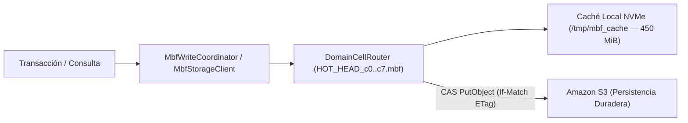

# ADR-001: Motor HTAP Binario Unificado (`.mbf`) sobre Amazon S3 con Consenso CAS

- **Estado:** Aceptado y Vigente
- **Fecha:** 2026-10-19
- **Componentes Afectados:** [`src/mbf/`](../../../src/mbf/mod.rs), [`src/mbf/storage.rs`](../../../src/mbf/storage.rs), [`src/mbf/tx/mod.rs`](../../../src/mbf/tx/mod.rs), [`template.yaml`](../../../template.yaml)

---

## 1. Contexto y Problema

Una plataforma empresarial multi-tenant moderna requiere simultáneamente:
1. **Operaciones Transaccionales (OLTP) de baja latencia**: Creación y mutación atómica de entidades comerciales, asientos contables con partida doble y control de secuencias.
2. **Consultas Analíticas (OLAP) y Estadísticas Avanzadas**: Agregaciones sobre millones de registros, cuantiles, regresiones lineales múltiples, análisis de supervivencia y detección de anomalías en tiempo real.
3. **Búsqueda Híbrida y Recorrido de Grafos**: Búsqueda tolerante a errores tipográficos, fonética, similitud vectorial y consultas jerárquicas de árboles contables u organizacionales.

En arquitecturas convencionales, satisfacer estas cargas exige mantener múltiples motores heterogéneos (una base de datos llave-valor o relacional para OLTP, un motor de búsqueda para texto/vectores, un almacén columnar externo para OLAP y pipelines de sincronización intermedia). Esa topología fragmentada presenta tres problemas críticos:
- **Inconsistencia Eventual**: Los cambios transaccionales tardan segundos o minutos en reflejarse en los motores de búsqueda y analítica.
- **Sobrecosto Operativo y Fijo**: Mantener clústeres dedicados o múltiples servicios administrados incrementa drásticamente el costo por tenant inactivo.
- **Complejidad de Seguridad Multi-Tenant**: Garantizar aislamiento criptográfico uniforme a través de 3 o 4 motores distintos multiplica la superficie de ataque.

---

## 2. Decisión

Adoptar el motor unificado **Metri Vortex** basado en el formato binario propietario **`.mbf` (*Metri Binary Format v1*)**, ejecutado íntegramente dentro del binario Rust de `metri-engine` sobre **AWS Lambda ARM64** y persistido directamente en **Amazon S3** con aceleración en caché local NVMe (`/tmp/mbf_cache`):

1. **Formato Físico Autocontenido de 8 Zonas (`src/mbf/zones/`)**:
   Cada archivo `.mbf` (con cabecera `MbfHeader` y trailer `MbfFooterTrailer` alineados a 64 bytes) encapsula en una única unidad atómica:
   - **Zona 1 (`pax_mvcc.rs`)**: Micro-bloques híbridos PAX con versionado MVCC, directorio Elias-Fano + MPHF en $O(1)$ y compresión de texto FSST.
   - **Zona 2 (`csr_graph.rs`)**: Grafos CSR directo e inverso (VAET) y recorrido Euler Tour (`tin`/`tout`) para subárboles jerárquicos en $O(1)$.
   - **Zona 3 (`iot_timeseries.rs`)**: Series temporales comprimidas con Delta-of-Delta y Chimp128 + pirámides multi-resolución.
   - **Zona 4 (`financial_ledger.rs`)**: Aritmética exacta `FixedDecimal128`, árbol de Fenwick $O(\log N)$ y cadena Merkle SHA-256.
   - **Zona 5 (`bi_synopses.rs`)**: Hiper-sinopsis `MbfHyperSynopsis512` (512 bytes con momentos de Pébay, KLL Sketch, Xor8 Filter y Roaring Bitmaps).
   - **Zona 5B (`hybrid_search.rs`)**: Índice de búsqueda híbrida de 6 capas (FST/Levenshtein, SymSpell, N-gramas, Fonética, RaBitQ/HNSW y Uber H3).
   - **Zonas 6A y 6B (`fuzzy_math_catalog.rs`, `cross_covariance.rs`)**: Cadenas de Markov, supervivencia Kaplan-Meier, Ley de Benford y matriz de covarianza cruzada $M \times M$ para regresión OLS por Cholesky en $O(M^3)$.
2. **Consenso Transaccional sin Servidor de Bloqueos (S3 CAS + Auto-Rebase)**:
   - Las escrituras se particionan en **8 celdas de dominio por tenant (`HOT_HEAD_c0.mbf` .. `HOT_HEAD_c7.mbf`)** mediante `DomainCellRouter`.
   - Cada commit utiliza escrituras condicionales nativas de Amazon S3 (`PutObject` con `If-Match: <ETag>`).
   - Ante una colisión concurrente (`HTTP 412 Precondition Failed`), el coordinador `MbfWriteCoordinator` evalúa las firmas de conflicto Bloom de 64 bits (`TxConflictSignature`) y ejecuta **Auto-Rebase en memoria** si los conjuntos de escritura son disjuntos o las operaciones son conmutativas.

---

## 3. Consecuencias

### Positivas
- **Consistencia HTAP Instantánea**: En el mismo instante en que una transacción `Transact` se confirma, las sinopsis OLAP (`MbfHyperSynopsis512`), el árbol de Fenwick contable, el grafo CSR y el índice de búsqueda híbrida ya están actualizados en la misma época MVCC.
- **Costo Fijo Cero en Reposo**: Un tenant inactivo solo consume centavos de almacenamiento estándar en Amazon S3, sin servidores encendidos.
- **Rendimiento Sub-Lineal en Memoria**: Las consultas estadísticas y de regresión lineal múltiple se resuelven en $O(1)$ u $O(M^3)$ leyendo las cabeceras de sinopsis sin escanear filas.

### Negativas y Mitigaciones
- **Contención en Escrituras de Alta Frecuencia sobre un Mismo Tenant**: S3 tiene una latencia base de red de `5-25 ms` por `PutObject`. Se mitiga mediante tres mecanismos implementados en [`src/mbf/tx/mod.rs`](../../../src/mbf/tx/mod.rs):
  1. **Ventana de Group Commit (`MBF_GROUP_COMMIT_WINDOW_MS=15`)** que agrupa múltiples transacciones concurrentes en una sola escritura S3.
  2. **Particionado en 8 Celdas de Dominio (`c0..c7`)** que multiplica por 8 el paralelismo físico por tenant.
  3. **Auto-Rebase Determinista** que resuelve colisiones `HTTP 412` sin abortar la petición del cliente.
