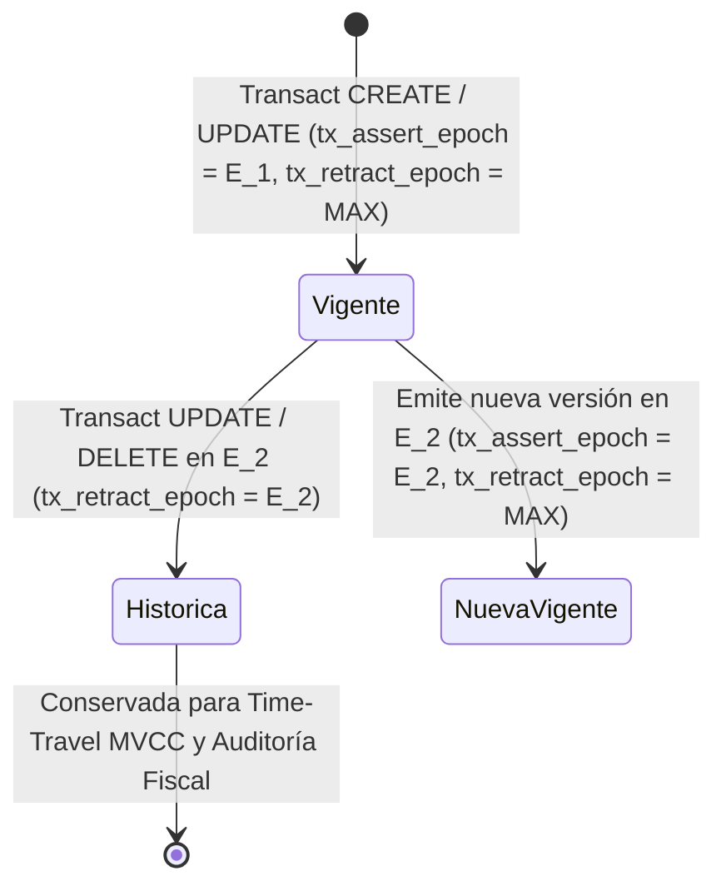

# ADR-002: Modelo de Hechos Inmutables (Datoms EAV) y Aislamiento MVCC en Bloques PAX

- **Estado:** Aceptado y Vigente
- **Fecha:** 2026-10-19
- **Componentes Afectados:** [`src/eav/`](../../../src/eav/mod.rs), [`src/mbf/zones/pax_mvcc.rs`](../../../src/mbf/zones/pax_mvcc.rs), [`src/domain/protocols.rs`](../../../src/domain/protocols.rs)

---

## 1. Contexto y Problema

En sistemas ERP, financieros y regulatorios multi-tenant, el esquema de las entidades evoluciona constantemente (nuevos atributos personalizados, variantes por industria) y las normativas de auditoría exigen:
1. Conocer exactamente qué valor tenía cada atributo de una entidad en cualquier punto histórico del tiempo (*Time-Travel* y *Snapshot Isolation*).
2. Evitar bloqueos de lectura durante las escrituras (*Readers never block writers, writers never block readers*).
3. Soportar atributos dispersos (*sparse attributes*) y evolución de esquemas sin ejecutar migraciones `ALTER TABLE` que reescriban tablas enteras.

Los modelos relacionales tradicionales con actualización destructiva en el lugar (*in-place overwrite*) destruyen el historial previo a menos que se dupliquen tablas de auditoría manuales, y sufren degradación severa cuando distintos tenants utilizan subconjuntos dispersos de atributos.

---

## 2. Decisión

Representar todo el estado del dominio como un flujo de **Datoms inmutables** bajo el modelo lógico **EAVT (Entidad - Atributo - Valor - Transacción/Época - Operación)**, materializado físicamente en **micro-bloques columnares híbridos PAX con control de concurrencia multiversión (MVCC)** dentro de la Zona 1 del archivo `.mbf` ([`src/mbf/zones/pax_mvcc.rs`](../../../src/mbf/zones/pax_mvcc.rs)):

1. **Estructura Lógica del Datom**:
   Cada cambio de estado calculado por [`src/eav/writer/datom_plan.rs`](../../../src/eav/writer/datom_plan.rs) produce tuplas atómicas:
   $$\text{Datom} = \langle \text{entity\_id}, \text{attribute\_base36}, \text{value}, \text{tx\_epoch}, \text{op} \in \{\text{Assert}, \text{Retract}\} \rangle$$
2. **Materialización Física PAX MVCC (`PaxMvccZone`)**:
   En lugar de almacenar tuplas EAV sueltas como filas estrechas (lo que penalizaría las consultas analíticas requeridas de múltiples columnas), `PaxMvccZone` agrupa hasta `4,096` versiones de entidades por micro-bloque utilizando diseño **PAX (Partition Attributes Across)**:
   - Cada versión de fila mantiene dos coordenadas temporales de época de 64 bits (`MvccRowVersion`):
     - `tx_assert_epoch: u64`: Época en la que la versión fue creada.
     - `tx_retract_epoch: u64`: Época en la que la versión fue reemplazada o eliminada (`u64::MAX` mientras continúa activa).
   - Un **bitmap de visibilidad activa de 512 bytes** (`active_visibility_bitmap: [u64; 64]`) permite identificar en un solo ciclo SIMD todas las filas vigentes en la cabeza (`HOT_HEAD`) sin comparar enteros de 64 bits.
3. **Evolución de Esquema en $O(1)$ (`MbfSchemaEvolutionDirectory`)**:
   Cuando se agrega un nuevo atributo en **Codice**, los bloques `.mbf` antiguos no se reescriben; el directorio proyecta `EvolvedColumnProjection::VirtualConstantDefault` en tiempo constante $O(1)$.

---

## 3. Consecuencias

### Positivas
- **Lecturas 100% Libres de Bloqueos (*Wait-Free Reads*)**: Toda consulta `Query`, `Explore` o `ListEntities` se ejecuta fijando una época inmutable $e_{\text{query}}$ y evaluando $\text{tx\_assert\_epoch} \le e_{\text{query}} < \text{tx\_retract\_epoch}$.
- **Auditoría y Viaje en el Tiempo Nativos**: No existe diferencia arquitectónica entre consultar el estado actual ($e_{\text{query}} = \text{max\_tx\_id}$) y auditar el balance exacto de un cliente en una época pasada ($e_{\text{query}} = e_{\text{histórica}}$).
- **Idempotencia por Diseño**: El motor de deltas (`src/eav/delta.rs`) compara el estado vigente en la época actual contra el payload entrante; si un atributo no presenta variación real, no genera una nueva versión ni contamina el historial transaccional.

### Negativas y Mitigaciones
- **Crecimiento de Versiones Históricas ante Mutaciones Frecuentes**: Las actualizaciones repetidas añaden nuevas versiones de fila en lugar de sobrescribir. Se mitiga mediante el bitmap denso de visibilidad de 512 bytes y la compactación ordenada por curva 3D de Hilbert (`hilbert_cluster_key_3d`) que separa las épocas históricas de las filas calientes en `HOT_HEAD`.
