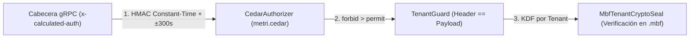

# ADR-003: Seguridad Zero-Trust con Autenticación HMAC-SHA256, Autorización AWS Cedar y Sellado `.mbf`

- **Estado:** Aceptado y Vigente
- **Fecha:** 2026-10-19
- **Componentes Afectados:** [`src/grpc/interceptors.rs`](../../../src/grpc/interceptors.rs), [`src/cedar/`](../../../src/cedar/mod.rs), [`config/policies/metri.cedar`](../../../config/policies/metri.cedar), [`src/infrastructure/tenant_guard.rs`](../../../src/infrastructure/tenant_guard.rs), [`src/mbf/format/mod.rs`](../../../src/mbf/format/mod.rs)

---

## 1. Contexto y Problema

En una arquitectura multi-tenant donde múltiples organizaciones comparten el mismo motor de ejecución serverless y el mismo bucket raíz en Amazon S3, el riesgo más crítico es la **fuga o corrupción cruzada de datos entre tenants (*Cross-Tenant Data Leakage / Tampering*)**.

Confiar únicamente en que el API Gateway o el BFF ya autenticó al usuario (seguridad perimetral tradicional) es insuficiente:
1. Un error de programación en el BFF podría enviar un `tenant_id` en el payload Protobuf distinto al de la sesión del usuario.
2. Un cursor de paginación manipulado por el cliente podría intentar saltar a páginas de otro tenant.
3. Un error de configuración en permisos de almacenamiento podría intentar montar el archivo `.mbf` del Tenant A durante una petición del Tenant B.
4. Codificar reglas complejas de permisos (RBAC + ABAC) mediante condicionales `if/else` dispersos en Rust dificulta las auditorías de seguridad.

---

## 2. Decisión

Implementar una arquitectura **Zero-Trust de Defensa en Profundidad** compuesta por cuatro controles formales y criptográficos obligatorios en cada petición:

1. **Autenticación de Borde por Firma HMAC-SHA256 y Ventana Anti-Replay (`src/grpc/interceptors.rs`)**:
   - Cada llamada gRPC debe incluir `x-tenant-id`, `x-user-id`, `x-user-roles`, `x-auth-timestamp` y `x-calculated-auth`.
   - El motor verifica que el timestamp se encuentre dentro de $\pm 300\text{ segundos}$ respecto al reloj UTC del servidor y valida la firma HMAC-SHA256 en **tiempo constante** usando un `HMAC_SECRET` de al menos 256 bits (`>= 32 bytes`).
   - El arranque es **Fail-Closed**: si `ENVIRONMENT` no es explícitamente local/desarrollo y falta `HMAC_SECRET`, el proceso aborta antes de abrir el puerto TCP.
2. **Autorización Formal con AWS Cedar (`src/cedar/authorizer.rs` y `config/policies/metri.cedar`)**:
   - Se desacopla toda la lógica de control de acceso hacia políticas declarativas evaluadas por el motor formal **`cedar-policy`**.
   - Se aplica la semántica estricta de Cedar donde cualquier política `forbid` prevalece sobre cualquier `permit` (*Default-Deny & Explicit-Forbid Wins*), garantizando matemáticamente que ningún principal fuera del tenant `system` pueda operar sobre un `Resource` cuyo `tenant_id` no coincida con `principal.tenant_id`.
3. **Verificación de Coherencia con `TenantGuard` y Cursores Firmados (`src/infrastructure/`)**:
   - `TenantGuard` valida que el `tenant_id` del mensaje Protobuf coincida con el `tenant_id` autenticado en el token HMAC.
   - Todo cursor de paginación se firma criptográficamente con HMAC-SHA256 vinculando el `tenant_id`.
4. **Sello Criptográfico Físico en cada Archivo `.mbf` (`MbfTenantCryptoSeal`)**:
   - Cada archivo `.mbf` incorpora un sello de 64 bytes firmado con una sub-clave derivada específicamente para su `tenant_id` ($\text{KDF} = \text{HMAC-SHA256}(\text{HMAC\_SECRET}, \texttt{"METRI\_MBF\_V1\_TENANT\_KDF:"} \mathbin{\Vert} \text{tenant\_id})$).

---

## 3. Consecuencias

### Positivas
- **Inmunidad ante Suplantación Cruzada de Archivos `.mbf`**: Incluso si alguien copiara manualmente en S3 el archivo `HOT_HEAD_c0.mbf` del Tenant A dentro de la carpeta del Tenant B, `MbfTenantCryptoSeal::verify` fallará instantáneamente con `MbfCryptoSeal001` porque la clave KDF derivada para el Tenant B no podrá validar el MAC del archivo del Tenant A.
- **Auditabilidad Formal de Políticas**: Las reglas de autorización en `config/policies/metri.cedar` son legibles, verificables de manera estática y probadas unitariamente contra escalaciones de privilegios.
- **Protección de Secretos en Reposo**: Los campos `type: "secret"` se hashean automáticamente con **Argon2id** en el ingreso y nunca se proyectan en lecturas.

### Negativas y Mitigaciones
- **Requisito de Sincronización NTP y Gestión de `HMAC_SECRET`**: El BFF y `metri-engine` deben compartir el mismo `HMAC_SECRET` en AWS Secrets Manager y mantener sus relojes sincronizados dentro de $\pm 5$ minutos. Esto es estándar en entornos AWS Lambda donde el reloj del hipervisor Firecracker está sincronizado por Amazon Time Sync Service.
