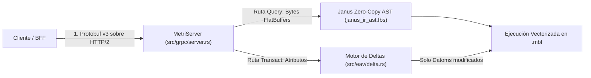

# ADR-004: Contratos Tipados con gRPC (Protobuf v3), AST FlatBuffers (`JanusIR`) y Mutaciones por Deltas

- **Estado:** Aceptado y Vigente
- **Fecha:** 2026-10-19
- **Componentes Afectados:** [`proto/metri.proto`](../../../proto/metri.proto), [`proto/eda.proto`](../../../proto/eda.proto), [`src/janus/janus_ir_ast.fbs`](../../../src/janus/janus_ir_ast.fbs), [`build.rs`](../../../build.rs), [`src/domain/events/delta.rs`](../../../src/domain/events/delta.rs)

---

## 1. Contexto y Problema

En la comunicación de alta frecuencia entre el BFF/clientes de plataforma y el motor de datos `metri-engine`, así como en la representación de árboles de consultas analíticas complejas (**Janus IR**):
1. Las APIs REST/JSON tradicionales sufren de alta sobrecarga de serialización/deserialización textual, ambigüedad numérica (pérdida de precisión en decimales financieros) y carencia de contratos estrictos verificados en compilación.
2. En el camino de lectura analítica (`Query`), deserializar árboles sintácticos abstractos (AST) profundos con múltiples predicados anidados desde JSON o estructuras recursivas alocadas en el heap introduce presión en el asignador de memoria (*heap allocations*) en cada petición.
3. En el camino de escritura (`Transact`), sobrescribir entidades completas sin calcular la diferencia exacta respecto al estado actual genera escrituras innecesarias en S3, eventos duplicados en la cola Outbox y ruido en las pistas de auditoría.

---

## 2. Decisión

Adoptar una estrategia de contratos binarios estrictamente tipados en tres niveles complementarios:

1. **Transporte RPC con HTTP/2 gRPC y Protocol Buffers v3 (`proto/metri.proto` y `proto/eda.proto`)**:
   - Toda comunicación externa se realiza mediante los 4 servicios gRPC compilados con `tonic-build` en [`build.rs`](../../../build.rs): `MetriService`, `MoiraRoutingService`, `QuotaService` y `AgentConfigService`.
   - Se genera y embebe el descriptor binario `metri_descriptor.bin` (`FILE_DESCRIPTOR_SET`) para habilitar **gRPC Server Reflection** (`tonic-reflection`), permitiendo autodescubrimiento por herramientas CLI y pruebas de conformidad (`tests/contract_conformance.rs`).
2. **Representación Intermedia de Consultas en FlatBuffers (`src/janus/janus_ir_ast.fbs`)**:
   - Los árboles de consulta complejos de **Janus** (`QueryPlan`, predicados compuestos `AND`/`OR`, filtros de rango, agregaciones y proyecciones) se definen en el esquema [`src/janus/janus_ir_ast.fbs`](../../../src/janus/janus_ir_ast.fbs) y se compilan en `build.rs` con `flatc v25.12.19`.
   - **Lectura Zero-Copy**: El motor Janus (`src/janus/mod.rs`) inspecciona el buffer de bytes de la consulta directamente mediante offsets relativos sin alojar árboles de objetos intermedios en el heap.
3. **Motor de Mutaciones Basado en Deltas (`src/eav/delta.rs`)**:
   - Antes de persistir una transacción `Transact`, el motor compara los atributos entrantes contra el snapshot MVCC actual de la entidad.
   - Solo los atributos cuyo valor realmente mutó generan pares de datoms (`Retract` del valor anterior + `Assert` del nuevo valor) y entradas en el registro de auditoría.

---

## 3. Consecuencias

### Positivas
- **Cero Alocaciones al Parsear Consultas (`Zero-Copy AST`)**: La validación y lectura de un plan de consulta FlatBuffers toma microsegundos y previene ataques de agotamiento de memoria por árboles JSON patológicos.
- **Ahorro de Ancho de Banda y Almacenamiento en Escrituras Idempotentes**: Si un cliente envía una actualización con 30 campos pero solo 2 cambiaron de valor, `compute_delta` emite únicamente 2 mutaciones en el bloque `.mbf` y en el historial de auditoría.
- **Verificación de Contrato en Compilación**: Cualquier cambio incompatible en `proto/*.proto` o `janus_ir_ast.fbs` es detectado inmediatamente por `cargo build` y `tests/contract_conformance.rs`.

### Negativas y Mitigaciones
- **Dependencia de Herramientas de Build (`protoc` y `flatc 25.12.19`)**: El entorno de compilación requiere tener instalados tanto `protoc` como la versión exacta `25.12.19` de `flatc`. Esto está completamente automatizado y cacheado en los workflows `.github/workflows/rust.yml` y `.github/workflows/deploy.yml`, y documentado en el [Quickstart Local](../../01-inicio/01-quickstart-local.md).
