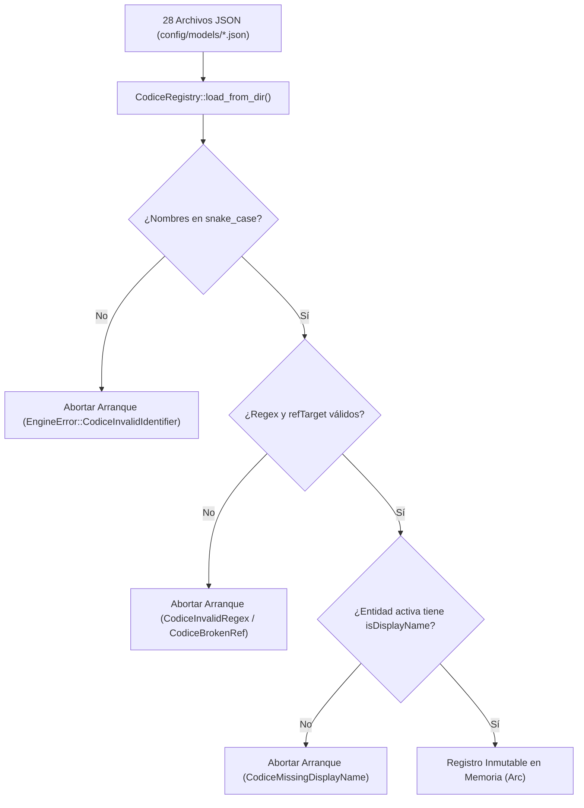

# ADR-005: Registro Declarativo SSOT (`Codice`) y Validación Fail-Closed al Arranque

- **Estado:** Aceptado y Vigente
- **Fecha:** 2026-10-19
- **Componentes Afectados:** [`src/codice/`](../../../src/codice/mod.rs), [`config/models/*.json`](../../../config/models/), [`tests/pm_vocabulary_guard.rs`](../../../tests/pm_vocabulary_guard.rs)

---

## 1. Contexto y Problema

En sistemas empresariales de gran escala (con cerca de un centenar de entidades que abarcan ventas, inventarios, contabilidad, recursos humanos, manufactura e IoT), mantener la definición de cada entidad sincronizada entre:
1. Las tablas o columnas físicas del motor de almacenamiento,
2. Los validadores de negocio del backend (tipos, obligatoriedad, regex, llaves foráneas),
3. Las fórmulas de campos calculados, y
4. Los metadatos de interfaz de usuario (grillas, formularios, tableros Kanban) en el frontend

suele derivar en **deriva de esquemas (*Schema Drift*)**: un campo se agrega en el backend pero no aparece en la UI, o una expresión regular inválida llega a producción y falla recién cuando un usuario intenta guardar un formulario.

---

## 2. Decisión

Establecer el motor **Codice** (`src/codice/`) y los archivos declarativos de [`config/models/*.json`](../../../config/models/) como la **Fuente Única de Verdad (SSOT — Single Source of Truth)** de todos los modelos de datos del motor, bajo una política de **validación exhaustiva en tiempo de arranque (*Fail-Closed Startup*)**:

1. **Carga y Validación Determinista al Iniciar (`CodiceRegistry::load_from_dir`)**:
   Durante el arranque de `bootstrap` (antes de abrir el socket gRPC), `CodiceRegistry` lee y fusiona los 28 archivos JSON de `config/models/` y verifica:
   - Que todos los identificadores de entidades y atributos cumplan estrictamente el formato `snake_case`.
   - Que todas las expresiones regulares (`regex`) compilen sin error en la máquina de estados `regex::Regex`.
   - Que toda entidad activa (`"active": true`) declare al menos un atributo con `"isDisplayName": true`.
   - Que todo atributo de tipo `"ref"` apunte mediante `"refTarget"` a una entidad existente en el registro global.
2. **Codificación Compacta Base36 (`src/codice/base36.rs`)**:
   Cada atributo recibe una representación compacta y determinista en Base36 para indexar los descriptores de columna (`ColumnChunkDescriptor`) dentro del archivo `.mbf` sin repetir nombres largos de cadenas en cada bloque.
3. **Inferencia y Gobernanza de Perfiles de UI (`src/codice/profiles.rs`)**:
   Cada entidad expone a través del RPC `MetriService/Discovery` su `EntityUiProfile` (`MASTER_GRID`, `TRANSACTION_DOCUMENT`, `KANBAN_BOARD`, `TREE_EXPLORER`, `SIMPLE_CATALOG`, `SETTINGS_FORM`), permitiendo que las capas superiores construyan vistas dinámicas sin duplicar esquemas.

---

## 3. Consecuencias

### Positivas
- **Detección Temprana de Errores de Modelado (*Shift-Left*)**: Es imposible desplegar un modelo con una referencia foránea rota, una expresión regular mal formada o sin atributo de visualización, ya que tanto `tests/pm_vocabulary_guard.rs` en CI como el arranque del binario fallan inmediatamente.
- **Lecturas de Metadatos sin Latencia de E/S**: Una vez validado al arranque, `CodiceRegistry` se comparte en memoria mediante `Arc<CodiceRegistry>` entre todos los hilos de Tokio, resolviendo validaciones de esquema y peticiones `Discovery` en nanosegundos.
- **Cero Migraciones DDL Bloqueantes**: Agregar una entidad o atributo consiste en editar el archivo JSON correspondiente en `config/models/`, ejecutar `make docs-gen` y desplegar; el directorio `MbfSchemaEvolutionDirectory` gestiona la compatibilidad hacia atrás con los archivos `.mbf` existentes en $O(1)$.

### Negativas y Mitigaciones
- **Acoplamiento del Ciclo de Vida del Esquema al Despliegue del Artefacto**: Los modelos base viven dentro del paquete de despliegue (`config/models/` -> `dist/lambda/models/`). Dado que el despliegue a AWS Lambda ARM64 mediante GitHub Actions tarda pocos minutos y no tiene tiempo de inactividad (`AutoPublishAlias: live`), versionar los modelos en Git junto con el código garantiza trazabilidad total y rollbacks atómicos.
