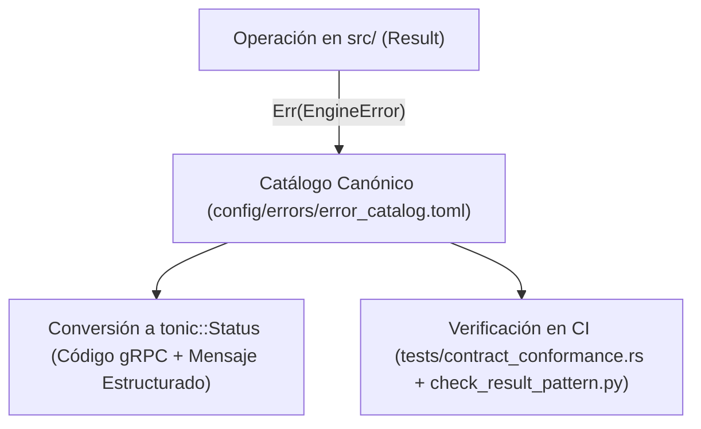

# ADR-006: Catálogo Canónico de Errores (`error_catalog.toml`) y Aplicación Estricta del Patrón `Result`

- **Estado:** Aceptado y Vigente
- **Fecha:** 2026-10-19
- **Componentes Afectados:** [`src/domain/errors.rs`](../../../src/domain/errors.rs), [`config/errors/error_catalog.toml`](../../../config/errors/error_catalog.toml), [`scripts/dev/check_result_pattern.py`](../../../scripts/dev/check_result_pattern.py), [`src/lib.rs`](../../../src/lib.rs)

---

## 1. Contexto y Problema

En servicios de misión crítica escritos en Rust, existen dos riesgos recurrentes en el manejo de errores:
1. **Uso de `.unwrap()`, `.expect()` o `panic!()` en rutas de producción**: Un dato inesperado, una división por cero o un desbordamiento desenrolla la pila (*stack unwind*) o aborta el proceso completo, afectando a todas las peticiones concurrentes en ejecución dentro del mismo contenedor Lambda.
2. **Mensajes de Error Ad-Hoc y Desincronizados**: Cuando cada módulo construye strings de error arbitrarios (`Status::internal("algo falló")`), los clientes (BFF y frontend) no pueden distinguir programáticamente si un fallo es reintentable (ej. conflicto CAS optimista), si se debe a un período contable cerrado o si es una denegación de permisos de Cedar.

---

## 2. Decisión

Establecer un contrato determinista de manejo de errores basado en dos pilares obligatorios:

1. **Prohibición Absoluta de Pánicos en Producción (`Result<T, EngineError>`)**:
   - Activar a nivel de crate en `src/lib.rs` y `src/main.rs`:
     `#![cfg_attr(not(test), deny(clippy::unwrap_used, clippy::expect_used, clippy::panic, clippy::todo, clippy::unimplemented))]`
   - Prohibir bloques `unsafe` en `Cargo.toml` (`unsafe_code = "deny"`).
   - Ejecutar en cada build local y en CI el analizador [`scripts/dev/check_result_pattern.py`](../../../scripts/dev/check_result_pattern.py) con un allowlist congelado en **`0` excepciones** (`scripts/dev/result_pattern_allowlist.json`).
2. **Catálogo Canónico Externo Validado al Arranque (`config/errors/error_catalog.toml`)**:
   - Todos los errores de negocio, seguridad, almacenamiento `.mbf` e infraestructura se modelan como variantes fuertemente tipadas en `EngineError` ([`src/domain/errors.rs`](../../../src/domain/errors.rs)).
   - Cada variante se vincula 1:1 con una entrada en [`config/errors/error_catalog.toml`](../../../config/errors/error_catalog.toml) que define su código público (`code`), código de estado HTTP equivalente (`http_status`), código canónico gRPC (`grpc_status`), categoría (`category`), indicador de reintento (`retryable`) y plantilla de mensaje (`message_template`).
   - Al iniciar el proceso, `init_error_catalog` valida la integridad del archivo TOML antes de aceptar tráfico.

---

## 3. Consecuencias

### Positivas
- **Disponibilidad y Resiliencia Garantizadas por el Compilador**: Ninguna entrada malformada del usuario ni corrupción de red puede causar un `panic!()` en producción; todo fallo retorna limpiamente a través del operador `?` como un `Result::Err`.
- **Semántica de Reintentos Clara para Clientes**: El BFF puede inspeccionar el código canónico (por ejemplo, `MBF-CAS-CONFLICT-001` con `retryable = true` vs. `MBF-FISCAL-CLOSED-001` con `retryable = false`) y tomar decisiones automatizadas sin adivinar mensajes de texto.
- **Documentación Siempre Sincronizada**: El script `scripts/docs/gen_reference.py` genera automáticamente [`docs/05-referencia/codigos-error.md`](../../05-referencia/codigos-error.md) a partir de `error_catalog.toml`.

### Negativas y Mitigaciones
- **Mayor Verbosidad al Agregar Nuevos Tipos de Error**: Introducir una nueva condición de fallo requiere añadir la variante en `src/domain/errors.rs`, registrarla en `config/errors/error_catalog.toml` y ejecutar `make docs-gen`. Este costo marginal es intencional y asegura que ningún error llegue a producción sin catalogación ni documentación.
