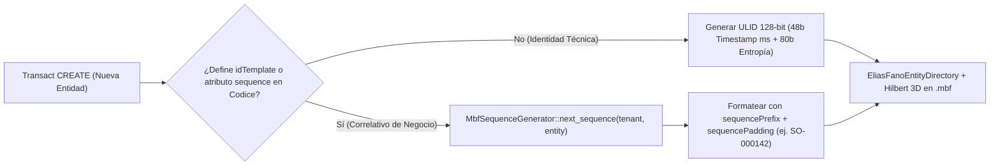

# ADR-007: Identidad de Entidades mediante ULIDs Ordenables, Plantillas de Dominio y Secuencias Atómicas

- **Estado:** Aceptado y Vigente
- **Fecha:** 2026-10-19
- **Componentes Afectados:** [`src/janus_router/ulid.rs`](../../../src/janus_router/ulid.rs), [`src/codice/sequence.rs`](../../../src/codice/sequence.rs), [`src/codice/base36.rs`](../../../src/codice/base36.rs), [`src/mbf/storage.rs`](../../../src/mbf/storage.rs)

---

## 1. Contexto y Problema

En un sistema empresarial distribuido y multi-tenant, los identificadores de entidades y documentos cumplen dos funciones distintas que a menudo entran en conflicto:
1. **Identificadores Técnicos Primarios (`entity_id`, `tx_id`)**: Deben poder generarse sin coordinación centralizada cuello de botella, ser globalmente únicos y, crucialmente, **conservar el orden temporal de creación** para optimizar la localidad espacial en índices columnares (Elias-Fano y curvas de Hilbert en `.mbf`). Los `UUID v4` puramente aleatorios destruyen la localidad de caché y fragmentan los índices por rango.
2. **Correlativos Legibles por Humanos y Fiscales (`order_number`, `invoice_number`, `idTemplate`)**: Los documentos comerciales y contables requieren numeración secuencial monótona por tenant y tipo de entidad (ej. `SO-2026-000142`, `FAC-000089`) donde no se permiten colisiones y donde el formato debe ser gobernado declarativamente desde **Codice**.

---

## 2. Decisión

Adoptar un esquema dual de identidad en [`src/janus_router/ulid.rs`](../../../src/janus_router/ulid.rs), [`src/codice/sequence.rs`](../../../src/codice/sequence.rs) y [`src/codice/base36.rs`](../../../src/codice/base36.rs):

1. **ULID (*Universally Unique Lexicographically Sortable Identifier*) como Identificador Técnico Base**:
   - Toda transacción (`tx_id`) y toda entidad creada sin plantilla explícita recibe un **ULID de 128 bits** codificado en 26 caracteres Crockford's Base32:
     - **Primeros 48 bits (10 caracteres)**: Marca temporal Unix en milisegundos (ordenamiento temporal lexicográfico garantizado).
     - **Últimos 80 bits (16 caracteres)**: Entropía criptográficamente aleatoria monotónica dentro del mismo milisegundo.
   - Si el esquema en Codice define `"idPrefix"` (ej. `"CUS"`), el identificador puede prefijarse semánticamente conservando la ordenabilidad lexicográfica dentro del tipo de entidad.
2. **Generador Atómico de Secuencias (`MbfSequenceGenerator`) y Plantillas Declarativas (`idTemplate` / `sequence`)**:
   - Para atributos con `"type": "sequence"` o entidades con `"idTemplate"` (ej. `"SO-{YYYY}-{SEQ:6}"`), el puerto `SequenceGenerator` implementado por `MbfSequenceGenerator` en el motor `.mbf` mantiene contadores atómicos aislados por `(tenant_id, entity_type, sequence_key)`.
   - Dado que el incremento de una secuencia es una operación algebraica conmutativa, el coordinador transaccional (`MbfWriteCoordinator`) soporta **Auto-Rebase** de secuencias sin pérdida de atomicidad.

---

## 3. Consecuencias

### Positivas
- **Máxima Localidad Espacial en `.mbf`**: Como los ULIDs crecen monótonamente con el tiempo, las entidades creadas en épocas cercanas comparten prefijos binarios idénticos. Esto maximiza la tasa de compresión del directorio **Elias-Fano** (`src/mbf/zones/pax_mvcc.rs`) y del diccionario de símbolos **FSST**.
- **Trazabilidad Temporal Implícita**: Todo `tx_id` y `entity_id` basado en ULID codifica directamente el milisegundo exacto de su creación sin necesidad de consultar un índice adicional.
- **Numeración Comercial Declarativa sin Código Acoplado**: Los analistas de dominio pueden configurar prefijos (`sequencePrefix`) y relleno de ceros (`sequencePadding`) directamente en `config/models/*.json` sin modificar el código Rust del servidor gRPC.

### Negativas y Mitigaciones
- **Coordinación en Secuencias Estrictas de Alta Contención**: A diferencia de los ULIDs que no requieren coordinación, los correlativos secuenciales (`sequence`) actualizan el estado del contador del tenant. Esto se mitiga alojando el estado en memoria del coordinador con persistencia agrupada (*Group Commit*) y rebase automático para operaciones de incremento.
