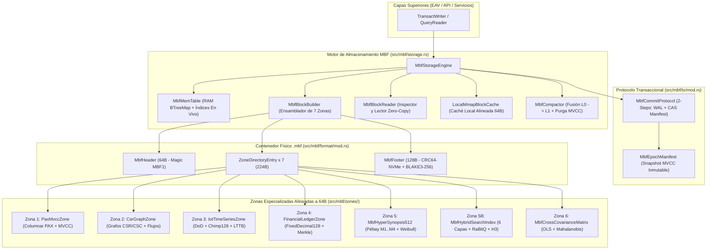
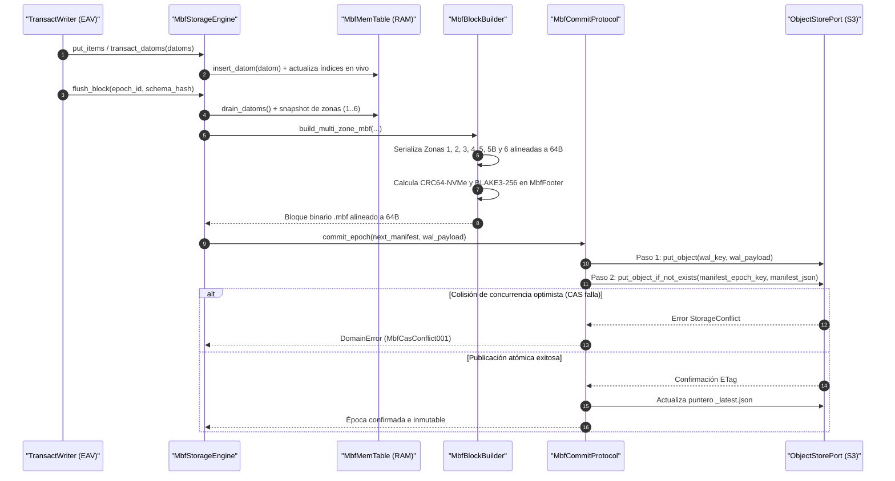

# 01. Motor de Almacenamiento Binario HTAP (`src/mbf/`)

> [!IMPORTANT]
> El módulo `mbf` (*Metri Binary Format*, v1.0) constituye el motor físico de almacenamiento inmutable HTAP (*Hybrid Transactional/Analytical Processing*) de `metri-engine`. Consolida hechos EAV/Datom, columnas analíticas PAX, topología de grafos CSR, telemetría IoT, libro mayor financiero en punto fijo y sinopsis matemáticas en archivos binarios `.mbf` auto-contenidos y alineados a 64 bytes sobre almacenamiento de objetos compatible con S3 (`ObjectStorePort`) y caché local proyectada por memoria (`mmap`).

---

## 1. Propósito y Responsabilidad

### Qué hace el componente
- **Formato físico unificado y alineado a caché (`64 bytes`)**: Define la especificación binaria `.mbf` (`MBF1\x00\x01\x00\x00`) con superbloque de cabecera (`MbfHeader`, 64 bytes), directorio de hasta 7 zonas especializadas (`ZoneDirectoryEntry`, 32 bytes por entrada) y pie de página criptográfico (`MbfFooter`, 128 bytes) sellado con **CRC64-NVMe** y **BLAKE3-256**.
- **Almacenamiento híbrido por niveles (*Tiered Storage*)**: Orquesta un `MemTable` transaccional en RAM, un protocolo de confirmación atómica de registro de escritura anticipada (**WAL**) más manifiesto condicionante (**CAS** / `PutObject If-None-Match: *`) sobre S3 (`MbfCommitProtocol`), caché local de lectura de copia cero (`LocalMmapBlockCache`) y compactación determinista en segundo plano (`MbfCompactor`).
- **Siete zonas físicas especializadas (Zonas 1 a 6 + 5B)**:
  - **Zona 1 (`pax_mvcc`)**: Vectores columnares PAX (*Partition Attributes Across*) con bitmaps de validez, diccionarios FSST/Zstd y vectores bitemporales MVCC (`tx_created`, `tx_retracted`, `valid_from`, `valid_until`).
  - **Zona 2 (`csr_graph`)**: Grafos comprimidos por filas dispersas (**CSR** directo y **CSC** transpuesto) con recorrido BFS acelerado por bitmaps, detección de ciclos de Tarjan, camino mínimo de Dijkstra, flujo máximo de Dinic y centralidad PageRank/Betweenness.
  - **Zona 3 (`iot_timeseries`)**: Bloques de series temporales IoT con compresión **Delta-of-Delta** (ZigZag + Varint) para marcas de tiempo, **XOR Chimp128** para valores IEEE 754, diezmado visual **LTTB** (*Largest-Triangle-Three-Buckets*) y uniones **ASOF** en $O(\log N)$.
  - **Zona 4 (`financial_ledger`)**: Contabilidad de partida doble exacta al centavo/punto básico mediante punto fijo de 128 bits (`FixedDecimal128`), redondeo bancario IEEE 754-2008, prorrateo de Hamilton, árboles de Fenwick (`FenwickPrefixSum128`), valoración de lotes (`FIFO`, `LIFO`, `WAC`, `FEFO`), bloqueo fiscal (`fiscal_lock_epoch_ms`) y cadena de auditoría Merkle **SHA-256**.
  - **Zona 5 (`bi_synopses` y `fuzzy_math_catalog`)**: Hipersinopsis matemática de 512 bytes (`MbfHyperSynopsis512`, 8 líneas de caché CPU) con momentos paralelos de Pébay hasta cuarto orden ($M_1 \dots M_4$), confiabilidad industrial de Weibull con censura por la derecha, econometría (ACF, Durbin-Watson, CUSUM, deriva OLS), análisis espectral FFT/Goertzel, cuantiles KLL (`CompactKllSketch`), filtros `Xor8Filter`, bitmaps comprimidos `RoaringBitmap32`, cadenas de Markov (`DiscreteMarkovChain`), auditoría antifraude de Benford y conversión dimensional SI (`DimensionalUnitRegistry`).
  - **Zona 5B (`hybrid_search`)**: Índice multimodal de búsqueda híbrida de 6 capas (léxico FST, diccionario de borrados simétricos **SymSpell** $O(1)$, autómata Damerau-Levenshtein $k \le 2$, N-gramas, fonética bilingüe Romance + Double Metaphone, tesauro declarativo `SynonymThesaurus`, vectores cuantizados de 1 bit **RaBitQ** con grafo `HnswFlatGraph` y celdas espaciales jerárquicas **H3 / Morton Z-Order** con agrupamiento DBSCAN).
  - **Zona 6 (`cross_covariance`)**: Matriz simétrica de co-momentos cruzados multivariados (`MbfCrossCovarianceMatrix`) fusionable en $O(M^2)$ mediante recurrencia de Pébay, correlación de Pearson y Spearman (identidad de Kruskal), regresión múltiple OLS con eliminación gaussiana y distancia de **Mahalanobis**.

### Qué NO hace el componente
- **No interpreta esquemas de negocio ni reglas declarativas del Códice**: La validación semántica de entidades, máquinas de estados finitos (FSM) y fórmulas CEL pertenece a `src/codice/` y `src/eav/writer/`.
- **No evalúa políticas de autorización ni autenticación**: El control de acceso ABAC/RBAC mediante Cedar y verificación criptográfica HMAC reside en `src/security/`.
- **No expone transporte de red directo**: La serialización hacia clientes externos (gRPC, FlatBuffers, deltas binarios) es responsabilidad de `src/api/`.

---

## 2. Arquitectura Interna

El subsistema `mbf` se estructura en cuatro capas cohesivas: el contrato de formato de contenedor (`format`), el gestor de transacciones y manifiestos (`tx`), el motor de almacenamiento y persistencia (`storage`) y el catálogo de zonas especializadas (`zones`).



---

## 3. Estructuras y Traits Públicos Principales

### Contenedor y Geometría de 64 Bytes (`src/mbf/format/mod.rs`)

```rust
pub const MBF_MAGIC: [u8; 8] = *b"MBF1\x00\x01\x00\x00";
pub const MBF_ALIGNMENT: usize = 64;

#[repr(u8)]
pub enum MbfZoneId {
    Zone1PaxMvcc = 1,
    Zone2CsrGraph = 2,
    Zone3IotTimeSeries = 3,
    Zone4FinancialLedger = 4,
    Zone5BiSynopses = 5,
    Zone5bHybridSearch = 6,
    Zone6CrossCovariance = 7,
}

#[repr(C, align(64))]
pub struct MbfHeader {
    pub magic: [u8; 8],
    pub schema_hash: u64,
    pub epoch_id: u64,
    pub min_tx_id: u64,
    pub max_tx_id: u64,
    pub row_count: u32,
    pub zone_count: u16,
    pub flags: u16,
    pub tenant_hash: u64,
    pub reserved: u64,
}

#[repr(C, align(64))]
pub struct MbfFooter {
    pub zone_dir_offset: u64,
    pub zone_dir_size: u64,
    pub total_file_size: u64,
    pub crc64_nvme: u64,
    pub blake3_hash: [u8; 32],
    pub signature_ed25519: [u8; 64],
}
```

### Motor de Almacenamiento y Transacciones (`src/mbf/storage.rs` y `src/mbf/tx/mod.rs`)

```rust
pub struct MbfStorageEngine {
    object_store: Arc<dyn ObjectStorePort>,
    tenant_id: String,
    active_epoch: RwLock<MbfEpochManifest>,
    memtable: RwLock<MbfMemTable>,
    block_cache: RwLock<HashMap<String, Vec<Datom>>>,
    mmap_cache: Option<Arc<LocalMmapBlockCache>>,
}

pub struct MbfCommitProtocol<S: ObjectStorePort> {
    store: S,
}
```

### Zonas Analíticas, Financieras y Multimodales (`src/mbf/zones/`)

```rust
#[repr(transparent)]
pub struct FixedDecimal128(pub i128);

#[repr(C, align(64))]
pub struct MbfHyperSynopsis512 {
    pub valid_count: u64,
    pub null_count: u64,
    pub sum_exact_i128: i128,
    pub pebay_mean_m1: f64,
    pub pebay_m2: f64,
    pub pebay_m3: f64,
    pub pebay_m4: f64,
    // ... 8 líneas de caché CPU (512 bytes exactos)
}
```

---

## 4. Catálogo Exhaustivo de Archivos Fuente (1:1)

La siguiente tabla documenta el 100% de los **14 archivos fuente** que integran `src/mbf/`:

| Archivo | Propósito | Ítems Públicos Clave |
| :--- | :--- | :--- |
| [`src/mbf/mod.rs`](../../src/mbf/mod.rs) | Punto de entrada del módulo `mbf`; declara los submódulos `backup`, `format`, `storage`, `tx` y `zones`, y reexporta el motor principal. | `MbfStorageEngine`, `MbfBackupManager`, `backup`, `format`, `storage`, `tx`, `zones` |
| [`src/mbf/backup.rs`](../../src/mbf/backup.rs) | Gestor de copias de seguridad inmutables, verificación forense de integridad y restauración granular por tenant o de partición completa. | `MbfBackupManager`, `MbfBackupMetadata`, `MbfIntegrityReport` |
| [`src/mbf/format/mod.rs`](../../src/mbf/format/mod.rs) | Especificación binaria `.mbf` v1.0 alineada a 64 bytes, sumas de verificación CRC64-NVMe y BLAKE3-256, y utilidades de serialización binaria. | `MBF_MAGIC`, `MBF_ALIGNMENT`, `MbfZoneId`, `MbfHeader`, `ZoneDirectoryEntry`, `MbfFooter`, `crc64_nvme`, `blake3_hash_256`, `pad_to_64` |
| [`src/mbf/tx/mod.rs`](../../src/mbf/tx/mod.rs) | Protocolo transaccional ACID de 2 pasos sobre almacenamiento de objetos (`WAL` + `CAS Manifest`), manifiestos de época y instantáneas MVCC. | `MbfBlockDescriptor`, `MbfEpochManifest`, `MvccSnapshot`, `MbfCommitProtocol` |
| [`src/mbf/storage.rs`](../../src/mbf/storage.rs) | Motor HTAP completo: `MemTable` en RAM, ensamblador y lector de bloques de 7 zonas, caché local `mmap`, compactador L0->L1 y adaptador `KvStorePort`. | `MbfMemTable`, `MbfBlockBuilder`, `MbfBlockReader`, `MbfBlockInspection`, `LocalMmapBlockCache`, `MbfCompactor`, `MbfCompactionReport`, `MbfStorageEngine` |
| [`src/mbf/zones/mod.rs`](../../src/mbf/zones/mod.rs) | Módulo raíz y fachada de las 7 zonas físicas especializadas del contenedor `.mbf`. | `pax_mvcc`, `csr_graph`, `iot_timeseries`, `financial_ledger`, `bi_synopses`, `fuzzy_math_catalog`, `hybrid_search`, `cross_covariance` |
| [`src/mbf/zones/pax_mvcc.rs`](../../src/mbf/zones/pax_mvcc.rs) | Zona 1: almacenamiento columnar PAX con vectores de visibilidad bitemporal MVCC, bitmaps de nulos y compresión de diccionarios FSST/Zstd. | `MvccVisibilityVectors`, `FsstDictionary`, `PaxColumnBuffer`, `PaxMvccZone`, `MBF_ZONE1_MAGIC` |
| [`src/mbf/zones/csr_graph.rs`](../../src/mbf/zones/csr_graph.rs) | Zona 2: adyacencia bidireccional de grafos CSR/CSC de copia cero y algoritmos de grafos (BFS, Tarjan, Dijkstra, Dinic, PageRank, Betweenness). | `CsrGraphZone`, `MBF_ZONE2_MAGIC` |
| [`src/mbf/zones/iot_timeseries.rs`](../../src/mbf/zones/iot_timeseries.rs) | Zona 3: compresión de series temporales IoT mediante Delta-of-Delta (marcas de tiempo) y XOR Chimp128 (valores `f64`), diezmado LTTB y unión ASOF. | `IotSeriesDescriptor`, `IotTimeSeriesZone`, `MBF_ZONE3_MAGIC` |
| [`src/mbf/zones/financial_ledger.rs`](../../src/mbf/zones/financial_ledger.rs) | Zona 4: contabilidad de partida doble en punto fijo `FixedDecimal128`, redondeo bancario, prorrateo de Hamilton, Fenwick Tree, lotes (`FIFO`/`LIFO`/`WAC`/`FEFO`) y cadena Merkle SHA-256. | `FixedDecimal128`, `FenwickPrefixSum128`, `ValuationMethod`, `ActiveBatchLayer`, `FinancialBlockCheckpoint`, `LedgerAuditHeader`, `FinancialLedgerZone` |
| [`src/mbf/zones/bi_synopses.rs`](../../src/mbf/zones/bi_synopses.rs) | Zona 5: hipersinopsis matemática `MbfHyperSynopsis512` (8 líneas de caché CPU), sinopsis de bloque `NumericBlockSynopsis`, cuantiles `CompactKllSketch`, `Xor8Filter` y `RoaringBitmap32`. | `MbfHyperSynopsis512`, `NumericBlockSynopsis`, `CompactKllSketch`, `Xor8Filter`, `RoaringBitmap32`, `MBF_ZONE5_MAGIC` |
| [`src/mbf/zones/fuzzy_math_catalog.rs`](../../src/mbf/zones/fuzzy_math_catalog.rs) | Extensión analítica de Zona 5: catálogo de 35+ fórmulas en $O(1)$, cadenas de Markov discretas, KPIs actuariales de renovación, ley de Benford y registro dimensional SI. | `DiscreteMarkovChain`, `SurvivalRenewalKpis`, `AffineTransform`, `DimensionalUnitRegistry` |
| [`src/mbf/zones/hybrid_search.rs`](../../src/mbf/zones/hybrid_search.rs) | Zona 5B: motor de búsqueda híbrida multimodal de 6 capas (BM25F, SymSpell, Levenshtein DFA, fonética Romance/Metaphone, vectores `RaBitQ`/HNSW y geoespacial H3/DBSCAN). | `MbfHybridSearchIndex`, `IndexedEntityDocument`, `HybridSearchHit`, `SynonymThesaurus`, `RaBitQVector`, `LevenshteinAutomatonDfa`, `HnswFlatGraph`, `MBF_ZONE5B_MAGIC` |
| [`src/mbf/zones/cross_covariance.rs`](../../src/mbf/zones/cross_covariance.rs) | Zona 6: matriz de co-momentos cruzados multivariados, correlación de Pearson/Spearman en $O(1)$, regresión OLS por eliminación gaussiana y distancia de Mahalanobis. | `MbfCrossCovarianceMatrix`, `OlsRegressionResult`, `MBF_ZONE6_MAGIC` |

---

## 5. Flujo de Ejecución Paso a Paso

### Escritura Transaccional, Volcado de Bloque `.mbf` y Publicación CAS



---

## 6. Invariantes, Seguridad y Manejo de Errores

### Invariantes Físicos, Criptográficos y Matemáticos
1. **Alineación estricta a 64 bytes (`MBF_ALIGNMENT = 64`)**: Todo archivo `.mbf`, su cabecera `MbfHeader` (64B), el comienzo de cada zona física y su pie de página `MbfFooter` (128B) son múltiplos exactos de 64 bytes para permitir proyección `mmap` y carga directa en registros SIMD (`AVX-512` / `NEON`) mediante `bytemuck::Pod`.
2. **Doble sello de integridad de bloque**: Ningún bloque `.mbf` puede ser leído por `MbfBlockReader::parse_and_verify` sin superar primero la verificación del polinomio **CRC64-NVMe** (`0xAD93D23594C93659`) y del resumen criptográfico **BLAKE3-256** sobre la totalidad del archivo excepto los últimos 128 bytes.
3. **Exactitud contable y bloqueo fiscal en Zona 4**:
   - Prohibición absoluta de punto flotante IEEE 754 para saldos monetarios; toda operación emplea `FixedDecimal128` con redondeo bancario (*Round Half-to-Even*) y prorrateo de Hamilton ($\sum c_i \equiv \text{total}$).
   - Todo asiento debe satisfacer $\sum \text{Débitos} == \sum \text{Créditos}$ antes de encadenarse al resumen `merkle_chain_tip` (SHA-256).
   - Ningún movimiento con `tx_epoch_ms <= fiscal_lock_epoch_ms` es admitido.

### Códigos de Error Canónicos (`ErrorCode`)
- `ErrorCode::MbfCorrupt001`: Violación de bytes mágicos (`MBF1`, `MBFZ1PAX`, `MBFZ2CSR`, `MBFZ3IOT`, `MBFZ4FIN`, `MBFZ5SYN`, `MBFZ5BHS`, `MBFZ6COV`), truncamiento de búfer, desalineación de 64 bytes o discrepancia de suma de verificación CRC64-NVMe / BLAKE3-256.
- `ErrorCode::MbfCasConflict001`: Colisión de concurrencia optimista al intentar publicar un manifiesto de época (`If-None-Match: *`) que ya fue reclamado por otro escritor.
- `ErrorCode::MbfLedgerUnbalanced001`: Asiento contable descuadrado ($\sum \text{Débitos} \neq \sum \text{Créditos}$), desbordamiento aritmético en `FixedDecimal128`, división por cero, falta de tasa de cambio o inventario insuficiente.
- `ErrorCode::MbfFiscalClosed001`: Intento de registrar asientos o movimientos de inventario en un período fiscal cerrado (`tx_epoch_ms <= fiscal_lock_epoch_ms`).

---

## 7. Configuración y Variables de Entorno

El comportamiento del motor MBF se configura a través de `AppConfig` (`src/config.rs`) y de los constructores de `MbfStorageEngine`:

| Variable / Parámetro | Valor por Defecto | Descripción |
| :--- | :--- | :--- |
| `STORAGE_BACKEND` | `"mbf"` | Selecciona el motor binario HTAP MBF como implementación activa de `KvStorePort` y `ObjectStorePort`. |
| `S3_BUCKET_NAME` | `"metri-engine-mbf"` | Bucket S3 donde se persisten los bloques `.mbf`, archivos WAL (`wal/`) y manifiestos de época (`manifests/`). |
| `MBF_MMAP_CACHE_DIR` | Opcional (`PathBuf`) | Directorio local en disco/NVMe gestionado por `LocalMmapBlockCache` para proyectar bloques `.mbf` en memoria virtual con alineación de 64 bytes. |
| `MBF_FISCAL_LOCK_EPOCH_MS` | `0` | Marca de tiempo (ms epoch UTC) de cierre fiscal inicial para la Zona 4 (`FinancialLedgerZone`). |

---

## 8. Relación con ADRs y otros Componentes

- **[ADR-001: Motor HTAP Binario MBF sobre S3](../03-arquitectura/adr/ADR-001-motor-htap-binario-mbf-sobre-s3.md)**: Define la decisión arquitectónica central de adoptar el formato `.mbf` de 7 zonas sobre S3 + `mmap` local en reemplazo de motores NoSQL tradicionales.
- **[ADR-002: Modelo de Datoms Inmutables y MVCC](../03-arquitectura/adr/ADR-002-modelo-datoms-inmutables-y-mvcc.md)**: Rige los vectores de visibilidad bitemporal (`MvccVisibilityVectors` en Zona 1) y las instantáneas `MvccSnapshot` de lectura consistente sin bloqueos.
- **[ADR-005: Registro SSOT del Códice y Validación de Arranque](../03-arquitectura/adr/ADR-005-registro-ssot-codice-y-validacion-arranque.md)**: Vincula `schema_hash` de `MbfHeader` y los perfiles `FuzzySearchProfile` / `SynonymThesaurus` con la definición declarativa del Códice.
- **[ADR-006: Catálogo Canónico de Errores y Patrón Result](../03-arquitectura/adr/ADR-006-catalogo-canonico-errores-y-patron-result.md)**: Estandariza los códigos `MbfCorrupt001`, `MbfCasConflict001`, `MbfLedgerUnbalanced001` y `MbfFiscalClosed001`.
- **Relación con [`02-eav.md`](./02-eav.md)**: El subsistema `src/eav/` actúa como capa lógica de lectura/escritura de Datoms, apoyándose en `MbfStorageEngine` (a través de `KvStorePort` y de las llamadas directas a las Zonas 1–6) para persistencia transaccional y consultas analíticas.

---

## 9. Pruebas y Verificación

Cada archivo del módulo `src/mbf/` incorpora pruebas unitarias y de propiedad exhaustivas (`#[cfg(test)] mod tests`):

- **`src/mbf/format/mod.rs`**: Verifica que `size_of::<MbfHeader>() == 64`, `size_of::<ZoneDirectoryEntry>() == 32`, `size_of::<MbfFooter>() == 128`, alineación a 64 bytes y determinismo de `crc64_nvme` y `blake3_hash_256`.
- **`src/mbf/tx/mod.rs`**: Valida la publicación atómica en dos pasos (`WAL` + `CAS Manifest`), la detección de conflictos concurrentes (`MbfCasConflict001`) y las reglas de visibilidad `MvccSnapshot::is_visible`.
- **`src/mbf/storage.rs`**: Prueba el ciclo completo HTAP: inserción en `MbfMemTable`, volcado de bloques `.mbf` con las 7 zonas activas, lectura e inspección `MbfBlockReader`, corrupción inducida de 1 bit detectada por CRC64/BLAKE3, caché `LocalMmapBlockCache` y compactación `MbfCompactor::compact_blocks` con recolección de basura MVCC.
- **`src/mbf/zones/*`**:
  - `pax_mvcc.rs`: Visibilidad MVCC bitemporal, compresión FSST y viaje de ida y vuelta binario (`MBFZ1PAX`).
  - `csr_graph.rs`: BFS, detección de ciclos de Tarjan, camino mínimo de Dijkstra, flujo máximo de Dinic, PageRank y centralidad de intermediación (`MBFZ2CSR`).
  - `iot_timeseries.rs`: Compresión sin pérdida Delta-of-Delta + Chimp128, diezmado visual LTTB y unión ASOF (`MBFZ3IOT`).
  - `financial_ledger.rs`: Redondeo bancario, prorrateo exacto de Hamilton, valoración `FIFO`/`LIFO`/`FEFO`/`WAC`, bloqueo fiscal (`MbfFiscalClosed001`) y cadena Merkle SHA-256 (`MBFZ4FIN`).
  - `bi_synopses.rs` y `fuzzy_math_catalog.rs`: Fusión paralela de Pébay de cuarto orden ($M_1 \dots M_4$), MLE de Weibull con censura, FFT/Goertzel, KLL, `Xor8Filter`, `RoaringBitmap32`, cadenas de Markov, ley de Benford y conversión de unidades SI (`MBFZ5SYN`).
  - `hybrid_search.rs`: Búsqueda híbrida tolerante a errores fonéticos/tipográficos severos, similitud vectorial `RaBitQ` y geocercas H3/DBSCAN (`MBFZ5BHS`).
  - `cross_covariance.rs`: Fusión paralela de co-momentos, correlación de Pearson/Spearman, regresión OLS y distancia de Mahalanobis (`MBFZ6COV`).
