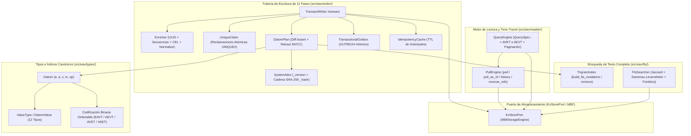
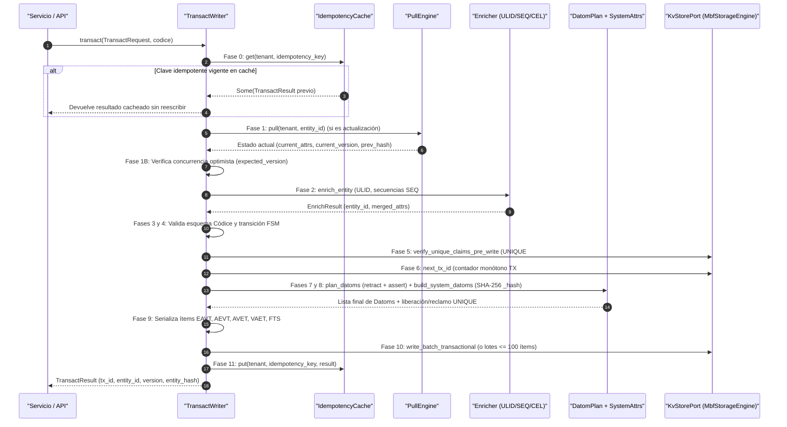

# 02. Motor Semántico EAV, Datoms Inmutables y Búsqueda FTS (`src/eav/`)

> [!IMPORTANT]
> El módulo `eav` (*Entity-Attribute-Value*) implementa el modelo semántico de hechos inmutables (**Datoms**) y concurrencia multiversión (**MVCC**) de `metri-engine`. Orquesta la tubería completa de escritura transaccional de 11 fases (`TransactWriter`), el motor de lectura reactiva y viajes en el tiempo (`PullEngine` y `QueryEngine`) y el buscador de texto completo tolerante a errores (`FtsSearcher` y `TrigramIndex`) sobre los cuatro índices lógicos canónicos (`EAVT`, `AEVT`, `AVET`, `VAET`).

---

## 1. Propósito y Responsabilidad

### Qué hace el componente
- **Modelo de datos basado en Datoms inmutables (`src/eav/types/`)**:
  - Representa cada hecho atómico mediante la quíntupla `Datom = (entity_id, attr_id, value, tx_id, op)`, donde `op = true` afirma (*assert*) un valor y `op = false` lo retracta (*retract*) sin sobrescribir jamás la historia previa.
  - Define los 12 tipos primitivos de valor en `ValueType` y `DatomValue` (`Null`, `Boolean`, `Long`, `Double`, `String`, `Uuid`, `Reference`, `Array`, `Bytes`, `BigInt`, `Instant`, `Geo`), junto con su codificación binaria determinista que preserva el orden lexicográfico en `AVET` (incluyendo inversión de bits IEEE 754 para `Double`).
  - Proyecta cada Datom en hasta 4 índices complementarios:
    - **`EAVT`** (`Entity -> Attribute -> Value -> Tx`): Reconstrucción completa de una entidad (`Pull`).
    - **`AEVT`** (`Attribute -> Entity -> Value -> Tx`): Escaneo analítico columnar por atributo.
    - **`AVET`** (`Attribute -> Value -> Entity -> Tx`): Búsqueda exacta y por rango sobre atributos con `indexed: true` o `unique: true`.
    - **`VAET`** (`Value -> Attribute -> Entity -> Tx`): Grafo inverso automático para atributos de tipo `Reference`.
- **Tubería de escritura transaccional de 11 fases (`src/eav/writer/`)**:
  - Ejecuta la validación contra el Códice, enriquecimiento automático de entidades (`enrich_entity`: ULID, secuencias monótonas, valores por defecto, `normalize` y expresiones calculadas CEL), evaluación de máquinas de estados finitos (`FSM`), reclamación atómica de unicidad (`UniqueClaim`), generación de diferenciales (`DatomPlan`), inyección de atributos de sistema (`_txInstant`, `_createdAt`, `_updatedAt`, `_version`, `_prevHash`, `_hash` en cadena SHA-256), actualización de índices FTS de trigramas, encolado de eventos `TransactionalOutbox` y confirmación atómica con caché de idempotencia (`IdempotencyCache`).
- **Motor de lectura Pull, Query y Time-Travel (`src/eav/reader/`)**:
  - Reconstruye el estado actual de cualquier entidad (`pull`), su estado exacto en cualquier corte histórico por transacción (`pull_as_of(entity_id, max_tx_id)`) o marca de tiempo (`pull_as_of_time(entity_id, timestamp_ms)`), y el historial completo de auditoría (`history`).
  - Resuelve enlaces inversos de grafos (`pull_reverse_refs` sobre `VAET`) y ejecuta consultas declarativas `QuerySpec` con selección automática del índice óptimo (`AVET` vs `AEVT`), filtros tipados (`Eq`, `Ne`, `Gt`, `Gte`, `Lt`, `Lte`, `StartsWith`, `Contains`), ordenamiento y paginación por cursor.
- **Búsqueda de texto completo por trigramas y fonética (`src/eav/fts/`)**:
  - Tokeniza y extrae trigramas de caracteres con relleno de frontera (`$$` y `$`), persiste listas de publicación invertidas (`FTS#<tenant>#<attr>#<trigram>`) y clasifica candidatos combinando similitud de Jaccard de trigramas, distancia de edición Damerau-Levenshtein, fonética romance y fusión híbrida con la Zona 5B de MBF.

### Qué NO hace el componente
- **No gestiona el formato físico de bloques `.mbf` ni llamadas directas a S3**: Delega toda lectura/escritura de clave-valor en el trait `KvStorePort` (implementado por `MbfStorageEngine` en `src/mbf/storage.rs`).
- **No define esquemas de dominio estáticos**: Todas las reglas de tipos, cardinalidad, obligatoriedad, unicidad, transiciones FSM y expresiones calculadas provienen dinámicamente de `Codice` (`src/codice/`).
- **No autentica solicitudes HTTP/gRPC**: Asume que el `TenantId` y el `tx_author` ya fueron autenticados y autorizados por la capa `src/security/`.

---

## 2. Arquitectura Interna



---

## 3. Estructuras y Traits Públicos Principales

### Tipos Fundamentales (`src/eav/types/`)

```rust
#[repr(u8)]
pub enum ValueType {
    Null = 0x00,
    Boolean = 0x01,
    Long = 0x02,
    Double = 0x03,
    String = 0x04,
    Uuid = 0x05,
    Reference = 0x06,
    Array = 0x07,
    Bytes = 0x08,
    BigInt = 0x09,
    Instant = 0x0A,
    Geo = 0x0B,
}

pub struct Datom {
    pub e: u64,
    pub a: u32,
    pub v: DatomValue,
    pub tx: u64,
    pub op: bool,
}
```

### Escritura Transaccional (`src/eav/writer/transact.rs`)

```rust
pub struct TransactRequest {
    pub tenant_id: TenantId,
    pub entity_type: String,
    pub entity_id: Option<String>,
    pub attrs: HashMap<String, DatomValue>,
    pub tx_author: Option<String>,
    pub idempotency_key: Option<String>,
    pub expected_version: Option<i64>,
    pub valid_from: Option<i64>,
    pub valid_until: Option<i64>,
}

pub struct TransactResult {
    pub tx_id: u64,
    pub entity_id: String,
    pub version: i64,
    pub datoms: usize,
    pub tx_instant: i64,
    pub entity_hash: String,
}
```

### Lectura Reactiva y Consultas (`src/eav/reader/pull.rs` y `src/eav/reader/query.rs`)

```rust
pub struct PullResult {
    pub entity_id: String,
    pub attrs: HashMap<String, DatomValue>,
    pub tx_id: u64,
    pub version: i64,
}

pub struct QuerySpec {
    pub entity_type: String,
    pub filters: Vec<AttrFilter>,
    pub limit: usize,
    pub cursor: Option<String>,
    pub order_by: Option<OrderSpec>,
}
```

---

## 4. Catálogo Exhaustivo de Archivos Fuente (1:1)

La siguiente tabla documenta el 100% de los **21 archivos fuente** que integran `src/eav/`:

| Archivo | Propósito | Ítems Públicos Clave |
| :--- | :--- | :--- |
| [`src/eav/mod.rs`](../../src/eav/mod.rs) | Módulo raíz del subsistema EAV; expone los submódulos `fts`, `reader`, `types` y `writer` y reexporta los tipos principales. | `Datom`, `DatomValue`, `ValueType`, `PullEngine`, `PullResult`, `QueryEngine`, `QuerySpec`, `TransactWriter`, `TransactRequest`, `TransactResult`, `FtsSearcher`, `TrigramIndex` |
| [`src/eav/types/mod.rs`](../../src/eav/types/mod.rs) | Fachada de tipos primitivos EAV y funciones de codificación binaria de los 4 índices. | `Datom`, `DatomValue`, `ValueType`, `eavt_pk`, `aevt_pk`, `avet_pk`, `vaet_pk`, `encode_value`, `decode_value` |
| [`src/eav/types/value_type.rs`](../../src/eav/types/value_type.rs) | Enumeración discriminante de 1 byte (`ValueType`) para los 12 tipos de valor del motor y su conversión desde tipos declarativos del Códice. | `ValueType` (`Null`, `Boolean`, `Long`, `Double`, `String`, `Uuid`, `Reference`, `Array`, `Bytes`, `BigInt`, `Instant`, `Geo`) |
| [`src/eav/types/datom.rs`](../../src/eav/types/datom.rs) | Definición de la tupla inmutable `Datom`, el contenedor tipado `DatomValue` y constructores `assert` / `retract`. | `Datom`, `DatomValue` |
| [`src/eav/types/encoding.rs`](../../src/eav/types/encoding.rs) | Codificación binaria big-endian y lexicográfica para claves de partición/ordenamiento de `EAVT`, `AEVT`, `AVET` y `VAET`, y mapeo `fnv1a_u64`. | `eavt_pk`, `eavt_sk`, `aevt_pk`, `aevt_sk`, `avet_pk`, `avet_sk`, `vaet_pk`, `vaet_sk`, `encode_value`, `decode_value`, `entity_str_to_u64`, `fnv1a_u64` |
| [`src/eav/reader/mod.rs`](../../src/eav/reader/mod.rs) | Módulo raíz de lectura EAV; reexporta `PullEngine` y `QueryEngine`. | `PullEngine`, `PullResult`, `HistoryEntry`, `QueryEngine`, `QuerySpec`, `QueryPage`, `AttrFilter`, `FilterOp`, `OrderSpec` |
| [`src/eav/reader/pull.rs`](../../src/eav/reader/pull.rs) | Reconstrucción de estado de entidades (`pull`), viajes en el tiempo por `tx_id` o `timestamp_ms`, historial de auditoría y referencias inversas `VAET`. | `PullEngine`, `PullResult`, `HistoryEntry` |
| [`src/eav/reader/query.rs`](../../src/eav/reader/query.rs) | Motor de consultas filtradas sobre `AVET` (atributos indexados) y `AEVT` (escaneo por atributo), con filtros relacionales, ordenamiento y paginación. | `QueryEngine`, `QuerySpec`, `QueryPage`, `AttrFilter`, `FilterOp`, `OrderSpec` |
| [`src/eav/writer/mod.rs`](../../src/eav/writer/mod.rs) | Módulo raíz de escritura transaccional EAV; reexporta la tubería de 11 fases y utilidades de caché/outbox. | `TransactWriter`, `TransactRequest`, `TransactResult`, `IdempotencyCache`, `TransactionalOutbox`, `OutboxEvent` |
| [`src/eav/writer/transact.rs`](../../src/eav/writer/transact.rs) | Orquestador principal de la transacción de 11 fases: validación Códice, enriquecimiento, FSM, unicidad, plan de Datoms, cadena SHA-256, FTS y Outbox. | `TransactWriter`, `TransactRequest`, `TransactResult` |
| [`src/eav/writer/enricher.rs`](../../src/eav/writer/enricher.rs) | Fase de enriquecimiento previo a la escritura: generación de ULID, secuencias atómicas (`SEQ#`), `default_value`, `normalize` y evaluación CEL (`expression`). | `EnrichResult`, `enrich_entity`, `apply_normalize` |
| [`src/eav/writer/datom_plan.rs`](../../src/eav/writer/datom_plan.rs) | Planificador diferencial MVCC: compara el estado actual contra los nuevos atributos para emitir pares exactos `(retract, assert)` y omitir escrituras redundantes (no-op). | `DatomPlan`, `plan_datoms` |
| [`src/eav/writer/system_attrs.rs`](../../src/eav/writer/system_attrs.rs) | Inyección de los 9 atributos de sistema (`attr_id` 1..9) y cálculo del hash criptográfico encadenado SHA-256 (`compute_entity_hash`). | `ATTR_TX_INSTANT`, `ATTR_TX_AUTHOR`, `ATTR_CREATED_AT`, `ATTR_UPDATED_AT`, `ATTR_VERSION`, `ATTR_ENTITY_TYPE`, `ATTR_ENTITY_ID`, `ATTR_PREV_HASH`, `ATTR_ENTITY_HASH`, `SystemAttrsInput`, `build_system_datoms`, `compute_entity_hash` |
| [`src/eav/writer/cache_policy.rs`](../../src/eav/writer/cache_policy.rs) | Caché de idempotencia en memoria con expiración TTL (`IdempotencyCache`) y traducción declarativa de `CacheStrategy` del Códice a directivas HTTP `Cache-Control`. | `IdempotencyCache`, `CacheDirectives` |
| [`src/eav/writer/outbox.rs`](../../src/eav/writer/outbox.rs) | Implementación del patrón *Transactional Outbox* (`OUTBOX#<tenant>`) dentro de la misma transacción atómica de los Datoms. | `OutboxEvent`, `TransactionalOutbox` |
| [`src/eav/writer/constraints/mod.rs`](../../src/eav/writer/constraints/mod.rs) | Módulo contenedor de restricciones de integridad transaccional durante la escritura. | `unique_claim` |
| [`src/eav/writer/constraints/unique_claim.rs`](../../src/eav/writer/constraints/unique_claim.rs) | Reclamación y liberación atómica de centinelas de unicidad (`UNIQUE#<tenant>#<attr_id>#<val_hex>`) para atributos con `unique: true`. | `UniqueClaim`, `build_unique_claims`, `verify_unique_claims_pre_write`, `claim_item`, `release_claim_key` |
| [`src/eav/writer/test_support.rs`](../../src/eav/writer/test_support.rs) | Constructor de instancias de `Codice` en memoria para pruebas unitarias e integración del subsistema `writer`. | `make_codice` |
| [`src/eav/fts/mod.rs`](../../src/eav/fts/mod.rs) | Módulo raíz del motor de búsqueda de texto completo (FTS) basado en trigramas y similitud fonética/léxica. | `FtsSearchResult`, `FtsSearcher`, `TrigramIndex` |
| [`src/eav/fts/trigram.rs`](../../src/eav/fts/trigram.rs) | Extractor de trigramas normalizados y constructor de mutaciones de índice invertido (`FTS#<tenant>#<attr>#<trigram>`) para inserción y borrado. | `TrigramIndex`, `fts_pk`, `fts_sk` |
| [`src/eav/fts/searcher.rs`](../../src/eav/fts/searcher.rs) | Ejecutor de consultas difusas FTS: intersección de trigramas, similitud de Jaccard, Damerau-Levenshtein, fonética romance y canonicalización de códigos. | `FtsSearcher`, `FtsSearchResult`, `damerau_levenshtein`, `canonicalize_alphanumeric_code` |

---

## 5. Flujo de Ejecución Paso a Paso

### Tubería de Escritura Transaccional de 11 Fases (`TransactWriter::transact`)



---

## 6. Invariantes, Seguridad y Manejo de Errores

### Invariantes Semánticos y Criptográficos
1. **Inmutabilidad de hechos y disciplina Assert/Retract**: Un cambio sobre un atributo existente nunca sobrescribe el registro previo; `plan_datoms` emite un Datom con `op = false` (retractando el valor anterior con un `tx_id` superior) seguido de un Datom con `op = true` (afirmando el nuevo valor). Si el valor nuevo es idéntico al vigente, el atributo se omite por completo (*no-op*).
2. **Cadena criptográfica de auditoría por entidad (`_prevHash` -> `_hash`)**: En cada transacción, `compute_entity_hash` calcula un resumen **SHA-256** sobre `(prev_hash, tx_id, tx_instant, [(attr_id, value_bytes)] ordenados por attr_id)`. Esto permite detectar cualquier adulteración histórica en la cadena de versiones de una entidad.
3. **Aislamiento multi-inquilino en claves de partición**: Todas las claves de los cuatro índices (`EAVT#`, `AEVT#`, `AVET#`, `VAET#`), centinelas de unicidad (`UNIQUE#`), contadores (`TX#`, `SEQ#`), trigramas (`FTS#`) y eventos (`OUTBOX#`) incluyen el `TenantId` como prefijo obligatorio tras el discriminador de índice.

### Códigos de Error Canónicos (`ErrorCode`)
- `ErrorCode::ValidationEntityTypeNotFound` / `ValidationRequiredAttrMissing` / `ValidationAttrTypeMismatch` / `ValidationRegexFailed` / `ValidationEnumInvalid`: Violaciones de contrato detectadas frente al `Codice` antes de tocar el almacenamiento.
- `ErrorCode::FsmInvalidTransition` / `FsmInitialStateInvalid`: Intento de transición de estado prohibida por la máquina de estados declarada en el Códice.
- `ErrorCode::EavUniqueConstraintViolation`: Atributo con `unique: true` cuyo valor ya está reclamado por otra entidad activa del mismo inquilino.
- `ErrorCode::EavOptimisticLockFailed`: Discrepancia entre `expected_version` enviada por el cliente y la `_version` actual de la entidad.
- `ErrorCode::EavEntityNotFound`: Entidad inexistente o completamente retractada al invocar `PullEngine::pull` o `pull_as_of`.

---

## 7. Configuración y Variables de Entorno

El subsistema `src/eav/` es agnóstico a la infraestructura y recibe sus dependencias por inyección (`Arc<dyn KvStorePort>` y `&Codice`), gobernándose mediante los siguientes parámetros declarativos y constantes:

| Parámetro / Constante | Valor / Origen | Descripción |
| :--- | :--- | :--- |
| `IdempotencyCache::default_ttl` | `86_400` segundos (24 h) | Tiempo de retención en memoria de respuestas para `idempotency_key` en `TransactWriter`. |
| `FtsSearcher::with_min_score` | `0.15` (por defecto) | Umbral mínimo de similitud combinada (Jaccard + Damerau-Levenshtein + fonética) para devolver coincidencias en búsquedas FTS. |
| `AttrDef.indexed` / `AttrDef.unique` | Códice YAML (`.codice`) | Controla si `DatomPlan` proyecta el atributo en el índice `AVET` y si `UniqueClaim` genera centinelas `UNIQUE#`. |
| `AttrDef.searchable` | Códice YAML (`.codice`) | Habilita la indexación automática de trigramas en `TrigramIndex` durante la Fase 9 de `TransactWriter`. |

---

## 8. Relación con ADRs y otros Componentes

- **[ADR-001: Motor HTAP Binario MBF sobre S3](../03-arquitectura/adr/ADR-001-motor-htap-binario-mbf-sobre-s3.md)**: Explica cómo los Datoms e índices lógicos de `src/eav/` se materializan físicamente en las Zonas 1 a 6 del formato `.mbf`.
- **[ADR-002: Modelo de Datoms Inmutables y MVCC](../03-arquitectura/adr/ADR-002-modelo-datoms-inmutables-y-mvcc.md)**: Fundamenta el diseño de las quíntuplas `(e, a, v, tx, op)`, los cuatro índices (`EAVT`, `AEVT`, `AVET`, `VAET`), la cadena SHA-256 por entidad y las consultas *Time-Travel* (`pull_as_of`, `pull_as_of_time`, `history`).
- **[ADR-005: Registro SSOT del Códice y Validación de Arranque](../03-arquitectura/adr/ADR-005-registro-ssot-codice-y-validacion-arranque.md)**: Define cómo `TransactWriter`, `PullEngine` y `QueryEngine` resuelven dinámicamente nombres de atributos, IDs numéricos (`attr_id`) y reglas de validación desde el Códice.
- **[ADR-006: Catálogo Canónico de Errores y Patrón Result](../03-arquitectura/adr/ADR-006-catalogo-canonico-errores-y-patron-result.md)**: Rige el manejo de errores tipados (`DomainError`, `ErrorCode`) en todas las fases de lectura y escritura.
- **[ADR-007: Identidad de Entidades ULID y Secuencias](../03-arquitectura/adr/ADR-007-identidad-entidades-ulid-y-secuencias.md)**: Especifica la generación de identificadores `ULID` ordenables por tiempo y secuencias atómicas con formato (`SEQ#<tenant>#<name>`) ejecutada en `src/eav/writer/enricher.rs`.
- **Relación con [`01-mbf.md`](./01-mbf.md)**: `src/eav/` es el productor y consumidor directo de Datoms sobre `MbfStorageEngine`, delegando además la aceleración de búsqueda híbrida de 6 capas en la Zona 5B (`src/mbf/zones/hybrid_search.rs`).

---

## 9. Pruebas y Verificación

El módulo `src/eav/` cuenta con suites de pruebas unitarias integradas en cada submódulo (`#[cfg(test)] mod tests`):

- **`src/eav/types/encoding.rs` y `value_type.rs`**: Verifican la preservación del orden numérico y lexicográfico en `encode_value` / `decode_value` (incluyendo números negativos `Long` y punto flotante `Double` con inversión de signo IEEE 754) y la generación de claves `EAVT`, `AEVT`, `AVET` y `VAET`.
- **`src/eav/writer/` (`transact.rs`, `enricher.rs`, `datom_plan.rs`, `history_mirror.rs`, `system_attrs.rs`, `unique_claim.rs`, `outbox.rs`, `cache_policy.rs`)**:
  - Creación de entidades con generación automática de ULID, secuencias formateadas (`FAC-000001`), evaluación de expresiones CEL y normalización (`lowercase`, `uppercase`, `trim`).
  - Emisión de pares `(retract, assert)` en actualizaciones parciales, omisión de escrituras redundantes (*no-op*) y encadenamiento criptográfico `_prevHash` -> `_hash`.
  - Bloqueo ante violaciones de unicidad (`EavUniqueConstraintViolation`), liberación de centinelas cuando un valor único cambia, control de concurrencia optimista (`expected_version`) e idempotencia (`IdempotencyCache`).
- **`src/eav/reader/` (`pull.rs` y `query.rs`)**:
  - Reconstrucción de estado actual (`pull`), viajes en el tiempo por transacción (`pull_as_of`) y por instante UTC (`pull_as_of_time`), historial completo de mutaciones (`history`) y navegación de referencias inversas (`pull_reverse_refs` sobre `VAET`).
  - Selección automática de ruta indexada (`AVET`) frente a escaneo por atributo (`AEVT`), filtros compuestos, ordenamiento ascendente/descendente y paginación por cursor.
- **`src/eav/fts/` (`trigram.rs` y `searcher.rs`)**:
  - Extracción de trigramas con normalización de acentos, indexación e invalidación de términos al actualizar entidades, y búsqueda difusa capaz de resolver erratas severas (`"balbula"` -> `"Válvula"`, `"suiche"` -> `"switch"`, códigos alfanuméricos con guiones/barras).
