# Componente 03 — Códice (`src/codice/`)

> **Módulo Rust:** `metri_engine::codice`  
> **Ubicación:** `src/codice/` (14 archivos `.rs`)  
> **Insumo Declarativo:** `config/models/*.json` (60 modelos) y `config/locales/*.json`  
> ** Ciclo de Vida:** Compilación e inicialización `fail-fast` en el arranque (`OnceLock<CodeRegistry>`), lecturas inmutables $O(1)$ en tiempo de ejecución.

---

## 1. Visión General y Propósito

El componente **Códice** (`src/codice/`) es el registro compilado de única fuente de verdad (**SSOT — Single Source of Truth**) de los esquemas de entidad, descriptores de atributos, restricciones de integridad, diccionarios de localización y perfiles analíticos/difusos de `metri-engine`.

Durante el arranque del motor (`bootstrap`), Códice escanea el directorio `config/models/`, deserializa y valida los 60 modelos JSON declarativos, calcula las huellas criptográficas SHA-256 (`fingerprint` de esquema y `cache_fingerprint` de modelo completo), registra los atributos de sistema reservados con sus identificadores hash DJB2 (`u16`) y verifica las referencias cruzadas de proveedores de ámbito de secuencia (`validate_scope_providers`). Una vez sellado en un contenedor estático `OnceLock<CodeRegistry>`, expone consultas en memoria en tiempo constante $O(1)$ sin bloqueos de sincronización (`Mutex`/`RwLock`).

Además del registro de esquemas, Códice agrupa los motores de ejecución vinculados al contrato del modelo:
- **Coerción de tipos (`coercion.rs`):** normalización determinista de escalares codificados como cadenas JSON hacia tipos numéricos y booleanos.
- **Validación estructural y semántica (`validator.rs`):** verificación de obligatoriedad, catálogos `enum` (cerrados y abiertos mediante `enum_open`), expresiones regulares y proyección tipada hacia `DatomValue` (incluyendo retracciones explícitas con `null`).
- **Inyección de atributos autogenerados (`generator.rs`, `sequence.rs`, `base36.rs`):** generación de códigos alfanuméricos estocásticos en Base36 mediante CSPRNG (`ChaCha20`) y secuencias atómicas ACID con herencia jerárquica de ámbito (`exact` y `nearest_registered`) gobernadas por la política dinámica del tenant.

---

## 2. Frontera Hexagonal (Responsabilidades y No-Responsabilidades)

| Dimensión | Responsabilidades (Dentro de `src/codice/`) | No-Responsabilidades (Fuera de `src/codice/`) |
| :--- | :--- | :--- |
| **Gestión de Esquemas** | Cargar, validar, firmar con SHA-256 e indexar los 60 modelos de `config/models/*.json` y las traducciones de `config/locales/`. | Definir la gramática de transporte Protobuf/FlatBuffers (`src/grpc/`) o almacenar esquemas dinámicos por petición. |
| **Perfiles Analíticos y Difusos** | Compilar y asignar por defecto los perfiles declarativos `MathProfile`, `SpectralProfile`, `FuzzySearchProfile`, `SurvivalAnalysisProfile`, `CrossCovarianceProfile` y `SpatialProfile`. | Ejecutar el cálculo vectorial SIMD de sinopsis estadísticas o índices léxicos en bloques físicos (delegado a `src/mbf/` y `src/aegis/`). |
| **Validación y Coerción** | Coaccionar escalares JSON, validar campos requeridos, patrones regex y opciones `enum`, y transformar el mapa de entrada en `HashMap<String, DatomValue>`. | Evaluar restricciones relacionales que requieren lectura del estado persistido (`RequiresWhen`, `RefState`, unicidad AVET), lo cual ejecuta el canal de escritura (`src/janus_router/`). |
| **Numeración y Códigos** | Resolver políticas de numeración por tenant (`SequencePolicy`), recorrer la cadena de ámbitos ancestro (`nearest_registered`), incrementar atómicamente el contador secuencial y emitir códigos Base36. | Resolver el grafo jerárquico de ubicaciones desde el almacén EAV para construir `ScopeContext` (responsabilidad del canal transaccional antes de invocar `generator::inject`). |

---

## 3. Arquitectura Interna y Diagrama de Flujo (Mermaid C3/C4)

```mermaid
flowchart TB
    subgraph Bootstrap["Fase de Arranque (Bootstrap Fail-Fast)"]
        ModelsDir[("config/models/*.json\n(60 modelos)")]
        LocalesDir[("config/locales/**\n(Diccionarios i18n)")]
        Build["CodeRegistry::build()"]
        ScopeGuard["validate_scope_providers()\nGuard COD_SCOPE_001"]
        OnceLock[["REGISTRY: OnceLock<CodeRegistry>\nLookup O(1) Lock-Free"]]

        ModelsDir --> Build
        LocalesDir --> Build
        Build --> ScopeGuard
        ScopeGuard --> OnceLock
    end

    subgraph RuntimeWrite["Camino de Escritura (Runtime Mutation Path)"]
        RawPayload["Payload JSON Entrante"]
        Coerce["coercion::coerce_value()\nNormalización de escalares"]
        Inject["generator::inject()\nInyección auto_generate"]
        Base36["base36::generate()\nCSPRNG ChaCha20"]
        SeqPol["sequence::read_global_policy()\nPolítica por Tenant"]
        SeqNext["sequence::next()\nHerencia + Incremento Atómico"]
        Validate["validator::validate_payload()\nReglas X-01, X-02, X-03"]
        DatomMap["HashMap<String, DatomValue>"]

        RawPayload --> Coerce
        Coerce --> Inject
        Inject -->|"stochastic_base36"| Base36
        Inject -->|"sequential"| SeqPol
        SeqPol --> SeqNext
        Base36 --> Validate
        SeqNext --> Validate
        Validate --> DatomMap
    end

    OnceLock -.->|"EntityModel & AttributeDescriptor"| Coerce
    OnceLock -.->|"auto_generate & scope field"| Inject
    OnceLock -.->|"AttrType, options, regex"| Validate
```

---

## 4. Mapa Completo de Submódulos y Archivos

La siguiente tabla documenta el **100% de los archivos `.rs`** que conforman `src/codice/` (14 archivos en total):

| Ruta Relativa a `src/codice/` | Rol Arquitectónico | Elementos Públicos Principales |
| :--- | :--- | :--- |
| `mod.rs` | Punto de entrada del módulo y re-exportación de tipos canónicos. | `global`, `init_global`, `CodeRegistry`, `EntityModel`, `AttributeDescriptor`, `AttrType`, perfiles. |
| `registry.rs` | Compilador y registro inmutable en memoria de modelos JSON, hashes DJB2 de atributos y diccionarios de localización. | `CodeRegistry`, `EntityModel`, `AttributeDescriptor`, `AttrType`, `EngineChannel`, `Constraint`, `ConstraintKind`, `ConstraintScope`, `RegistryEntry`, `init_global`, `global`, `global_opt`. |
| `profiles.rs` | Definición de perfiles declarativos estadísticos, espectrales, fonéticos, difusos, de supervivencia, covarianza y geoespaciales. | `AffineTransformSpec`, `DistributionFamily`, `SpectralProfile`, `MathProfile`, `PhoneticAlgorithm`, `FuzzySearchProfile`, `SurvivalAnalysisProfile`, `CrossCovarianceProfile`, `SpatialProfile`. |
| `validator.rs` | Validador estructural y semántico de payloads JSON frente a `EntityModel` y conversor hacia `DatomValue`. | `validate_payload`, `map_to_datom_value`. |
| `coercion.rs` | Motor de coerción segura de cadenas JSON hacia tipos numéricos (`i64`, `f64`) y booleanos (`bool`). | `coerce_value`. |
| `generator.rs` | Orquestador de inyección de atributos `auto_generate` (`stochastic_base36` y `sequential`). | `AutoGenStrategy`, `ScopeContext`, `inject`. |
| `sequence.rs` | Generador de códigos secuenciales ACID con política personalizable por tenant y herencia de ámbito. | `SeqAttrConfig`, `ScopeResolution`, `SequencePolicy`, `parse_seq_defaults`, `global_sequence_code`, `scope_tag_from_pk`, `read_global_policy`, `next`. |
| `base36.rs` | Generador estocástico de códigos alfanuméricos Base36 mediante CSPRNG local por hilo. | `generate`. |
| `tests/base36_tests.rs` | Suite de pruebas unitarias de longitud, alfabeto canónico y no-colisión en Base36. | Tests unitarios (`#[cfg(test)]`). |
| `tests/coercion_tests.rs` | Suite de pruebas unitarias de coerción de enteros, decimales y booleanos. | Tests unitarios (`#[cfg(test)]`). |
| `tests/generator_tests.rs` | Suite de pruebas unitarias de inyección de atributos autogenerados y preservación de valores existentes. | Tests unitarios (`#[cfg(test)]`). |
| `tests/registry_tests.rs` | Suite de pruebas de compilación de los 60 modelos reales, candados de duplicidad, proveedores de scope, enums abiertos y cobertura 100% de perfiles. | Tests unitarios e integración con `config/models/` (`#[cfg(test)]`). |
| `tests/sequence_tests.rs` | Suite de pruebas unitarias de claves de secuencia, formateo con segmento de ubicación y precedencia de `SequencePolicy`. | Tests unitarios (`#[cfg(test)]`). |
| `tests/validator_tests.rs` | Suite de pruebas unitarias de validación de payloads, retracción con `null` (`DatomValue::Null`), enums cerrados/abiertos y expresiones regulares. | Tests unitarios (`#[cfg(test)]`). |

---

## 5. Contratos Públicos, Traits y Estructuras de Datos Clave

### 5.1. `CodeRegistry`, `EntityModel` y `AttributeDescriptor` (`registry.rs`)
- **`CodeRegistry::build(models_dir: &Path) -> Result<(Self, Vec<Value>), DomainError>`**:
  Escanea de forma determinista (ordenado por nombre de archivo) todos los archivos `.json` de `models_dir`, carga recursivamente los diccionarios de `config/locales/`, registra los 7 atributos de sistema reservados (`ULID`, `TYPE`, `TENANT`, `CREATED_AT`, `UPDATED_AT`, `CREATED_BY`, `UPDATED_BY`), verifica los candados de integridad y retorna el registro junto con las reglas semilla de eventos (`event_rules_seed`).
- **`EntityModel`**:
  Representa el contrato integral de una entidad: identidad (`entity`, `primary_key`), metadatos de UI (`label`, `icon`), indexación (`fts_fields`), banderas de control (`is_sequence_scope_provider`, `write_path_locked`, `is_system`, `disable_eda`), restricciones relacionales (`constraints: Vec<Constraint>`) y perfiles a nivel de entidad (`survival_profile`, `cross_covariance_matrix`, `spatial_profile`).
- **`AttributeDescriptor`**:
  Describe cada atributo del modelo, incluyendo su `AttrType`, banderas analíticas (`is_dimension`, `is_metric`, `is_measure`, `default_rollup`), banderas de indexación (`indexed`, `fts`, `unique`), comportamiento de enumeración (`options`, `enum_open`), configuración de autogeneración (`auto_generate`, `is_sequence_scope`, `is_sequence_scope_via`), metadatos terminológicos/vectoriales (`subtype`, `terminology_uri`, `dimensions`, `vector_model`, `auto_generate_from`) y perfiles acoplados (`math_profile`, `fuzzy_profile`).

### 5.2. Perfiles Matemáticos, Espectrales, Geoespaciales y Difusos (`profiles.rs`)
- **`MathProfile`**: Configura el nivel de sinopsis (`hyper_512b`), familia de distribución primaria (`DistributionFamily`), detección de anomalías ($\sigma$, MAD, IQR), control estadístico de procesos CUSUM (`cusum_slack_k`, `cusum_threshold_h`), auditoría de Ley de Benford, ajuste Weibull por MLE, transformación afín a unidades canónicas (`AffineTransformSpec`), momentos centrales de Welford/Pébay hasta orden 4, árbol de Fenwick (`fenwick_prefix_sum`), cuantiles (`KLL_SKETCH_256`, `DDSKETCH_EXTREME_TAIL`), autocorrelación con retardos y medias móviles exponenciales (`ema_alphas`).
- **`FuzzySearchProfile`**: Configura distancia máxima de edición SymSpell (`max_edit_distance = 2`), índice de trigramas, mapa de bits de bigramas, léxico FST, algoritmos fonéticos (`RomancePhonetic`, `DoubleMetaphone`, `AlphanumericCodeNormalizer`) y peso de relevancia `bm25_field_boost`.
- **`SurvivalAnalysisProfile`**, **`CrossCovarianceProfile`** y **`SpatialProfile`**: Configuran a nivel de entidad el modelado de confiabilidad (Weibull 3P y Kaplan-Meier con censura por la derecha), la matriz de co-momentos multivariados cuando existen $\ge 2$ medidas y la indexación geoespacial Uber H3 (resoluciones `[7, 9, 11, 13]`) con curva Morton Z-Order.

### 5.3. Validación y Retracción por Parche (`validator.rs`)
- **`validate_payload(model, payload, tenant_id, is_create) -> Result<HashMap<String, DatomValue>, DomainError>`**:
  - **Regla X-01 (Enums abiertos vs. cerrados):** Si `attr_type == AttrType::Enum`, verifica que el valor pertenezca a `options`. Si `enum_open == true` (p. ej. `work_order.status` y `work_order.category`), acepta valores personalizados del tenant fuera del catálogo canónico registrando traza `debug`.
  - **Regla X-02 (Expresiones regulares):** Evalúa `validation_regex` sobre valores de texto.
  - **Regla X-03 (Limpieza por parche con `null`):** Si un atributo opcional llega explícitamente como `Value::Null`, inserta `DatomValue::Null` en el mapa resultante para que el planificador de escritura emita una retracción sin aserción. Si el atributo es `required: true`, `null` produce violación de validación.

### 5.4. Secuencias ACID y Herencia de Ámbito (`generator.rs`, `sequence.rs`, `base36.rs`)
- **`generator::inject(ddb, model, tenant_id, payload, scope)`**:
  Recorre los atributos con estrategia `auto_generate`. Si el atributo ya viene poblado en el payload, lo respeta sin sobreescribirlo.
- **`sequence::next(ddb, config, scope_tag, tenant_id, ancestor_scopes, segment)`**:
  Combina la configuración estática del Códice con la `SequencePolicy` global del tenant (`read_global_policy`). En modo `NearestRegistered`, busca el primer contador con actividad desde la ubicación propia hacia los ancestros; si ninguno tiene actividad, cae al contador global `{tenant}:{field}_seq`. Ejecuta incremento atómico (`sequence_increment`) y formatea el código interpolando el segmento de la ubicación propia (`{prefix}{segment}-{number:0>padding}`).

---

## 6. Invariantes del Componente

1. **Inmutabilidad Post-Bootstrap (`OnceLock`):** `CodeRegistry` se construye y sella una sola vez antes de aceptar tráfico gRPC. Ninguna operación en tiempo de ejecución puede mutar esquemas ni descriptores.
2. **Unicidad de Entidades y Huellas SHA-256:** Dos archivos JSON no pueden declarar el mismo nombre de `entity` (candado `Cod002`) ni producir la misma huella estructural SHA-256 (candado `Cod003`).
3. **Integridad de Proveedores de Ámbito (`CodScope001`):** Todo atributo con `is_sequence_scope: true` o `is_sequence_scope_via: true` que declare `entity_ref` debe apuntar a una entidad cuyo modelo declare `is_sequence_scope_provider: true`.
4. **Cobertura Automática de Perfiles Analíticos y Difusos:** Todo atributo con `is_measure: true` recibe un `MathProfile` efectivo; todo atributo con `fts: true` recibe un `FuzzySearchProfile` con ponderación BM25F automática ($5.0$ para únicos, $3.5$ para requeridos, $1.0$ estándar); toda entidad con $\ge 2$ atributos de medida recibe un `CrossCovarianceProfile` activo.
5. **Política Zero-Drop en Numeración Secuencial:** Si la lectura de la política global o el incremento atómico del contador falla en la capa de almacenamiento, el error se propaga inmediatamente (`Err(DomainError)`) abortando la creación de la entidad antes que emitir un registro sin código secuencial o con contador reiniciado a cero.

---

## 7. Catálogo de Errores Emitidos

| Variante `ErrorCode` | Código Canónico TOML | Etapa (`stage`) | HTTP / gRPC | Retryable | Condición de Disparo en `src/codice/` |
| :--- | :--- | :--- | :--- | :---: | :--- |
| `ErrorCode::Cod001` | `CDX_001` | `codice` | `500` / `INTERNAL` | No | Directorio de modelos inexistente, archivo JSON ilegible/malformado, ausencia del campo `"entity"`, o violaciones acumuladas en `validate_payload`. |
| `ErrorCode::Cod002` | `CDX_002` | `codice` | `400` / `INVALID_ARGUMENT` | No | Directorio `config/models/` vacío, entidad duplicada en dos archivos JSON, o discrepancia de tipo escalar en `map_to_datom_value`. |
| `ErrorCode::Cod003` | `CDX_004` | `codice` | `500` / `INTERNAL` | No | Colisión de huella SHA-256 (`schema_fingerprint`) entre dos entidades distintas durante `CodeRegistry::build`. |
| `ErrorCode::CodScope001` | `JNS_SCOPE_001` | `codice` | `500` / `INTERNAL` | Sí | Un atributo con `is_sequence_scope` o `is_sequence_scope_via` referencia una entidad `entityRef` que no tiene `is_sequence_scope_provider: true`. |
| `ErrorCode::CodMat001` | `COD_MAT_001` | `codice` | `400` / `INVALID_ARGUMENT` | No | Una especificación de materialización declarativa referencia una entidad, atributo o hook inexistente en el registro. |

---

## 8. Decisiones de Diseño Relacionadas

- [ADR-004: Contratos Tipados gRPC, FlatBuffers y Deltas](../03-arquitectura/adr/ADR-004-contratos-tipados-grpc-flatbuffers-y-deltas.md)
- [ADR-005: Registro SSOT Códice y Validación en el Arranque](../03-arquitectura/adr/ADR-005-registro-ssot-codice-y-validacion-arranque.md)
- [ADR-006: Catálogo Canónico de Errores y Patrón Result](../03-arquitectura/adr/ADR-006-catalogo-canonico-errores-y-patron-result.md)
- [ADR-007: Identidad de Entidades ULID y Secuencias](../03-arquitectura/adr/ADR-007-identidad-entidades-ulid-y-secuencias.md)

---

## 9. Estrategia de Pruebas del Componente

El módulo `src/codice/` cuenta con 6 suites de pruebas unitarias y de contrato alojadas en `src/codice/tests/`:

1. **`tests/registry_tests.rs`**:
   - Verifica la compilación en frío de modelos aislados en directorios temporales y del catálogo real `config/models/` (60 entidades).
   - Valida el disparo determinista de `ErrorCode::Cod002` ante entidades duplicadas y `ErrorCode::CodScope001` ante proveedores de ámbito inválidos.
   - Verifica los invariantes de dominio de las familias `procedure_template`, `work_order_procedure`, `technical_specification` (UN/CEFACT), `technician_shift` y `shift_pattern`.
   - Comprueba la cobertura del 100% de `math_profile` ($\ge 30$ medidas), `fuzzy_profile` ($\ge 50$ campos FTS), `survival_profile` y `spatial_profile`.
2. **`tests/validator_tests.rs`**:
   - Ejercita la conversión de todos los tipos `AttrType` hacia `DatomValue`.
   - Verifica la regla X-01 (`enum_open: true` en `work_order.status` y `work_order.category` frente a validación estricta en `work_order.priority`).
   - Verifica la regla X-03: un `null` explícito sobre un atributo opcional produce `DatomValue::Null` (retracción), mientras que sobre un atributo requerido produce `ErrorCode::Cod001`.
3. **`tests/sequence_tests.rs` y `tests/generator_tests.rs`**:
   - Verifican la construcción de claves globales y por ámbito (`{tenant}:{field}:{tag}_seq`), la extracción de `scope_tag_from_pk`, la precedencia de `SequencePolicy` sobre los valores por defecto del Códice y la interpolación del segmento de ubicación en `format_code`.
   - Comprueban que `generator::inject` preserve atributos ya presentes en el payload y parsee correctamente estrategias `sequential` y `stochastic_base36`.
4. **`tests/base36_tests.rs` y `tests/coercion_tests.rs`**:
   - Verifican que `base36::generate` emita únicamente caracteres `[0-9A-Z]` con la longitud exacta solicitada y sin colisiones en ráfagas de $1\,000$ muestras.
   - Verifican la coerción segura de cadenas numéricas y booleanas insensibles a mayúsculas/minúsculas.
