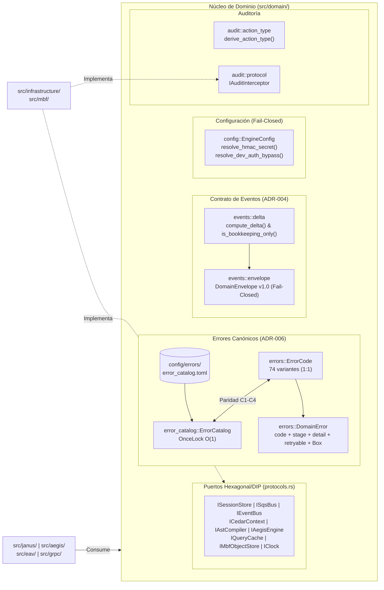

# Componente 04 — Dominio (`src/domain/`)

> **Módulo Rust:** `metri_engine::domain`  
> **Ubicación:** `src/domain/` (19 archivos `.rs`)  
> **Insumo Declarativo:** `config/errors/error_catalog.toml` (Catálogo Canónico v3.0.0)  
> **Dependencias de Infraestructura:** Ninguna (Núcleo Hexagonal Puro).

---

## 1. Visión General y Propósito

El componente **Dominio** (`src/domain/`) constituye el núcleo hexagonal puro de `metri-engine`. No depende de SDKs de nube, motores de almacenamiento ni protocolos de red; por el contrario, define el lenguaje ubicuo, la mónada de error canónica, los contratos de eventos inter-servicios, la configuración inmutable del motor y los puertos estáticos (traits) que el resto de los módulos implementan o consumen.

Sus responsabilidades estructurales se dividen en seis pilares:
1. **Mónada de Error y Catálogo Canónico (`errors.rs`, `error_catalog.rs`):** Define `DomainError` y el enum exhaustivo `ErrorCode` (74 variantes activas), garantizando una correspondencia biyectiva 1:1 con `config/errors/error_catalog.toml` verificada en el arranque y en tiempo de pruebas.
2. **Puertos del Dominio (`protocols.rs`):** Declara los traits asíncronos y síncronos bajo el Principio de Inversión de Dependencias (DIP) y Segregación de Interfaces (ISP): `ISessionStore`, `ISqsBus`, `IEventBus`, `ICedarContext`, `IAstCompiler`, `IAegisEngine`, `IExportStorage`, `IQueryCache`, `QueryCacheInvalidator`, `IMbfObjectStore` e `IClock`.
3. **Contrato Productor de Eventos (`events/envelope.rs`, `events/delta.rs`):** Implementa el lado productor del contrato `metri-contracts` v1.0 (`DomainEnvelope`, `Delta`, `is_bookkeeping_only`), garantizando compatibilidad bit a bit con `metri-schedulers` (Go) mediante fixtures dorados.
4. **Configuración Inmutable del Motor (`config.rs`):** Centraliza la lectura de variables de entorno en `EngineConfig` (`OnceLock`) y provee los candados puros `resolve_hmac_secret` y `resolve_dev_auth_bypass` bajo filosofía *fail-closed*.
5. **Contratos de Auditoría (`audit/action_type.rs`, `audit/protocol.rs`):** Deriva de forma pura el `ActionType` a partir del resultado de una operación y define el puerto `IAuditInterceptor` bajo semántica *fire-and-forget*.
6. **Composición Railway-Oriented Programming (`pipeline/result.rs`):** Define el alias `Railway<T> = Result<T, DomainError>`, los predicados `is_ok`/`is_error` y las macros `ok!` y `fail!`.

---

## 2. Frontera Hexagonal (Responsabilidades y No-Responsabilidades)

| Dimensión | Responsabilidades (Dentro de `src/domain/`) | No-Responsabilidades (Fuera de `src/domain/`) |
| :--- | :--- | :--- |
| **Gestión de Errores** | Definir `ErrorCode`, `DomainError`, el cargador `ErrorCatalog` desde TOML y la resolución de `stage`, `http_status`, `grpc_status` y `retryable`. | Traducir `DomainError` a `tonic::Status` o payloads Protobuf de transporte (responsabilidad de `src/grpc/`). |
| **Inversión de Dependencias** | Declarar las firmas estáticas de los puertos (`ISessionStore`, `IMbfObjectStore`, `IQueryCache`, etc.) y sus tipos de transferencia asociados (`Session`, `CedarCtx`, `MbfObjectPayload`). | Implementar clientes de red, adaptadores de almacenamiento S3/NVMe o motores criptográficos concretos (ubicados en `src/infrastructure/` y `src/mbf/`). |
| **Eventos de Dominio** | Construir y validar bajo política *fail-closed* el sobre `DomainEnvelope` v1.0, calcular `Delta` (`before`/`after`) y clasificar mutaciones de bitácora (`is_bookkeeping_only`). | Ejecutar el transporte efectivo hacia EventBridge o el barrido del outbox transaccional (`src/application/` y `src/infrastructure/`). |
| **Seguridad de Configuración** | Validar en frío que entornos productivos o desconocidos posean un `HMAC_SECRET` robusto ($\ge 32$ bytes) y rechazar `METRI_DEV_AUTH_BYPASS` fuera de entornos locales/dev. | Terminar el proceso (`std::process::exit`) o inicializar el servidor gRPC (`src/main.rs` y `src/grpc/bootstrap.rs`). |

---

## 3. Arquitectura Interna y Diagrama de Flujo (Mermaid C3/C4)

---

## 4. Mapa Completo de Submódulos y Archivos

La siguiente tabla documenta el **100% de los archivos `.rs`** que conforman `src/domain/` (19 archivos en total):

| Ruta Relativa a `src/domain/` | Rol Arquitectónico | Elementos Públicos Principales |
| :--- | :--- | :--- |
| `mod.rs` | Raíz del módulo de dominio y re-exportación de tipos primordiales. | `DomainError`, `ErrorCode`, `DomainResult`, `ErrorCatalog`, `ErrorEntry`, `error_catalog`, `init_error_catalog`. |
| `config.rs` | Configuración global inmutable (`OnceLock<EngineConfig>`) y candados de seguridad de arranque. | `DEFAULT_MAX_LIST_LIMIT`, `EngineConfig`, `engine_config`, `init_engine_config`, `resolve_hmac_secret`, `resolve_dev_auth_bypass`. |
| `errors.rs` | Enumeración `ErrorCode` (74 variantes), mapeo canónico 1:1 y estructura `DomainError`. | `ErrorCode`, `ErrorCode::ALL`, `DomainError`. |
| `error_catalog.rs` | Cargador y validador en memoria del archivo `config/errors/error_catalog.toml`. | `ErrorEntry`, `ErrorCatalog`, `init_global`, `global`, `try_global`. |
| `protocols.rs` | Definición de todos los puertos estáticos (traits DIP/ISP) y estructuras de datos asociadas. | `DomainResult`, `Session`, `ISessionStore`, `SqsMessage`, `ISqsBus`, `IEventBus`, `CedarCtx`, `ICedarContext`, `IAstCompiler`, `ResultChunk`, `IAegisEngine`, `IExportStorage`, `CacheEntry`, `CachePut`, `IQueryCache`, `QueryCacheInvalidator`, `MbfObjectPayload`, `MbfConditionalGet`, `IMbfObjectStore`, `IClock`. |
| `audit/mod.rs` | Submódulo de contratos de auditoría. | `action_type`, `protocol`. |
| `audit/action_type.rs` | Función pura de clasificación de operaciones hacia `ActionType`. | `ActionType`, `derive_action_type`. |
| `audit/protocol.rs` | Puerto asíncrono `IAuditInterceptor` con contrato de absorción de errores. | `IAuditInterceptor`. |
| `events/mod.rs` | Submódulo del contrato productor de eventos `metri-contracts` v1.0. | Re-exporta `compute_delta`, `is_bookkeeping_only`, `Delta`, `DeltaEntry`, `DomainEnvelope`, `ScheduledJobEventInput`, `ScheduledJobOp`, `SCHEMA_VERSION`. |
| `events/delta.rs` | Cálculo determinista de diferencias (`BTreeMap`) y filtro de mutaciones de bitácora. | `Delta`, `DeltaEntry`, `compute_delta`, `is_bookkeeping_only`. |
| `events/envelope.rs` | Constructor y validador *fail-closed* del sobre de eventos `DomainEnvelope` v1.0. | `SCHEMA_VERSION`, `ScheduledJobOp`, `EnvelopeError`, `DomainEnvelope`, `ScheduledJobEventInput`. |
| `events/golden_test.rs` | Candado de paridad bit a bit contra los fixtures de `metri-contracts/golden/`. | Pruebas de contrato dorado (`#[cfg(all(test, has_metri_contracts))]`). |
| `pipeline/mod.rs` | Submódulo de utilidades Railway-Oriented Programming. | Re-exporta `Railway`, `is_ok`, `is_error`. |
| `pipeline/result.rs` | Alias `Railway<T>`, predicados booleanos y macros `ok!` / `fail!`. | `Railway`, `is_ok`, `is_error`, macros `ok!`, `fail!`. |
| `tests/action_type_tests.rs` | Pruebas unitarias de derivación de `ActionType` para cada etapa de fallo. | Tests unitarios (`#[cfg(test)]`). |
| `tests/catalog_parity_tests.rs` | Candados de paridad C1–C4 entre `ErrorCode::ALL` y `error_catalog.toml`. | Tests unitarios (`#[cfg(test)]`). |
| `tests/error_catalog_tests.rs` | Pruebas de carga TOML, resolución de `http_status` y bandera `retryable`. | Tests unitarios (`#[cfg(test)]`). |
| `tests/errors_tests.rs` | Pruebas de constructores de `DomainError`, etapas (`stage`) y contexto encajonado. | Tests unitarios (`#[cfg(test)]`). |
| `tests/result_tests.rs` | Pruebas unitarias de `Railway<T>`, `is_ok` e `is_error`. | Tests unitarios (`#[cfg(test)]`). |

---

## 5. Contratos Públicos, Traits y Estructuras de Datos Clave

### 5.1. `DomainError`, `ErrorCode` y `ErrorCatalog` (`errors.rs`, `error_catalog.rs`)
- **`DomainError`**:
  Estructura compacta (`code: ErrorCode`, `stage: String`, `detail: String`, `retryable: bool`, `context: Option<Box<serde_json::Value>>`). El campo `context` se aloja en el heap (`Box`) para mantener el tamaño en pila de `Result<T, DomainError>` por debajo del umbral de `clippy::result_large_err`.
- **`ErrorCode`**:
  Enumera las 74 variantes tipadas del motor y expone `ErrorCode::ALL`, `canonical_code(&self) -> &'static str`, `is_retryable(&self) -> bool`, `fallback_is_retryable(&self) -> bool` y `stage(&self) -> &'static str`.
- **`ErrorCatalog`**:
  Carga `config/errors/error_catalog.toml` en el arranque. Al invocar `init_global(catalog)`, verifica que todas las variantes de `ErrorCode::ALL` posean su entrada correspondiente en el archivo TOML; de lo contrario, aborta el inicio inmediatamente.

### 5.2. Puertos del Dominio (`protocols.rs`)
- **Autenticación y Autorización Zero-Trust:**
  - `ISessionStore`: Verifica tokens `mk_...` (`get_session`) y administra la lista de revocación por `jti` (`revoke_session`, `unrevoke_session`).
  - `ICedarContext`: Evalúa solicitudes frente a políticas ABAC Cedar y produce un `CedarCtx` con `tenant_id`, `user_id`, `roles` y `domain_boundaries`.
- **Compilación y Ejecución Analítica:**
  - `IAstCompiler`: Compila de forma pura un descriptor de consulta y un `CedarCtx` hacia un AST IR que garantiza el filtro de aislamiento `tenant_id`.
  - `IAegisEngine`: Ejecuta un AST IR sobre el motor analítico unificado y devuelve `Vec<ResultChunk>`.
- **Caché de Consultas (ISP):**
  - `IQueryCache`: Lectura (`get`) y escritura idempotente (`put`) de entradas `CacheEntry` con verificación de `tenant_id`, `expires_at` lógico y sello de generación (`generation`).
  - `QueryCacheInvalidator`: Puerto segregado para el camino de escritura (`invalidate_tenant`).
- **Almacenamiento de Objetos `.mbf` y Reloj Determinista:**
  - `IMbfObjectStore`: Operaciones de lectura completa con `ETag` (`get_object`), revalidación condicional HTTP 304 (`get_if_none_match` -> `MbfConditionalGet`), lectura de sub-rangos de bytes (`get_byte_range`) y escritura atómica Compare-And-Swap (`put_if_match`).
  - `IClock`: Obtención determinista del tiempo actual en milisegundos UTC (`now_epoch_ms`) para pruebas de cierres fiscales y series temporales.

### 5.3. Contrato de Eventos `metri-contracts` v1.0 (`events/envelope.rs`, `events/delta.rs`)
- **`DomainEnvelope::from_attributes(input: ScheduledJobEventInput)`**:
  Valida bajo política *fail-closed* la presencia y validez de `job_id`, `tenant_id`, `ulid`, `trigger_type` (`CRON` | `EXACT_TIME` | `TELEMETRY`), `action_type` (`RPC_CALL` | `DISPATCH_NOTIFICATION` | `WEBHOOK` | `EDA_BROADCAST`), `status` (`PENDING` | `ACTIVE` | `SUSPENDED` | `COMPLETED` | `FAILED`), `trigger_expression` e `idempotency_hash`. Normaliza `action_payload` si llega como cadena JSON serializada.
- **`compute_delta(before, after) -> Delta` e `is_bookkeeping_only(delta) -> bool`**:
  Calcula un `BTreeMap<String, DeltaEntry>` con orden de claves determinista que incluye únicamente los atributos cuyo valor cambió efectivamente. `is_bookkeeping_only` retorna `true` si y solo si el delta no es vacío y todas sus claves pertenecen al conjunto de bitácora del ejecutor (`["last_run_at", "run_count", "last_error"]`).

---

## 6. Invariantes del Componente

1. **Paridad Biyectiva 1:1 del Catálogo de Errores (Candados C1–C4):**
   - **C1:** `ErrorCode::ALL` contiene todas las variantes sin duplicados.
   - **C2:** Todo código devuelto por `ErrorCode::canonical_code()` existe en `config/errors/error_catalog.toml`.
   - **C3:** Ningún par de variantes de `ErrorCode` comparte el mismo código canónico.
   - **C4:** `ErrorCode::fallback_is_retryable()` coincide exactamente con el atributo `retryable` declarado en `error_catalog.toml`.
2. **Seguridad de Arranque *Fail-Closed* (`config.rs`):**
   Todo valor de `ENVIRONMENT` distinto de `"development"`, `"dev"`, `"local"` o `"test"` (incluyendo `None` o nombres desconocidos como `"staging"` o `"qa"`) se trata como entorno productivo: exige un `HMAC_SECRET` explícito de al menos 32 bytes distinto de las claves de desarrollo y prohíbe `METRI_DEV_AUTH_BYPASS`.
3. **Invariante del Filtro de Bitácora (`delta.rs`):**
   Un `Delta` vacío retorna `is_bookkeeping_only(&delta) == false` deliberadamente: ante incertidumbre sobre qué atributos cambiaron, reprovisionar de forma idempotente en el Hub es más seguro que omitir un cambio de umbral o programación.
4. **Contrato de Absorción en Auditoría (`IAuditInterceptor`):**
   El método `IAuditInterceptor::audit` se invoca siempre (tanto en `Ok` como en `Err`) y jamás retorna ni propaga un error hacia el flujo transaccional.

---

## 7. Catálogo de Errores Emitidos

El módulo `src/domain/` define las **74 variantes** del catálogo en `ErrorCode` y emite directamente los siguientes errores durante la validación de configuración, carga del catálogo y construcción de sobres de eventos:

| Código / Variante | Etapa (`stage`) | HTTP / gRPC | Retryable | Condición de Disparo Directo en `src/domain/` |
| :--- | :--- | :--- | :---: | :--- |
| `ErrorCode::InfraCatalog001` (`INFRA_CATALOG_001`) | `infrastructure` (`error-catalog`) | `500` / `INTERNAL` | No | `ErrorCatalog::load` falla al leer o parsear `config/errors/error_catalog.toml` en el arranque. |
| `ErrorCode::InfraConfig001` (`INFRA_CONFIG_001`) | `infrastructure` (`config`) | `500` / `INTERNAL` | No | `resolve_hmac_secret` detecta secreto ausente, corto ($<32$ bytes) o de desarrollo en entorno no-dev; o `resolve_dev_auth_bypass` detecta solicitud de bypass fuera de entornos de desarrollo. |
| `EnvelopeError::Poison` (`E-EVT-001` .. `E-EVT-004`) | `domain::events` | N/A (DLQ) | No | `ScheduledJobOp::parse` o `DomainEnvelope::from_attributes` rechazan un sobre con operación desconocida, `action_payload` malformado o ausencia de `job_id`, `tenant_id`, `ulid`, `trigger_type`, `action_type`, `status`, `trigger_expression` o `idempotency_hash`. |

*(Para la referencia exhaustiva de las 74 variantes definidas en `src/domain/errors.rs`, véase `docs/05-referencia/codigos-error.md`).*

---

## 8. Decisiones de Diseño Relacionadas

- [ADR-004: Contratos Tipados gRPC, FlatBuffers y Deltas](../03-arquitectura/adr/ADR-004-contratos-tipados-grpc-flatbuffers-y-deltas.md)
- [ADR-005: Registro SSOT Códice y Validación en el Arranque](../03-arquitectura/adr/ADR-005-registro-ssot-codice-y-validacion-arranque.md)
- [ADR-006: Catálogo Canónico de Errores y Patrón Result](../03-arquitectura/adr/ADR-006-catalogo-canonico-errores-y-patron-result.md)
- [ADR-007: Identidad de Entidades ULID y Secuencias](../03-arquitectura/adr/ADR-007-identidad-entidades-ulid-y-secuencias.md)

---

## 9. Estrategia de Pruebas del Componente

El módulo `src/domain/` verifica sus invariantes mediante pruebas unitarias embebidas y suites dedicadas en `src/domain/tests/` y `src/domain/events/`:

1. **Paridad del Catálogo (`tests/catalog_parity_tests.rs` y `tests/error_catalog_tests.rs`):**
   - Ejecuta los 4 candados estructurales (`all_sin_variantes_duplicadas`, `todo_codigo_canonico_esta_en_el_catalogo`, `codigos_canonicos_son_unicos`, `fallback_retryable_coincide_con_el_catalogo`) directamente contra `config/errors/error_catalog.toml`.
2. **Candado Dorado de Eventos (`events/golden_test.rs`, `events/envelope.rs`, `events/delta.rs`):**
   - Valida la deserialización y re-serialización exacta contra los 5 fixtures canónicos (`scheduled_job_created_cron.json`, `scheduled_job_created_telemetry.json`, `scheduled_job_updated_bookkeeping.json`, `scheduled_job_updated_status.json`, `scheduled_job_deleted.json`).
   - Verifica la normalización de `action_payload` cuando proviene como cadena JSON del validador Códice y el rechazo `Poison` (`E-EVT-001` a `E-EVT-004`) ante campos obligatorios ausentes.
3. **Candados *Fail-Closed* de Configuración (`config.rs::tests`):**
   - Comprueba sin mutar variables globales de entorno (seguro en ejecución paralela) que `resolve_hmac_secret` y `resolve_dev_auth_bypass` fallen cerrados ante `None`, `"production"`, `"staging"` o `"qa"`.
4. **Mónada de Error, Auditoría y Railway (`tests/errors_tests.rs`, `tests/action_type_tests.rs`, `tests/result_tests.rs`):**
   - Verifica constructores por dominio (`DomainError::janus`, `eav`, `aegis`, `auth`, `infra`, `codice`, `mbf`), adjunción de contexto encajonado y derivación pura de `ActionType` (`WRITE`, `ACCESS_DENIED`, `QUOTA_EXHAUSTED`, `WRITE_ERROR`, `UNKNOWN`).
