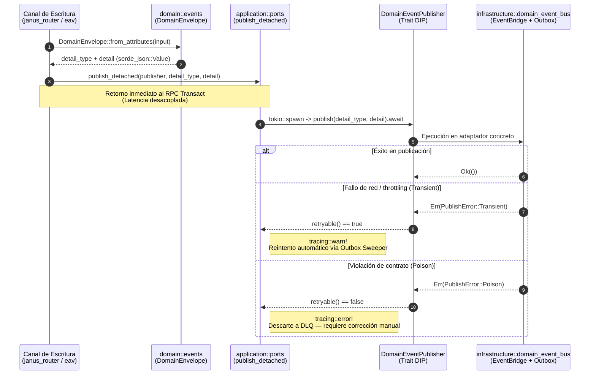

# Componente 05 — Aplicación (`src/application/`)

> **Módulo Rust:** `metri_engine::application`  
> **Ubicación:** `src/application/` (2 archivos `.rs`)  
> **Patrón Arquitectónico:** Puertos de Salida Delimitados por el Consumidor (DIP) y Despacho Asíncrono Desacoplado con Clasificación de Errores (`Transient` vs. `Poison`).

---

## 1. Visión General y Propósito

El componente **Aplicación** (`src/application/`) define los puertos de salida de nivel de caso de uso que conectan las mutaciones transaccionales del motor con el ecosistema de eventos de dominio (`metri-contracts`), manteniendo el desacoplamiento estricto respecto a los adaptadores de infraestructura.

Su diseño resuelve dos problemas críticos en el camino de escritura transaccional:
1. **Clasificación Semántica del Error en el Contrato (`PublishError`):** Distingue por tipo entre fallos transitorios de red o infraestructura (`PublishError::Transient`, que deben ser reintentados con backoff por el *outbox sweeper*) y violaciones permanentes del contrato de eventos (`PublishError::Poison`, donde reintentar solo envenenaría la cola y el evento debe dirigirse a DLQ / inspección humana).
2. **Desacoplamiento de Latencia en el Camino Caliente (`publish_detached`):** Permite que el canal de escritura confirme la transacción ACID al cliente sin bloquear la respuesta del RPC `Transact` por la latencia de red del bus de eventos externo, delegando la publicación a una tarea asíncrona supervisada con trazabilidad diferenciada (`tracing::warn!` para reintentables vía outbox y `tracing::error!` para eventos *poison*).

---

## 2. Frontera Hexagonal (Responsabilidades y No-Responsabilidades)

| Dimensión | Responsabilidades (Dentro de `src/application/`) | No-Responsabilidades (Fuera de `src/application/`) |
| :--- | :--- | :--- |
| **Definición de Puertos de Salida** | Definir el trait `DomainEventPublisher` y el contrato de error `PublishError` con su predicado `retryable()`. | Implementar el transporte concreto hacia AWS EventBridge, colas locales o el almacenamiento del outbox (ubicado en `src/infrastructure/domain_event_bus.rs`). |
| **Orquestación Asíncrona** | Proveer `publish_detached` para despachar publicaciones fuera del camino crítico de latencia de `Transact` y registrar diagnósticos estructurados según `retryable()`. | Construir o validar el contenido estructural del sobre `DomainEnvelope` o calcular el `Delta` de atributos (ubicado en `src/domain/events/`). |
| **Inyección de Dependencias** | Exponer un contrato limpio (`Arc<dyn DomainEventPublisher>`) que permite inyectar dobles de prueba (*fakes*/*spies*) en memoria sin requerir conectividad externa. | Cablear las instancias concretas en el arranque del servidor (responsabilidad de `src/grpc/bootstrap.rs` y `src/grpc/server.rs`). |

---

## 3. Arquitectura Interna y Diagrama de Flujo (Mermaid C3/C4)



---

## 4. Mapa Completo de Submódulos y Archivos

La siguiente tabla documenta el **100% de los archivos `.rs`** que conforman `src/application/` (2 archivos en total):

| Ruta Relativa a `src/application/` | Rol Arquitectónico | Elementos Públicos Principales |
| :--- | :--- | :--- |
| `mod.rs` | Raíz de la capa de aplicación y declaración de módulos de puertos bajo el Principio de Inversión de Dependencias (DIP). | `ports`. |
| `ports.rs` | Definición del puerto de publicación de eventos de dominio `DomainEventPublisher`, el contrato de error `PublishError` y el despachador asíncrono `publish_detached`. | `PublishError`, `PublishError::retryable`, `DomainEventPublisher`, `publish_detached`. |

---

## 5. Contratos Públicos, Traits y Estructuras de Datos Clave

### 5.1. `PublishError` (`ports.rs`)
```rust
#[derive(Debug, thiserror::Error)]
pub enum PublishError {
    #[error("transitorio (reintentable): {0}")]
    Transient(String),
    #[error("poison (DLQ): {0}")]
    Poison(String),
}
```
- **`PublishError::Transient(String)`**: Representa un fallo recuperable de infraestructura (timeout de red, límite de tasa excedido o indisponibilidad temporal del bus). `retryable()` retorna `true`.
- **`PublishError::Poison(String)`**: Representa una violación semántica o estructural del contrato `metri-contracts` que jamás tendrá éxito al reintentarse. `retryable()` retorna `false`.

### 5.2. Trait `DomainEventPublisher` (`ports.rs`)
```rust
#[async_trait]
pub trait DomainEventPublisher: Send + Sync {
    async fn publish(&self, detail_type: &str, detail: &Value) -> Result<(), PublishError>;
}
```
- Define la frontera entre la lógica de aplicación y el bus de eventos de dominio (`system.scheduled_job.created`, `system.scheduled_job.updated`, `system.scheduled_job.deleted`, etc.).
- Exige `Send + Sync` para permitir su compartición segura entre hilos del runtime Tokio mediante `Arc<dyn DomainEventPublisher>`.

### 5.3. Despachador `publish_detached` (`ports.rs`)
```rust
pub fn publish_detached(
    publisher: std::sync::Arc<dyn DomainEventPublisher>,
    detail_type: String,
    detail: Value,
)
```
- Lanza una tarea asíncrona independiente en el runtime Tokio (`tokio::spawn`) que invoca `publisher.publish(&detail_type, &detail).await`.
- Evalúa `e.retryable()` en caso de error para emitir telemetría estructurada diferenciada sin propagar pánicos ni bloquear el hilo transaccional.

---

## 6. Invariantes del Componente

1. **Separación Estricta entre Fallos Transitorios y Mensajes *Poison*:**
   `PublishError::retryable(&self)` retorna `true` exclusivamente para `PublishError::Transient(_)`. Ningún error `Poison` puede marcarse como reintentable, evitando el envenenamiento del *outbox sweeper* con eventos malformados.
2. **No-Bloqueo del Camino Transaccional:**
   `publish_detached` nunca espera de forma síncrona la respuesta de red del publicador ni propaga errores hacia el llamador de la transacción ya confirmada.
3. **Independencia de Infraestructura (DIP):**
   `src/application/` depende únicamente de `async_trait`, `serde_json` y `tracing`, permitiendo instanciar casos de uso y canales de escritura en pruebas unitarias con publicadores en memoria sin dependencias de red.

---

## 7. Catálogo de Errores Emitidos

El módulo `src/application/` define su propio tipo de error de puerto (`PublishError`), el cual se articula con el catálogo del dominio y del adaptador de infraestructura de la siguiente manera:

| Variante de Error | `retryable()` | Severidad en Trazas | Destino Operativo | Causa Raíz Típica |
| :--- | :---: | :--- | :--- | :--- |
| `PublishError::Transient(msg)` | `true` | `WARN` (`tracing::warn!`) | Outbox Transaccional (reintento con backoff) | Fallo de transporte en EventBridge (`INFRA_EB_001`) o indisponibilidad temporal del endpoint. |
| `PublishError::Poison(msg)` | `false` | `ERROR` (`tracing::error!`) | Dead-Letter Queue (DLQ) / Alerta Operativa | Conversión desde `EnvelopeError::Poison` (`E-EVT-001` .. `E-EVT-004`) por violación del esquema `metri-contracts` v1.0. |

---

## 8. Decisiones de Diseño Relacionadas

- [ADR-004: Contratos Tipados gRPC, FlatBuffers y Deltas](../03-arquitectura/adr/ADR-004-contratos-tipados-grpc-flatbuffers-y-deltas.md)
- [ADR-005: Registro SSOT Códice y Validación en el Arranque](../03-arquitectura/adr/ADR-005-registro-ssot-codice-y-validacion-arranque.md)
- [ADR-006: Catálogo Canónico de Errores y Patrón Result](../03-arquitectura/adr/ADR-006-catalogo-canonico-errores-y-patron-result.md)
- [ADR-007: Identidad de Entidades ULID y Secuencias](../03-arquitectura/adr/ADR-007-identidad-entidades-ulid-y-secuencias.md)

---

## 9. Estrategia de Pruebas del Componente

El contrato de `src/application/ports.rs` se verifica en dos niveles complementarios:

1. **Pruebas Unitarias con Dobles de Prueba (*Fakes* / *Recording Publishers*):**
   - Los consumidores del puerto `DomainEventPublisher` (como el canal de escritura y el bus de eventos en `src/infrastructure/domain_event_bus.rs`) inyectan implementaciones `Arc<dyn DomainEventPublisher>` en memoria para verificar qué eventos `system.scheduled_job.*` se emiten, qué eventos se suprimen (cuando `is_bookkeeping_only` es `true`) y cómo reaccionan ante respuestas `PublishError::Transient` frente a `PublishError::Poison`.
2. **Verificación del Contrato de Clasificación (`retryable`):**
   - Comprueba que los errores originados por validación de sobre (`EnvelopeError::Poison`) se traduzcan siempre a `PublishError::Poison` (`retryable() == false`), mientras que los fallos de transporte del cliente subyacente produzcan `PublishError::Transient` (`retryable() == true`) activando la persistencia de respaldo en el outbox.
