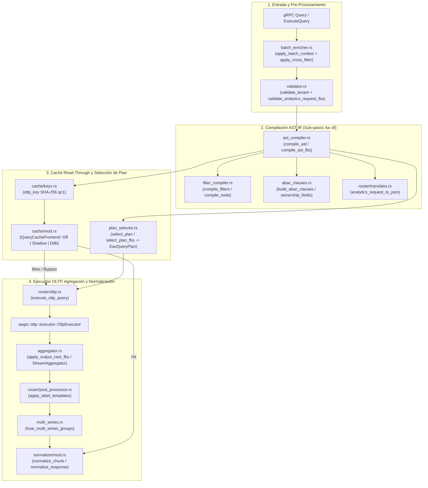

# Componente 06 — Janus (`src/janus/`)

> **Módulo Rust:** `metri_engine::janus`  
> **Ubicación:** `src/janus/` (33 archivos `.rs` + esquema FlatBuffers `janus_ir_ast.fbs`)  
> **Capa:** Orquestación, Compilación AST IR, Caché Read-Through y Normalización del Read Path HTAP  
> **Dependencias internas directas:** `crate::aegis`, `crate::codice`, `crate::domain`, `crate::eav`, `crate::iop`, `crate::temporal`

---

## 1. Visión General y Propósito

El componente **Janus** (`src/janus/`) es el orquestador del **Read Path** analítico y transaccional de `metri-engine`. Recibe mapas de sub-consultas tipadas en FlatBuffers (`AnalyticsRequestT`) o solicitudes de consulta/exploración desde la capa gRPC, aplica de manera determinista las reglas de seguridad Zero-Trust ABAC y multi-tenant, compila cada consulta hacia el **AST IR** inmutable, evalúa la caché read-through (`QueryCacheFrontend`), selecciona el plan de ejecución óptimo sobre el motor EAV `.mbf` (`EavQueryPlan`), delega la ejecución física a **Aegis** (`OltpExecutor`), aplica agregaciones de visualización (`OutputCast`), fusiona series múltiples (`MultiSeriesGroup`) y normaliza las respuestas garantizando el contrato de salida para el cliente UI.

Sus responsabilidades estructurales abarcan cuatro pilares:
1. **Compilación e Inyección de Seguridad Zero-Trust (`ast_compiler.rs`, `abac_clauses.rs`, `filter_compiler.rs`, `batch_enricher.rs`, `validator.rs`)**: Verifica la validez semántica del contrato de entrada, enriquece lotes de sub-queries con filtros globales (`BatchContext`) y filtros cruzados de tablero (`DashboardCrossFilterContext`), e inyecta de forma ineludible la cláusula de aislamiento `tenant_id` y las restricciones ABAC derivadas de `CedarCtx` (`domain_boundaries`, `is_owner`, `is_assignee`).
2. **Selección de Plan EAV (`plan_selector.rs`)**: Analiza el predicado `WHERE` compilado del AST IR y selecciona el índice de menor costo asintótico siguiendo la jerarquía estricta: `PointLookup` ($O(1)$) $>$ `AvetSingleFilter` ($O(\log N)$) $>$ `AvetIntersection` $>$ `FtsSearch` $>$ `AevtScan`.
3. **Caché Read-Through Determinista (`cache/mod.rs`, `cache/keys.rs`)**: Calcula claves SHA-256 sobre el AST IR post-ABAC canónico + ventana temporal resuelta + huella del esquema Códice (`qc1`), operando bajo tres modos (`Off`, `Shadow`, `Ddb`) con política *fail-open* en disponibilidad y *fail-closed* en corrección.
4. **Agregación, Fusión Multiserie y Normalización (`aggregator.rs`, `multi_series.rs`, `normalizer/`)**: Transforma filas crudas según el `OutputCast` (`TABLE`, `KPI`, `TIMESERIES`, `PIE`, `BUBBLE`, `CSV_EXPORT`), ejecuta *Full Outer Join* asintótico sobre grupos multiserie y garantiza que toda respuesta gRPC cumpla con su estructura canónica (`QueryNormalizer`, `BulkNormalizer`, `DiscoveryNormalizer`, `ExploreNormalizer`, `TransactionNormalizer`, `MatchRulesNormalizer`).

---

## 2. Frontera Hexagonal (Responsabilidades y No-Responsabilidades)

| Dimensión | Responsabilidades (Dentro de `src/janus/`) | No-Responsabilidades (Fuera de `src/janus/`) |
| :--- | :--- | :--- |
| **Compilación de Consultas y ABAC** | Validar contratos JSON/FlatBuffers, inyectar el `tenant_id` del sistema y compilar cláusulas `WHERE` combinando filtros del cliente con fronteras ABAC de `CedarCtx`. | Evaluar políticas Cedar o verificar firmas HMAC de tokens de sesión (responsabilidad de [`src/cedar/`](09-cedar.md)). |
| **Planificación y Enrutamiento de Lectura** | Seleccionar el `EavQueryPlan` óptimo, coordinar la ejecución paralela de sub-queries (`run_query_pipeline`) y gestionar el ciclo read-through de `QueryCacheFrontend`. | Ejecutar escaneos físicos sobre zonas `.mbf`, índices EAV o evaluar fórmulas post-lectura (delegado a [`src/aegis/`](08-aegis.md) y [`src/eav/`](02-eav.md)). |
| **Caché de Consultas (Política)** | Gobernar modos (`Off`, `Shadow`, `Ddb`), compuertas de bypass (`BypassReason`), anillos de medición en memoria (`ShadowKeyRing`, `OversizeKeyRing`) y generación de claves SHA-256. | Implementar el cliente de red o almacenamiento subyacente del puerto `IQueryCache` (definido en [`src/domain/`](04-domain.md) e implementado en [`src/infrastructure/`](15-infrastructure.md)). |
| **Normalización y Posprocesamiento** | Aplicar `OutputCast`, plantillas de etiquetas (`post_processor`), fusión `MultiSeriesGroup` e inteligencia de metadatos VIZ/HATEOAS (`normalizer/`). | Ejecutar mutaciones transaccionales sobre entidades de negocio (responsabilidad exclusiva de [`src/janus_router/`](07-janus-router.md)). |

---

## 3. Arquitectura Interna y Diagrama de Flujo (Mermaid C3/C4)

---

## 4. Mapa Completo de Submódulos y Archivos

La siguiente tabla documenta el **100% de los archivos** que conforman `src/janus/` (33 archivos `.rs` y 1 esquema `.fbs`):

| Ruta Relativa a `src/janus/` | Rol Arquitectónico | Elementos Públicos Principales |
| :--- | :--- | :--- |
| `mod.rs` | Punto de entrada del módulo Read Path; exporta compiladores, caché, normalizadores y enrutador. | Submódulos `abac_clauses`, `aggregator`, `ast_compiler`, `batch_enricher`, `cache`, `fbs`, `filter_compiler`, `multi_series`, `normalizer`, `plan_selector`, `router`, `validator`. |
| `abac_clauses.rs` | Construcción de predicados ABAC en el AST IR a partir de `CedarCtx` y atributos de propiedad del Códice. | `OwnershipFields`, `ownership_fields`, `build_abac_clauses`. |
| `aggregator.rs` | Paso 7 del Read Path: ensamblaje de resultados y agregación en una pasada por `OutputCast`. | `MetricSpec`, `MetricSpec::from_json`, `apply_metrics`, `apply_output_cast`, `apply_output_cast_fbs`. |
| `ast_compiler.rs` | Ensamblador del AST IR inmutable (JSON y FlatBuffers) combinando filtros de cliente, cláusulas ABAC, dimensiones, métricas y límites. | `compile_ast`, `compile_ast_fbs`. |
| `batch_enricher.rs` | Enriquecedor pre-compilación que inyecta `BatchContext.common_filters` y `DashboardCrossFilterContext` en mapas de sub-queries. | `apply_batch_context`, `apply_cross_filter`. |
| `cache/mod.rs` | Frontend de caché read-through: gobierna modos (`Off`, `Shadow`, `Ddb`), compuertas de bypass y anillos de medición en memoria. | `CacheMode`, `CacheChannel`, `ChannelFlags`, `QueryCachePolicy`, `BypassReason`, `LookupOutcome`, `CacheCandidate`, `QueryCacheFrontend`, `NoopQueryCache`. |
| `cache/keys.rs` | Constructor determinista de claves de caché SHA-256 (`QC#qc1#<hex>`) sobre el AST compilado post-ABAC. | `CACHE_KEY_VERSION`, `ENTRY_KEY_PREFIX`, `oltp_key`. |
| `cache/cache_tests.rs` | Suite de pruebas unitarias del frontend de caché sin infraestructura externa (modos, expiración, generación, bypass y *fail-open*). | Tests unitarios de `janus::cache` (`#[cfg(test)]`). |
| `fbs.rs` | Código Rust autogenerado por `flatc` a partir de `janus_ir_ast.fbs` (`#[allow(missing_docs)]`). | `AnalyticsRequestT`, `FilterNodeT`, `FilterValueT`, `MetricSpecT`, `OutputCast`, `AggregationOp`, etc. |
| `janus_ir_ast.fbs` | Esquema declarativo FlatBuffers del contrato binario de consultas analíticas y de visualización. | Tablas y enumeraciones IDL de FlatBuffers (`AnalyticsRequest`, `FilterNode`, `ComparisonDef`, etc.). |
| `filter_compiler.rs` | Compilador recursivo de árboles de filtros del cliente (`criteria` y `group`) hacia nodos del AST IR. | `compile_node`, `compile_filters`. |
| `multi_series.rs` | Motor de fusión `MultiSeriesGroup`: realiza *Full Outer Join* asintótico de sub-queries agrupadas bajo el mismo `group_id`. | `fuse_multi_series_groups`, `merge_group_chunks`. |
| `normalizer/mod.rs` | Fachada de normalización de respuestas y chunks; infiere `ResponseType` y despacha a la estrategia correspondiente. | `ResponseType`, `ResponseType::infer`, `normalize_response`, `normalize_error_response`, `normalize_chunk`. |
| `normalizer/strategy.rs` | Definición del trait polimórfico `NormalizerStrategy` (una implementación por forma de RPC). | `NormalizerStrategy`, `NormalizerStrategy::normalize`. |
| `normalizer/query.rs` | Normalizador especializado para `QueryResponse`: metadatos de caché/latencia, paginación, enlaces HATEOAS e inteligencia VIZ. | `QueryNormalizer`. |
| `normalizer/bulk.rs` | Normalizador para respuestas de `BulkIngest` (`ingested_count`, `outbox_count`). | `BulkNormalizer`. |
| `normalizer/discovery.rs` | Normalizador para respuestas de descubrimiento de esquemas (`schemas`, `has_next`, `next_cursor`). | `DiscoveryNormalizer`. |
| `normalizer/explore.rs` | Normalizador para respuestas de exploración de facetas (`values`). | `ExploreNormalizer`. |
| `normalizer/match_rules.rs` | Normalizadores para evaluación individual (`MatchRulesNormalizer`) y por lotes (`MatchRulesBatchNormalizer`) de reglas de ruteo. | `MatchRulesNormalizer`, `MatchRulesBatchNormalizer`. |
| `normalizer/transaction.rs` | Normalizador para respuestas de transacciones individuales (`entity_id`). | `TransactionNormalizer`. |
| `normalizer/helpers.rs` | Funciones puras compartidas por los normalizadores: conversiones numéricas seguras, inferencia de visualización y etiquetas semánticas. | `safe_double`, `new_query_id`, `ensure_status`, `infer_viz_type`, `hint_to_static`, `capitalize_key`, `derive_semantic_label`. |
| `plan_selector.rs` | Paso 5 del Read Path: analiza el AST IR compilado y selecciona el `EavQueryPlan` de menor costo. | `EavQueryPlan`, `select_plan`, `select_plan_fbs`. |
| `router/mod.rs` | Coordinador paralelo del Read Path (`run_query_pipeline`, `process_single_query`) y contenedores de contexto (`CedarCtx`, `QueryChunk`, `QueryExecCtx`). | `CedarCtx`, `QueryChunk`, `QueryExecCtx`, `run_query_pipeline`, `process_single_query`. |
| `router/oltp.rs` | Ejecutor del canal de lectura OLTP/HTAP: integra compilación FlatBuffers, caché read-through, `OltpExecutor`, `OutputCast` y post-procesamiento. | `execute_oltp_query`. |
| `router/post_processor.rs` | Post-procesador de filas que interpola plantillas de etiquetas (`label_template`) sobre los registros resultantes. | `apply_label_templates`. |
| `router/translator.rs` | Traductores deterministas de estructuras FlatBuffers (`AnalyticsRequestT`, `FilterNodeT`, `FilterValueT`) a JSON canónico. | `fbs_filter_value_to_json`, `fbs_filter_node_to_json`, `analytics_request_to_json`. |
| `validator.rs` | Validador estructural y semántico de contratos del Read Path y tipos de entidad frente al Códice. | `validate_tenant`, `validate_entity_type`, `validate_query_request`, `validate_analytics_request_fbs`. |
| `testing/mod.rs` | Arnés de pruebas unitarias y de contrato del módulo `janus`. | Registro de suites de prueba bajo `#[cfg(test)]`. |
| `testing/aggregator_tests.rs` | Pruebas unitarias de `aggregator.rs` (`KPI`, `TIMESERIES`, `PIE`, `BUBBLE`, `TABLE`). | Tests unitarios (`#[cfg(test)]`). |
| `testing/batch_enricher_tests.rs` | Pruebas unitarias de inyección de `BatchContext` y `DashboardCrossFilterContext`. | Tests unitarios (`#[cfg(test)]`). |
| `testing/contract_tests.rs` | Pruebas de contrato e instantáneas (*golden snapshots* con `insta`) de planes y salidas VIZ. | Tests de contrato (`#[cfg(test)]`). |
| `testing/normalizer_tests.rs` | Pruebas unitarias de todas las estrategias de `janus::normalizer`. | Tests unitarios (`#[cfg(test)]`). |
| `testing/plan_selector_tests.rs` | Pruebas unitarias de selección y prioridad de `EavQueryPlan`. | Tests unitarios (`#[cfg(test)]`). |
| `testing/validator_tests.rs` | Pruebas unitarias de rechazo de contratos inválidos, operadores desconocidos y `tenant_id` vacíos. | Tests unitarios (`#[cfg(test)]`). |
| `testing/viz_engine_complete_tests.rs` | Suite integral de cobertura del motor VIZ (`QueryNormalizer`, `post_processor`, `multi_series`). | Tests unitarios e integración (`#[cfg(test)]`). |

---

## 5. Contratos Públicos, Traits y Estructuras de Datos Clave

### 5.1. Pipeline de Consulta y Contextos (`router/mod.rs`)
- **`CedarCtx`**: Transporta la identidad y alcance de seguridad verificados (`tenant_id`, `user_id`, `roles`, `is_super_master`, `cross_tenant_scope`, `domain_boundaries`).
- **`QueryChunk`**: Unidad atómica de respuesta por cada `query_key` dentro de una solicitud batch (`query_key: String`, `body: Value`, `success: bool`).
- **`run_query_pipeline(tenant_id, queries, cedar_ctx, executor, explain_plan, cache) -> Vec<QueryChunk>`**: Ejecuta todas las sub-queries en tareas asíncronas concurrentes (`tokio::spawn`), aislando cualquier error individual dentro de su respectivo `QueryChunk` sin abortar las demás sub-queries del tablero.

### 5.2. Selección de Plan EAV (`plan_selector.rs`)
- **`EavQueryPlan`**: Enumera los 7 planes físicos de acceso al motor EAV:
  - `PointLookup { entity_id }`: Lectura directa `O(1)` en el índice EAVT por ULID.
  - `AvetSingleFilter { attr_name, value }`: Búsqueda indexada `O(log N)` sobre un atributo único o indexado en AVET.
  - `AvetIntersection { filters }`: Intersección en paralelo de múltiples predicados de igualdad indexados.
  - `FtsSearch { term }`: Búsqueda léxica/difusa mediante índice de trigramas FTS.
  - `AevtScan { entity_type, shard_total }`: Escaneo completo por tipo de entidad en el índice AEVT.
  - `VaetLookup { ref_entity_id, attr_name }`: Navegación inversa de referencias en el índice VAET.
  - `AsOfSnapshot { entity_id, as_of_tx }`: Reconstrucción histórica *time-travel* hasta el corte transaccional `as_of_tx`.

### 5.3. Frontend de Caché Read-Through (`cache/mod.rs`, `cache/keys.rs`)
- **`QueryCachePolicy`** y **`CacheMode`**: Configuración inmutable resuelta en el arranque (`Off`, `Shadow`, `Ddb`) con TTL por canal, jitter anti-estampida (`ttl_jitter_secs`), límite de tamaño por ítem (`max_item_bytes <= 380 KB`) y lista blanca opcional de tenants (`tenant_allowlist`).
- **`QueryCacheFrontend`**: Orquestador siempre presente (patrón *Null Object* en modo `Off`) que evalúa las compuertas de elegibilidad (`CacheCandidate` $\rightarrow$ `LookupOutcome::{Hit, Miss, Bypass}`) y verifica la generación de invalidación por `(tenant_id, entity)`.

### 5.4. Estrategias de Normalización (`normalizer/`)
- **`NormalizerStrategy`** y **`ResponseType`**: Garantizan que toda respuesta contenga el bloque `status` (`{"success": true}` o detalle de error), metadatos de ejecución (`execution_time_ms`, `cache_hits`), estructuras de paginación y enriquecimiento visual (`viz-ext`, ejes, series y etiquetas semánticas).

---

## 6. Invariantes del Componente

1. **Inyección Ineludible de Tenant y ABAC Post-Autenticación**: `ast_compiler` ignora cualquier `tenant_id` enviado por el cliente en los filtros y fuerza en la raíz del predicado `WHERE` el `tenant_id` de `CedarCtx` (salvo cuando `is_super_master == true` y `cross_tenant_scope == "FULL"`).
2. **Aislamiento Criptográfico de Claves de Caché (`qc1`)**: La clave `oltp_key` se calcula sobre el AST IR **después** de inyectar `tenant_id` y las cláusulas ABAC de `CedarCtx`, concatenado con la ventana temporal resuelta y el `schema_fingerprint` del Códice. Dos usuarios con distintos alcances ABAC producen claves SHA-256 distintas por construcción.
3. **Doble Política de Fallo en Caché (*Fail-Open* en Disponibilidad / *Fail-Closed* en Corrección)**: Un fallo de I/O en el adaptador `IQueryCache` degrada silenciosamente a `Miss`/`Bypass` sin derribar la consulta, pero una entrada con `tenant_id` distinto, TTL expirado o generación menor a la vigente jamás es servida.
4. **Exclusión de Entidades con `RowOverlay` (`BypassReason::OverlayEntity`)**: Entidades cuyos valores se superponen en lectura desde contadores externos (como `domain_quota` con `QuotaUsageOverlay`) nunca se almacenan en la caché de consultas para evitar servir consumos obsoletos.
5. **Determinismo y Totalidad en Normalización**: Ningún normalizador en `src/janus/normalizer/` puede entrar en `panic!` ante payloads parciales, escalares o vacíos; siempre retorna un `serde_json::Value` válido que respeta el esquema de salida.

---

## 7. Catálogo de Errores Emitidos

| Variante `ErrorCode` | Código Canónico TOML | Etapa (`stage`) | HTTP / gRPC | Retryable | Condición de Disparo en `src/janus/` |
| :--- | :--- | :--- | :--- | :---: | :--- |
| `ErrorCode::Janus400` | `JANUS_400` | `janus` | `400` / `INVALID_ARGUMENT` | No | Payload de consulta sin `tenant_id`, entidad vacía o inexistente en el Códice, operador de filtro desconocido o `_UNSPECIFIED`, o violación del contrato FlatBuffers/JSON. |
| `ErrorCode::Jns001` | `JNS_001` | `janus` | `400` / `INVALID_ARGUMENT` | No | Error general de validación semántica en el enrutador o normalizador de consultas. |
| `ErrorCode::InfraConfig001` | `INFRA_CONFIG_001` | `infra` | `500` / `INTERNAL` | No | Configuración inválida en variables de entorno de `QueryCachePolicy` (`QUERY_CACHE_MODE`, `QUERY_CACHE_CHANNELS`, `QUERY_CACHE_TTL_*` o `QUERY_CACHE_MAX_ITEM_KB > 380`). |

---

## 8. Decisiones de Diseño Relacionadas

- [ADR-001: Motor HTAP Binario `.mbf` sobre S3](../03-arquitectura/adr/ADR-001-motor-htap-binario-mbf-sobre-s3.md)
- [ADR-002: Modelo de Datoms Inmutables y MVCC](../03-arquitectura/adr/ADR-002-modelo-datoms-inmutables-y-mvcc.md)
- [ADR-003: Seguridad Zero-Trust Cedar y HMAC](../03-arquitectura/adr/ADR-003-seguridad-zero-trust-cedar-y-hmac.md)
- [ADR-004: Contratos Tipados gRPC, FlatBuffers y Deltas](../03-arquitectura/adr/ADR-004-contratos-tipados-grpc-flatbuffers-y-deltas.md)
- [ADR-005: Registro SSOT Códice y Validación en el Arranque](../03-arquitectura/adr/ADR-005-registro-ssot-codice-y-validacion-arranque.md)
- [ADR-006: Catálogo Canónico de Errores y Patrón Result](../03-arquitectura/adr/ADR-006-catalogo-canonico-errores-y-patron-result.md)

---

## 9. Estrategia de Pruebas del Componente

El componente `src/janus/` dispone de 8 suites especializadas de pruebas unitarias, de contrato y de instantáneas (*golden snapshots*):

1. **Pruebas de Contrato y Snapshots (`testing/contract_tests.rs` + `testing/snapshots/*.snap`)**:
   - Valida con `insta` la compilación determinista de planes nativos (`point_lookup`, `fts_search`) y las salidas de visualización para las 6 formas canónicas (`kpi`, `timeseries`, `table`, `pie`, `bubble`, `csv_export`).
2. **Pruebas del Frontend de Caché (`cache/cache_tests.rs`)**:
   - Verifica modos `Off`, `Shadow` y `Ddb`, compuertas de bypass (`ExplainPlan`, `OverlayEntity`, `TenantNotAllowlisted`, `Oversize`), invalidación por generación y degradación *fail-open* ante errores del backend.
3. **Pruebas de Selección de Plan (`testing/plan_selector_tests.rs`)**:
   - Comprueba que `select_plan` y `select_plan_fbs` elijan siempre el índice más selectivo (`PointLookup` sobre `AvetSingleFilter`, `AvetIntersection` sobre `AevtScan`, etc.).
4. **Pruebas de Agregación y Motor VIZ (`testing/aggregator_tests.rs`, `testing/viz_engine_complete_tests.rs`)**:
   - Ejercitan `StreamAggregator`, truncamiento de series temporales por intervalo, fusión multiserie (`multi_series.rs`), plantillas de etiquetas (`post_processor.rs`) y generación de metadatos `viz-ext`.
5. **Pruebas de Validación, Enriquecimiento y Normalización (`testing/validator_tests.rs`, `testing/batch_enricher_tests.rs`, `testing/normalizer_tests.rs`)**:
   - Verifican el rechazo temprano de operadores inválidos, la propagación de filtros batch/cross-filter y el cumplimiento del contrato de salida en todas las variantes de `ResponseType`.
