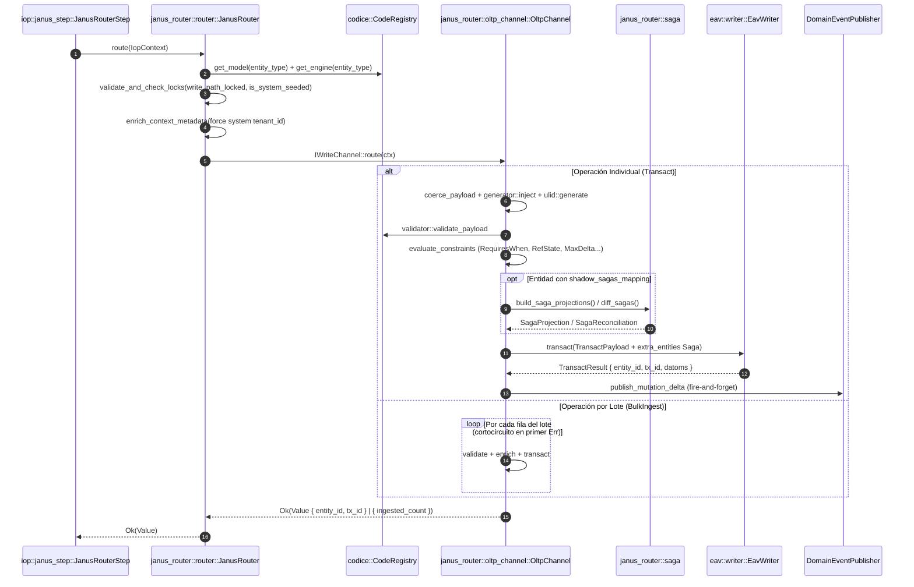

# Componente 07 — Janus Router (`src/janus_router/`)

> **Módulo Rust:** `metri_engine::janus_router`  
> **Ubicación:** `src/janus_router/` (6 archivos `.rs`)  
> **Capa:** Enrutamiento Transaccional del Write Path, Canal ACID `.mbf`, Sagas Declarativas y Generación ULID  
> **Dependencias internas directas:** `crate::application`, `crate::codice`, `crate::domain`, `crate::eav`, `crate::infrastructure`, `crate::iop`, `crate::janus`

---

## 1. Visión General y Propósito

El componente **Janus Router** (`src/janus_router/`) implementa el **Write Path** transaccional de `metri-engine`. Es invocado exclusivamente como el **Paso 3** del pipeline de ingesta (**IOP**), una vez que la solicitud ha superado la autorización Zero-Trust de **Cedar** (Paso 1) y la verificación/reserva atómica de cuota en **Quota** (Paso 2).

Su propósito es transformar mutaciones de negocio (`CREATE`, `UPDATE`, `DELETE`, `UPSERT` y lotes `BulkIngest`) en transacciones ACID sobre el motor binario `.mbf` (`EavWriter`), garantizando en una única operación atómica:
1. **Gobierno de Esquema y Candados de Escritura (`router.rs`)**: Resolución $O(1)$ del modelo en el Códice, verificación de candados de inmutabilidad (`write_path_locked`, `is_system_seeded`), inyección forzosa del `tenant_id` autenticado en el payload (anulando cualquier intento de suplantación desde el cliente) y despacho al canal registrado (`EngineChannel`).
2. **Ejecución Transaccional ACID y Validación Relacional (`oltp_channel.rs`)**: Coerción de escalares, inyección de códigos autogenerados (`generator::inject`), asignación de identificadores monotónicos ULID (`ulid.rs`), evaluación de restricciones cruzadas declarativas del Códice (`RequiresWhen`, `ForbiddenWhen`, `RangeCheck`, `CrossFieldOrder`, `MaxDelta`, `RefState`) y persistencia de datoms en `EavWriter` junto con sus eventos de Transactional Outbox y Deltas de dominio.
3. **Proyección y Reconciliación Declarativa de Sagas (`saga.rs`)**: Cuando una entidad madre declara `shadow_sagas_mapping` en el Códice, proyecta, actualiza o retira automáticamente los trabajos programados (`scheduled_job`) asociados dentro de la misma transacción o ciclo de convergencia, sin acoplar vocabulario de dominio en el motor.

---

## 2. Frontera Hexagonal (Responsabilidades y No-Responsabilidades)

| Dimensión | Responsabilidades (Dentro de `src/janus_router/`) | No-Responsabilidades (Fuera de `src/janus_router/`) |
| :--- | :--- | :--- |
| **Enrutamiento del Write Path** | Cargar el esquema desde Códice, validar candados (`write_path_locked`, `is_system_seeded`), sobrescribir `tenant_id` con el del contexto autenticado y despachar al `IWriteChannel`. | Autenticar tokens, evaluar permisos ABAC ([`src/cedar/`](09-cedar.md)) o debitar cuotas de consumo ([`src/quota/`](10-quota.md)). |
| **Canal Transaccional OLTP (`OltpChannel`)** | Coaccionar tipos, inyectar atributos autogenerados y de auditoría (`meta/*`), evaluar constraints relacionales con estado y orquestar la llamada a `EavWriter::transact`. | Codificar páginas binarias `.mbf`, mantener índices EAVT/AEVT/AVET/VAET o gestionar el protocolo CAS sobre S3 (delegado a [`src/eav/`](02-eav.md) y [`src/mbf/`](01-mbf.md)). |
| **Orquestación de Sagas (`saga.rs`)** | Construir proyecciones `SagaProjection` hacia `scheduled_job` a partir de `shadow_sagas_mapping` y calcular el diff puro de convergencia (`diff_sagas`). | Ejecutar el demonio planificador externo que dispara los trabajos cuando llega su `trigger_epoch` (responsabilidad del consumidor de eventos / scheduler externo). |
| **Identidad de Entidades (`ulid.rs`)** | Generar y validar identificadores ULID monotónicos de 26 caracteres en Crockford Base32 libres de colisiones en la misma marca de milisegundo. | Generar secuencias legibles por humanos (`WO-0001`) o códigos Base36 (responsabilidad de [`src/codice/`](03-codice.md)). |

---

## 3. Arquitectura Interna y Diagrama de Flujo (Mermaid C3/C4)

---

## 4. Mapa Completo de Submódulos y Archivos

La siguiente tabla documenta el **100% de los archivos `.rs`** que conforman `src/janus_router/` (6 archivos en total):

| Ruta Relativa a `src/janus_router/` | Rol Arquitectónico | Elementos Públicos Principales |
| :--- | :--- | :--- |
| `mod.rs` | Punto de entrada del módulo Write Path; exporta `router`, `oltp_channel`, `saga` y `ulid`. | Submódulos `oltp_channel`, `router`, `saga`, `ulid`. |
| `router.rs` | Enrutador principal del Write Path (`JanusRouter`) y definición del puerto `IWriteChannel`. Ejecuta los 6 pasos previos al canal. | `IWriteChannel`, `JanusRouter`, `JanusRouter::new`, `JanusRouter::route`. |
| `oltp_channel.rs` | Implementación del canal transaccional ACID sobre `EavWriter`: coerción, autogeneración, validación de constraints relacionales, reconciliación de sagas y soporte `BulkIngest`. | `OltpChannel`, `OltpChannel::new`, `OltpChannel::new_with_publisher`. |
| `saga.rs` | Constructor y reconciliador declarativo de proyecciones hacia `scheduled_job` gobernado por `shadow_sagas_mapping`. | `SagaProjection`, `LiveSagaJob`, `SagaReconciliation`, `desired_job_status`, `diff_sagas`, `build_saga_projections`. |
| `ulid.rs` | Generador thread-safe de identificadores ULID monotónicos (48 bits timestamp ms + 80 bits aleatorios en Crockford Base32). | `generate`, `is_ulid`. |
| `tests/saga_tests.rs` | Suite exhaustiva de pruebas de proyección declarativa de sagas, fan-out de pre-notificación, resolución de referencias y convergencia `diff_sagas`. | Tests unitarios e integración con Códice (`#[cfg(test)]`). |

---

## 5. Contratos Públicos, Traits y Estructuras de Datos Clave

### 5.1. `IWriteChannel` y `JanusRouter` (`router.rs`)
- **`pub trait IWriteChannel: Send + Sync`**:
  Contrato asíncrono de todo canal de escritura (`async fn route(&self, ctx: IopContext) -> Result<Value, DomainError>`).
- **`JanusRouter`**:
  Mantiene el mapa `HashMap<EngineChannel, Arc<dyn IWriteChannel>>` e implementa el pipeline de 6 pasos:
  1. Carga el `EntityModel` desde `codice_global()` en $O(1)$.
  2. Valida que el tipo de entidad sea conocido.
  3. Verifica `write_path_locked` (`ErrorCode::JnsLock001`) e `is_system_seeded` (`ErrorCode::JnsSeed001`).
  4. Resuelve el `EngineChannel` del modelo.
  5. Inyecta el esquema en `ctx.schema` y fuerza `tenant_id` tanto en `payload` individual como en cada elemento de `data` en operaciones `BulkIngest`.
  6. Delega la ejecución a `channel.route(ctx).await`.

### 5.2. `OltpChannel` (`oltp_channel.rs`)
- **`OltpChannel::new(writer: EavWriter)`** y **`OltpChannel::new_with_publisher(writer, event_publisher)`**:
  Ejecuta mutaciones individuales (`route_single`) y masivas (`route_bulk`). En `route_single`, resuelve el estado previo de la entidad en `UPDATE`/`DELETE`/`UPSERT`, evalúa todas las restricciones declarativas del modelo, construye y reconcilia las sagas asociadas, ejecuta la escritura atómica en `EavWriter` y emite el evento de delta al bus de dominio.

### 5.3. Proyección y Convergencia de Sagas (`saga.rs`)
- **`SagaProjection`**: Representa un `scheduled_job` listo para persistirse en la misma transacción ACID que su entidad madre (`entity_type`, `entity_id`, `attrs: HashMap<String, DatomValue>`).
- **`LiveSagaJob`** y **`SagaReconciliation`**: Estructuras utilizadas por `diff_sagas(desired, live, desired_status)` para calcular de forma pura qué trabajos deben crearse (`to_create`), cuáles eliminarse por cambio de horario/configuración (`to_delete`) y cuáles deben actualizar su estado (`to_restatus`) sin tocar nunca trabajos históricos ya cerrados (`COMPLETED` o `FAILED`).

### 5.4. Generador Monotónico ULID (`ulid.rs`)
- **`generate() -> String`**: Protegido por un `Mutex<Option<Ulid>>` estático (`LAST_ULID`), garantiza que si se solicitan múltiples ULIDs dentro del mismo milisegundo, el componente aleatorio de 80 bits se incremente monotónicamente (`prev.increment()`), preservando el orden lexicográfico estricto en los índices EAVT.

---

## 6. Invariantes del Componente

1. **Inmutabilidad del `tenant_id` del Sistema**: `JanusRouter::enrich_context_metadata` sobrescribe incondicionalmente el campo `tenant_id` dentro de `request["payload"]` y dentro de cada fila de `request["data"]` usando el `ctx.tenant_id` autenticado por Cedar. Un cliente jamás puede escribir datos en otro tenant manipulando el cuerpo JSON.
2. **Bloqueo Estricto de Entidades de Solo Lectura**: Toda mutación individual hacia una entidad con `write_path_locked: true` es rechazada con `JnsLock001`, y cualquier mutación (individual o bulk) hacia una entidad con `is_system_seeded: true` es rechazada con `JnsSeed001` antes de tocar el motor de almacenamiento.
3. **Atomicidad Madre-Saga en Creación**: Las proyecciones `SagaProjection` generadas por `build_saga_projections` viajan en el mismo lote transaccional que la entidad madre; o se persisten tanto la entidad madre como sus `scheduled_job`, o no se persiste ninguno.
4. **Preservación de Bitácora Histórica en Sagas**: Durante `UPDATE`, `diff_sagas` jamás modifica ni elimina trabajos en estado `COMPLETED` o `FAILED`; únicamente reconcilia trabajos en ciclo activo (`ACTIVE`, `SUSPENDED`, `PENDING`) mediante su `idempotency_hash` SHA-256.
5. **Monotonía Estricta de Identificadores ULID**: Para toda secuencia de llamadas consecutivas a `ulid::generate()`, se cumple invariablemente que $\text{ULID}_i < \text{ULID}_{i+1}$ en orden lexicográfico ASCII.

---

## 7. Catálogo de Errores Emitidos

| Variante `ErrorCode` | Código Canónico TOML | Etapa (`stage`) | HTTP / gRPC | Retryable | Condición de Disparo en `src/janus_router/` |
| :--- | :--- | :--- | :--- | :---: | :--- |
| `ErrorCode::Jns001` | `JNS_001` | `janus` | `400` / `INVALID_ARGUMENT` | No | Entidad desconocida en el Códice, operación de escritura inválida, payload malformado o mapeo `shadow_sagas_mapping` sin `trigger_source` válido. |
| `ErrorCode::JnsLock001` | `JNS_LOCK_001` | `janus` | `403` / `PERMISSION_DENIED` | No | Intento de mutación sobre una entidad protegida con `write_path_locked: true`. |
| `ErrorCode::JnsSeed001` | `JNS_SEED_001` | `janus` | `403` / `PERMISSION_DENIED` | No | Intento de mutación sobre una entidad de catálogo semilla con `is_system_seeded: true`. |
| `ErrorCode::Jns101`–`Jns106` | `JNS_101`–`JNS_106` | `janus` | `400` / `INVALID_ARGUMENT` | No | Violación de restricciones declarativas del Códice evaluadas en `OltpChannel` (`RequiresWhen`, `ForbiddenWhen`, `RangeCheck`, `CrossFieldOrder`, `MaxDelta`, `RefState`). |

---

## 8. Decisiones de Diseño Relacionadas

- [ADR-001: Motor HTAP Binario `.mbf` sobre S3](../03-arquitectura/adr/ADR-001-motor-htap-binario-mbf-sobre-s3.md)
- [ADR-002: Modelo de Datoms Inmutables y MVCC](../03-arquitectura/adr/ADR-002-modelo-datoms-inmutables-y-mvcc.md)
- [ADR-004: Contratos Tipados gRPC, FlatBuffers y Deltas](../03-arquitectura/adr/ADR-004-contratos-tipados-grpc-flatbuffers-y-deltas.md)
- [ADR-005: Registro SSOT Códice y Validación en el Arranque](../03-arquitectura/adr/ADR-005-registro-ssot-codice-y-validacion-arranque.md)
- [ADR-006: Catálogo Canónico de Errores y Patrón Result](../03-arquitectura/adr/ADR-006-catalogo-canonico-errores-y-patron-result.md)
- [ADR-007: Identidad de Entidades ULID y Secuencias](../03-arquitectura/adr/ADR-007-identidad-entidades-ulid-y-secuencias.md)

---

## 9. Estrategia de Pruebas del Componente

Las pruebas del componente se dividen en dos niveles complementarios:

1. **Pruebas Unitarias de ULID (`src/janus_router/ulid.rs`)**:
   - Verifican longitud exacta de 26 caracteres, validez bajo el alfabeto Crockford Base32, rechazo de cadenas malformadas y ordenamiento monotónico estricto en ráfagas de 100 generaciones consecutivas.
2. **Suite de Proyección y Reconciliación de Sagas (`src/janus_router/tests/saga_tests.rs`)**:
   - Ejercita la proyección declarativa contra modelos reales de `config/models/` (`reminder`, `work_order`, etc.).
   - Verifica el cálculo del `trigger_epoch` desde atributos ISO-8601, la expansión *fan-out* por arreglos de pre-notificación (`prenotify_before_minutes`), la resolución de atributos a través de referencias EAV (`[campo_ref, attr]`), el cálculo determinista de `idempotency_hash` y las reglas de convergencia de `diff_sagas` ante cambios de fecha, adición/eliminación de pre-notificaciones y cambios de estado de la entidad madre (`desired_job_status`).
3. **Pruebas de Integración con el Pipeline IOP (`src/iop/tests/janus_step_tests.rs`)**:
   - Validan la integración de `JanusRouter` dentro del Paso 3 del IOP, comprobando el bloqueo de entidades `write_path_locked` / `is_system_seeded` y la propagación de resultados hacia el normalizador.
