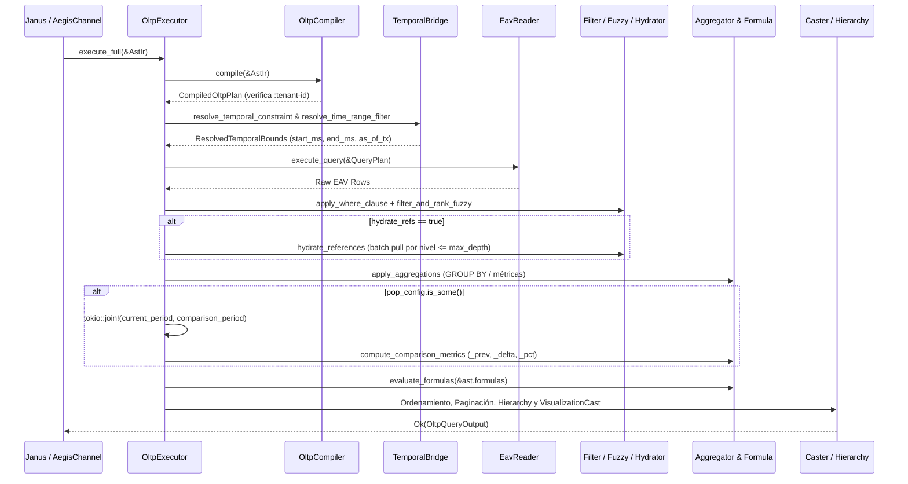
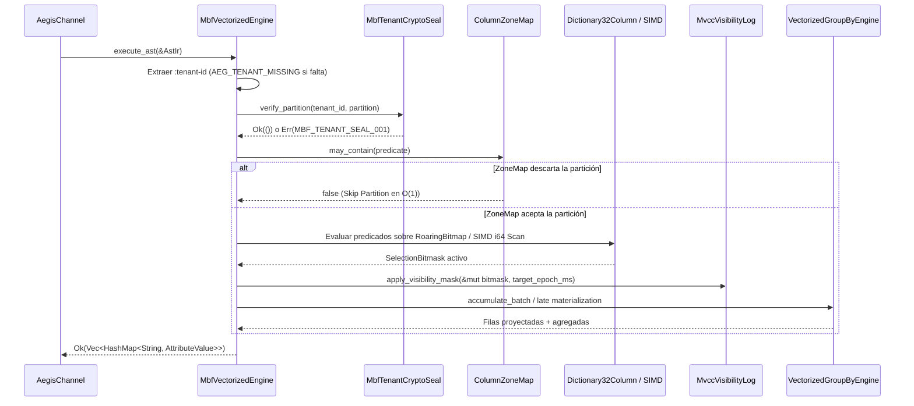

# 08 — Aegis (`src/aegis/`)

> **Capa:** Ejecución Analítica y Transaccional (Lectura HTAP)  
> **Ruta raíz:** `src/aegis/`  
> **Archivos fuente:** 42 archivos `.rs`  
> **Dependencias internas directas:** `crate::contracts`, `crate::datom`, `crate::eav`, `crate::error`, `crate::storage`, `crate::temporal`

---

## 1. Propósito y Responsabilidad

El componente **Aegis** es el motor unificado de ejecución de lecturas analíticas y transaccionales de `metri-engine`. Recibe una representación intermedia agnóstica (**AST IR**, `AstIr`) ya autenticada, autorizada y enriquecida con aislamiento multi-tenant por **Janus**, y la ejecuta sobre el motor de almacenamiento correspondiente devolviendo filas tipadas listas para serialización gRPC (`Vec<HashMap<String, AttributeValue>>` o `OltpQueryOutput`).

Sus responsabilidades principales dentro de la arquitectura HTAP Zero-Cloud-DB son:

1. **Despacho Híbrido HTAP (`AegisChannel` / `EngineType`)**:
   - **Camino Caliente OLTP (`aegis::oltp`)**: Traduce el `AstIr` a un `QueryPlan` sobre el índice EAV (`EavReader`), aplica filtros post-lectura expresivos (`oltp::filter`), búsqueda difusa por trigramas con distancia de Levenshtein (`oltp::fuzzy`), agregaciones de una sola pasada (`oltp::aggregation`), períodos comparativos paralelos (`oltp::comparison`), hidratación recursiva de referencias N+1-free (`oltp::hydrator`), árboles jerárquicos con protección de ciclos (`oltp::hierarchy`), fórmulas post-agregación (`aegis::formula`) y formateo de visualización (`oltp::caster`).
   - **Camino Analítico Vectorizado OLAP (`aegis::mbf`)**: Ejecuta escaneos columnares Zero-Copy directamente sobre snapshots binarios `.mbf` (*Metri Binary Format*) en memoria o S3 mediante **Late Materialization** (`SelectionBitmask` de bloques de 64 bits), **Dictionary Encoding** (`Dictionary32Column` con `RoaringBitmap`), **Zone Maps** (`ColumnZoneMap` min/max/bloom), **SIMD Vectorized Scan** (`NEON` en `aarch64` / `AVX2` en `x86_64`), **Point-In-Time Time-Travel MVCC** (`target_epoch_ms`), **Adaptive Radix Tree** (`ArtIndex`), **Keyset Cursor Pagination** (`KeysetCursor`) y **Vectorized Hash Group-By** (`VectorizedGroupByEngine`).
2. **Evaluación Segura de Fórmulas (`aegis::formula`)**: Provee un pipeline determinista de cuatro etapas (`Security` → `Lexer` → `Parser` → `Evaluator`) para evaluar columnas calculadas (`FormulaDef`) sobre cada fila resultante sin riesgo de denegación de servicio (límites estrictos de longitud, tokens y anidamiento) ni inyección sintáctica.
3. **Puente Temporal y Utilidades Transversales**:
   - `temporal_bridge`: Resuelve predicados temporales declarativos del `AstIr` y períodos comparativos (`PopConfig`) delegando los cálculos calendáricos puros a `crate::temporal`.
   - `pagination`: Codifica y decodifica cursores opacos Base64 (`PaginationCursor`) y construye sobres de paginación (`PaginationMeta`).
   - `label_template`: Interpola plantillas de etiquetas (`"{nombre} ({codigo})"`) para payloads orientados a componentes UI (`SELECT`, `AUTOCOMPLETE`).

---

## 2. Diagrama C3 de Componentes Internos

```mermaid
flowchart TD
    Janus["Janus Pipeline (Execution Stage)"] -->|"AstIr validado con :tenant-id"| AegisChannel["AegisChannel (aegis::mod)"]
    Janus -->|"Direct OLTP Route"| OltpChannel["OltpChannel (aegis::oltp::channel)"]

    AegisChannel -->|"EngineType::Oltp"| OltpExecutor["OltpExecutor (aegis::oltp::executor)"]
    AegisChannel -->|"EngineType::Olap"| MbfEngine["MbfVectorizedEngine (aegis::mbf)"]
    OltpChannel --> OltpExecutor

    subgraph OLTP["Subsistema OLTP (aegis::oltp)"]
        OltpExecutor --> OltpCompiler["OltpCompiler (compiler.rs)"]
        OltpExecutor --> TemporalBridge["TemporalBridge (temporal_bridge.rs)"]
        OltpExecutor --> EavFilter["Post-Read Filter (filter.rs)"]
        OltpExecutor --> FuzzySearch["Trigram + Levenshtein (fuzzy.rs)"]
        OltpExecutor --> Hierarchy["Tree Builder + Cycle Guard (hierarchy.rs)"]
        OltpExecutor --> Hydrator["Batch Ref Hydrator (hydrator.rs)"]
        OltpExecutor --> Aggregator["Single-Pass Aggregator (aggregation.rs)"]
        OltpExecutor --> Comparison["Parallel PoP Executor (comparison.rs)"]
        OltpExecutor --> Caster["Visualization Caster (caster.rs)"]
    end

    subgraph Formula["Subsistema de Fórmulas (aegis::formula)"]
        FormulaPipe["evaluate_formulas (mod.rs)"] --> SecValidator["validate_formula_security (security.rs)"]
        FormulaPipe --> Lexer["tokenize (lexer.rs / token.rs)"]
        FormulaPipe --> Parser["parse Pratt Parser (parser.rs)"]
        FormulaPipe --> Evaluator["evaluate AST (evaluator.rs)"]
        Evaluator --> FuncReg["16 Built-in Functions (functions.rs / functions_registry.rs)"]
        Evaluator --> Resolver["Row Variable Resolver (resolver.rs)"]
    end

    subgraph MBF["Subsistema Analítico Vectorizado .mbf (aegis::mbf)"]
        MbfEngine --> TenantSeal["MbfTenantCryptoSeal (BLAKE3 Keyed MAC)"]
        MbfEngine --> ZoneMap["ColumnZoneMap + Bloom64"]
        MbfEngine --> Dict32["Dictionary32Column + RoaringBitmap"]
        MbfEngine --> SimdScan["SIMD Filter i64 (NEON / AVX2)"]
        MbfEngine --> Bitmask["SelectionBitmask (Late Materialization)"]
        MbfEngine --> MvccLog["MvccVisibilityLog (Time-Travel)"]
        MbfEngine --> HashGroup["VectorizedGroupByEngine (FX-Hash)"]
    end

    OltpExecutor --> FormulaPipe
    OltpCompiler --> EavReader["EavReader (crate::eav)"]
    TemporalBridge --> TemporalMod["crate::temporal"]
    Caster --> LabelTpl["render_label_template (label_template.rs)"]
    OltpExecutor --> Pagination["PaginationCursor / PaginationMeta (pagination.rs)"]
```



---

## 3. Estructura de Archivos del Módulo

| Archivo (relativo a `src/`) | Propósito Técnico | Elementos Públicos Principales |
| :--- | :--- | :--- |
| `aegis/mod.rs` | Punto de entrada del módulo; define `AegisChannel` y despacha consultas `AstIr` hacia OLTP o `.mbf` OLAP. | `AegisChannel`, `AegisChannel::new`, `AegisChannel::with_mbf_workspace`, `AegisChannel::execute`, re-exports de `ast_ir`, `formula`, `label_template`, `mbf`, `oltp`, `pagination`, `temporal_bridge` |
| `aegis/ast_ir.rs` | Define el contrato tipado del Árbol de Sintaxis Abstracta Intermedio (`AstIr`) compartido entre Janus y Aegis. | `AstIr`, `EngineType`, `WhereClause`, `WhereCondition`, `CompareOp`, `SelectField`, `AggFunction`, `OrderDirection`, `OrderSpec`, `TemporalConstraint`, `TemporalFilterMode`, `TimeRangeFilter`, `TimeFrameFilterSpec`, `PopConfig`, `ComparisonMethod`, `ShiftTarget`, `FuzzySpec`, `FormulaDef`, `FormatType`, `VisualizationCast`, `HierarchySpec`, `HierarchyMode`, `HierarchyDirection` |
| `aegis/label_template.rs` | Renderiza plantillas de texto con placeholders `{campo}` a partir de los atributos de una fila EAV. | `render_label_template` |
| `aegis/pagination.rs` | Codificación/decodificación Base64 de cursores de paginación y cálculo de metadatos `PaginationMeta`. | `PaginationCursor`, `PaginationMeta`, `encode_cursor`, `decode_cursor`, `paginate_in_memory` |
| `aegis/temporal_bridge.rs` | Puente entre predicados declarativos de `AstIr` (`TimeRangeFilter`, `PopConfig`) y los tipos de `crate::temporal`. | `ResolvedTemporalBounds`, `ResolvedPopBounds`, `resolve_time_range_filter`, `resolve_temporal_constraint`, `resolve_pop_config` |
| `aegis/mbf/mod.rs` | Motor analítico columnar vectorizado Zero-Copy sobre `.mbf` con SIMD, Zone Maps, RoaringBitmaps, MVCC y Hash Group-By. | `MBF_SIMD_ALIGNMENT`, `MBF_L1_BATCH_SIZE`, `MbfAlignedBuffer`, `ColumnZoneMap`, `SelectionBitmask`, `Dictionary32Column`, `SimdFilterOp`, `simd_filter_i64_slice`, `ArtIndex`, `MvccDeltaRecord`, `MvccVisibilityLog`, `KeysetCursor`, `MbfColumnBuffer`, `MbfTenantCryptoSeal`, `MbfTablePartition`, `MbfWorkspaceSnapshot`, `MbfPredicateOp`, `MbfColumnPredicate`, `MbfAggOp`, `MbfAggSpec`, `VectorizedGroupByEngine`, `MbfVectorizedEngine` |
| `aegis/formula/mod.rs` | Orquestador del pipeline de evaluación de fórmulas post-agregación sobre lotes de filas. | `evaluate_formulas` |
| `aegis/formula/errors.rs` | Jerarquía de errores tipados (`FormulaError`, `FormulaWarning`) con mapeo 1:1 a códigos `FML_001`..`FML_013`. | `FormulaError`, `FormulaWarning` |
| `aegis/formula/evaluator.rs` | Evaluador recursivo del `FormulaAst` por fila, con cortocircuito en `IF` y tolerancia a `DivisionByZero`/`MathDomainError`. | `FormulaAst`, `evaluate` |
| `aegis/formula/functions.rs` | Implementación matemática y lógica de las 16 funciones escalares nativas del motor de fórmulas. | `eval_abs`, `eval_round`, `eval_ceil`, `eval_floor`, `eval_power`, `eval_sqrt`, `eval_log`, `eval_log10`, `eval_mod`, `eval_sign`, `eval_nullif`, `eval_coalesce`, `eval_if`, `eval_greatest`, `eval_least`, `eval_clamp` |
| `aegis/formula/functions_registry.rs` | Catálogo estático de firmas (`FunctionSignature`) y despachador por nombre de función. | `Arity`, `FunctionSignature`, `lookup_function`, `call_function`, `registered_function_names` |
| `aegis/formula/lexer.rs` | Analizador léxico de una pasada con validación de longitud máxima (`500` caracteres) y conteo de tokens (`128`). | `MAX_FORMULA_LENGTH`, `MAX_TOKEN_COUNT`, `tokenize` |
| `aegis/formula/parser.rs` | Parser Pratt recursivo con control de precedencia de operadores, aridad y profundidad de anidamiento (`10` paréntesis, `5` funciones). | `MAX_PAREN_DEPTH`, `MAX_FUNCTION_DEPTH`, `parse` |
| `aegis/formula/resolver.rs` | Resolución de variables del `FormulaAst` contra una fila `HashMap<String, AttributeValue>` convirtiendo escalares numéricos a `f64`. | `resolve_variable` |
| `aegis/formula/security.rs` | Escáner de seguridad por límites de palabra contra patrones de inyección SQL/DDL y comentarios antes de tokenizar. | `validate_formula_security` |
| `aegis/formula/token.rs` | Definición de tokens léxicos (`Token`, `TokenKind`) con posición de byte para diagnósticos precisos (`FML_001`). | `Token`, `TokenKind` |
| `aegis/oltp/mod.rs` | Punto de entrada del subsistema OLTP; re-exporta compilador, ejecutor, canal y procesadores post-lectura. | Re-exports de `aggregation`, `caster`, `channel`, `comparison`, `compiler`, `executor`, `filter`, `fuzzy`, `hierarchy`, `hydrator` |
| `aegis/oltp/aggregation.rs` | Motor de agregación en memoria de una sola pasada (`COUNT`, `SUM`, `AVG`, `MIN`, `MAX`, `COUNT_DISTINCT`) con soporte `GROUP BY`. | `Accumulators`, `apply_aggregations`, `extract_numeric` |
| `aegis/oltp/caster.rs` | Transformador de salida para visualización (`SELECT_OPTIONS`, `AUTOCOMPLETE`, `TIME_SERIES`, `METRIC_CARD`, `RAW_DATA`) y formateo de celdas. | `CastOutput`, `SelectOptionItem`, `AutocompleteItem`, `TimeSeriesPoint`, `MetricCardPayload`, `apply_field_formats`, `apply_visualization_cast` |
| `aegis/oltp/channel.rs` | Adaptador del pipeline de Janus que valida el contrato `AstIr` (tenant obligatorio) y delega al `OltpExecutor`. | `OltpChannel`, `OltpChannel::new`, `OltpChannel::route` |
| `aegis/oltp/comparison.rs` | Ejecutor paralelo (`tokio::join!`) de períodos comparativos (*Period-over-Period*) y enriquecedor de deltas absolutos/porcentuales. | `ComparisonOutput`, `execute_with_comparison`, `compute_comparison_metrics` |
| `aegis/oltp/compiler.rs` | Compilador determinista que traduce `AstIr` al `QueryPlan` nativo del índice EAV (`EntityPull`, `EntityTypeScan`, `AttributeValueScan`). | `CompiledOltpPlan`, `OltpCompiler`, `OltpCompiler::compile` |
| `aegis/oltp/executor.rs` | Orquestador del flujo completo de consulta OLTP en 10 etapas secuenciales sobre `EavReader`. | `OltpQueryOutput`, `OltpExecutor`, `OltpExecutor::new`, `OltpExecutor::execute`, `OltpExecutor::execute_full` |
| `aegis/oltp/filter.rs` | Evaluador en memoria de cláusulas `WhereClause` complejas (`AND`, `OR`, `NOT`, `IN`, `BETWEEN`, `CONTAINS`, `STARTS_WITH`, etc.). | `apply_where_clause`, `evaluate_condition`, `compare_attribute_values` |
| `aegis/oltp/fuzzy.rs` | Motor de búsqueda difusa con extracción de trigramas (`extract_trigrams`), intersección sobre índice invertido FTS y distancia de Levenshtein normalizada. | `FuzzyMatch`, `extract_trigrams`, `normalized_levenshtein_similarity`, `filter_and_rank_fuzzy` |
| `aegis/oltp/hierarchy.rs` | Constructor de estructuras jerárquicas (`TREE`, `FLAT_WITH_LEVEL`, `BREADCRUMB`) con detección de ciclos por conjunto de visitados. | `HierarchyNode`, `build_hierarchy` |
| `aegis/oltp/hydrator.rs` | Hidratador por lotes de atributos de tipo referencia (`AttributeValue::Ref`) con deduplicación y límite de profundidad (`max_depth`). | `MAX_HYDRATION_DEPTH`, `hydrate_references` |
| `aegis/testing/mod.rs` | Arnés de pruebas unitarias e integración del módulo Aegis. | Módulos de prueba registrados bajo `#[cfg(test)]` |
| `aegis/testing/formula_evaluator_tests.rs` | Suite de pruebas del evaluador de fórmulas, precedencia aritmética, variables y manejo de división por cero. | Tests unitarios de `aegis::formula::evaluator` |
| `aegis/testing/formula_functions_tests.rs` | Suite de pruebas exhaustiva para las 16 funciones nativas del catálogo de fórmulas y sus casos de borde. | Tests unitarios de `aegis::formula::functions` |
| `aegis/testing/formula_integration_tests.rs` | Pruebas de extremo a extremo del pipeline de fórmulas encadenadas sobre lotes de filas OLTP. | Tests de integración de `aegis::formula::evaluate_formulas` |
| `aegis/testing/formula_lexer_tests.rs` | Pruebas de tokenización, literales científicos, límites de longitud (`FML_008`) y límite de tokens (`FML_010`). | Tests unitarios de `aegis::formula::lexer` |
| `aegis/testing/formula_parser_tests.rs` | Pruebas del parser Pratt, balanceo de paréntesis (`FML_002`), aridad (`FML_004`) y anidamiento (`FML_009`, `FML_011`). | Tests unitarios de `aegis::formula::parser` |
| `aegis/testing/formula_security_tests.rs` | Pruebas de bloqueo de inyección SQL/DDL (`FML_007`) y falsos positivos por subcadenas legítimas (`updated_at`, `created_by`). | Tests unitarios de `aegis::formula::security` |
| `aegis/testing/label_template_tests.rs` | Pruebas de interpolación de plantillas `{campo}` con múltiples tipos de `AttributeValue` y campos ausentes. | Tests unitarios de `aegis::label_template` |
| `aegis/testing/oltp_aggregation_tests.rs` | Pruebas de agregación `COUNT`, `SUM`, `AVG`, `MIN`, `MAX`, `COUNT_DISTINCT` con y sin agrupación `GROUP BY`. | Tests unitarios de `aegis::oltp::aggregation` |
| `aegis/testing/oltp_comparison_tests.rs` | Pruebas de ejecución paralela de períodos comparativos (`PopConfig`) y cálculo de deltas. | Tests unitarios de `aegis::oltp::comparison` |
| `aegis/testing/oltp_compiler_tests.rs` | Pruebas de compilación de `AstIr` hacia `QueryPlan` y rechazo de consultas sin `:tenant-id` (`AEG_TENANT_MISSING`). | Tests unitarios de `aegis::oltp::compiler` |
| `aegis/testing/oltp_fuzzy_tests.rs` | Pruebas de generación de trigramas, similitud de Levenshtein y ranking de coincidencias difusas. | Tests unitarios de `aegis::oltp::fuzzy` |
| `aegis/testing/pagination_tests.rs` | Pruebas de codificación/decodificación Base64 de `PaginationCursor` y corte de páginas `PaginationMeta`. | Tests unitarios de `aegis::pagination` |
| `aegis/testing/temporal_bridge_tests.rs` | Pruebas del puente entre `TimeRangeFilter`, `TemporalConstraint` y `PopConfig` hacia `crate::temporal`. | Tests unitarios de `aegis::temporal_bridge` |
| `aegis/testing/viz_caster_and_ast_tests.rs` | Pruebas de formateo de campos (`FormatType`), `VisualizationCast`, `HierarchySpec` e hidratación. | Tests unitarios de `aegis::oltp::caster` y `hierarchy` |

---

## 4. Contratos Públicos y Tipos Clave

### 4.1 Contrato de Entrada: `AstIr` (`src/aegis/ast_ir.rs`)

`AstIr` es la estructura central que desacopla el compilador semántico de **Janus** de los motores físicos de ejecución en **Aegis**:

```rust
pub struct AstIr {
    pub engine: EngineType,
    pub entity_type: String,
    pub select: Vec<SelectField>,
    pub where_clause: WhereClause,
    pub group_by: Vec<String>,
    pub order_by: Vec<OrderSpec>,
    pub limit: Option<usize>,
    pub offset: Option<usize>,
    pub cursor: Option<String>,
    pub temporal: Option<TemporalConstraint>,
    pub time_range: Option<TimeRangeFilter>,
    pub pop_config: Option<PopConfig>,
    pub fuzzy: Option<FuzzySpec>,
    pub formulas: Vec<FormulaDef>,
    pub visualization: Option<VisualizationCast>,
    pub hierarchy: Option<HierarchySpec>,
    pub hydrate_refs: bool,
    pub max_hydration_depth: Option<usize>,
    pub label_template: Option<String>,
}
```

### 4.2 Salida Enriquecida OLTP: `OltpQueryOutput` (`src/aegis/oltp/executor.rs`)

```rust
pub struct OltpQueryOutput {
    pub rows: Vec<HashMap<String, AttributeValue>>,
    pub comparison_rows: Option<Vec<HashMap<String, AttributeValue>>>,
    pub pagination: PaginationMeta,
    pub formula_warnings: Vec<FormulaWarning>,
    pub cast_output: Option<CastOutput>,
    pub hierarchy_tree: Option<Vec<HierarchyNode>>,
}
```

### 4.3 Catálogo de 16 Funciones del Motor de Fórmulas (`src/aegis/formula/functions_registry.rs`)

| Función | Aridad | Semántica y Reglas de Dominio |
| :--- | :--- | :--- |
| `ABS(x)` | Exacta (`1`) | Valor absoluto $\|x\|$. |
| `ROUND(x [, d])` | Rango (`1..=2`) | Redondea `x` a `d` decimales (`0` por defecto). |
| `CEIL(x)` | Exacta (`1`) | Entero menor o igual más próximo hacia $+\infty$ (`x.ceil()`). |
| `FLOOR(x)` | Exacta (`1`) | Entero mayor o igual más próximo hacia $-\infty$ (`x.floor()`). |
| `POWER(base, exp)` | Exacta (`2`) | Potencia $\text{base}^{\text{exp}}$; emite `FML_006` (`MathDomainError`) si el resultado es `NaN` o infinito. |
| `SQRT(x)` | Exacta (`1`) | Raíz cuadrada $\sqrt{x}$; emite `FML_006` si $x < 0$. |
| `LOG(x)` | Exacta (`1`) | Logaritmo natural $\ln(x)$; emite `FML_006` si $x \le 0$. |
| `LOG10(x)` | Exacta (`1`) | Logaritmo en base 10 $\log_{10}(x)$; emite `FML_006` si $x \le 0$. |
| `MOD(a, b)` | Exacta (`2`) | Resto de división en punto flotante $a \bmod b$; emite `FML_005` (`DivisionByZero`) si $b == 0$. |
| `SIGN(x)` | Exacta (`1`) | Devuelve `-1.0` si $x < 0$, `0.0` si $x == 0$, `1.0` si $x > 0$. |
| `NULLIF(a, b)` | Exacta (`2`) | Devuelve `0.0` si $\|a - b\| < \varepsilon$, o `a` en caso contrario. |
| `COALESCE(x1, ...)` | Variádica ($\ge 1$) | Devuelve el primer argumento finito distinto de `0.0`, o `0.0` si todos son cero. |
| `IF(cond, then, else)` | Exacta (`3`) | Evaluación perezosa con cortocircuito: evalúa `then` si $\text{cond} \ne 0.0$, o `else` si $\text{cond} == 0.0$. |
| `GREATEST(x1, ...)` | Variádica ($\ge 1$) | Valor máximo entre todos los argumentos evaluados. |
| `LEAST(x1, ...)` | Variádica ($\ge 1$) | Valor mínimo entre todos los argumentos evaluados. |
| `CLAMP(val, min, max)` | Exacta (`3`) | Restringe `val` al intervalo cerrado $[\min, \max]$; emite `FML_006` si $\min > \max$. |

### 4.4 Estructuras Clave del Motor Vectorizado `.mbf` (`src/aegis/mbf/mod.rs`)

- **`MbfAlignedBuffer<T>`**: Buffer contiguo alineado a `64` bytes (`MBF_SIMD_ALIGNMENT`) para cargas vectoriales AVX-512/AVX2/NEON sin penalización por cruce de línea de caché.
- **`ColumnZoneMap`**: Estadísticas por bloque (`min_i64`, `max_i64`, `null_count`, `row_count`, `bloom_filter_64`) que permiten saltar bloques completos (*Data Skipping*) sin descomprimir ni escanear valores.
- **`SelectionBitmask`**: Vector de palabras `u64` (1 bit por fila) para **Late Materialization**. Los predicados operan intersectando bitmasks (`and_Assign`) y sólo se materializan las filas con bits activos al final del pipeline.
- **`Dictionary32Column`**: Columna codificada por diccionario con `codes: Vec<u32>` y `posting_lists: Vec<RoaringBitmap>`, permitiendo resolver predicados de igualdad (`Eq`) e `In` en $O(1)$ sin tocar el vector de datos.
- **`MvccVisibilityLog`**: Registro de deltas transaccionales (`MvccDeltaRecord`) en memoria que aplica visibilidad **Snapshot Isolation** para un `target_epoch_ms` dado sobre el bitmask de selección.
- **`MbfTenantCryptoSeal`**: Sello criptográfico BLAKE3 Keyed MAC por tenant que garantiza que ninguna partición `.mbf` pueda ser leída por un tenant distinto al propietario de la clave derivada.

---

## 5. Flujos de Ejecución Paso a Paso

### 5.1 Flujo de Consulta OLTP Enriquecida (`OltpExecutor::execute_full`)



1. **Compilación y Guardia de Aislamiento (`OltpCompiler::compile`)**: Verifica que `ast.where_clause` contenga obligatoriamente `:tenant-id` no vacío (emitiendo `AEG_TENANT_MISSING` en caso contrario) y selecciona la estrategia óptima de índice EAV (`EntityPull` si hay `:entity-id`, `AttributeValueScan` si existe un filtro selectivo indexado, o `EntityTypeScan`).
2. **Resolución Temporal (`temporal_bridge`)**: Si el `AstIr` incluye `temporal` (Time-Travel `AS OF` / `BETWEEN`) o `time_range` (`TimeFrameType` relativo o absoluto), calcula los límites exactos en milisegundos epoch UTC usando `crate::temporal`.
3. **Lectura Física EAV (`EavReader`)**: Ejecuta el `QueryPlan` contra el almacenamiento subyacente y reconstruye los mapas de atributos por entidad.
4. **Filtrado Post-Lectura y Búsqueda Difusa (`filter` + `fuzzy`)**: Evalúa predicados booleanos anidados (`AND`/`OR`/`NOT`), rangos temporales y, si existe `FuzzySpec`, filtra candidatos por trigramas y ordena por similitud normalizada de Levenshtein.
5. **Hidratación de Referencias (`hydrator`)**: Si `hydrate_refs` está activo, recolecta todos los `AttributeValue::Ref` únicos por nivel y los resuelve en lote hasta `MAX_HYDRATION_DEPTH` (`3`), evitando el problema N+1.
6. **Agregación y Período Comparativo (`aggregation` + `comparison`)**: Ejecuta los acumuladores en una sola pasada y, si `pop_config` está presente, lanza en paralelo (`tokio::join!`) la consulta del período desplazado e inyecta sufijos `_prev`, `_delta` y `_delta_pct`.
7. **Evaluación de Fórmulas (`aegis::formula`)**: Valida seguridad, tokeniza y parsea una sola vez cada `FormulaDef` antes del bucle de filas, y evalúa el AST sobre cada fila agregada registrando advertencias no fatales (`FML_005`, `FML_006`, `FML_012`) en `formula_warnings`.
8. **Ordenamiento, Paginación, Jerarquía y Casting (`pagination`, `hierarchy`, `caster`)**: Ordena las filas resultantes, corta la ventana solicitada generando `PaginationMeta`, construye árboles jerárquicos si aplica y transforma la salida al formato visual solicitado (`CastOutput`).

### 5.2 Flujo Analítico Vectorizado sobre `.mbf` (`MbfVectorizedEngine::execute_ast`)



---

## 6. Invariantes y Reglas de Negocio

1. **Invariante de Aislamiento Multi-Tenant Inquebrantable (`AEG_TENANT_MISSING` / `MBF_TENANT_SEAL_001`)**:
   Ninguna consulta OLTP ni OLAP puede ejecutarse sin un `:tenant-id` explícito y no vacío en el `AstIr`. Además, en el motor `.mbf`, cada partición verifica criptográficamente su sello BLAKE3 Keyed MAC (`MbfTenantCryptoSeal`) contra la clave derivada del tenant antes de acceder a cualquier buffer columnar.
2. **Invariante de Complejidad Acotada en Fórmulas (`FML_008`..`FML_011`)**:
   Toda expresión de fórmula está sujeta a límites estáticos estrictos para impedir ataques DoS por agotamiento de pila o CPU:
   - Longitud máxima de expresión: `MAX_FORMULA_LENGTH = 500` bytes (`FML_008`).
   - Cantidad máxima de tokens: `MAX_TOKEN_COUNT = 128` tokens (`FML_010`).
   - Profundidad máxima de paréntesis: `MAX_PAREN_DEPTH = 10` niveles (`FML_009`).
   - Profundidad máxima de funciones anidadas: `MAX_FUNCTION_DEPTH = 5` niveles (`FML_011`).
3. **Invariante de Tolerancia por Fila en Errores Aritméticos de Fórmulas (`FML_005`, `FML_006`, `FML_012`)**:
   Los errores de dominio matemático (`SQRT(-1)`, `LOG(0)`), división por cero (`a / 0`) o variable ausente en una fila individual **nunca abortan la consulta completa**: omiten el atributo calculado en esa fila específica y adjuntan un `FormulaWarning` trazable en `OltpQueryOutput::formula_warnings`.
4. **Invariante de Protección contra Ciclos en Jerarquías e Hidratación**:
   - `hydrate_references` limita la recursión a `MAX_HYDRATION_DEPTH = 3` niveles y deduplica IDs por lote.
   - `build_hierarchy` mantiene un `HashSet<String>` de ancestros visitados en cada rama para romper ciclos en grafos de datos corruptos sin caer en recursión infinita.
5. **Invariante de Alineación SIMD y Late Materialization en `.mbf`**:
   Todo `MbfAlignedBuffer<T>` mantiene alineación estricta a `64` bytes (`MBF_SIMD_ALIGNMENT`), y los filtros columnares operan exclusivamente sobre `SelectionBitmask` antes de materializar strings o mapas de salida.

---

## 7. Errores Emitidos (`config/errors/error_catalog.toml`)

### 7.1 Familia `AEG` — Motor Aegis

| Código | Severidad | HTTP | gRPC | Etapa | Descripción y Condición de Disparo | Contexto Requerido |
| :--- | :--- | :--- | :--- | :--- | :--- | :--- |
| `AEG_001` | `error` | `400` | `INVALID_ARGUMENT` | `aegis` | Tipo de motor desconocido en `AstIr` (reservado). | `["engine", "tenant_id"]` |
| `AEG_002` | `error` | `500` | `INTERNAL` | `aegis` | Fallo durante la ejecución de la consulta sobre el índice EAV o ausencia de workspace `.mbf` en consulta OLAP. | `["detail", "tenant_id"]` |
| `AEG_003` | `warning` | `404` | `NOT_FOUND` | `aegis` | Entidad no encontrada en pull OLTP (deprecado en favor de `EAV_005`). | `["entity_id", "tenant_id"]` |
| `AEG_004` | `error` | `500` | `INTERNAL` | `aegis` | Fallo al iniciar ejecución analítica (deprecado). | `["detail", "tenant_id"]` |
| `AEG_005` | `error` | `500` | `INTERNAL` | `aegis` | Fallo al recuperar resultados analíticos (deprecado). | `["execution_id", "tenant_id"]` |
| `AEG_006` | `warning` | `504` | `DEADLINE_EXCEEDED` | `aegis` | Tiempo de espera agotado durante la ejecución de consulta analítica. | `["execution_id", "timeout_ms"]` |
| `AEG_007` | `error` | `500` | `INTERNAL` | `aegis` | Error al parsear o transformar la forma de salida de una consulta. | `["execution_id", "detail"]` |
| `AEG_008` | `error` | `400` | `INVALID_ARGUMENT` | `aegis` | Función de agregación no soportada. | `["function"]` |
| `AEG_COMPILE_001` | `error` | `400` | `INVALID_ARGUMENT` | `aegis` | Fallo al compilar `AstIr` a `QueryPlan` EAV (`entity_type` vacío o nodo malformado). | `["detail", "tenant_id"]` |
| `AEG_COMPILE_002` | `error` | `400` | `INVALID_ARGUMENT` | `aegis` | Fallo al compilar el AST de filtros o expresión de fórmula inválida en `OltpExecutor`. | `["detail", "tenant_id"]` |
| `AEG_COMPILE_003` | `error` | `400` | `INVALID_ARGUMENT` | `aegis` | Fallo general de compilación de consulta en Aegis. | `["detail", "tenant_id"]` |
| `AEG_TENANT_MISSING` | `fatal` | `500` | `INTERNAL` | `aegis` | `AstIr` recibido sin aislamiento `:tenant-id` en `:where`; ejecución bloqueada preventivamente. | `["tenant_id"]` |

### 7.2 Familia `FML` — Motor de Fórmulas (`aegis::formula`)

| Código | Severidad | HTTP | gRPC | Etapa | Descripción y Condición de Disparo | Contexto Requerido |
| :--- | :--- | :--- | :--- | :--- | :--- | :--- |
| `FML_001` | `warning` | `400` | `INVALID_ARGUMENT` | `aegis::formula::lexer` | Token o carácter inesperado en la expresión de fórmula. | `["position", "found"]` |
| `FML_002` | `warning` | `400` | `INVALID_ARGUMENT` | `aegis::formula::parser` | Paréntesis desbalanceados en la fórmula. | `["position"]` |
| `FML_003` | `warning` | `400` | `INVALID_ARGUMENT` | `aegis::formula::parser` | Función invocada desconocida (fuera del catálogo de 16 funciones). | `["function_name"]` |
| `FML_004` | `warning` | `400` | `INVALID_ARGUMENT` | `aegis::formula::parser` | Discrepancia de aridad en llamada a función. | `["function_name", "expected", "got"]` |
| `FML_005` | `info` | `200` | `OK` | `aegis::formula::evaluator` | División por cero durante la evaluación de una fila (se omite el valor en la fila y se emite `FormulaWarning`). | `[]` |
| `FML_006` | `info` | `200` | `OK` | `aegis::formula::evaluator` | Error de dominio matemático (`SQRT(-1)`, `LOG(0)`, `CLAMP` con `min > max`). | `["function_name", "detail"]` |
| `FML_007` | `error` | `403` | `PERMISSION_DENIED` | `aegis::formula::security` | Patrón de inyección SQL/DDL o comentario detectado por coincidencia de palabra completa. | `["fragment"]` |
| `FML_008` | `warning` | `400` | `INVALID_ARGUMENT` | `aegis::formula::lexer` | La fórmula supera la longitud máxima permitida (`500` bytes). | `["length", "max"]` |
| `FML_009` | `warning` | `400` | `INVALID_ARGUMENT` | `aegis::formula::parser` | La profundidad de paréntesis anidados supera el límite (`10`). | `["depth", "max"]` |
| `FML_010` | `warning` | `400` | `INVALID_ARGUMENT` | `aegis::formula::lexer` | El número de tokens de la fórmula supera el límite (`128`). | `["count", "max"]` |
| `FML_011` | `warning` | `400` | `INVALID_ARGUMENT` | `aegis::formula::parser` | La profundidad de llamadas a funciones anidadas supera el límite (`5`). | `["depth", "max"]` |
| `FML_012` | `info` | `200` | `OK` | `aegis::formula::evaluator` | Variable referenciada ausente o no numérica en el contexto de la fila evaluada. | `["variable_name"]` |
| `FML_013` | `warning` | `400` | `INVALID_ARGUMENT` | `aegis::formula::lexer` | Cadena de fórmula vacía o compuesta únicamente por espacios. | `[]` |

### 7.3 Códigos Adicionales Emitidos por Submódulos de Aegis

- **`MBF_CORRUPT_001`** (`500` / `DATA_LOSS`): Emitido en `aegis::mbf` cuando falla la verificación de integridad binaria de un bloque `.mbf` (magic bytes inválidos, buffer truncado o longitud incongruente).
- **`MBF_TENANT_SEAL_001`** (`403` / `PERMISSION_DENIED`): Emitido por `MbfTenantCryptoSeal::verify_partition` cuando el sello criptográfico BLAKE3 de una partición `.mbf` no coincide con el tenant solicitante.
- **`JNS_001`** / **`JANUS_VAL_001`** (`400` / `INVALID_ARGUMENT`): Emitidos por `OltpChannel::route` cuando el `InvocationContext` llega sin `ast_ir` compilado o sin aislamiento `:tenant-id`.

---

## 8. Relaciones con ADRs

- **[ADR-001: Motor HTAP Binario `.mbf` sobre S3](../03-arquitectura/adr/ADR-001-motor-htap-binario-mbf-sobre-s3.md)**: Fundamenta el diseño completo de `src/aegis/mbf/mod.rs`, incluyendo los buffers alineados a 64 bytes (`MbfAlignedBuffer`), Zone Maps con filtros de Bloom de 64 bits (`ColumnZoneMap`), codificación por diccionario con `RoaringBitmap` (`Dictionary32Column`), escaneo SIMD (`NEON`/`AVX2`) y Late Materialization (`SelectionBitmask`).
- **[ADR-002: Modelo de Datoms Inmutables y MVCC](../03-arquitectura/adr/ADR-002-modelo-datoms-inmutables-y-mvcc.md)**: Sustenta las consultas Time-Travel tanto en OLTP (`TemporalConstraint` resuelto por `temporal_bridge` hacia el índice EAV) como en OLAP (`MvccVisibilityLog` y `MvccDeltaRecord` en `aegis::mbf`).
- **[ADR-003: Seguridad Zero-Trust, Cedar y HMAC](../03-arquitectura/adr/ADR-003-seguridad-zero-trust-cedar-y-hmac.md)**: Respalda la defensa en profundidad de `AEG_TENANT_MISSING` en `OltpCompiler`/`MbfVectorizedEngine`, el sello criptográfico por tenant `MbfTenantCryptoSeal` (`MBF_TENANT_SEAL_001`) y el validador anti-inyección `validate_formula_security` (`FML_007`).
- **[ADR-004: Contratos Tipados gRPC, FlatBuffers y Deltas](../03-arquitectura/adr/ADR-004-contratos-tipados-grpc-flatbuffers-y-deltas.md)**: Define la proyección tipada producida por `oltp::caster` (`CastOutput`), la paginación determinista por cursores (`PaginationCursor` / `KeysetCursor`) y la estructura de deltas comparativos (`oltp::comparison`).
- **[ADR-006: Catálogo Canónico de Errores y Patrón Result](../03-arquitectura/adr/ADR-006-catalogo-canonico-errores-y-patron-result.md)**: Rige el mapeo estricto de `ErrorCode::Aeg*`, `ErrorCode::Mbf*` y `FormulaError` hacia el catálogo central `config/errors/error_catalog.toml`.

---

## 9. Estrategia de Pruebas

El componente Aegis cuenta con una cobertura de pruebas organizada en **15 archivos dedicados bajo `src/aegis/testing/`** más suites unitarias inline en `src/aegis/mbf/mod.rs`:

1. **Pruebas del Motor de Fórmulas (`formula_*_tests.rs`)**:
   - **Seguridad (`formula_security_tests.rs`)**: Verifica la detección de palabras clave prohibidas (`DROP`, `DELETE`, `UNION`, `SELECT`, `--`, `/*`) y comprueba que identificadores legítimos con subcadenas coincidentes (`updated_at`, `created_by`, `order_select_count`) no generen falsos positivos.
   - **Lexer y Parser (`formula_lexer_tests.rs`, `formula_parser_tests.rs`)**: Prueba la precedencia de operadores (`^` asociativo por la derecha, `*`/`/`/`%` sobre `+`/`-`), operadores unarios, límites `FML_008`..`FML_011` y errores de aridad `FML_004`.
   - **Catálogo de 16 Funciones e Integración (`formula_functions_tests.rs`, `formula_evaluator_tests.rs`, `formula_integration_tests.rs`)**: Verifica las 16 funciones matemáticas/lógicas, cortocircuito en `IF`, resolución de fórmulas dependientes en cascada y generación de `FormulaWarning` ante divisiones por cero (`FML_005`).
2. **Pruebas del Motor OLTP (`oltp_*_tests.rs`, `viz_caster_and_ast_tests.rs`, `pagination_tests.rs`, `label_template_tests.rs`, `temporal_bridge_tests.rs`)**:
   - Verifica compilación de planes EAV (`EntityPull`, `AttributeValueScan`, `EntityTypeScan`) y bloqueo `AEG_TENANT_MISSING`.
   - Prueba agregaciones con `GROUP BY`, cálculos paralelos *Period-over-Period* (`_prev`, `_delta`, `_delta_pct`), ranking difuso por trigramas + Levenshtein, hidratación recursiva de referencias, detección de ciclos en jerarquías y formateo de `CastOutput`.
3. **Pruebas del Motor Vectorizado `.mbf` (inline en `src/aegis/mbf/mod.rs`)**:
   - Verifica alineación de memoria a 64 bytes (`MbfAlignedBuffer`), poda de bloques por `ColumnZoneMap`, filtrado `RoaringBitmap` en `Dictionary32Column`, paridad entre escaneo SIMD (`NEON`/`AVX2`) y escalar, visibilidad MVCC Time-Travel (`MvccVisibilityLog`), paginación `KeysetCursor`, sello criptográfico `MbfTenantCryptoSeal` (`MBF_TENANT_SEAL_001`) y agregación `VectorizedGroupByEngine`.
