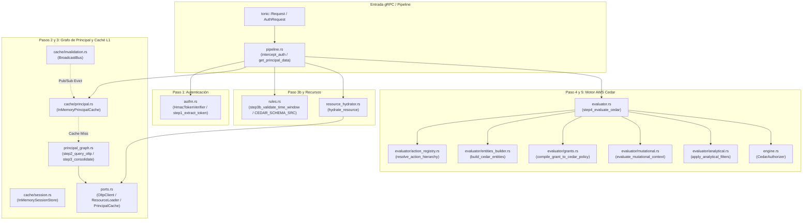
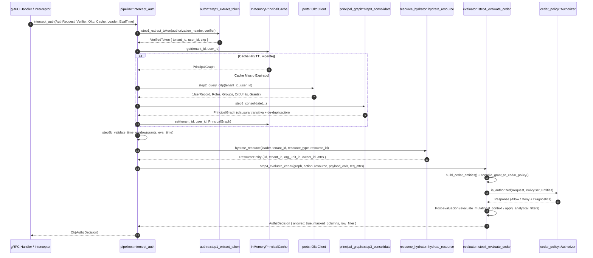

# 09. Componente `cedar` — Motor de Autorización Zero-Trust ABAC/RBAC

## 1. Propósito y Responsabilidad

El módulo `src/cedar/` implementa el plano de seguridad, autenticación de sesiones y autorización de grano fino (**ABAC + RBAC + ReBAC**) de `metri-engine` basado en el motor declarativo **AWS Cedar (`cedar-policy` v4.x)**. Opera bajo una filosofía estricta **Zero-Trust** y **Fail-Closed**: ninguna operación mutacional o analítica puede ejecutarse en el motor sin antes superar el pipeline de cinco etapas que verifica criptográficamente la identidad del llamante, construye su grafo jerárquico de membresías, valida ventanas horarias operativas y evalúa políticas Cedar con condiciones contextuales.

### Qué hace este componente
- **Autenticación criptográfica sin estado (Paso 1)**: Extrae y verifica tokens opacos firmados con `HMAC-SHA256` (`v1.<payload_b64>.<sig_b64>`) desde el header `authorization` de gRPC (`HmacTokenVerifier`).
- **Hidratación y consolidación del Grafo de Principal (Pasos 2 y 3)**: Resuelve desde almacenamiento OLTP (o caché en memoria con invalidación Pub/Sub) el perfil del usuario, sus membresías directas (`UserRole`), grupos (`UserGroup`), jerarquía de unidades organizacionales (`OrgUnit`) y asignaciones de permisos (`PermissionGrant`), calculando la clausura transitiva con detección de ciclos.
- **Validación de ventana horaria (Paso 3b)**: Verifica que la marca de tiempo de evaluación se encuentre dentro del horario permitido (`TimeWindow`: días de la semana y rango de horas UTC) antes de invocar al motor Cedar.
- **Evaluación formal en AWS Cedar (Paso 4)**: Construye el conjunto de entidades Cedar (`Metri::User`, `Metri::Role`, `Metri::Group`, `Metri::OrgUnit`, `Metri::Resource`, `Metri::Action`), inyecta políticas estáticas de aislamiento multi-tenant (`forbid` cruzado y `forbid` por usuario inactivo) junto con políticas dinámicas compiladas desde `PermissionGrant`, y ejecuta `cedar_policy::Authorizer::is_authorized`.
- **Filtrado post-evaluación (Paso 5)**: Aplica máscaras de columnas (`allowed_columns` / `denied_columns` con precedencia de denegación) y filtros de filas (`row_filter_expr`) sobre respuestas analíticas o mutacionales.

### Qué NO hace este componente
- **No ejecuta consultas SQL ni acceso directo a Aurora/DynamoDB**: Define puertos asíncronos (`OltpClient`, `ResourceLoader`) en `ports.rs` que son implementados por adaptadores de persistencia externos.
- **No gestiona el ciclo de vida de emisión de credenciales (IdP)**: Asume que los tokens de sesión o identidades pre-autenticadas provienen del plano de identidad o del interceptor de sesión.
- **No reemplaza las invariantes de esquema del catálogo**: Las validaciones de tipos de datos, fórmulas y máquinas de estado ocurren en `src/catalog/` y `src/engine/` tras la autorización.

---

## 2. Arquitectura Interna

El módulo separa limpiamente la extracción de credenciales, el grafo de identidad con su caché L1 (`DashMap` + canal `tokio::sync::broadcast`), el constructor de entidades/políticas Cedar y los evaluadores especializados por modo de operación (`Mutational` vs `Analytical`).

---

## 3. Flujo de Ejecución Paso a Paso

El siguiente diagrama de secuencia detalla una solicitud autorizada a través de `intercept_auth` en `src/cedar/pipeline.rs`:

---

## 4. Mapa Completo de Submódulos y Archivos

A continuación se listan los **26 archivos `.rs`** que componen `src/cedar/`:

| Ruta Relativa (`src/cedar/...`) | Responsabilidad Exacta |
| :--- | :--- |
| `mod.rs` | Punto de entrada del módulo; declara submódulos y re-exporta los tipos, puertos y funciones del pipeline de autorización. |
| `authn.rs` | Paso 1 del pipeline: extracción del Bearer token y verificación criptográfica `HMAC-SHA256` (`HmacTokenVerifier`, `VerifiedToken`, `step1_extract_token`). |
| `cache/mod.rs` | Submódulo contenedor de las estructuras de caché de autorización y bus de invalidación. |
| `cache/invalidation.rs` | Bus Pub/Sub en memoria (`BroadcastBus`) y bucle reactor (`start_invalidation_listener`) para expulsar entradas de caché ante cambios de roles/permisos. |
| `cache/principal.rs` | Caché concurrente L1 (`InMemoryPrincipalCache` sobre `DashMap`) para `PrincipalGraph` con TTL perezoso y límite de capacidad (`MAX_PRINCIPAL_CACHE_SIZE = 10_000`). |
| `cache/session.rs` | Almacén concurrente en memoria (`InMemorySessionStore`) de sesiones autenticadas (`SessionRecord`) indexadas por `session_id` con expiración automática. |
| `engine.rs` | Envoltorio de bajo nivel sobre `cedar_policy::Authorizer`, `PolicySet` y `Schema` (`CedarAuthorizer`). |
| `evaluator.rs` | Paso 4 del pipeline (`step4_evaluate_cedar`): orquesta la construcción de entidades, compilación de políticas estáticas/dinámicas, invocación a AWS Cedar y post-procesamiento. |
| `evaluator/action_registry.rs` | Registro y resolución de jerarquías de acciones (`read`, `write`, `delete`, `export`) y determinación del modo de operación (`Mutational` vs `Analytical`). |
| `evaluator/analytical.rs` | Paso 5 (modo analítico): cálculo de máscaras de proyección (`allowed_columns` vs `denied_columns`) y extracción de predicados `row_filter_expr`. |
| `evaluator/entities_builder.rs` | Traducción del `PrincipalGraph` y `ResourceEntity` a objetos `cedar_policy::Entity` con atributos tipados y relaciones de ancestros (`Parents`). |
| `evaluator/grants.rs` | Compilador dinámico de `PermissionGrant` hacia sentencias Cedar (`permit(...) when { ... }`) y generador de políticas estáticas base (`policy_tenant_isolation`, `policy_active_user`). |
| `evaluator/mutational.rs` | Validación post-evaluación para comandos de escritura (`write`, `delete`): verifica restricción de campos modificables (`allowed_fields`) y condiciones sobre atributos de solicitud. |
| `pipeline.rs` | Orquestador de extremo a extremo (`intercept_auth`, `intercept` para Tonic, `get_principal_data` con degradación elegante ante fallos de caché). |
| `ports.rs` | Contratos asíncronos (traits `TokenVerifier`, `OltpClient`, `PrincipalCache`, `InvalidationBus`, `ResourceLoader`, `SessionStore`) y enumeración de errores `AuthzError`. |
| `principal_graph.rs` | Pasos 2 y 3 del pipeline (`step2_query_oltp`, `step3_consolidate`, `assemble_principal_graph`): consulta concurrente (`tokio::try_join!`) y cálculo de clausura transitiva de `OrgUnit` con detección de ciclos. |
| `request.rs` | Representación agnóstica del transporte (`AuthRequest`) y extractor de metadatos desde `tonic::Request<T>` (`from_tonic`). |
| `resource_hydrator.rs` | Hidratación perezosa de la entidad de destino (`hydrate_resource`) y ensamblaje de recursos sintéticos para creaciones o listados. |
| `rules.rs` | Esquema estático de AWS Cedar en formato JSON (`CEDAR_SCHEMA_SRC`), validador de ventanas horarias (`step3b_validate_time_window`) y política de modo de autenticación (`AuthenticationPolicy`). |
| `types.rs` | Estructuras de datos fundamentales del dominio de autorización: `UserStatus`, `UserRecord`, `UserRole`, `UserGroup`, `OrgUnit`, `OperationMode`, `TimeWindow`, `PermissionGrant`, `PrincipalGraph`, `ResourceEntity`, `AuthzDecision`, `InvalidationEvent`, `SessionRecord`. |
| `tests/mod.rs` | Punto de entrada de la suite de pruebas unitarias e integración del motor Cedar. |
| `tests/authn.rs` | Pruebas de firma, verificación, expiración y rechazo de manipulación en tokens `HMAC-SHA256`. |
| `tests/evaluator.rs` | Pruebas exhaustivas de evaluación Cedar: aislamiento multi-tenant, jerarquía de `OrgUnit`, máscaras de columnas, filtros de fila y denegación por usuario suspendido. |
| `tests/fakes.rs` | Implementaciones simuladas en memoria (`FakeOltpClient`, `FakeResourceLoader`, etc.) para pruebas deterministas sin base de datos externa. |
| `tests/principal_graph.rs` | Pruebas de consolidación del grafo de identidad, herencia transitiva de unidades organizacionales y detección de ciclos (`CycleDetected`). |
| `tests/rules.rs` | Pruebas de validación del esquema JSON de Cedar y evaluación de ventanas de tiempo (`TimeWindow`) en bordes de día y hora UTC. |

---

## 5. Contratos Públicos (`Traits`, `Structs`, `Enums`)

### Puertos Principales (`src/cedar/ports.rs`)
- **`TokenVerifier`**: Verifica la firma y vigencia de un token opaco y retorna `Result<VerifiedToken, AuthzError>`.
- **`OltpClient`**: Puerto de lectura hacia el almacén relacional/documento de identidades (`get_user`, `get_user_roles`, `get_user_groups`, `get_org_units`, `get_permission_grants`).
- **`PrincipalCache`**: Caché de lectura/escritura e invalidación puntual o por tenant para `PrincipalGraph`.
- **`ResourceLoader`**: Carga metadatos de propiedad y jerarquía (`org_unit_id`, `owner_id`, `attributes`) de un recurso existente antes de autorizar mutaciones.
- **`SessionStore`**: Almacén de sesiones autenticadas (`get_session`) utilizado por el interceptor gRPC.

### Estructuras Clave (`src/cedar/types.rs` y `request.rs`)
- **`PrincipalGraph`**: Estructura consolidada e inmutable en caché que agrupa `user: UserRecord`, `roles: HashSet<String>`, `groups: HashSet<String>`, `org_units: HashSet<String>` (incluyendo ancestros transitivos) y `grants: Vec<PermissionGrant>`.
- **`PermissionGrant`**: Concesión de permiso que especifica sujeto (`Role`, `Group` o `User`), acción, tipo de recurso, alcance organizacional, ventana horaria opcional (`Option<TimeWindow>`), listas de columnas permitidas/denegadas y filtro de filas opcional.
- **`AuthRequest`**: Contenedor desacoplado de Tonic con `authorization_header`, `action`, `resource_type`, `resource_id`, `org_unit_id`, `payload_columns`, `request_attributes` y `client_ip`.
- **`AuthzDecision`**: Resultado enriquecido de autorización con `allowed: bool`, `principal_id`, `tenant_id`, `masked_columns: HashSet<String>`, `row_filter: Option<String>` y `diagnostics: Vec<String>`.

---

## 6. Invariantes de Seguridad y Dominio

1. **Aislamiento Multi-Tenant Inquebrantable (`policy_tenant_isolation`)**: Todo conjunto de políticas compilado incluye una regla estática `forbid(principal, action, resource) unless { principal.tenant_id == resource.tenant_id };`. En Cedar, cualquier `forbid` tiene precedencia absoluta sobre cualquier `permit`.
2. **Bloqueo Inmediato de Usuarios Inactivos (`policy_active_user`)**: Una regla estática `forbid(principal, action, resource) unless { principal.status == "Active" };` garantiza que usuarios en estado `Suspended` o `Revoked` sean rechazados incluso si poseen roles administrativos.
3. **Comparación en Tiempo Constante**: `HmacTokenVerifier` verifica la firma del token utilizando comparación resistente a ataques de temporización (`subtle` / verificación byte a byte acumulada sin cortocircuito).
4. **Precedencia de Columnas Denegadas**: En consultas analíticas (`apply_analytical_filters`), si un `PermissionGrant` autoriza un conjunto de columnas pero otro grant aplicable incluye una columna en `denied_columns`, la denegación prevalece siempre.
5. **Protección contra Ciclos en Jerarquías**: `step3_consolidate` recorre el árbol de `OrgUnit` manteniendo un conjunto `visited` por rama y un límite de profundidad máxima; si detecta un ciclo en los datos OLTP, aborta en modo Fail-Closed con `AuthzError::CycleDetected`.
6. **Guardia de Producción para Bypass de Desarrollo**: `AuthenticationPolicy::DevBypass` comprueba en tiempo de ejecución la variable `METRI_ENV`; si vale `"production"` o `"prod"`, entra en `panic!` inmediato impidiendo iniciar el servidor con autenticación deshabilitada.

---

## 7. Manejo de Errores y Resiliencia

El enum `AuthzError` (`src/cedar/ports.rs`) modela de forma exhaustiva todos los modos de fallo:
- **Errores de Credenciales (`Unauthenticated`)**: `MissingToken`, `MalformedToken`, `InvalidSignature`, `TokenExpired`.
- **Errores de Dominio y Políticas (`PermissionDenied`)**: `UserNotFound`, `UserInactive`, `OutsideTimeWindow`, `CycleDetected`, `ResourceNotFound`, `AccessDenied { reason }`.
- **Errores de Infraestructura (`Internal` / `Unavailable`)**: `OltpError(String)`, `CacheError(String)`, `CedarInternalError(String)`.

### Degradación Elegante de Caché
En `get_principal_data` (`src/cedar/pipeline.rs`), si `PrincipalCache::get` o `PrincipalCache::set` devuelven un error de caché (`CacheError`), el pipeline registra una advertencia en telemetría y continúa consultando directamente a `OltpClient` (`step2_query_oltp`). Sin embargo, si `OltpClient` o `CedarAuthorizer` fallan, el pipeline aplica **Fail-Closed** y rechaza el acceso.

---

## 8. Configuración y Variables de Entorno

| Variable / Constante | Ubicación | Valor por Defecto | Descripción |
| :--- | :--- | :--- | :--- |
| `METRI_ENV` | `src/cedar/rules.rs`, `src/grpc/bootstrap.rs` | `"development"` | Entorno de ejecución. Si es `"production"` o `"prod"`, prohíbe `AuthenticationPolicy::DevBypass`. |
| `METRI_DEV_AUTH_BYPASS` | `src/grpc/bootstrap.rs` | `"false"` | Habilita el modo `DevBypass` únicamente en entornos locales/pruebas cuando vale `"1"` o `"true"`. |
| `MAX_PRINCIPAL_CACHE_SIZE` | `src/cedar/cache/principal.rs` | `10_000` | Límite máximo de grafos de identidad en `InMemoryPrincipalCache` antes de expulsar entradas expiradas o antiguas. |
| `MAX_SESSION_CACHE_SIZE` | `src/cedar/cache/session.rs` | `50_000` | Límite máximo de sesiones activas en `InMemorySessionStore`. |

---

## 9. Guía de Extensión y Testing

### Cómo agregar una nueva condición contextual a las políticas Cedar
1. **Actualizar el esquema**: Añade el atributo correspondiente en `CEDAR_SCHEMA_SRC` dentro de `src/cedar/rules.rs` (bajo la entidad `User`, `Resource` o el objeto `context` de las acciones).
2. **Inyectar el atributo en las entidades**: Modifica `src/cedar/evaluator/entities_builder.rs` para incluir el nuevo atributo en el mapa de atributos de `cedar_policy::Entity`.
3. **Compilar la cláusula `when`**: Extiende `compile_grant_to_cedar_policy` en `src/cedar/evaluator/grants.rs` para emitir la condición Cedar cuando el `PermissionGrant` la especifique.
4. **Registrar pruebas**: Añade casos positivos y negativos en `src/cedar/tests/evaluator.rs` usando los dobles de prueba de `src/cedar/tests/fakes.rs`.

### Estructura de Pruebas
Las pruebas del módulo están aisladas de la red y de bases de datos mediante `src/cedar/tests/fakes.rs`, cubriendo:
- Criptografía y expiración de tokens (`tests/authn.rs`).
- Clausura transitiva y ciclos en grafos organizacionales (`tests/principal_graph.rs`).
- Validación de esquema Cedar y ventanas horarias (`tests/rules.rs`).
- Evaluación integral de políticas ABAC/RBAC, aislamiento de tenant y enmascaramiento de columnas (`tests/evaluator.rs`).
