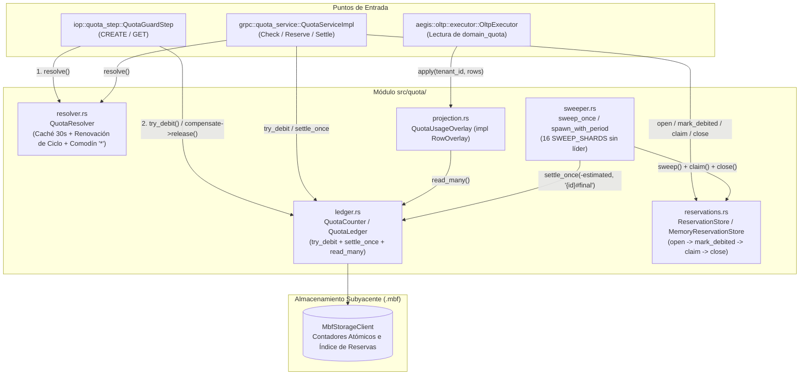

# Componente 10 — Quota (`src/quota/`)

> **Módulo Rust:** `metri_engine::quota`  
> **Ubicación:** `src/quota/` (12 archivos `.rs`)  
> **Capa:** Gobierno Atómico de Cuotas por Tenant, Reservas de IA, Proyección en Lectura y Recolección de Expirados  
> **Dependencias internas directas:** `crate::aegis`, `crate::domain`, `crate::infrastructure`

---

## 1. Visión General y Propósito

El componente **Quota** (`src/quota/`) concentra en un único subsistema toda la lógica que decide si un tenant puede consumir recursos del motor (`WRITE_COUNT`, `READ_COUNT`, `AI_TOKENS`, etc.). Elimina la clásica condición de carrera *read-modify-write* separando explícitamente la **localización de la regla de negocio** de la **decisión atómica sobre el contador**:

1. **Resolución de Configuración (`resolver.rs`)**: Consulta las filas `domain_quota` del tenant (con caché en memoria de corta duración, 30 s por defecto) para determinar qué configuración gobierna hoy la operación, soportando renovación automática de ciclos (`DAILY`, `MONTHLY`, `YEARLY`) y plantillas comodín (`resource_domain = "*"`) donde cada dominio estrena su propio contador derivado (`{id}#{periodo}` o `{id}#{dominio}`).
2. **Libro Mayor y Contador con Autoridad (`ledger.rs`)**: Ejecuta la verificación del techo (`max_limit`) y el incremento (`amount`) dentro de una **única operación atómica condicional** sobre `MbfStorageClient` (`QuotaCounter::try_debit`), inicializando el contador desde `seed_usage` únicamente la primera vez que se toca. Soporta ajustes idempotentes (`settle_once`) mediante claves de liquidación.
3. **Reservas de Tokens en Vuelo (`reservations.rs`)**: Modela tickets de reserva (`Reservation`) que sobreviven al proceso y se almacenan de forma compartida (`ReservationStore`) con semántica de *lease* temporal (`claim`), permitiendo que cualquier réplica concilie el consumo real de un modelo de IA contra la estimación inicial sin doble devolución ni fugas de cuota.
4. **Proyección de Consumo en Tiempo de Lectura (`projection.rs`)**: Implementa `RowOverlay` (`QuotaUsageOverlay`) para inyectar el valor vivo del contador en la columna `current_usage` cuando el panel consulta filas de `domain_quota`, evitando escribir una transacción EAV completa en cada débito del camino crítico.
5. **Barredor Distribuido sin Líder (`sweeper.rs`)**: Recorre periódicamente las 16 particiones de barrido (`SWEEP_SHARDS = 16`) en orden rotatorio aleatorio, reclamando (`claim`) y cerrando reservas expiradas (`EXPIRED` con reintegro idempotente si `debited == true`, o `ABANDONED` sin tocar el contador si `debited == false`).

---

## 2. Frontera Hexagonal (Responsabilidades y No-Responsabilidades)

| Dimensión | Responsabilidades (Dentro de `src/quota/`) | No-Responsabilidades (Fuera de `src/quota/`) |
| :--- | :--- | :--- |
| **Localización de Cuota (`QuotaResolver`)** | Consultar `domain_quota` vía `OltpQueryRunner`, elegir la fila vigente para la fecha actual, derivar el `counter_id` y cachear aciertos por TTL corto. | Tomar decisiones de admisión o rechazo comparando `seed_usage` contra `max_limit` en memoria (responsabilidad exclusiva de `QuotaCounter::try_debit`). |
| **Contabilidad Atómica (`QuotaLedger`)** | Aplicar débitos condicionales (`try_debit`), ajustes (`settle`), liquidaciones idempotentes (`settle_once`), liberaciones (`release`) y lecturas por lote (`read_many`). | Gestionar el pipeline de ingesta o decidir qué verbos gRPC están exentos de cuota (responsabilidad de [`src/iop/quota_step.rs`](11-iop.md) y [`src/grpc/`](14-grpc.md)). |
| **Ciclo de Vida de Reservas (`reservations`, `sweeper`)** | Emitir identificadores de cable (`wire_id`), gestionar el estado `Open`/`Closed` con *leases* y barrer tickets vencidos con idempotencia `{id}#final`. | Invocar proveedores externos de LLM o calcular cuántos tokens consumió un prompt (responsabilidad del llamante que invoca `ReserveQuota` / `SettleQuota`). |
| **Superposición en Lectura (`QuotaUsageOverlay`)** | Implementar `RowOverlay` para sustituir en lote `current_usage` al leer la entidad `domain_quota`. | Persistir copias de `current_usage` en el log de datoms EAV durante el camino de escritura. |

---

## 3. Arquitectura Interna y Diagrama de Flujo (Mermaid C3/C4)

---

## 4. Mapa Completo de Submódulos y Archivos

La siguiente tabla documenta el **100% de los archivos `.rs`** que conforman `src/quota/` (12 archivos en total):

| Ruta Relativa a `src/quota/` | Rol Arquitectónico | Elementos Públicos Principales |
| :--- | :--- | :--- |
| `mod.rs` | Punto de entrada del subsistema; declara los submódulos y re-exporta los tipos y traits principales. | Re-exports de `DebitOutcome`, `QuotaCounter`, `QuotaLedger`, `SettleOutcome`, `QuotaUsageOverlay`, `Reservation`, `ReservationStore`, `QuotaResolver`, `QuotaSpec`, etc. |
| `ledger.rs` | Contador atómico con techo e idempotencia respaldado por `MbfStorageClient`. | `DebitOutcome`, `SettleOutcome`, `QuotaLedger`, `QuotaCounter`. |
| `projection.rs` | Superposición en tiempo de lectura (`RowOverlay`) que inyecta el `current_usage` real sobre filas de `domain_quota`. | `QuotaUsageOverlay`, `QuotaUsageOverlay::new`. |
| `reservations.rs` | Modelo de tickets de reserva de IA, claves de idempotencia, particionamiento FNV-1a (`SWEEP_SHARDS`) y almacén con *leases*. | `SWEEP_SHARDS`, `ReservationStatus`, `CloseReason`, `Reservation`, `ClaimResult`, `ReservationStore`, `MemoryReservationStore`, `wire_id`, `split_wire_id`, `settlement_key`, `late_charge_key`, `shard_of`. |
| `resolver.rs` | Localizador de la fila `domain_quota` vigente para `(tenant, dominio, tipo_límite)` con soporte de renovación de periodo y dominio comodín `*`. | `DEFAULT_QUOTA_DOMAIN`, `QuotaSpec`, `OltpQueryRunner`, `QuotaResolver`, `covers`, `renewed_period`. |
| `sweeper.rs` | Recolector periódico y sin líder de reservas vencidas sobre las 16 particiones de barrido. | `SweepReport`, `SWEEP_PERIOD`, `sweep_once`, `spawn`, `spawn_with_period`. |
| `tests/fakes.rs` | Dobles de prueba deterministas (`FakeCounter`) que reproducen la semántica de techo, semilla e idempotencia. | `FakeCounter` (`#[cfg(test)]`). |
| `tests/ledger_tests.rs` | Pruebas de `QuotaLedger` sobre `MbfStorageClient`: techo exacto, concurrencia, inicialización con `seed` e idempotencia de `settle_once`. | Tests unitarios (`#[cfg(test)]`). |
| `tests/projection_tests.rs` | Pruebas de `QuotaUsageOverlay`: superposición en lote, preservación de semilla cuando no hay contador y degradación ante error. | Tests unitarios (`#[cfg(test)]`). |
| `tests/reservations_tests.rs` | Pruebas de `ReservationStore`: formato `wire_id`, contención de `claim`, expiración de *lease* y distribución de `shard_of`. | Tests unitarios (`#[cfg(test)]`). |
| `tests/resolver_tests.rs` | Pruebas de `QuotaResolver`: selección de periodo vigente, renovación automática de ciclos pasados, fallback al comodín `*` y caché TTL. | Tests unitarios (`#[cfg(test)]`). |
| `tests/sweeper_tests.rs` | Pruebas de `sweep_once`: reembolso de reservas con `debited = true`, cierre `Abandoned` con `debited = false` y reintento seguro tras fallo. | Tests unitarios (`#[cfg(test)]`). |

---

## 5. Contratos Públicos, Traits y Estructuras de Datos Clave

### 5.1. Resolución de Cuotas (`resolver.rs`)
- **`QuotaSpec`**: Especificación normalizada que devuelve `QuotaResolver::resolve`:
  - `id`: ULID de la fila `domain_quota` de configuración.
  - `counter_id`: Identificador del contador autoritativo (`id` directo, `{id}#{periodo}` en ciclo renovado, o `{id}#{dominio}` en cuota comodín `*`).
  - `max_limit`: Techo máximo permitido en el periodo.
  - `seed_usage`: Valor inicial de arranque extraído de la fila EAV (0 en contadores derivados).
  - `period_key`: Clave temporal vigente (`YYYY-MM-DD_YYYY-MM-DD` o `LIFETIME`).

### 5.2. Contador Autoritativo (`ledger.rs`)
- **`pub trait QuotaCounter: Send + Sync`**:
  - `try_debit(tenant_id, quota_id, amount, max_limit, seed) -> Result<DebitOutcome, DomainError>`: Evalúa techo e incrementa en una sola operación atómica, devolviendo `DebitOutcome::Debited { new_usage }` o `DebitOutcome::Exhausted { current_usage, limit }`.
  - `settle_once(tenant_id, quota_id, delta, idem_key) -> Result<SettleOutcome, DomainError>`: Aplica un ajuste `delta` garantizando ejecución exactamente una vez por `idem_key` (`Applied` vs `AlreadyApplied`).
  - `read_many(tenant_id, quota_ids) -> Result<HashMap<String, i64>, DomainError>`: Lectura en lote para `QuotaUsageOverlay`.

### 5.3. Reservas y Almacén (`reservations.rs`)
- **`Reservation`** y **`ReservationStore`**:
  - Flujo de apertura en dos fases (`open` con `debited = false` $\rightarrow$ `try_debit` $\rightarrow$ `mark_debited`): garantiza que si el proceso muere antes o durante el débito, el barredor cierre el ticket como `CloseReason::Abandoned` sin regalar tokens.
  - Claves de idempotencia separadas por intención: `settlement_key(id)` (`{id}#final`, compartida entre conciliación normal y barrido por vencimiento) y `late_charge_key(id)` (`{id}#late`, para cargos reales que llegan después de que el barrido expiró la reserva).

---

## 6. Invariantes del Componente

1. **Separación Estricta entre Lectura (`QuotaResolver`) y Decisión (`QuotaCounter`)**: Ningún componente del motor decide si hay cupo comparando `QuotaSpec::seed_usage` en memoria; toda decisión ocurre dentro de `QuotaCounter::try_debit` de forma atómica frente a peticiones concurrentes.
2. **Orden Inquebrantable `open` Antes de `try_debit` en Reservas**: Toda reserva se registra primero en `ReservationStore::open` con `debited: false` antes de tocar el contador. Así, una caída intermedia nunca deja un débito huérfano sin ticket ni provoca devoluciones espurias.
3. **Exactamente Una Vez en Liquidación y Barrido (`{id}#final`)**: Tanto la conciliación del cliente como el recolector `sweeper` utilizan la misma clave `settlement_key(id)` al invocar `settle_once`. Si ambos compiten en el borde del vencimiento del *lease*, el contador solo se ajusta una vez.
4. **Aislamiento de Contadores en Cuota Comodín (`*`)**: La fila `resource_domain = "*"` actúa como plantilla por defecto, nunca como bolsa compartida: cada dominio recibe un `counter_id = "{id}#{dominio}"` con `seed_usage = 0`.
5. **Degradación Segura en Proyección de Lectura (`QuotaUsageOverlay`)**: Si `read_many` falla al consultar el contador durante una lectura de `domain_quota`, el overlay conserva el valor semilla almacenado y emite `warn!`, sin derribar la consulta del usuario.

---

## 7. Catálogo de Errores Emitidos

| Variante `ErrorCode` | Código Canónico TOML | Etapa (`stage`) | HTTP / gRPC | Retryable | Condición de Disparo en `src/quota/` |
| :--- | :--- | :--- | :--- | :---: | :--- |
| `ErrorCode::Quota001` | `QTA_001` | `quota` | `429` / `RESOURCE_EXHAUSTED` | No | Cuota agotada (`DebitOutcome::Exhausted`), ausencia de configuración `domain_quota` vigente para el tenant/dominio (política *fail-closed*), o periodo de cuota vencido sin estrategia de renovación. |
| `ErrorCode::Infra001` | `INFRA_001` | `infra` | `503` / `UNAVAILABLE` | Sí | Error de almacenamiento subyacente al ejecutar operaciones sobre el contador o el almacén de reservas. |

---

## 8. Decisiones de Diseño Relacionadas

- [ADR-001: Motor HTAP Binario `.mbf` sobre S3](../03-arquitectura/adr/ADR-001-motor-htap-binario-mbf-sobre-s3.md)
- [ADR-002: Modelo de Datoms Inmutables y MVCC](../03-arquitectura/adr/ADR-002-modelo-datoms-inmutables-y-mvcc.md)
- [ADR-006: Catálogo Canónico de Errores y Patrón Result](../03-arquitectura/adr/ADR-006-catalogo-canonico-errores-y-patron-result.md)
- [ADR-007: Identidad de Entidades ULID y Secuencias](../03-arquitectura/adr/ADR-007-identidad-entidades-ulid-y-secuencias.md)

---

## 9. Estrategia de Pruebas del Componente

El módulo `src/quota/` cuenta con 6 archivos de pruebas dedicados en `src/quota/tests/`:

1. **`tests/ledger_tests.rs`**:
   - Valida sobre `MbfStorageClient` que `try_debit` respete el techo exacto bajo ráfagas concurrentes, inicialice desde `seed` solo cuando el contador no existe y garantice idempotencia en `settle_once`.
2. **`tests/resolver_tests.rs`**:
   - Verifica la elección de la fila `domain_quota` activa entre múltiples periodos históricos y futuros, la renovación automática de ciclos (`DAILY`, `MONTHLY`, `YEARLY`), el uso del comodín `*` con contadores separados por dominio y la expiración de la caché TTL.
3. **`tests/reservations_tests.rs`**:
   - Comprueba la codificación/decodificación segura de `wire_id` (`{tenant}:{ulid}`), el rechazo de formatos antiguos manipulables, la exclusión mutua por *lease* en `claim` y la distribución uniforme en `SWEEP_SHARDS`.
4. **`tests/sweeper_tests.rs`**:
   - Verifica que `sweep_once` devuelva exactamente `estimated` cuando `debited == true` (`CloseReason::Expired`), cierre sin tocar el contador cuando `debited == false` (`CloseReason::Abandoned`) y reintente de forma idempotente si un paso intermedio falla.
5. **`tests/projection_tests.rs`**:
   - Comprueba que `QuotaUsageOverlay` actualice en una sola llamada `read_many` todas las filas de la página, respete filas que no solicitaron la columna `current_usage` y maneje contadores renovados `{id}#{periodo}`.
