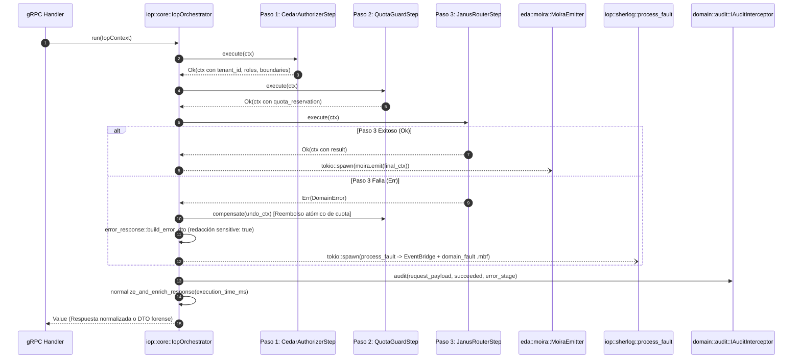

# Componente 11 — IOP (`src/iop/`)

> **Módulo Rust:** `metri_engine::iop`  
> **Ubicación:** `src/iop/` (14 archivos `.rs`)  
> **Capa:** Orquestación del Pipeline de Ingesta (Railway Oriented Programming), Compensación de Sagas, Sanitización Forense y Fault Bus (Sherlog)  
> **Dependencias internas directas:** `crate::aegis`, `crate::cedar`, `crate::codice`, `crate::domain`, `crate::eav`, `crate::janus`, `crate::janus_router`, `crate::otel`, `crate::quota`

---

## 1. Visión General y Propósito

El componente **IOP (Ingest Orchestration Pipeline)** (`src/iop/`) es el coordinador central de todas las operaciones transaccionales y de mutación de `metri-engine`. Implementa una arquitectura basada en **Railway Oriented Programming** con compensación inversa automática (*Saga Undo*) que conecta en secuencia estricta tres pasos síncronos seguidos de tres efectos transversales desacoplados:

1. **Paso 1 — Autorización Zero-Trust (`cedar_step.rs` $\rightarrow$ `CedarAuthorizerStep`)**: Evalúa la identidad del llamante, su sesión y sus políticas ABAC/RBAC mediante `crate::cedar::intercept_auth`, poblando en `IopContext` el `tenant_id` verificado, `user_id`, `roles`, `domain_boundaries` y `cross_tenant_scope`.
2. **Paso 2 — Control Atómico de Cuota (`quota_step.rs` $\rightarrow$ `QuotaGuardStep`)**: Filtra en $O(1)$ operaciones exentas (`UPDATE`, `DELETE`, `UPSERT`) o entidades de sistema, localiza la cuota vigente con `QuotaResolver` y ejecuta el débito atómico en `QuotaLedger` para operaciones `CREATE` (`WRITE_COUNT`) y `GET` (`READ_COUNT`), anotando el ticket en `ctx.quota_reservation`.
3. **Paso 3 — Enrutamiento y Persistencia ACID (`janus_step.rs` $\rightarrow$ `JanusRouterStep`)**: Invoca `JanusRouter::route` para validar el esquema Códice, verificar candados de escritura y persistir la transacción sobre el motor `.mbf`. Si este paso falla, `IopOrchestrator` ejecuta en orden inverso `step.compensate(&undo_ctx)` devolviendo inmediatamente la unidad de cuota debitada en el Paso 2.
4. **Efectos Post-Pipeline (`core.rs`, `error_response.rs`, `sherlog.rs`)**:
   - En caso de `Ok`: dispara de forma asíncrona (*fire-and-forget*) el drenaje del Transactional Outbox mediante `MoiraEmitter`.
   - En caso de `Err`: construye el DTO forense (`build_error_dto`) redactando campos con `sensitive: true` según el Códice, adjunta `trace_id`/`span_id` de OpenTelemetry y dispara en segundo plano `sherlog::process_fault` para persistir la entidad `domain_fault` en `.mbf` y notificar a AWS EventBridge según su severidad.
   - En **ambos** casos (`Ok` y `Err`): registra el evento de auditoría (`IAuditInterceptor`) y normaliza la respuesta con `janus::normalizer`.

---

## 2. Frontera Hexagonal (Responsabilidades y No-Responsabilidades)

| Dimensión | Responsabilidades (Dentro de `src/iop/`) | No-Responsabilidades (Fuera de `src/iop/`) |
| :--- | :--- | :--- |
| **Orquestación Railway y Compensación (`core.rs`, `pipeline.rs`)** | Ejecutar los pasos `IopStep` en orden, cortocircuitar al primer error y ejecutar `compensate` en orden inverso cuando `has_reversible_effects()` es verdadero. | Implementar la lógica interna de evaluación Cedar, contabilidad de cuotas o escritura de datoms EAV. |
| **Adaptadores de Paso (`cedar_step`, `quota_step`, `janus_step`)** | Traducir `IopContext` hacia los contratos de `crate::cedar`, `crate::quota` y `crate::janus_router`, e instrumentar los spans OTel de cada etapa. | Importar tipos de transporte `tonic`, `lambda_runtime` o `crate::infrastructure` (prohibido explícitamente por `tests/architecture_solid_guard.rs`). |
| **Sanitización Forense (`error_response.rs`)** | Construir el sobre JSON canónico de error con `trace_id`, `span_id`, `correlation_id` y redacción `[REDACTED]` de atributos marcados como `sensitive: true`. | Definir el catálogo de códigos de error o su mapeo a códigos de estado gRPC (responsabilidad de [`src/domain/`](04-domain.md) y [`src/grpc/`](14-grpc.md)). |
| **Pipeline de Fallos (`sherlog.rs`)** | Clasificar la severidad del fallo desde `error_catalog`, notificar a EventBridge (`IFaultNotifier`) y persistir el registro `domain_fault` vía `telemetry_channel`. | Interrumpir o bloquear la respuesta al cliente si falla la notificación externa (*fire-and-forget* estricto). |

---

## 3. Arquitectura Interna y Diagrama de Flujo (Mermaid C3/C4)

---

## 4. Mapa Completo de Submódulos y Archivos

La siguiente tabla documenta el **100% de los archivos `.rs`** que conforman `src/iop/` (14 archivos en total):

| Ruta Relativa a `src/iop/` | Rol Arquitectónico | Elementos Públicos Principales |
| :--- | :--- | :--- |
| `mod.rs` | Punto de entrada del módulo IOP; exporta el orquestador, el motor Railway, los 3 pasos, el constructor de errores y Sherlog. | Submódulos `cedar_step`, `core`, `error_response`, `janus_step`, `pipeline`, `quota_step`, `sherlog`. |
| `core.rs` | Orquestador raíz (`IopOrchestrator`), contexto de ejecución (`IopContext`) y traits de extensión (`IIopOrchestrator`, `IopStep`, `MoiraEmitter`). | `IopContext`, `IIopOrchestrator`, `IopOrchestrator`, `IopStep`, `MoiraEmitter`, `record_step_span_error`. |
| `pipeline.rs` | Motor funcional puro de ejecución Railway (`run` síncrono y `run_async` asíncrono) con cortocircuito en el primer `Err`. | `Step`, `run`, `run_async`. |
| `cedar_step.rs` | Paso 1 del IOP (`CedarAuthorizerStep`): adaptador que ejecuta la autorización Zero-Trust de Cedar y enriquece `IopContext`. | `CedarAuthorizerStep`, `CedarAuthorizerStep::new`. |
| `quota_step.rs` | Paso 2 del IOP (`QuotaGuardStep`): filtrado rápido $O(1)$, débito atómico con `QuotaLedger` y compensación (`compensate`) ante fallos posteriores. | `QuotaGuardStep`, `QuotaGuardStep::new`. |
| `janus_step.rs` | Paso 3 del IOP (`JanusRouterStep`): adaptador que invoca `JanusRouter::route` e inserta el resultado en `ctx.request["result"]`. | `JanusRouterStep`, `JanusRouterStep::new`. |
| `error_response.rs` | Constructor del DTO forense de errores (`build_error_dto`) con sanitización de atributos `sensitive: true` e inyección de trazas OTel. | `build_error_dto`. |
| `sherlog.rs` | Pipeline EDA de errores (Sherlog): clasificación por `FaultSeverity`, notificación a EventBridge y persistencia de `domain_fault` en `.mbf`. | `FaultSeverity`, `IFaultNotifier`, `EventBridgeNotifier`, `NoopFaultNotifier`, `process_fault`. |
| `tests/cedar_step_tests.rs` | Pruebas unitarias de `CedarAuthorizerStep`: propagación de identidad, bloqueo de accesos no autorizados y manejo de super-master. | Tests unitarios (`#[cfg(test)]`). |
| `tests/janus_step_tests.rs` | Pruebas unitarias de `JanusRouterStep`: fusión de resultados en `IopContext` y propagación de errores de validación/candados. | Tests unitarios (`#[cfg(test)]`). |
| `tests/orchestrator_tests.rs` | Pruebas de `IopOrchestrator`: flujo feliz completo, compensación inversa de cuota cuando falla el Paso 3, auditoría y disparo de Moira/Sherlog. | Tests unitarios (`#[cfg(test)]`). |
| `tests/pipeline_tests.rs` | Pruebas unitarias del motor Railway (`run` y `run_async`) y política *Zero-Drop* de cortocircuito. | Tests unitarios (`#[cfg(test)]`). |
| `tests/quota_step_tests.rs` | Pruebas unitarias de `QuotaGuardStep`: fast-path para `UPDATE`/`DELETE`, débito en `CREATE`/`GET`, rechazo `Quota001` y reembolso en `compensate`. | Tests unitarios (`#[cfg(test)]`). |
| `tests/sherlog_tests.rs` | Pruebas unitarias de `sherlog`: despacho por severidad (`Info` vs `Warning`/`Error`/`Fatal`), tolerancia a fallos del notificador y persistencia de `domain_fault`. | Tests unitarios (`#[cfg(test)]`). |

---

## 5. Contratos Públicos, Traits y Estructuras de Datos Clave

### 5.1. `IopContext`, `IopStep` e `IIopOrchestrator` (`core.rs`)
- **`IopContext`**: Estructura que viaja a lo largo de todo el pipeline transportando la solicitud original (`request: Map<String, Value>`), identidad (`tenant_id`, `user_id`, `roles`), metadatos de operación (`entity_type`, `operation`, `schema`, `model`), atributos de seguridad Cedar (`granted_action_keys`, `is_super_master`, `cross_tenant_scope`, `domain_boundaries`) y el ticket de compensación (`quota_reservation: Option<Value>`).
- **`pub trait IopStep: Send + Sync`**:
  - `async fn execute(&self, ctx: IopContext) -> Result<IopContext, DomainError>`: Transforma el contexto o aborta con error tipado.
  - `async fn compensate(&self, _ctx: &IopContext)`: Revierte efectos externos producidos por `execute` cuando un paso posterior falla.

### 5.2. `QuotaGuardStep` (`quota_step.rs`)
- Evalúa si la operación requiere consumo de cuota (`CREATE` $\rightarrow$ `WRITE_COUNT`, `GET` $\rightarrow$ `READ_COUNT`), eximiendo a `is_super_master`, entidades de sistema (`domain_quota`, `domain_fault`, `outbox_event`, `audit_log`) y verbos de modificación/borrado (`UPDATE`, `DELETE`, `UPSERT`).
- En `compensate`, extrae el `id` de `ctx.quota_reservation` e invoca `counter.release(&ctx.tenant_id, id, 1)` para reintegrar la unidad debitada si la escritura en Janus falló.

### 5.3. Sanitización Forense y Sherlog (`error_response.rs`, `sherlog.rs`)
- **`build_error_dto(error, tenant_id, user_id, context, model) -> Value`**: Redacta con `"[REDACTED]"` todo campo cuyo `AttributeDescriptor` en el Códice declare `sensitive: true` antes de incluir el contexto en la respuesta o enviarlo al bus de fallos.
- **`FaultSeverity`** y **`process_fault`**: Consulta la severidad canónica del código en `error_catalog`. Si es `Warning`, `Error` o `Fatal`, emite el evento `DOMAIN_FAULT_<SEVERITY>` mediante `IFaultNotifier` y persiste un registro `domain_fault` vía `telemetry_channel`.

---

## 6. Invariantes del Componente

1. **Política *Zero-Drop* (Cortocircuito Inmediato)**: Si el Paso 1 (Cedar) o el Paso 2 (Quota) retorna `Err(DomainError)`, ningún paso subsiguiente es invocado.
2. **Compensación Garantizada de Efectos Externos (*Saga Undo*)**: Antes de ejecutar cualquier paso posterior a la adquisición de un efecto reversible (`ctx.has_reversible_effects() == true`), `IopOrchestrator::run_steps` conserva una instantánea `undo_ctx` y, ante cualquier error posterior, ejecuta `done.compensate(&undo_ctx)` en orden inverso. Ninguna escritura fallida en Janus filtra cuota del tenant.
3. **Privacidad por Diseño en Errores (`sensitive: true`)**: Ningún valor de un atributo marcado como `sensitive: true` en `config/models/*.json` puede abandonar el motor dentro de un `error_dto` ni persistirse en claro en `domain_fault`.
4. **Auditoría Incondicional y No-Bloqueo de Efectos Secundarios**: `perform_audit` se ejecuta siempre tanto en `Ok` como en `Err`. Por su parte, `MoiraEmitter` y `sherlog::process_fault` se ejecutan en tareas asíncronas desacopladas (`tokio::spawn`) cuyos fallos se registran en telemetría pero jamás alteran ni bloquean la respuesta entregada al cliente.
5. **Pureza Hexagonal de los Pasos (DIP)**: `cedar_step.rs`, `quota_step.rs` y `janus_step.rs` están auditados por `tests/architecture_solid_guard.rs` para mantener 0 dependencias hacia `aws_sdk_*`, `tonic`, `lambda_runtime`, `crate::grpc` o `crate::infrastructure`.

---

## 7. Catálogo de Errores Emitidos

| Variante `ErrorCode` | Código Canónico TOML | Etapa (`stage`) | HTTP / gRPC | Retryable | Condición de Disparo en `src/iop/` |
| :--- | :--- | :--- | :--- | :---: | :--- |
| `ErrorCode::Cdr001`–`Cdr004` | `CDR_001`–`CDR_004` | `cedar` | `401` / `403` | No | Propagados por `CedarAuthorizerStep` ante fallo de autenticación, sesión inválida o denegación de política ABAC. |
| `ErrorCode::Quota001` | `QTA_001` | `quota` | `429` / `RESOURCE_EXHAUSTED` | No | Emitido por `QuotaGuardStep` cuando el tenant carece de cuota configurada o alcanza el techo `max_limit` en `QuotaLedger`. |
| `ErrorCode::Jns001` / `JnsLock001` / `JnsSeed001` | `JNS_*` | `janus` | `400` / `403` | No | Propagados por `JanusRouterStep` cuando la validación del modelo o la escritura transaccional son rechazadas. |
| `ErrorCode::Infra004` | `INFRA_004` | `infra` | `502` / `UNAVAILABLE` | Sí | Registrado internamente por `EventBridgeNotifier::notify` cuando falla el despacho `PutEvents` hacia AWS EventBridge. |

---

## 8. Decisiones de Diseño Relacionadas

- [ADR-001: Motor HTAP Binario `.mbf` sobre S3](../03-arquitectura/adr/ADR-001-motor-htap-binario-mbf-sobre-s3.md)
- [ADR-003: Seguridad Zero-Trust Cedar y HMAC](../03-arquitectura/adr/ADR-003-seguridad-zero-trust-cedar-y-hmac.md)
- [ADR-005: Registro SSOT Códice y Validación en el Arranque](../03-arquitectura/adr/ADR-005-registro-ssot-codice-y-validacion-arranque.md)
- [ADR-006: Catálogo Canónico de Errores y Patrón Result](../03-arquitectura/adr/ADR-006-catalogo-canonico-errores-y-patron-result.md)

---

## 9. Estrategia de Pruebas del Componente

El componente `src/iop/` cuenta con 6 suites de pruebas unitarias y de integración en `src/iop/tests/`:

1. **`tests/orchestrator_tests.rs`**:
   - Verifica el pipeline completo de 3 pasos, la inyección de `execution_time_ms`, la invocación de `IAuditInterceptor` tanto en éxito como en error y, de forma crítica, la **compensación inversa** (`compensate`) que devuelve la cuota debitada en el Paso 2 cuando el Paso 3 falla.
2. **`tests/quota_step_tests.rs`**:
   - Comprueba el *fast-path* sin I/O para `UPDATE`/`DELETE`/`UPSERT`, la exención de entidades de sistema y super-master, el débito atómico en `CREATE` y `GET`, y la liberación del débito al invocar `compensate`.
3. **`tests/cedar_step_tests.rs` y `tests/janus_step_tests.rs`**:
   - Verifican el enriquecimiento de `IopContext` tras la evaluación Cedar y el transporte del resultado de `JanusRouter` hacia el normalizador.
4. **`tests/pipeline_tests.rs`**:
   - Valida las propiedades algebraicas de `pipeline::run` y `pipeline::run_async` (cortocircuito exacto en el primer `Err`).
5. **`tests/sherlog_tests.rs`**:
   - Verifica que los errores de severidad `Info` solo se registren en bitácora, mientras que `Warning`, `Error` y `Fatal` notifiquen al bus y encolen la creación de la entidad `domain_fault`, sin propagar pánicos ni errores si el notificador externo falla.
