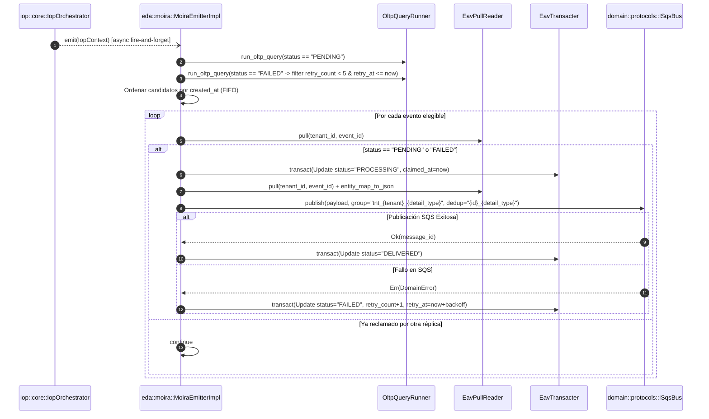

# Componente 12 — EDA (`src/eda/`)

> **Módulo Rust:** `metri_engine::eda`  
> **Ubicación:** `src/eda/` (3 archivos `.rs`)  
> **Capa:** Arquitectura Orientada a Eventos (Transactional Outbox Drainage, Reclamo Atómico, Reintentos con Backoff Exponencial y Watchdog de Huérfanos)  
> **Dependencias internas directas:** `crate::aegis`, `crate::domain`, `crate::eav`, `crate::iop`

---

## 1. Visión General y Propósito

El componente **EDA (Event-Driven Architecture)** (`src/eda/`) completa el ciclo del patrón **Transactional Outbox** en `metri-engine`. Mientras que la entidad `outbox_event` nace dentro de la misma transacción ACID `.mbf` que la mutación de negocio en `crate::eav::writer::outbox` (garantizando que ningún evento de dominio pueda perderse si el proceso muere tras confirmar la escritura), `src/eda/moira.rs` (`MoiraEmitterImpl`) se encarga de drenar, reclamar y despachar dichos eventos de forma asíncrona hacia las colas **AWS SQS FIFO** sin bloquear el Write Path.

Sus responsabilidades principales son:
1. **Recolección FIFO de Eventos Elegibles (`fetch_pending_events`)**: Consulta mediante `OltpQueryRunner` hasta 100 eventos `outbox_event` en estado `PENDING` y hasta 100 eventos en estado `FAILED` cuyo contador de reintentos sea menor a 5 (`retry_count < 5`) y cuyo instante de enfriamiento haya vencido (`retry_at <= now`), ordenándolos cronológicamente por `created_at` (FIFO).
2. **Reclamo Transaccional Atómico (`try_claim_event`)**: Antes de publicar en la red, lee el estado actual del evento con `EavPullReader::pull`, verifica que continúe en `PENDING` o `FAILED`, y ejecuta una transacción de actualización (`EavTransacter::transact`) marcándolo como `PROCESSING` con marca de tiempo `claimed_at = now`.
3. **Despacho Determinista a SQS FIFO y Confirmación (`emit`, `mark_delivered`)**: Publica el payload hidratado en el puerto `ISqsBus` utilizando `MessageGroupId = "tnt_{tenant_id}_{detail_type}"` (preservando el orden por tenant y tipo de evento) y `MessageDeduplicationId = "{event_id}_{detail_type}"`. Si la entrega tiene éxito, transiciona el evento a `DELIVERED`.
4. **Reintentos con *Backoff* Exponencial y Tope (`mark_failed`)**: Si el envío a SQS FIFO falla, incrementa `retry_count` y calcula el próximo intento mediante la fórmula de *backoff* exponencial acotado:
   $$\text{delay\_ms} = \min\left(2^{\text{retry\_count}} \times 30\,000\text{ ms},\; 1\,800\,000\text{ ms}\right)$$
   (desde 30 segundos hasta un máximo de 30 minutos), pasando a estado `FAILED` permanente al alcanzar `max_retries = 5`.
5. **Watchdog de Eventos Huérfanos (`reset_orphaned_processing`)**: Detecta eventos que quedaron atrapados en estado `PROCESSING` (por ejemplo, si una instancia Lambda murió entre el `claim` y la confirmación) cuyo `claimed_at <= now - ttl_ms` y los revierte transaccionalmente a `PENDING` para su reprocesamiento.

---

## 2. Frontera Hexagonal (Responsabilidades y No-Responsabilidades)

| Dimensión | Responsabilidades (Dentro de `src/eda/`) | No-Responsabilidades (Fuera de `src/eda/`) |
| :--- | :--- | :--- |
| **Drenaje del Outbox (`MoiraEmitterImpl`)** | Consultar eventos `PENDING`/`FAILED` elegibles, reclamarlos a `PROCESSING`, publicarlos en `ISqsBus` y transicionarlos a `DELIVERED` o `FAILED`. | Generar los datoms iniciales de `outbox_event` o evaluar las reglas de coincidencia de eventos durante la mutación (responsabilidad de [`src/eav/writer/outbox.rs`](02-eav.md)). |
| **Abstracción de Almacenamiento y Cola** | Definir y consumir los traits de puerto `EavPullReader`, `EavTransacter`, `OltpQueryRunner` e `ISqsBus`. | Implementar el cliente del SDK de AWS SQS o el motor físico de archivos `.mbf` (implementados en [`src/infrastructure/`](15-infrastructure.md), [`src/eav/`](02-eav.md) y [`src/mbf/`](01-mbf.md)). |
| **Recuperación de Huérfanos (`reset_orphaned_processing`)** | Identificar eventos en `PROCESSING` con `claimed_at` vencido y regresarlos a `PENDING`. | Invocar los endpoints gRPC de mantenimiento (`ReprocessFailedOutbox`, `PurgeOutbox`), los cuales viven en [`src/grpc/eda_service.rs`](14-grpc.md). |

---

## 3. Arquitectura Interna y Diagrama de Flujo (Mermaid C3/C4)

```mermaid
stateDiagram-v2
    [*] --> PENDING: Creado en la misma TX ACID (eav::writer::outbox)
    PENDING --> PROCESSING: try_claim_event() [claimed_at = now]
    PROCESSING --> DELIVERED: ISqsBus::publish() Ok -> mark_delivered()
    PROCESSING --> FAILED: ISqsBus::publish() Err -> mark_failed() [retry_count + 1, retry_at]
    FAILED --> PROCESSING: retry_count < 5 y retry_at <= now -> try_claim_event()
    PROCESSING --> PENDING: reset_orphaned_processing() [claimed_at <= now - ttl_ms]
    DELIVERED --> [*]
```



---

## 4. Mapa Completo de Submódulos y Archivos

La siguiente tabla documenta el **100% de los archivos `.rs`** que conforman `src/eda/` (3 archivos en total):

| Ruta Relativa a `src/eda/` | Rol Arquitectónico | Elementos Públicos Principales |
| :--- | :--- | :--- |
| `mod.rs` | Punto de entrada del módulo EDA; documenta el ciclo completo del Transactional Outbox y expone el submódulo `moira`. | Submódulo `moira`. |
| `moira.rs` | Implementación de `MoiraEmitterImpl`: drenaje de eventos `outbox_event`, reclamo atómico, publicación SQS FIFO, *backoff* exponencial y *watchdog* de huérfanos. | `EavPullReader`, `EavTransacter`, `OltpQueryRunner`, `MoiraEmitterImpl`, `MoiraEmitterImpl::new`, `MoiraEmitterImpl::reset_orphaned_processing`. |
| `tests/moira_tests.rs` | Suite exhaustiva de pruebas unitarias, de fallos de red, *backoff* exponencial, deduplicación FIFO y recuperación de eventos huérfanos. | Tests unitarios con dobles en memoria (`#[cfg(test)]`). |

---

## 5. Contratos Públicos, Traits y Estructuras de Datos Clave

### 5.1. Puertos de Desacoplamiento (`moira.rs`)
Para permitir pruebas unitarias 100% deterministas en memoria sin depender de clientes concretos de almacenamiento, `moira.rs` define tres traits con implementaciones por defecto para los tipos productivos:
- **`pub trait EavPullReader: Send + Sync`** (implementado para `Arc<EavReader>`):
  - `async fn pull(&self, tenant_id: &str, entity_id: &str, attributes: Option<&[&str]>) -> Result<HashMap<String, DatomValue>, DomainError>`
- **`pub trait EavTransacter: Send + Sync`** (implementado para `Arc<EavWriter>`):
  - `async fn transact(&self, payload: TransactPayload) -> Result<TransactResult, DomainError>`
- **`pub trait OltpQueryRunner: Send + Sync`** (implementado para `OltpExecutor`):
  - `async fn run_oltp_query(&self, tenant_id: &str, ast_ir: &Value) -> Result<Value, DomainError>`

### 5.2. `MoiraEmitterImpl<R, W, O>` (`moira.rs`)
- **`MoiraEmitterImpl::new(eav_reader, eav_writer, sqs_bus, oltp_executor) -> Self`**:
  Implementa el trait `crate::iop::core::MoiraEmitter`:
  - `async fn emit(&self, ctx: IopContext) -> Result<(), DomainError>`: Ejecuta un ciclo completo de drenaje para el `ctx.tenant_id`.
  - `async fn reset_orphaned_processing(&self, tenant_id: &str, ttl_ms: i64) -> Result<usize, DomainError>`: Reestablece a `PENDING` todos los eventos en `PROCESSING` cuyo `claimed_at <= now - ttl_ms` y devuelve la cantidad de eventos recuperados.

---

## 6. Invariantes del Componente

1. **Garantía *At-Least-Once* con Deduplicación Determinista en SQS FIFO**: Todo evento reclamado se publica con `MessageGroupId = "tnt_{tenant_id}_{detail_type}"` y `MessageDeduplicationId = "{event_id}_{detail_type}"`. Si un trabajador falla después de publicar en SQS pero antes de ejecutar `mark_delivered`, el reintento posterior enviará el mismo `MessageDeduplicationId`, siendo absorbido sin duplicidad dentro de la ventana de deduplicación de SQS FIFO.
2. **Ordenamiento FIFO por Creación**: `fetch_pending_events` combina candidatos `PENDING` y `FAILED` elegibles y los ordena siempre de forma ascendente por `created_at` antes de despacharlos.
3. **Backoff Exponencial Acotado y Tope de 5 Reintentos**: Ningún evento con `retry_count >= 5` vuelve a ser seleccionado por `fetch_pending_events`. Mientras `retry_count < 5`, el tiempo de espera crece exponencialmente ($30\text{ s}, 60\text{ s}, 120\text{ s}, 240\text{ s}, 480\text{ s}$) con techo duro en $1\,800\,000\text{ ms}$ ($30\text{ min}$).
4. **Aislamiento de Errores por Evento en el Lote**: Un fallo al reclamar o serializar un evento individual dentro del bucle de `emit` se registra en telemetría o transiciona ese evento a `FAILED`, pero no detiene el despacho de los demás eventos pendientes del tenant.

---

## 7. Catálogo de Errores Emitidos

| Variante `ErrorCode` | Código Canónico TOML | Etapa (`stage`) | HTTP / gRPC | Retryable | Condición de Disparo en `src/eda/` |
| :--- | :--- | :--- | :--- | :---: | :--- |
| `ErrorCode::Eav004` | `EAV_004` | `eav` | `500` / `INTERNAL` | No | Error de serialización JSON al preparar el cuerpo del evento reclamado antes de enviarlo a SQS FIFO. |
| `ErrorCode::Infra003` | `INFRA_003` | `infra` | `502` / `UNAVAILABLE` | Sí | Fallo de transporte al publicar en el adaptador `ISqsBus` (capturado por `emit` para activar `mark_failed` con *backoff* exponencial). |

---

## 8. Decisiones de Diseño Relacionadas

- [ADR-001: Motor HTAP Binario `.mbf` sobre S3](../03-arquitectura/adr/ADR-001-motor-htap-binario-mbf-sobre-s3.md)
- [ADR-002: Modelo de Datoms Inmutables y MVCC](../03-arquitectura/adr/ADR-002-modelo-datoms-inmutables-y-mvcc.md)
- [ADR-004: Contratos Tipados gRPC, FlatBuffers y Deltas](../03-arquitectura/adr/ADR-004-contratos-tipados-grpc-flatbuffers-y-deltas.md)
- [ADR-006: Catálogo Canónico de Errores y Patrón Result](../03-arquitectura/adr/ADR-006-catalogo-canonico-errores-y-patron-result.md)

---

## 9. Estrategia de Pruebas del Componente

La suite `src/eda/tests/moira_tests.rs` (más de 1.300 líneas de pruebas unitarias y de concurrencia con `MockPullReader`, `MockTransacter`, `MockQueryRunner` y `MockSqsBus`) verifica exhaustivamente:

1. **Flujo Feliz y Ordenamiento FIFO**:
   - Drenaje de múltiples eventos `PENDING`, transición `PENDING` $\rightarrow$ `PROCESSING` $\rightarrow$ `DELIVERED`, formato exacto de `MessageGroupId` y `MessageDeduplicationId`, e inyección de `id` y `outbox_id` en el payload publicado.
2. **Curva de *Backoff* Exponencial y Agotamiento (`max_retries = 5`)**:
   - Verifica que ante fallos de `ISqsBus::publish`, `retry_count` se incremente de 0 a 5, `retry_at` respete la progresión $2^n \times 30\,\text{s}$ con tope en $30\,\text{min}$, y al llegar al quinto fallo el evento quede excluido de futuros barridos.
3. **Contención entre Réplicas**:
   - Comprueba que si `try_claim_event` encuentra el evento ya en estado `PROCESSING` o `DELIVERED` (reclamado por otra réplica), devuelve `Ok(None)` sin publicar duplicados en SQS.
4. **Watchdog de Eventos Huérfanos (`reset_orphaned_processing`)**:
   - Verifica que únicamente los eventos en `PROCESSING` con `claimed_at <= now - ttl_ms` sean revertidos a `PENDING`, preservando intactos los eventos cuyo reclamo sigue dentro de la ventana de vida.
