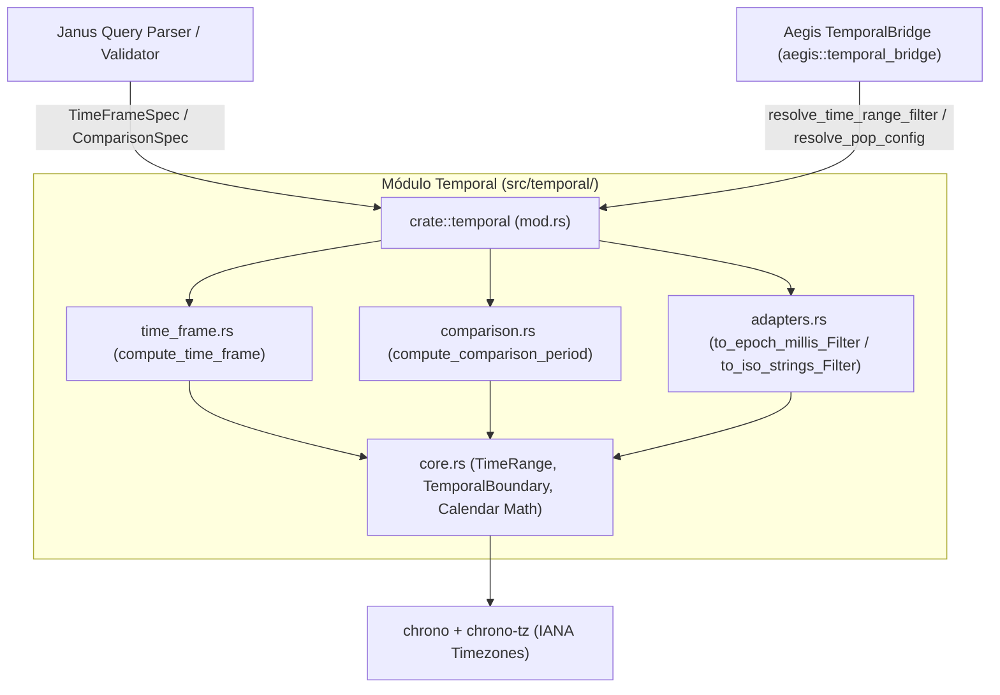
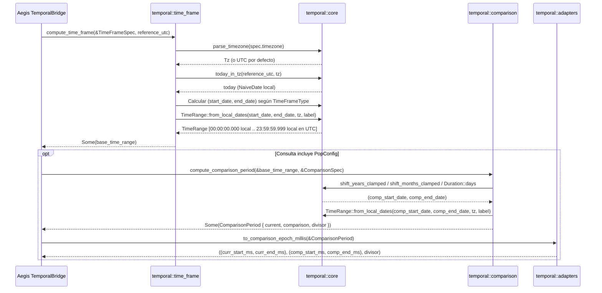

# 13 — Temporal (`src/temporal/`)

> **Capa:** Núcleo Funcional de Inteligencia Calendárica y Series de Tiempo  
> **Ruta raíz:** `src/temporal/`  
> **Archivos fuente:** 5 archivos `.rs`  
> **Dependencias internas directas:** Ninguna (módulo hoja puro; depende únicamente de `chrono`, `chrono_tz` y `serde`)

---

## 1. Propósito y Responsabilidad

El componente **Temporal** (`crate::temporal`) es el motor matemático-calendárico puro de `metri-engine`. Proporciona primitivas deterministas, libres de efectos secundarios (*side-effect-free*) y conscientes de husos horarios IANA (`chrono_tz::Tz`) para resolver ventanas de tiempo declarativas y períodos comparativos (*Period-over-Period*, **PoP**) tanto para el motor transaccional OLTP como para el motor analítico columnar `.mbf`.

Sus responsabilidades principales son:

1. **Resolución de Ventanas Temporales Declarativas (`time_frame`)**: Traduce especificaciones de alto nivel (`TimeFrameSpec`, con 29 variantes de `TimeFrameType` que abarcan períodos actuales, previos, rodantes, acumulados hasta la fecha *To-Date*, años fiscales configurables y rangos personalizados) en intervalos cerrados `[start, end]` con precisión de milisegundo (`TimeRange`).
2. **Desplazamiento de Períodos Comparativos (`comparison`)**: Calcula el intervalo histórico exacto (`ComparisonPeriod`) frente al cual debe compararse un `TimeRange` base utilizando cuatro estrategias (`PeriodBefore`, `RollingAverage`, `ShiftShortcut` con 12 atajos como `YoY`, `MoM`, `QoQ`, `WoW`, y `CustomShift`), preservando las invariantes de calendario (años bisiestos y longitudes variables de mes).
3. **Aritmética Calendárica Segura y Total (`core`)**: Encapsula todas las operaciones sobre `NaiveDate`, `DateTime<Utc>` y zonas horarias IANA garantizando funciones totales (sin `unwrap()` riesgosos ni pánicos en fechas extremas, restringiendo años al rango seguro `[0, 9999]` y aplicando *clamping* automático al último día válido del mes).
4. **Adaptación sin Fricción a Motores de Consulta (`adapters`)**: Convierte cualquier `TimeRange` o `ComparisonPeriod` en tuplas listas para filtros de milisegundos epoch UTC `(i64, i64)` o cadenas RFC 3339 `(String, String)`.

---

## 2. Diagrama C3 de Componentes Internos

---

## 3. Estructura de Archivos del Módulo

| Archivo (relativo a `src/`) | Propósito Técnico | Elementos Públicos Principales |
| :--- | :--- | :--- |
| `temporal/mod.rs` | Punto de entrada público del módulo; expone y re-exporta los tipos y funciones de `core`, `time_frame`, `comparison` y `adapters`. | Re-exports de `TemporalBoundary`, `TimeRange`, `CustomDate`, `TimeFrameSpec`, `TimeFrameType`, `compute_time_frame`, `ComparisonPeriod`, `ComparisonSpec`, `ShiftShortcut`, `TimeComparisonMethod`, `compute_comparison_period`, `to_comparison_epoch_millis`, `to_epoch_millis_filter`, `to_iso_strings_filter` |
| `temporal/core.rs` | Primitivas de frontera temporal (`TemporalBoundary`), intervalo (`TimeRange`), resolución de zona horaria IANA y aritmética calendárica con *clamping* de fin de mes. | `TemporalBoundary`, `TimeRange`, `parse_timezone`, `today_in_tz`, `start_of_day_in_tz`, `end_of_day_in_tz`, `first_day_of_month`, `last_day_of_month`, `shift_months_clamped`, `shift_years_clamped`, `quarter_of_month`, `first_day_of_quarter`, `last_day_of_quarter` |
| `temporal/time_frame.rs` | Definición de las 29 variantes de `TimeFrameType`, `CustomDate`, `TimeFrameSpec` y el motor de resolución `compute_time_frame`. | `TimeFrameType`, `CustomDate`, `TimeFrameSpec`, `compute_time_frame` |
| `temporal/comparison.rs` | Definición de métodos de comparación (`TimeComparisonMethod`), 12 atajos (`ShiftShortcut`), `ComparisonSpec`, `ComparisonPeriod` y `compute_comparison_period`. | `TimeComparisonMethod`, `ShiftShortcut`, `ComparisonSpec`, `ComparisonPeriod`, `compute_comparison_period` |
| `temporal/adapters.rs` | Adaptadores de proyección de `TimeRange` y `ComparisonPeriod` hacia tuplas epoch UTC `(i64, i64)` y cadenas RFC 3339 `(String, String)`. | `to_epoch_millis_filter`, `to_iso_strings_filter`, `to_comparison_epoch_millis` |

---

## 4. Contratos Públicos y Tipos Clave

### 4.1 Fronteras e Intervalos: `TemporalBoundary` y `TimeRange` (`src/temporal/core.rs`)

- **`TemporalBoundary`**: Representa un instante exacto en UTC (`datetime_utc: DateTime<Utc>`, `epoch_millis: i64`, `iso_string: String`) junto con la fecha local en la zona horaria del tenant (`local_date: NaiveDate`).
- **`TimeRange`**: Intervalo cerrado `[start, end]` compuesto por dos `TemporalBoundary`, la zona horaria IANA efectiva (`timezone: String`) y una etiqueta descriptiva (`label: String`). Provee el método `duration_days(&self) -> i64` que calcula la cantidad inclusiva de días calendario abarcados.

### 4.2 Catálogo de 29 Variantes de `TimeFrameType` (`src/temporal/time_frame.rs`)

| Categoría | Variantes de `TimeFrameType` | Semántica de Resolución (en el huso horario del tenant) |
| :--- | :--- | :--- |
| **Período Actual Completo** | `Today`, `ThisWeek`, `ThisMonth`, `ThisQuarter`, `ThisYear` | Desde las `00:00:00.000` del primer día del período actual hasta las `23:59:59.999` del último día del período actual (semana ISO Lunes–Domingo). |
| **Período Previo Completo** | `Yesterday`, `LastWeek`, `LastMonth`, `LastQuarter`, `LastYear` | Desde las `00:00:00.000` del primer día hasta las `23:59:59.999` del último día del período inmediato anterior completo. |
| **Ventanas Rodantes (*Rolling*)** | `LastNDays`, `LastNWeeks`, `LastNMonths`, `LastNQuarters`, `LastNYears`, `Last7Days`, `Last30Days`, `Last90Days`, `Last365Days`, `Last12Months` | Ventanas móviles ancladas en `today` (para días) o en el período actual/previo según la unidad y `rolling_count` ($\max(1, n)$). |
| **Acumulados a la Fecha (*To-Date*)** | `WeekToDate`, `MonthToDate`, `QuarterToDate`, `YearToDate` | Desde el inicio del período en curso (`00:00:00.000`) hasta el final del día actual (`today 23:59:59.999`). |
| **Calendario Fiscal Configurable** | `ThisFiscalQuarter`, `ThisFiscalYear`, `LastFiscalQuarter`, `LastFiscalYear`, `FiscalYearToDate` | Calcula el año y trimestre fiscal a partir de `fiscal_year_start_month` (`1..=12`, por defecto `1` = enero). |
| **Personalizados y Nulos** | `CustomRange`, `BeforeDate`, `AfterDate`, `OnDate`, `AllTime`, `Unspecified` | Rangos definidos por `custom_start`/`custom_end` (`CustomDate`), época completa (`1970-01-01` a `today`), o `None` si es `Unspecified`. |

### 4.3 Estrategias y Atajos de Comparación (`src/temporal/comparison.rs`)

- **`TimeComparisonMethod`**:
  1. `PeriodBefore`: Desplaza el rango base exactamente su propia duración (`duration_days`) hacia atrás, terminando el día inmediato anterior a `base.start`.
  2. `RollingAverage`: Construye una ventana histórica contigua de $k \times \text{duration\_days}$ días previos (`rolling_periods = k`), ideal para comparar contra el promedio móvil de los últimos $k$ períodos.
  3. `ShiftShortcut`: Aplica uno de los 12 desplazamientos calendáricos predefinidos en `ShiftShortcut`.
  4. `CustomShift`: Desplaza las fechas de inicio y fin exactamente `custom_shift_days` días hacia el pasado.
  5. `Unspecified`: Desactiva el cálculo comparativo devolviendo `None`.
- **12 Variantes de `ShiftShortcut`**:
  - `PreviousPeriod`: Equivalente a `PeriodBefore` (desplazamiento contiguo de igual duración).
  - `SamePeriodLastYear` / `YoY`: Desplaza inicio y fin `-1` año con *clamping* de año bisiesto (`shift_years_clamped`).
  - `SamePeriodLastQuarter` / `QoQ`: Desplaza inicio y fin `-3` meses con *clamping* de fin de mes (`shift_months_clamped`).
  - `SamePeriodLastMonth` / `MoM`: Desplaza inicio y fin `-1` mes con *clamping* de fin de mes.
  - `SamePeriodLastWeek` / `WoW`: Desplaza inicio y fin `-7` días exactos.
  - `SameDayLastYear`: Desplaza `-1` año sobre la fecha puntual.
  - `SameDayLastMonth`: Desplaza `-1` mes sobre la fecha puntual.
  - `SameDayLastWeek`: Desplaza `-7` días sobre la fecha puntual.

---

## 5. Flujos de Ejecución Paso a Paso

### 5.1 Resolución de Ventana Temporal y Período Comparativo (PoP)

1. **Normalización del Huso Horario (`parse_timezone`)**: Se interpreta la cadena IANA provista en `TimeFrameSpec::timezone` (por ejemplo, `"America/Bogota"` o `"Europe/Madrid"`). Si está vacía o no existe en la base IANA, se aplica *fallback* determinista a `chrono_tz::UTC`.
2. **Anclaje Local (`today_in_tz`)**: El instante de referencia `DateTime<Utc>` se proyecta a la zona horaria del tenant para obtener la fecha calendario local (`NaiveDate`) sobre la cual se calculan inicios de semana, mes, trimestre o año fiscal.
3. **Expansión a Límites Diarios Inclusivos (`start_of_day_in_tz` / `end_of_day_in_tz`)**: Las fechas locales inicial y final se expanden respectivamente a `00:00:00.000` y `23:59:59.999` en la zona horaria del tenant (resolviendo transiciones de horario de verano DST mediante `.earliest()` / `.latest()`) y se convierten a epoch milisegundos UTC.
4. **Cálculo del Período Comparativo (`compute_comparison_period`)**: A partir del `TimeRange` actual ya resuelto, se aplica el desplazamiento solicitado (`YoY`, `MoM`, `QoQ`, `WoW`, `PeriodBefore` o `RollingAverage`) reutilizando exactamente la misma zona horaria IANA del período base.

---

## 6. Invariantes y Reglas de Negocio

1. **Invariante de Totalidad Funcional (Cero Pánicos)**:
   Ninguna función en `src/temporal/` puede entrar en pánico (`panic!`) ante entradas arbitrarias del usuario:
   - Zonas horarias inválidas caen silenciosamente a `chrono_tz::UTC`.
   - Desplazamientos extremos de meses o años se acotan mediante `clamp_year` al intervalo seguro `[0, 9999]`.
   - Fechas personalizadas inválidas en `CustomDate::to_naive_date` (como `2025-02-30` o `mes = 13`) hacen *clamping* del mes a `1..=12` y del día al último día válido de ese mes.
2. **Invariante de Preservación de Fin de Mes y Año Bisiesto (*Clamped Shifts*)**:
   - Desplazar `2024-02-29` (año bisiesto) `-1` año mediante `shift_years_clamped` produce `2023-02-28`.
   - Desplazar `2025-03-31` `-1` mes mediante `shift_months_clamped` produce `2025-02-28` (y en bisiesto `2024-02-29`).
3. **Invariante de Ventana Diaria Cerrada `[00:00:00.000, 23:59:59.999]`**:
   Todo `TimeRange` construido con `TimeRange::from_local_dates` cubre desde el milisegundo `0` del día inicial hasta el milisegundo `999` del último segundo del día final en la hora local del tenant, garantizando que los operadores `BETWEEN` (`start_ms <= ts <= end_ms`) en EAV y `.mbf` incluyan todos los eventos del día final.
4. **Invariante de Simetría en `PeriodBefore` y `RollingAverage`**:
   - En `PeriodBefore`, si el período actual abarca $D$ días inclusivos, el período comparativo abarca exactamente $D$ días inclusivos y su fecha final es exactamente $\text{current.start} - 1\text{ día}$.
   - En `RollingAverage` con $k$ períodos (`rolling_periods = k`), el período comparativo abarca $k \times D$ días contiguos previos y retorna `rolling_periods_divisor = k as f64` ($\ge 1.0$) para que `aegis::oltp::comparison` normalice los acumulados antes de calcular deltas.

---

## 7. Errores Emitidos (`config/errors/error_catalog.toml`)

El módulo `src/temporal/` está diseñado deliberadamente como un **núcleo funcional puro de funciones totales**: **no emite códigos `EngineError` ni depende de `crate::error`**.

- Cuando una especificación temporal o comparativa no aplica (`TimeFrameType::Unspecified` o `TimeComparisonMethod::Unspecified`) o cuando un `CustomRange` tiene la fecha de inicio posterior a la fecha de fin (`start > end`), las funciones `compute_time_frame` y `compute_comparison_period` devuelven `None` (`Option<TimeRange>` / `Option<ComparisonPeriod>`).
- La validación semántica de contratos temporales malformados en la frontera de entrada es responsabilidad de **Janus** (`JANUS_VAL_001` / `JANUS_422`) y la ejecución de consultas resultantes es responsabilidad de **Aegis** (`AEG_002` / `AEG_COMPILE_001`).

---

## 8. Relaciones con ADRs

- **[ADR-001: Motor HTAP Binario `.mbf` sobre S3](../03-arquitectura/adr/ADR-001-motor-htap-binario-mbf-sobre-s3.md)**: Las fronteras en milisegundos epoch UTC producidas por `to_epoch_millis_filter` alimentan la poda de bloques por `ColumnZoneMap` (`min_i64` / `max_i64`) y el escaneo SIMD de marcas de tiempo en `aegis::mbf`.
- **[ADR-002: Modelo de Datoms Inmutables y MVCC](../03-arquitectura/adr/ADR-002-modelo-datoms-inmutables-y-mvcc.md)**: Las primitivas de `TemporalBoundary` y `TimeRange` permiten traducir predicados declarativos de negocio a ventanas exactas de tiempo de transacción (`tx_time`) para consultas históricas e inmutables sobre Datoms.
- **[ADR-004: Contratos Tipados gRPC, FlatBuffers y Deltas](../03-arquitectura/adr/ADR-004-contratos-tipados-grpc-flatbuffers-y-deltas.md)**: Los enumerados `TimeFrameType`, `TimeComparisonMethod` y `ShiftShortcut` reflejan en el dominio interno las capacidades declarativas de series de tiempo y comparativas *Period-over-Period* expuestas en los contratos gRPC de consulta.

---

## 9. Estrategia de Pruebas

La verificación del módulo **Temporal** combina suites unitarias exhaustivas dentro de cada uno de sus 4 submódulos lógicos con pruebas de integración en el puente de Aegis:

1. **Pruebas de Primitivas Calendáricas (`src/temporal/core.rs` — `#[cfg(test)]`)**:
   - Verifica el *clamping* en años bisiestos (`2024-02-29` $\to$ `2023-02-28`), desplazamientos de meses con 31 días hacia meses de 28, 29 y 30 días, cálculo de trimestres (`quarter_of_month`), *fallback* a `"UTC"` ante zonas horarias desconocidas y cálculo exacto de `duration_days`.
2. **Pruebas de las 29 Variantes de `TimeFrameType` (`src/temporal/time_frame.rs` — `#[cfg(test)]`)**:
   - Valida cada variante de `TimeFrameType` con un instante de referencia fijo (`2025-05-15T14:30:00Z`), comprobando inicios y cierres de semana ISO, trimestres estándar y fiscales (`fiscal_year_start_month = 4` y `7`), rangos personalizados (`CustomRange`), inversión inválida (`start > end` $\to$ `None`) y conversión con huso horario `"America/Bogota"`.
3. **Pruebas de Comparación *Period-over-Period* (`src/temporal/comparison.rs` — `#[cfg(test)]`)**:
   - Verifica `PeriodBefore`, `RollingAverage` (comprobando que la ventana cubra $k \times D$ días y que `rolling_periods_divisor == k`), todos los atajos `ShiftShortcut` (`YoY`, `QoQ`, `MoM`, `WoW`, `SameDayLastYear`) incluyendo el caso bisiesto `2024-02-29` en `YoY`, y `CustomShift`.
4. **Pruebas de Adaptadores y Puente con Aegis (`src/temporal/adapters.rs` y `src/aegis/testing/temporal_bridge_tests.rs`)**:
   - Comprueba la conversión exacta a tuplas `(start_ms, end_ms)` e ISO-8601 (`to_epoch_millis_filter`, `to_iso_strings_filter`, `to_comparison_epoch_millis`) y su integración directa con `AstIr` (`TimeRangeFilter`, `TemporalConstraint`, `PopConfig`) en `aegis::temporal_bridge`.
