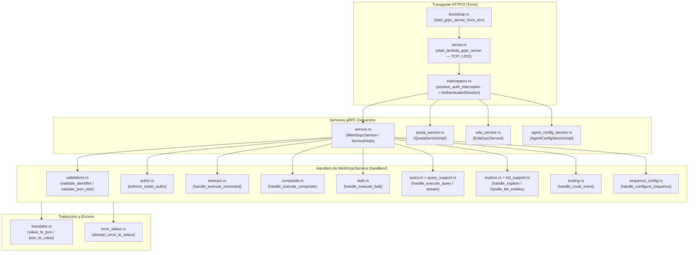
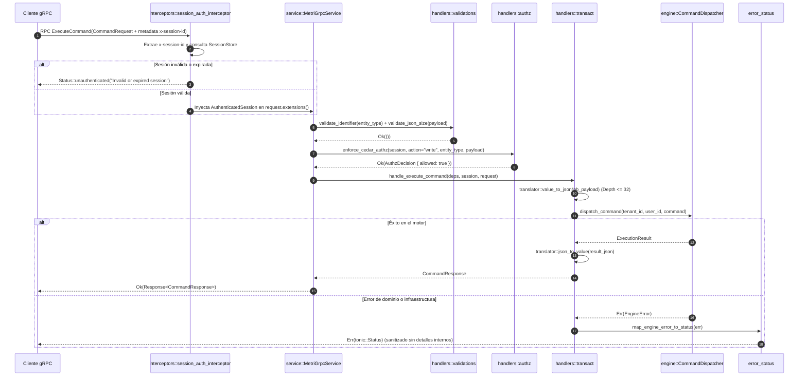

# 14. Componente `grpc` — Capa de Transporte gRPC, Interceptors y Servicios

## 1. Propósito y Responsabilidad

El módulo `src/grpc/` constituye la frontera de entrada de red de `metri-engine`. Expone los contratos Protobuf compilados con `tonic` a través de HTTP/2 (tanto en sockets TCP dedicados como en sockets de dominio Unix `UDS` para AWS Lambda Extensions), intercepta cada llamada para autenticar sesiones, despacha comandos transaccionales/analíticos hacia el motor central (`MetriGrpcService`) y provee servicios satélite para evaluación de cuotas (`QuotaServiceImpl`), enrutamiento de eventos EDA (`EdaGrpcService`) y administración de configuración de agentes (`AgentConfigServiceImpl`).

### Qué hace este componente
- **Servidor y Bootstrap de Dependencias (`server.rs`, `bootstrap.rs`)**: Ensambla el grafo completo de objetos del motor (Aurora, DynamoDB, DuckDB, Cedar, S3, SQS, EventBridge, RateLimiter) y levanta el servidor Tonic con soporte para TCP (`0.0.0.0:50051`) o Unix Domain Sockets (`/tmp/metri-engine.sock`) con graceful shutdown.
- **Intercepción de Seguridad (`interceptors.rs`)**: Extrae `x-session-id` (o credenciales Bearer), valida la sesión contra `SessionStore`, previene suplantación de identidad y adjunta `AuthenticatedSession` en las extensiones del `tonic::Request`.
- **Traducción Bidireccional de Tipos (`translator.rs`, `error_status.rs`)**: Convierte entre tipos Protobuf (`prost_types::Value`, `Struct`) y `serde_json::Value` con límite estricto de recursión (`MAX_JSON_DEPTH = 32`), y mapea errores de dominio (`EngineError`, `CatalogError`, `AuthzError`, `SqlError`) a códigos `tonic::Status` sin filtrar trazas internas ni esquemas SQL.
- **Handlers de Dominio (`handlers/*`)**: Descompone la fachada `MetriEngineService` en manejadores especializados para transacciones simples (`transact.rs`), operaciones compuestas (`composite.rs`), lotes (`bulk.rs`), consultas analíticas y streaming (`query.rs`, `explore.rs`), enrutamiento EDA (`routing.rs`), secuencias (`sequence_config.rs`) y validaciones de entrada (`validations.rs`).

### Qué NO hace este componente
- **No contiene lógica de negocio ni evaluación de fórmulas**: Delega toda validación semántica al catálogo (`src/catalog/`) y la ejecución transaccional al motor (`src/engine/`).
- **No ejecuta consultas SQL directamente**: Usa los casos de uso (`QueryEngine`, `DynamicExplorer`, `CommandDispatcher`) inyectados en `ServiceDeps`.

---

## 2. Arquitectura Interna

El diseño de `src/grpc/` desacopla el transporte HTTP/2 de los casos de uso mediante un interceptor de sesión, cuatro implementaciones de servicios Tonic y un conjunto modular de handlers bajo `src/grpc/handlers/`.

---

## 3. Flujo de Ejecución Paso a Paso

El siguiente diagrama de secuencia muestra el procesamiento completo de una llamada RPC `ExecuteCommand` a través de `src/grpc/`:

---

## 4. Mapa Completo de Submódulos y Archivos

A continuación se listan los **25 archivos `.rs`** que componen `src/grpc/`:

| Ruta Relativa (`src/grpc/...`) | Responsabilidad Exacta |
| :--- | :--- |
| `mod.rs` | Punto de entrada del módulo gRPC; incluye el código generado por Protobuf (`pub mod pb`) y exporta los servicios, interceptores y utilidades de servidor. |
| `agent_config_service.rs` | Implementación de `AgentConfigService` (`AgentConfigServiceImpl`) para gestionar configuraciones de agentes de IA con control de acceso por propietario y rol `admin`. |
| `bootstrap.rs` | Inicialización declarativa desde variables de entorno (`start_grpc_server_from_env`), cableado de adaptadores AWS/locales y validación de política de autenticación. |
| `eda_service.rs` | Servicio gRPC dedicado (`EdaGrpcService`) y tipos de soporte (`EdaMatchRequest`, `EdaWebhookTarget`, `EdaRoutingResult`, `EdaResponseJson`) para evaluación de reglas Event-Driven Architecture. |
| `error_status.rs` | Traductor centralizado y sanitizado de errores de dominio (`EngineError`, `CatalogError`, `AuthzError`, `RateLimitError`) hacia códigos canónicos `tonic::Status`. |
| `interceptors.rs` | Interceptor Tonic de autenticación de sesión (`AuthenticatedSession`, `build_session_interceptor`) con verificación contra `SessionStore` o modo `DevBypass` controlado. |
| `quota_service.rs` | Implementación del servicio gRPC de cuotas y limitación de tasa (`QuotaServiceImpl`) respaldado por `RateLimiterPort` (Token Bucket / Sliding Window). |
| `server.rs` | Arranque del servidor HTTP/2 (`start_lambda_grpc_server`) con soporte dual para sockets Unix (`UDS` con permisos `0o600`) y sockets TCP con apagado elegante (`graceful shutdown`). |
| `service.rs` | Contenedor de dependencias (`ServiceDeps`) e implementación principal del trait `MetriEngineService` (`MetriGrpcService`) que delega en los submódulos de `handlers/`. |
| `translator.rs` | Conversión recursiva acotada (`MAX_JSON_DEPTH = 32`) entre `prost_types::Value` / `prost_types::Struct` y `serde_json::Value` (`value_to_json`, `value_to_struct`, `json_to_value`). |
| `handlers/mod.rs` | Declaración y organización de los submódulos manejadores de cada operación del servicio `MetriGrpcService`. |
| `handlers/authz.rs` | Puente entre los handlers gRPC y el pipeline de autorización `src/cedar/`: construye `AuthRequest` desde `AuthenticatedSession` y verifica permisos antes de ejecutar casos de uso. |
| `handlers/bulk.rs` | Manejador de operaciones masivas (`ExecuteBulk`): valida límites de lote, autoriza cada ítem y coordina la ejecución transaccional por lotes. |
| `handlers/composite.rs` | Manejador de transacciones compuestas multi-entidad (`ExecuteComposite`) con preservación de atomicidad y referencias cruzadas. |
| `handlers/explore.rs` | Manejador de exploración analítica dinámica (`ExploreData`) y exportación asíncrona hacia S3 cuando el resultado supera el umbral de respuesta en línea. |
| `handlers/list_support.rs` | Funciones auxiliares de paginación basada en cursor, ordenamiento seguro y proyección de campos para listados de entidades. |
| `handlers/query.rs` | Manejadores de consultas analíticas (`ExecuteQuery`) y streaming de resultados del lado del servidor (`ExecuteQueryStream` mediante `ReceiverStream`). |
| `handlers/query_support.rs` | Construcción de contextos de consulta analítica, inyección de filtros de fila (`row_filter`) y aplicación de enmascaramiento de columnas (`masked_columns`) provenientes de Cedar. |
| `handlers/routing.rs` | Manejador de evaluación y despacho de eventos de dominio a través del motor EDA (`RouteEvent`) desde `MetriGrpcService`. |
| `handlers/sequence_config.rs` | Manejador para crear, actualizar y consultar configuraciones de secuencias numéricas atómicas por tenant (`ConfigureSequence`). |
| `handlers/transact.rs` | Manejador del flujo transaccional unitario (`ExecuteCommand`): creación, actualización, transición de estado y eliminación lógica con auditoría. |
| `handlers/validations.rs` | Validaciones defensivas de frontera: longitud y caracteres de identificadores, tamaño máximo de payloads JSON y obligatoriedad de campos de trazabilidad. |
| `tests/quota_service_tests.rs` | Pruebas unitarias de `QuotaServiceImpl`: consumo de tokens, rechazo `ResourceExhausted` y aislamiento de cuotas por tenant. |
| `tests/service_tests.rs` | Pruebas de integración de `MetriGrpcService`: ciclo completo de comandos, consultas, interceptores de sesión y propagación de errores gRPC. |
| `tests/translator_tests.rs` | Pruebas de conversión `Protobuf <-> JSON`, preservación de tipos numéricos/booleanos/nulos y rechazo de estructuras que exceden `MAX_JSON_DEPTH`. |

---

## 5. Contratos Públicos (`Traits`, `Structs`, `Enums`)

- **`ServiceDeps` (`src/grpc/service.rs`)**: Estructura de inyección de dependencias que agrupa los puertos requeridos por `MetriGrpcService`: `catalog_repo`, `command_dispatcher`, `query_engine`, `dynamic_explorer`, `eda_engine`, `sequence_manager`, `cedar_oltp`, `cedar_cache`, `resource_loader` y `token_verifier`.
- **`MetriGrpcService` (`src/grpc/service.rs`)**: Fachada principal que implementa `pb::metri_engine_service_server::MetriEngineService`. Es clonable de forma económica gracias al uso interno de `Arc<ServiceDeps>`.
- **`AuthenticatedSession` (`src/grpc/interceptors.rs`)**: Contexto inmutable de identidad extraído por el interceptor de sesión (`tenant_id`, `user_id`, `roles`). Los handlers obtienen el `tenant_id` exclusivamente desde esta extensión y nunca confían ciegamente en el `tenant_id` del cuerpo Protobuf si difiere de la sesión.
- **`QuotaServiceImpl`, `EdaGrpcService`, `AgentConfigServiceImpl`**: Servicios gRPC modulares que se registran en el mismo `tonic::transport::Server` durante el arranque en `server.rs`.

---

## 6. Invariantes de Seguridad y Dominio

1. **Prevención de Tenant Spoofing**: Todos los handlers validan que el `tenant_id` de la sesión autenticada (`AuthenticatedSession.tenant_id`) coincida con el `tenant_id` solicitado en el mensaje Protobuf (o lo sobrescriben con el de la sesión), impidiendo que un cliente autenticado opere sobre otro tenant.
2. **Protección contra Desbordamiento de Pila (`MAX_JSON_DEPTH = 32`)**: `translator.rs` contabiliza la profundidad de anidamiento al convertir `prost_types::Value` a `serde_json::Value` y viceversa, abortando con `Status::invalid_argument` ante payloads maliciosamente profundos.
3. **Permisos Restringidos en Unix Domain Sockets (`0o600`)**: Cuando `start_lambda_grpc_server` crea un socket Unix (`unix:///tmp/...`), aplica inmediatamente permisos `0o600` (`rw-------`) en sistemas Unix para que ningún otro usuario del sistema operativo pueda conectarse al socket local.
4. **Sanitización de Errores de Infraestructura (`error_status.rs`)**: Los fallos internos de SQL, Aurora, DuckDB o AWS SDK se registran en los logs estructurados pero se devuelven al cliente como `Status::internal("Internal server error")` genérico para evitar filtración de esquemas o topología.
5. **Autorización de Propietario en `AgentConfigServiceImpl`**: Un usuario solo puede leer o modificar sus propias configuraciones de agente (`owner_id == session.user_id`), salvo que su `AuthenticatedSession` contenga explícitamente el rol `"admin"`.

---

## 7. Manejo de Errores y Resiliencia

La tabla de mapeo en `src/grpc/error_status.rs` garantiza semántica HTTP/2 + gRPC consistente:

| Error de Origen | Código `tonic::Code` | Comportamiento de Reintento Recomendado |
| :--- | :--- | :--- |
| `AuthzError::MissingToken`, `InvalidSignature`, `TokenExpired` | `Unauthenticated` | Renovar token/sesión antes de reintentar. |
| `AuthzError::AccessDenied`, `UserInactive`, `OutsideTimeWindow` | `PermissionDenied` | No reintentar; requiere cambio de permisos. |
| Validación de entrada (`validations.rs`, `translator.rs`) | `InvalidArgument` | No reintentar sin corregir el payload. |
| Entidad o registro inexistente | `NotFound` | No reintentar. |
| Conflicto de concurrencia optimista (`version mismatch`) | `Aborted` / `AlreadyExists` | Recargar versión actual y reintentar comando. |
| Cuota excedida (`QuotaServiceImpl` / `RateLimiter`) | `ResourceExhausted` | Backoff exponencial respetando `retry_after_ms`. |
| Fallo transitorio de base de datos o red | `Unavailable` / `Internal` | Backoff exponencial con jitter. |

---

## 8. Configuración y Variables de Entorno

| Variable de Entorno | Valor por Defecto | Efecto en `src/grpc/` |
| :--- | :--- | :--- |
| `METRI_GRPC_ADDR` / `SOCKET_PATH` | `0.0.0.0:50051` o `/tmp/metri.sock` | Define si `start_lambda_grpc_server` escucha en un puerto TCP (`host:port`) o en un Unix Domain Socket (`unix://...` o ruta de archivo). |
| `METRI_ENV` | `"development"` | Determina si las guardias de seguridad de producción están activas. |
| `METRI_DEV_AUTH_BYPASS` | `"false"` | Si es `"true"` en entorno no productivo, inyecta una sesión sintética de desarrollo cuando no se envía `x-session-id`. |
| `METRI_HMAC_SECRET` | Requerido en prod | Clave secreta compartida para inicializar `HmacTokenVerifier` en `bootstrap.rs`. |

---

## 9. Guía de Extensión y Testing

### Cómo agregar un nuevo método RPC o Handler
1. **Definir el contrato Protobuf**: Añade el mensaje y método RPC en `proto/metri_engine.proto`.
2. **Crear el handler modular**: Crea un archivo o función en `src/grpc/handlers/` que reciba `&ServiceDeps`, `&AuthenticatedSession` y el request Protobuf.
3. **Invocar validación y Cedar**: Llama primero a las funciones de `handlers/validations.rs` y `handlers/authz.rs` (`enforce_cedar_authz`) antes de tocar el motor.
4. **Conectar en `MetriGrpcService`**: Implementa el método del trait en `src/grpc/service.rs` delegando al nuevo handler y envolviendo la ejecución en un span OpenTelemetry (`otel_span!`).
5. **Añadir pruebas**: Incorpora pruebas unitarias en `src/grpc/tests/service_tests.rs` verificando tanto el camino feliz como el rechazo por sesión inválida o falta de permisos.
