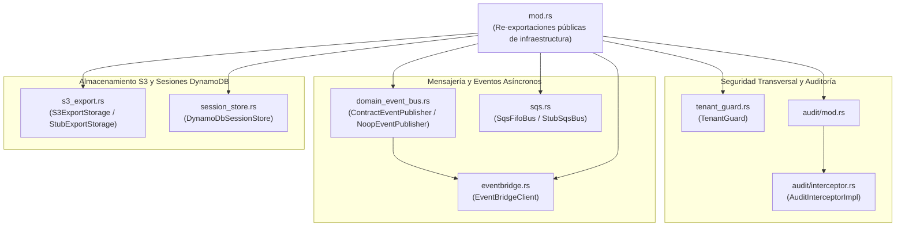
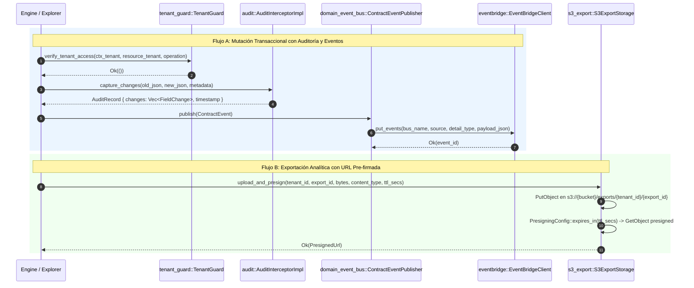

# 15. Componente `infrastructure` — Adaptadores Cloud AWS, Auditoría y Guardias Multi-Tenant

## 1. Propósito y Responsabilidad

El módulo `src/infrastructure/` agrupa los adaptadores de infraestructura transversal y servicios gestionados de AWS que dan soporte al motor transaccional, al explorador analítico y al plano de seguridad de `metri-engine`. Implementa los puertos de salida hacia **Amazon EventBridge**, **Amazon SQS FIFO**, **Amazon S3 (con URLs pre-firmadas)**, **Amazon DynamoDB (almacén de sesiones)**, el **Interceptor de Auditoría inmutable** y el **Guardia de Aislamiento Multi-Tenant (`TenantGuard`)**.

### Qué hace este componente
- **Interceptor de Auditoría (`audit/interceptor.rs`)**: Calcula diferencias campo por campo (`FieldChange`: `Added`, `Modified`, `Removed`) entre el estado previo y nuevo de cada entidad mutada, y emite registros `AuditRecord` listos para persistir en la bitácora transaccional.
- **Publicación de Eventos de Dominio y EDA (`domain_event_bus.rs`, `eventbridge.rs`)**: Serializa eventos de dominio (`ContractEvent`) y eventos de enrutamiento EDA para publicarlos en buses de **Amazon EventBridge** mediante `aws-sdk-eventbridge`.
- **Colas Transaccionales Ordenadas (`sqs.rs`)**: Encola mensajes en colas **Amazon SQS FIFO** garantizando orden estricto por tenant/entidad (`message_group_id`) e idempotencia de entrega (`message_deduplication_id`), además de ofrecer `StubSqsBus` en memoria para desarrollo local y pruebas.
- **Exportación Analítica a S3 (`s3_export.rs`)**: Sube resultados analíticos masivos (JSON/CSV/Parquet) a un bucket de **Amazon S3** y genera URLs pre-firmadas (`presigned GET URLs`) con tiempo de expiración acotado (`S3ExportStorage`), contando con `StubExportStorage` para entornos sin AWS.
- **Persistencia Distribuida de Sesiones (`session_store.rs`)**: Implementa `SessionStore` sobre **Amazon DynamoDB** (`DynamoDbSessionStore`) con verificación de expiración (`expires_at`) y deserialización segura de roles y atributos.
- **Guardia de Aislamiento Multi-Tenant (`tenant_guard.rs`)**: Valida que toda operación sobre datos de un tenant coincida con el `tenant_id` del contexto de seguridad activo (`TenantGuard`), registrando intentos de acceso cruzado (`SecurityViolation`) y permitiendo únicamente operaciones de sistema explícitamente autorizadas.

### Qué NO hace este componente
- **No ejecuta consultas SQL sobre Aurora ni DuckDB**: Esos adaptadores residen en `src/aurora/` y `src/duckdb_olap/`.
- **No define políticas de autorización ABAC**: La evaluación de políticas corresponde a `src/cedar/`.

---

## 2. Arquitectura Interna

Cada adaptador implementa un puerto de dominio o expone una interfaz con contraparte `Stub`/`Noop` para permitir que `metri-engine` se ejecute tanto en AWS Lambda (producción) como en un portátil sin conexión a la nube (desarrollo y pruebas).

---

## 3. Flujo de Ejecución Paso a Paso

El siguiente diagrama de secuencia ilustra cómo interactúan `TenantGuard`, `AuditInterceptorImpl`, `ContractEventPublisher` (`EventBridgeClient`) y `S3ExportStorage` durante operaciones transaccionales y analíticas:

---

## 4. Mapa Completo de Submódulos y Archivos

A continuación se listan los **9 archivos `.rs`** que componen `src/infrastructure/`:

| Ruta Relativa (`src/infrastructure/...`) | Responsabilidad Exacta |
| :--- | :--- |
| `mod.rs` | Punto de entrada del módulo de infraestructura; declara y re-exporta los adaptadores de auditoría, mensajería, almacenamiento, sesiones y aislamiento multi-tenant. |
| `audit/mod.rs` | Submódulo contenedor del subsistema de auditoría transaccional; re-exporta `AuditInterceptorImpl`. |
| `audit/interceptor.rs` | Implementación del puerto `AuditInterceptor` (`AuditInterceptorImpl`): calcula diferencias estructurales entre estados JSON (`old` vs `new`), ignora campos volátiles del sistema y construye el `AuditRecord` inmutable. |
| `domain_event_bus.rs` | Adaptador `ContractEventPublisher` que publica eventos del ciclo de vida de contratos/entidades hacia EventBridge, y `NoopEventPublisher` para entornos de prueba sin bus externo. |
| `eventbridge.rs` | Cliente envoltorio sobre `aws_sdk_eventbridge::Client` (`EventBridgeClient`) para envío de eventos estructurados con control de errores de entrega parcial (`failed_entry_count`). |
| `s3_export.rs` | Adaptador de almacenamiento de exportaciones analíticas en Amazon S3 (`S3ExportStorage`) con generación de URLs pre-firmadas (`GetObject`) y su contraparte en memoria `StubExportStorage`. |
| `session_store.rs` | Adaptador `DynamoDbSessionStore` que implementa el puerto `SessionStore` de `src/cedar/ports.rs` consultando sesiones activas en una tabla de Amazon DynamoDB. |
| `sqs.rs` | Adaptador de colas `SqsFifoBus` sobre `aws_sdk_sqs::Client` con soporte para grupos de ordenamiento FIFO y deduplicación, más `StubSqsBus` para inspección de mensajes en pruebas. |
| `tenant_guard.rs` | Guardia de seguridad en memoria (`TenantGuard`) que verifica la correspondencia estricta entre el tenant del contexto y el tenant del recurso o consulta, bloqueando fugas entre inquilinos. |

---

## 5. Contratos Públicos (`Traits`, `Structs`, `Enums`)

- **`AuditInterceptorImpl` (`src/infrastructure/audit/interceptor.rs`)**:
  - Instanciación: `AuditInterceptorImpl::new()`.
  - Implementa el trait `AuditInterceptor` del motor transaccional para producir la lista determinista de `FieldChange` en cada creación, actualización o cambio de estado.
- **`EventBridgeClient` (`src/infrastructure/eventbridge.rs`)** y **`ContractEventPublisher` (`src/infrastructure/domain_event_bus.rs`)**:
  - `EventBridgeClient::new(client: aws_sdk_eventbridge::Client, bus_name: String)`.
  - `ContractEventPublisher::new(eb_client: Arc<EventBridgeClient>, source_prefix: String)`.
  - `NoopEventPublisher`: Implementación sin efectos secundarios para pruebas unitarias.
- **`SqsFifoBus` y `StubSqsBus` (`src/infrastructure/sqs.rs`)**:
  - `SqsFifoBus::new(client: aws_sdk_sqs::Client, queue_url: String)`.
  - `StubSqsBus::new()` y `StubSqsBus::messages()` para verificar en pruebas los mensajes FIFO encolados (`group_id`, `dedup_id`, `body`).
- **`S3ExportStorage` y `StubExportStorage` (`src/infrastructure/s3_export.rs`)**:
  - `S3ExportStorage::new(client: aws_sdk_s3::Client, bucket: String)`.
  - Organiza las claves bajo el prefijo aislado por tenant y firma URLs temporales de descarga directa.
- **`DynamoDbSessionStore` (`src/infrastructure/session_store.rs`)**:
  - Consulta la clave primaria `session_id` con lectura consistente y valida que `expires_at > now` antes de retornar `SessionRecord`.
- **`TenantGuard` (`src/infrastructure/tenant_guard.rs`)**:
  - `TenantGuard::new()` o `TenantGuard::with_system_ops(allowed_ops)`.

---

## 6. Invariantes de Seguridad y Dominio

1. **Verificación de Fallos Parciales en EventBridge**: `EventBridgeClient` no solo comprueba el resultado HTTP del SDK de AWS, sino también `output.failed_entry_count()`. Si al menos una entrada fue rechazada por el bus, retorna error explícito para evitar pérdida silenciosa de eventos.
2. **Aislamiento de Claves S3 por Tenant**: `S3ExportStorage` construye las claves de objeto anteponiendo el `tenant_id` validado, evitando colisiones de nombres o sobreescrituras entre inquilinos distintos.
3. **Deduplicación y Ordenamiento FIFO en SQS**: `SqsFifoBus` exige `message_group_id` (generalmente compuesto por `tenant_id` + `entity_id`) y `message_deduplication_id` para garantizar procesamiento exactamente una vez en orden dentro de cada flujo de entidad.
4. **Inmutabilidad y Completitud del Diff de Auditoría**: `AuditInterceptorImpl` compara recursivamente las claves de primer nivel del objeto JSON antiguo y nuevo en orden determinista, registrando el valor anterior y el valor nuevo exacto.
5. **Rechazo Fail-Closed en `TenantGuard`**: Si `expected_tenant` o `actual_tenant` están vacíos o difieren entre sí (y la operación no está en la lista blanca de sistema), `TenantGuard` aborta inmediatamente la operación.

---

## 7. Manejo de Errores y Resiliencia

- **Errores del SDK de AWS (`SdkError`)**: Los adaptadores `EventBridgeClient`, `SqsFifoBus`, `S3ExportStorage` y `DynamoDbSessionStore` capturan errores de red, credenciales o throttling de AWS y los transforman en errores tipados del dominio (`EngineError` / `AuthzError`) conservando el contexto diagnóstico en los logs internos.
- **Tolerancia a Desarrollo sin Nube (Patrón Stub/Noop)**: Todos los servicios externos poseen una implementación gemela en memoria (`NoopEventPublisher`, `StubSqsBus`, `StubExportStorage`, `InMemorySessionStore`) que se selecciona automáticamente en `src/grpc/bootstrap.rs` cuando las variables de recursos AWS no están definidas en desarrollo local.

---

## 8. Configuración y Variables de Entorno

| Variable de Entorno | Adaptador Asociado | Descripción |
| :--- | :--- | :--- |
| `AWS_REGION` | Todos los clientes AWS SDK | Región de AWS donde residen EventBridge, SQS, S3 y DynamoDB. |
| `METRI_EVENT_BUS_NAME` | `EventBridgeClient` | Nombre o ARN del bus de Amazon EventBridge de destino. |
| `METRI_SQS_FIFO_URL` | `SqsFifoBus` | URL de la cola Amazon SQS `.fifo` para despacho ordenado. |
| `METRI_EXPORT_BUCKET` | `S3ExportStorage` | Nombre del bucket de Amazon S3 para exportaciones analíticas grandes. |
| `METRI_SESSIONS_TABLE` | `DynamoDbSessionStore` | Nombre de la tabla de Amazon DynamoDB que almacena sesiones activas. |

---

## 9. Guía de Extensión y Testing

### Cómo agregar un nuevo adaptador de infraestructura
1. **Definir el puerto en el módulo de dominio correspondiente**: Por ejemplo, en `src/engine/` o `src/cedar/ports.rs`.
2. **Implementar el adaptador AWS y su Stub local**: Crea el archivo en `src/infrastructure/<servicio>.rs` implementando tanto el cliente real (sobre `aws-sdk-*`) como un `Stub*` o `Noop*` respaldado por `tokio::sync::Mutex` o `DashMap`.
3. **Exportar en `src/infrastructure/mod.rs`**: Añade `pub mod <servicio>;` y re-exporta los tipos públicos con comentarios `///`.
4. **Conectar en `src/grpc/bootstrap.rs`**: Inicializa el adaptador real cuando la variable de entorno exista o el stub en modo local.
5. **Guía de inicio rápido**: Consulta `docs/01-inicio/01-quickstart-local.md` para ejecutar el motor localmente con los adaptadores `Stub`/`Noop`.
