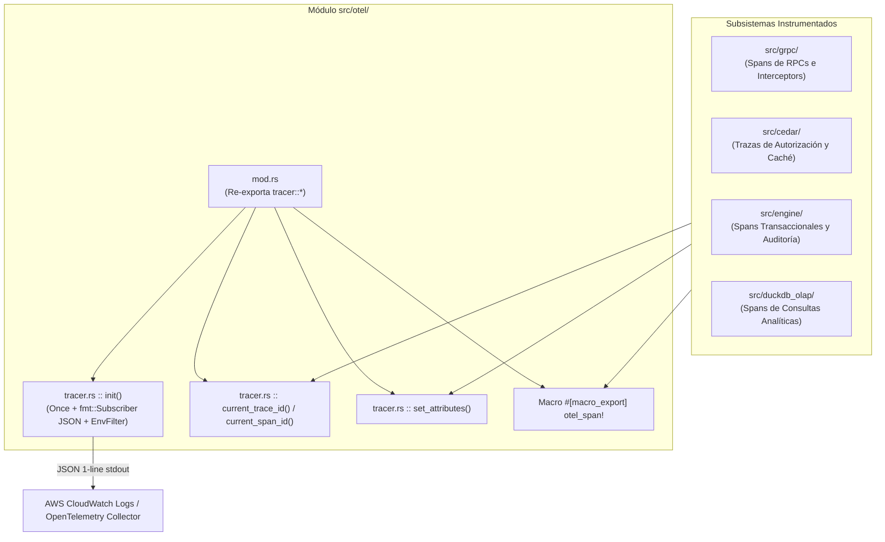
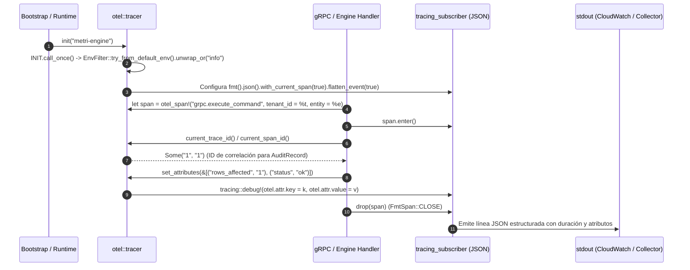

# 16. Componente `otel` — Observabilidad, Trazabilidad Distribuida y Logging Estructurado

## 1. Propósito y Responsabilidad

El módulo `src/otel/` provee la capa de instrumentación transversal de observabilidad de `metri-engine` basada en **OpenTelemetry** y el ecosistema **`tracing` de Rust**. Estandariza la inicialización del suscriptor global de telemetría, la emisión de logs estructurados en formato **JSON de una sola línea compatible con AWS CloudWatch Logs Insights**, la propagación de contexto de trazas (`trace_id`, `span_id`) y la macro ergonómica `otel_span!` utilizada en cada etapa crítica del motor.

### Qué hace este componente
- **Inicialización Idempotente del Suscriptor (`tracer::init`)**: Configura una única vez por proceso (`std::sync::Once`) el suscriptor global `tracing_subscriber` con salida JSON a `stdout`, filtro de niveles configurable por entorno (`EnvFilter`, por defecto `info`) e inclusión de identificadores de span y eventos de cierre.
- **Extracción de Correlación (`current_trace_id`, `current_span_id`)**: Permite a cualquier componente (como el interceptor de auditoría, el despachador de eventos o los handlers gRPC) recuperar el identificador del span activo para adjuntarlo en cabeceras HTTP/gRPC o registros de base de datos.
- **Enriquecimiento Dinámico de Spans (`set_attributes`)**: Registra pares clave-valor de negocio (`tenant_id`, `entity_type`, `operation`, `latency_ms`) sobre el span activo en tiempo de ejecución.
- **Instrumentación Declarativa (`otel_span!`)**: Macro exportada en la raíz del crate que crea un `tracing::info_span!` con metadatos estandarizados de componente y atributos estructurados.

### Qué NO hace este componente
- **No bloquea el hilo de ejecución con exportadores de red síncronos**: Emite telemetría JSON directamente hacia `stdout` para que el recolector de AWS Lambda Telemetry API / CloudWatch Logs la ingiera con latencia sub-milisegundo sin penalizar el hot-path transaccional.
- **No almacena métricas de negocio ni cuotas**: El conteo de cuotas operativas reside en `src/rate_limiter/`.

---

## 2. Arquitectura Interna

El módulo mantiene una superficie mínima y libre de bloqueos compuesta por `src/otel/mod.rs` y `src/otel/tracer.rs`, integrándose con todos los demás subsistemas del motor.



---

## 3. Flujo de Ejecución Paso a Paso

El siguiente diagrama de secuencia muestra desde la inicialización del runtime hasta la creación y enriquecimiento de un span durante una petición en `metri-engine`:



---

## 4. Mapa Completo de Submódulos y Archivos

A continuación se listan los **2 archivos `.rs`** que componen `src/otel/`:

| Ruta Relativa (`src/otel/...`) | Responsabilidad Exacta |
| :--- | :--- |
| `mod.rs` | Punto de entrada del módulo de observabilidad; declara el submódulo `tracer` y re-exporta todas sus funciones públicas (`pub use tracer::*;`). |
| `tracer.rs` | Implementación del inicializador idempotente `init`, extractores de contexto (`current_trace_id`, `current_span_id`), inyector de atributos (`set_attributes`), macro `otel_span!` y suite de pruebas unitarias de correlación. |

---

## 5. Contratos Públicos (`Traits`, `Structs`, `Enums`)

- **`pub fn init(service_name: &str)` (`src/otel/tracer.rs`)**:
  - Inicializa el suscriptor global de `tracing` en formato JSON aplanado (`flatten_event(true)`), con lista de spans ancestros (`with_span_list(true)`) y evento de cierre (`FmtSpan::CLOSE`).
  - Es completamente **idempotente**: protegida por `static INIT: Once = Once::new()`, por lo que puede invocarse de forma segura desde múltiples tests o puntos de arranque sin provocar `panic!` por doble registro de suscriptor.
- **`pub fn current_trace_id() -> Option<String>`**:
  - Retorna el identificador numérico del span activo en el hilo/tarea actual, o `None` si no existe ningún span abierto o el suscriptor está deshabilitado.
- **`pub fn current_span_id() -> Option<String>`**:
  - Retorna el identificador del span actual (`Span::current().id()`) codificado como cadena decimal.
- **`pub fn set_attributes(attrs: &[(&str, &str)])`**:
  - Adjunta atributos dinámicos al contexto de ejecución actual registrando eventos estructurados cuando el span está activo (`!span.is_disabled()`).
- **`#[macro_export] macro_rules! otel_span`**:
  - Sintaxis 1 (sin atributos): `otel_span!("component.operation")`.
  - Sintaxis 2 (con atributos): `otel_span!("component.operation", tenant_id = %tenant, count = 5)`.

---

## 6. Invariantes de Seguridad y Dominio

1. **Idempotencia Garantizada en Arranque y Tests**: El uso de `std::sync::Once` (`INIT.call_once`) y `let _ = subscriber.try_init()` garantiza que nunca se produzca un fallo en tiempo de ejecución si el host (por ejemplo, el arnés de pruebas o Lambda Runtime) ya registró un `tracing` subscriber previo.
2. **Aislamiento de PII y Secretos en Spans**: Por convención arquitectónica de `metri-engine`, `otel_span!` y `set_attributes` solo deben recibir metadatos operativos (`tenant_id`, `user_id`, `entity_type`, `action`, `status`) y **nunca** tokens HMAC crudos, contraseñas ni payloads completos de negocio.
3. **Cero Bloqueo de Red en el Camino Crítico**: Al delegar la exportación al colector externo mediante JSON estructurado por `stdout`, un fallo en el backend de observabilidad nunca degrada ni bloquea las transacciones de `metri-engine`.

---

## 7. Manejo de Errores y Resiliencia

- **Fallback Seguro de `RUST_LOG`**: Si la variable de entorno `RUST_LOG` no está definida o contiene una directiva malformada, `EnvFilter::try_from_default_env()` hace fallback automático al nivel `"info"` sin abortar el inicio del proceso.
- **Operación No-Op sin Span Activo**: Si `current_trace_id()`, `current_span_id()` o `set_attributes()` son invocadas fuera de un span activo, retornan `None` o finalizan inmediatamente sin asignar memoria ni registrar eventos vacíos.

---

## 8. Configuración y Variables de Entorno

| Variable de Entorno | Valor por Defecto | Efecto en `src/otel/` |
| :--- | :--- | :--- |
| `RUST_LOG` | `"info"` | Controla el nivel de verbosidad global y por módulo (por ejemplo, `RUST_LOG=info,metri_engine::cedar=debug`). |

---

## 9. Guía de Extensión y Testing

### Cómo instrumentar una nueva operación en el motor
1. **Crear el span al inicio de la función**:
   ```rust
   let span = crate::otel_span!(
       "modulo.nombre_operacion",
       tenant_id = %tenant_id,
       resource_type = %resource_type
   );
   let _enter = span.enter();
   ```
2. **Enriquecer con resultados dinámicos**:
   ```rust
   crate::otel::set_attributes(&[("decision", "allow")]);
   ```
3. **Propagar correlación hacia auditoría**: Usa `crate::otel::current_trace_id()` para poblar el campo de correlación de trazas en registros de auditoría o eventos de dominio.

### Pruebas Unitarias Incluidas
En `src/otel/tracer.rs` (módulo `tests`), se verifican tres propiedades fundamentales:
- `test_init_is_idempotent`: Llamadas sucesivas a `init("test-svc")` no provocan `panic!`.
- `test_span_creation_and_ids`: Dentro de un `otel_span!`, `current_trace_id()` y `current_span_id()` devuelven `Some(...)`.
- `test_no_active_span_returns_none`: Fuera de cualquier span, `current_trace_id()` devuelve `None` de forma determinista.
