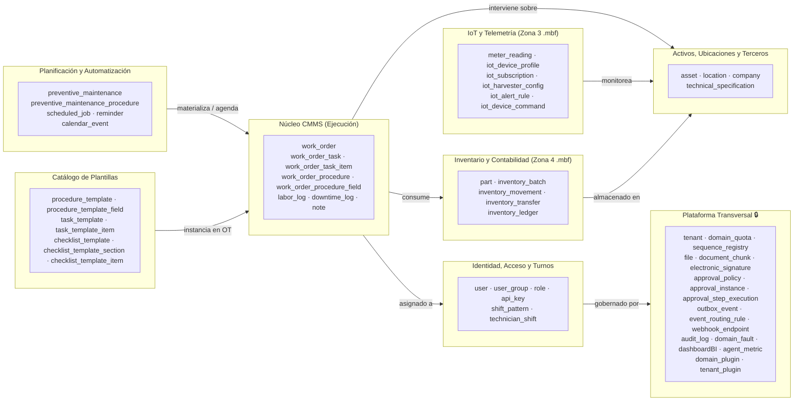
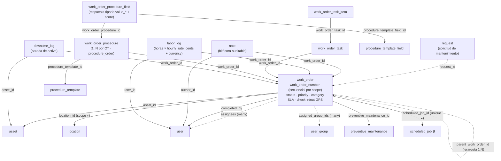
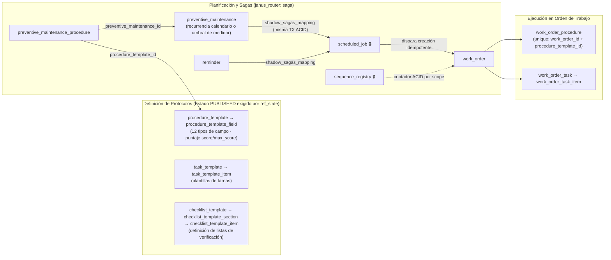
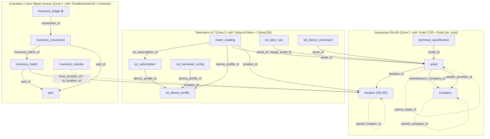
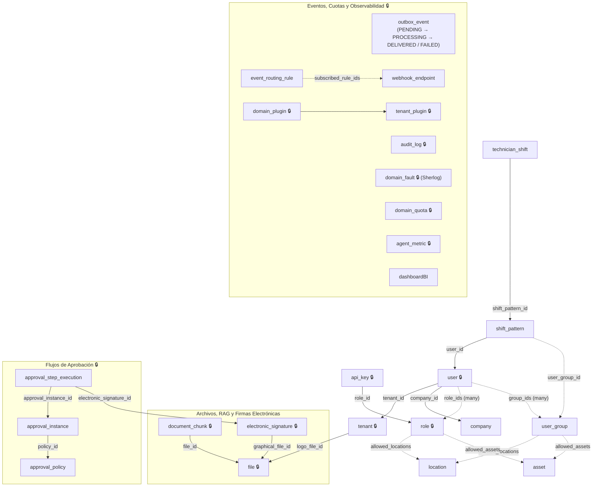

# Diagrama del Modelo de Datos del Códice (`.mbf`)

> **Fuente única de verdad (SSOT):** `config/models/*.json` (58 modelos activos). La referencia detallada de atributos por modelo se encuentra en [modelos-codice.md](modelos-codice.md) (autogenerada con `python3 scripts/docs/gen_reference.py`) y la guía de autoría en [modelado de entidades del Códice](../02-guias/02-modelado-entidades-codice.md).

## Convenciones de los Diagramas

- **Flecha sólida `──1──▶`**: atributo `reference` con `cardinality: "one"` (relación `belongs_to`).
- **Flecha punteada `┈┈N┈┈▶`**: atributo `reference` con `cardinality: "many"` (arreglo de identificadores).
- **Auto-referencia**: jerarquía reflexiva dentro de la misma entidad (`asset.parent_asset_id`, `location.parent_location_id`, `work_order.parent_work_order_id`).
- 🔒 = `is_system: true` (entidades reservadas del plano de control y plataforma).
- **Almacenamiento unificado**: Todos los modelos —tanto operativos como de auditoría, series temporales IoT y libro mayor financiero— se persisten y consultan sobre el motor binario HTAP **Metri Vortex (`.mbf`)** en sus respectivas zonas físicas (Zona 1 PAX+MVCC, Zona 2 Grafo CSR ISA-95, Zona 3 Series Temporales IoT Chimp128, Zona 4 Libro Mayor `FixedDecimal128` y Zona 5 Sinopsis BI).

---

## 1. Mapa de Dominios del Catálogo

---

## 2. Núcleo de Ejecución CMMS: `work_order` y su Órbita

### Invariantes Clave del Dominio `work_order`
- **Idempotencia de generación preventiva**: Constraint declarativo `unique(scheduled_job_id, asset_id)` por tenant en `work_order`, impidiendo que reintentos de planificación dupliquen órdenes de trabajo.
- **Resolución automática de secuencia (`work_order_number`)**: `location_id` actúa como proveedor de ámbito (`is_sequence_scope_provider: true`). Si la OT solo recibe `asset_id`, el generador resuelve el ámbito navegando hacia la ubicación del activo (`nearest_registered`).
- **Composición atómica (`CompositeTransact`)**: Una orden de trabajo junto con sus `work_order_procedure`, `work_order_procedure_field`, `work_order_task` y `work_order_task_item` se persiste en una única transacción ACID sobre `HOT_HEAD.mbf`.

---

## 3. Planificación Preventiva, Plantillas y Sagas Declarativas

---

## 4. Activos, Jerarquías ISA-95, Telemetría IoT e Inventario Contable

---

## 5. Identidad, Autorización ABAC, Aprobaciones y Eventos (EDA)

---

## 6. Asociaciones Polimórficas (`owner_entity_*` / `target_entity_*`)

Las siguientes entidades utilizan un par polimórfico `(tipo_entidad, id_entidad)` para asociarse a cualquier entidad del catálogo sin acoplar el grafo de referencias:

| Entidad Origen | Atributos Polimórficos | Entidades Destino Soportadas |
| :--- | :--- | :--- |
| `file` | `owner_entity_type` + `owner_entity_id` | Cualquier entidad del dominio (vía única canónica para adjuntos y evidencias). |
| `document_chunk` | `owner_entity_type` + `owner_entity_id` | Entidad propietaria del fragmento documental indexado para búsqueda híbrida / RAG. |
| `electronic_signature` | `signed_entity` + `signed_entity_id` | Entidad sobre la cual se estampa la firma criptográfica (`work_order`, `approval_step_execution`, etc.). |
| `approval_instance` | `target_entity_name` + `target_entity_id` | Entidad sujeta al flujo de aprobación (`work_order`, `inventory_transfer`, `request`, etc.). |
| `calendar_event` | `source_entity_type` + `source_entity_id` | `preventive_maintenance`, `reminder`, `work_order`, `technician_shift`. |
| `scheduled_job` | `parent_entity_ref` | `preventive_maintenance`, `reminder`, `user`. |
| `inventory_movement` | `reference_entity` + `reference_id` | `work_order`, `inventory_transfer` u orden externa que origina el movimiento de inventario. |
