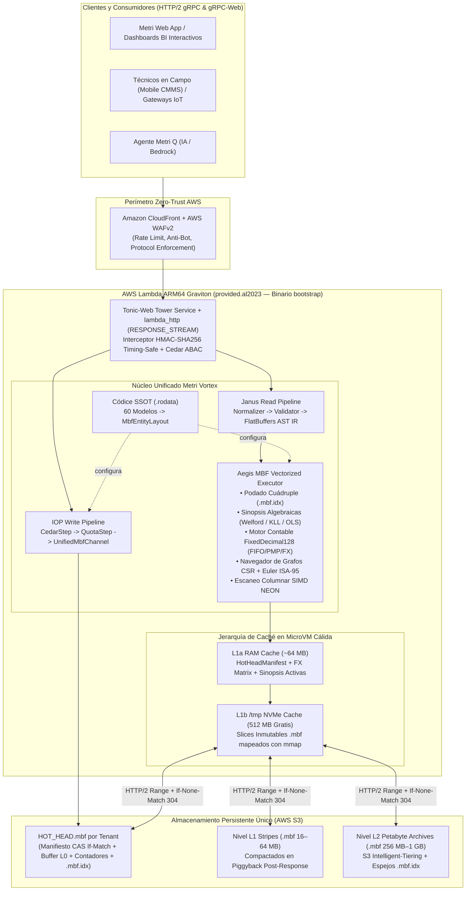

# Architecture and HTAP Design of Metri Vortex (`.mbf`)

> **English summary:** This document defines the end-to-end architecture of **Metri Vortex (`.mbf`)**, a unified Hybrid Transactional/Analytical Processing (HTAP) storage and execution engine written in pure Rust. It consolidates OLTP transactions, Petabyte-scale BI analytics, IoT time-series telemetry, ISA-95 asset/location graphs, and ERP-grade double-entry financial accounting into a single custom binary format hosted natively on AWS S3.

---

## 1. Visión Arquitectónica: Del Cisma OLTP/OLAP al Motor Único HTAP

### 1.1. Limitaciones de la Arquitectura Dual Precedente
En el diseño previo de `metri-engine`, la plataforma dividía el estado del negocio en dos silos tecnológicos desconectados:

1. **Silo Transaccional OLTP (`src/eav/` sobre AWS DynamoDB):**
   - Persistía hechos individuales (`[E A V T op]`) replicados en la tabla principal (`EAVT`) y tres índices secundarios globales (`GSI-AEVT`, `GSI-AVET`, `GSI-VAET`).
   - Implicaba una amplificación de escritura de **4× a 6× en WRUs**, límite de 100 ítems por llamada `TransactWriteItems` y alta latencia al hidratar miles de datoms por red para consultas analíticas en memoria (`src/aegis/oltp/executor.rs`).
2. **Silo Analítico OLAP (`src/aegis/sql/` + Firehose + Glue + AWS Athena):**
   - Enrutaba entidades de alto volumen (`meter_reading`, `inventory_ledger`, `audit_log`, `domain_fault`) hacia Kinesis Firehose para escribir Parquet en S3 y consultarlos compilando SQL de Presto vía `sea-query`.
   - Implicaba latencias basales de **800 ms a 3.500 ms** por consulta en Athena, facturación doble (pago por TB escaneado en Athena + pago por GB-segundo en AWS Lambda mientras esperaba el *polling* de Athena), retraso de ingesta de 1 a 15 minutos y la necesidad de mantener un motor SQL casero duplicado (`LocalS3QueryEngine`, 1.555 líneas) para pruebas locales.

### 1.2. El Paradigma Unificado «Metri Vortex (`.mbf`)»
**Metri Vortex** elimina ambos silos y los sustituye por un **único motor de almacenamiento y ejecución vectorizada** basado en archivos binarios inmutables `.mbf` (Metri Binary Format) alojados en AWS S3:

- **Contrato Externo Inalterado:** Los servicios gRPC definidos en [`proto/metri.proto`](../../proto/metri.proto) (`MetriService`, `QuotaService`, `AgentConfigService`) y [`proto/eda.proto`](../../proto/eda.proto) (`MoiraRoutingService`) mantienen el 100 % de compatibilidad hacia clientes web y móviles.
- **Ejecución Directa desde el AST IR en FlatBuffers:** El pipeline de lectura (`janus`) valida la consulta, inyecta las cláusulas de seguridad Zero-Trust de Cedar (`abac_clauses`) y compila el AST binario zero-copy ([`src/janus/janus_ir_ast.fbs`](../../src/janus/janus_ir_ast.fbs)). En lugar de traducir ese AST a texto SQL, el nuevo ejecutor `aegis::mbf` lo ejecuta directamente sobre **vectores binarios alineados a 64 bytes** usando instrucciones SIMD ARM64 NEON.
- **ACID Serverless mediante S3 Conditional Writes:** Las mutaciones transaccionales y contables utilizan las primitivas atómicas de AWS S3 (`If-Match: <ETag>` y `If-None-Match: "*"`) sobre un manifiesto auto-contenido (`HOT_HEAD.mbf`), proporcionando aislamiento de instantánea (*Snapshot Isolation* MVCC) sin depender de DynamoDB ni gestores de bloqueo externos.

---

## 2. Diagrama de Arquitectura General End-to-End

---

## 3. Sinergia de los 4 Dominios de Negocio en un Único Motor

La mayor ventaja arquitectónica de `.mbf` es que permite cruzar en **nanosegundos y dentro del mismo espacio de direcciones de memoria** cuatro mundos que antes vivían separados:

### 3.1. Dominio CMMS y Jerarquías Industriales/Hospitalarias (ISA-95)
- **Modelos:** `work_order`, `work_order_procedure`, `work_order_task`, `asset`, `location`, `preventive_maintenance`, `scheduled_job`, `downtime_log`, `request`.
- **Mecanismo en `.mbf`:** La **Zona 1 (PAX + MVCC)** almacena los atributos transaccionales con historial bi-temporal (`tx_assert`, `tx_retract`), mientras que la **Zona 2 (Grafo CSR + Recorrido de Euler)** codifica todas las referencias (`asset_id`, `location_id`, `parent_location_id`, `parent_asset_id`) como arreglos contiguos `u32` con intervalos `[tin, tout]`.
- **Resultado:** Consultar todas las órdenes de trabajo abiertas, tiempos de parada (`MTTR`/`MTBF`) y repuestos consumidos debajo de toda una sede hospitalaria (`/hospital-central/torre-quirurgica/*`) se resuelve evaluando `tin >= parent.tin && tout <= parent.tout` en un solo ciclo SIMD, sin `JOIN`s ni consultas recursivas.

### 3.2. Dominio IoT y Telemetría de Alta Frecuencia
- **Modelos:** `meter_reading`, `iot_subscription`, `iot_device_profile`, `iot_harvester_config`, `iot_alert_rule`, `iot_device_command`.
- **Mecanismo en `.mbf`:** La **Zona 3 (Time-Series Slab)** comprime marcas de tiempo con *Delta-of-Delta* (~1.6 bits por lectura) y valores `f64` con *Chimp128 XOR*, incrustando en el mismo archivo una **Pirámide Multi-Resolución (`1m`, `1h`, `1d`)**.
- **Resultado:** Ingestión masiva por lotes (`BulkIngest`) directa a S3 sin el sobrecosto de redondeo a 5 KB de Kinesis Firehose, y visualización instantánea de series temporales anuales leyendo la pirámide pre-agregada.

### 3.3. Dominio Financiero, Contable y de Inventario (Grado ERP/Bancario)
- **Modelos:** `inventory_ledger`, `inventory_batch`, `inventory_movement`, `inventory_transfer`, `labor_log`, `part`, `company`, `asset` (`purchase_cost_cents`, `salvage_value_cents`, `cost_center`).
- **Mecanismo en `.mbf`:** La **Zona 4 (Financial & Accounting Core)** reemplaza la aritmética `f64` por **punto fijo exacto de 128 bits (`FixedDecimal128`, escala $10^{-6}$)** con redondeo bancario (*Half-to-Even*), invariante de **Partida Doble ($\Sigma \text{Débitos} == \Sigma \text{Créditos}$)**, cadena criptográfica **Merkle SHA-256**, vectores **Prefix-Sum de Fenwick** (flujos P&L en $O(1)$), **Checkpoints `As-Of`** (saldos `last_value` en $O(\log B)$), capas de inventario **FIFO/LIFO/PMP/FEFO** en tiempo real y matriz histórica **Multi-Divisa ISO 4217 (`EmbeddedFxMatrix`)**.
- **Resultado:** Cada consumo de repuesto o registro de mano de obra (`labor_log`) en una orden de trabajo actualiza atómicamente el lote, el movimiento y el libro mayor (`inventory_ledger`) en el mismo commit S3, permitiendo calcular el TCO real y la depreciación NIC 16 (cruzada con horómetros IoT) al instante.

### 3.4. Motor de Business Intelligence (Janus + Aegis)
- **Modelos:** Los 60 modelos del Códice expuestos hacia los 6 `OutputCastType` (`KPI`, `TIMESERIES`, `TABLE`, `PIE`, `BUBBLE`, `CSV_EXPORT`).
- **Mecanismo en `.mbf`:** La **Zona 5 (BI Hyper-Accelerator)** almacena en cada micro-bloque de 4.096 filas y en el índice `.mbf.idx` las **Sinopsis Estadísticas Algebraicas Fusionables** (momentos de Welford `n, sum, M2, min, max`, co-momentos bivariados `sum_xy` y sketches de cuantiles `KLL`), junto con índices invertidos de trigramas sobre `RoaringBitmap`.
- **Resultado:** El 95 % de las consultas de BI a escala Petabyte se responden en **< 25 ms** leyendo únicamente los archivos `.mbf.idx` (~64 KB) y fusionando las sinopsis algebraicamente sin siquiera descargar los bloques crudos de S3.

---

## 4. Benchmarking Competitivo: `metri-engine (.mbf)` vs. IBM Maximo, Oracle, SAP y CMMS SaaS

| Criterio Arquitectónico | **Metri Engine (`.mbf` HTAP en Rust + S3)** | **IBM Maximo Application Suite (MAS 8/9)** | **Oracle Cloud Maintenance / eAM (Exadata)** | **SAP S/4HANA EAM (Plant Maintenance)** | **CMMS SaaS Modernos (MaintainX, UpKeep, Fiix)** |
| :--- | :--- | :--- | :--- | :--- | :--- |
| **Stack Base** | **Rust 2021 Nativo** + Formato binario `.mbf` Zero-Copy en S3 + AWS Lambda ARM64. | Monolito **Java EE (WebSphere)** en OpenShift + **IBM Db2 / Oracle / SQL Server**. | **Java ADF / PL/SQL** sobre **Oracle Autonomous DB / Exadata**. | **ABAP** sobre **SAP HANA** (clústeres dedicados de RAM 24/7). | **Node.js / Python / Go** sobre **PostgreSQL / MongoDB** + ETL a **Snowflake**. |
| **Arquitectura de Datos (OLTP + OLAP + IoT + Finanzas)** | **100 % Unificada en `.mbf` (Zonas 1 a 5).** 0 ms de retraso entre una transacción y el motor de BI. | **Fragmentada en 4 productos:** Manage (OLTP) + Monitor/Kafka (IoT) + Db2 Warehouse + Cognos (BI). | **Acoplada a procesos batch:** Conciliación contable (SLA) e inventario vía jobs programados. | **Costosa a escala PB:** La telemetría IoT masiva no cabe en la RAM de HANA y requiere SAP Datasphere externo. | **Partida con *Data Lag*:** Los dashboards analíticos sufren retrasos de **15 min a 24 h** por pipelines ETL. |
| **Jerarquías ISA-95 y Grafos de Activos** | **Grafo CSR + Intervalos de Euler `[tin, tout]`:** Subárboles y herencia de `cost_center` en **$O(1)$ (~15 ns)**. | Tabla puente `LOCANCESTOR` / `ANCESTOR` con explosión cuadrática de filas y `JOIN`s lentos. | Consultas recursivas `CONNECT BY PRIOR` intensivas en CPU. | Vistas CDS en memoria rápidas pero con altísimo costo de RAM por GB. | `WITH RECURSIVE` en SQL tradicional; lento en árboles profundos de >10.000 activos. |
| **Rigor Financiero y Contable** | **Grado Bancario:** `FixedDecimal128`, FIFO/LIFO/PMP/FEFO atómico, `last_value` en $O(\log B)$, FX en 1 ciclo, NIC 16 + IoT y Merkle SHA-256. | Integración diferida hacia ERP externo vía *Maximo Enterprise Adapter (MEA)*. | Completo (*Oracle Cost Management*), pero no opera en tiempo real sub-milisegundo sobre el BI. | Tabla `ACDOCA` completa, pero exige licencias e infraestructura de decenas de miles de USD/mes. | **Superficial:** `qty * unit_cost` en coma flotante; sin libro mayor inmutable, sin cierre fiscal ni capas FIFO/FEFO auditables. |
| **Estadística Avanzada y Regresiones en BI** | **14 funciones nativas SIMD + Sinopsis:** Welford, KLL Percentiles, Pearson, Regresión Lineal/Logística y `z_score` en **< 25 ms**. | Reportes estáticos BIRT o licencias adicionales de *IBM Cognos*. | Requiere *Oracle Analytics Cloud (OAC)* aparte. | Requiere *SAP Analytics Cloud (SAC)* aparte. | Solo agregaciones SQL básicas (`COUNT`, `SUM`, `AVG`); sin modelado estadístico ni regresiones en tiempo real. |
| **TCO Mensual de Infraestructura Cloud** | **Serverless *Scale-to-Zero*:** **~\$0/mes en reposo**; reducción de **> 92 % a 98 %** en carga alta. | **\$4.000 – \$25.000+ USD/mes** (clúster OpenShift + nodos Db2 24/7). | **\$5.000 – \$40.000+ USD/mes** (OCPUs Exadata / Autonomous DB 24/7). | **\$8.000 – \$60.000+ USD/mes** (instancias certificadas SAP HANA en RAM). | **\$500 – \$8.000+ USD/mes** (RDS Multi-AZ + Redis + Snowflake + Fivetran). |
