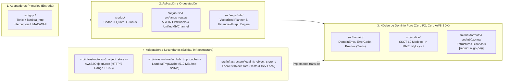

# Architectural Principles, SOLID, DRY, and Clean Code Standards

> **English summary:** This document specifies how the Metri Vortex (`.mbf`) engine enforces Clean Architecture (Hexagonal Ports & Adapters), SOLID principles, DRY schema derivation from the 60 Códice models, strict Railway-Oriented Error Handling (`Result<T, DomainError>` with zero `unwrap`/`panic`), and 100% safe Zero-Copy memory access (`#![forbid(unsafe_code)]` via `bytemuck`).

---

## 1. Arquitectura Limpia (Hexagonal / Clean Architecture)

El motor `.mbf` respeta estrictamente la regla de dependencia concéntrica de `metri-engine`: **las dependencias de código fuente solo apuntan hacia adentro (hacia el Dominio)**.



### Reglas de Aislamiento de Capas
1. **Prohibición de SDKs Externos en el Dominio y Compiladores:**
   - Ningún archivo dentro de `src/domain/`, `src/codice/`, `src/mbf/format/`, `src/mbf/zones/`, `src/janus/` o `src/aegis/mbf/` puede importar `aws_sdk_s3`, `tonic` ni `lambda_http`.
   - Toda operación de almacenamiento se expresa contra los puertos abstractos definidos en [`src/domain/protocols.rs`](../../src/domain/protocols.rs).
2. **Funciones Puras en el Núcleo `.mbf` y `Aegis`:**
   - Los lectores y escritores de zonas binarias (`src/mbf/zones/*.rs`) operan exclusivamente sobre slices en memoria (`&[u8]` $\rightarrow$ `DomainResult<View<'a>>`) y constructores de buffers (`Vec<u8>`), lo que permite probar el 100 % del formato binario y de los algoritmos estadísticos/financieros en microsegundos sin levantar red ni mocks asíncronos.

---

## 2. Aplicación Estricta de los Principios SOLID

### 2.1. Single Responsibility Principle (SRP)
Cada módulo y struct dentro de `src/mbf/` y `src/aegis/mbf/` tiene **una única razón para cambiar**:
- `src/mbf/format/header.rs` y `footer.rs`: Solo definen la geometría binaria de 64 bytes, los números mágicos (`METRIBIN`, `MBFFOOTR`) y la verificación de sumas CRC32C.
- `src/mbf/zones/pax_mvcc.rs`: Solo gestiona la codificación columnar PAX, diccionarios FSST y vectores de visibilidad bi-temporal (`tx_assert`, `tx_retract`).
- `src/mbf/zones/csr_graph.rs`: Solo construye y navega arreglos CSR y recorridos de Euler `[tin, tout]` para jerarquías ISA-95.
- `src/mbf/zones/iot_timeseries.rs`: Solo comprime/descomprime series de tiempo (*Delta-of-Delta* + *Chimp128*) y pirámides de rollup.
- `src/mbf/zones/financial_ledger.rs`: Solo ejecuta aritmética `FixedDecimal128`, validación de partida doble, capas FIFO/LIFO/PMP/FEFO, matriz FX y cadena Merkle SHA-256.
- `src/mbf/zones/bi_synopses.rs`: Solo calcula y fusiona sinopsis estadísticas (Welford, Co-momentos, KLL Sketches y Roaring Bitmaps).
- `src/mbf/tx/manifest_cas.rs`: Solo coordina el ciclo de commit optimista (`If-Match` / `If-None-Match`) sobre `HOT_HEAD.mbf`.

### 2.2. Open/Closed Principle (OCP)
El motor está **abierto a la extensión y cerrado a la modificación** mediante tres puntos de extensión polimórficos:
1. **`ColumnCodec` Trait (`src/mbf/format/codec.rs`):**
   ```rust
   pub trait ColumnCodec: Send + Sync {
       fn codec_id(&self) -> u8;
       fn encode(&self, raw_values: &[DatomValue], out_buf: &mut Vec<u8>) -> DomainResult<ColumnChunkMeta>;
       fn decode_range(&self, slice: &[u8], row_mask: &RoaringBitmap) -> DomainResult<DecodedVector>;
   }
   ```
   Agregar un nuevo método de compresión (p. ej., cuantización escalar `int8` para vectores de embeddings de IA en `document_chunk`) solo requiere registrar una nueva implementación de `ColumnCodec` sin alterar el lector de archivos `.mbf`.
2. **`InventoryValuationStrategy` Trait (`src/mbf/zones/financial_ledger.rs`):**
   Permite seleccionar o añadir políticas de valorización (`FifoStrategy`, `LifoStrategy`, `WacStrategy`, `FefoStrategy`) sin modificar el coordinador transaccional.
3. **`FormulaFunction` Registry (`src/aegis/formula/functions_registry.rs`):**
   Las nuevas funciones financieras y actuariales (`NPV`, `IRR`, `STRAIGHT_LINE_DEPR`, `DDB_DEPR`, `FX_CONVERT`, `RAV_RATIO`) se registran implementando el trait existente `FormulaFunction` sin tocar ni una línea del lexer ni del parser de fórmulas.

### 2.3. Liskov Substitution Principle (LSP)
Cualquier implementación de los puertos de almacenamiento (`AwsS3ObjectStore`, `LambdaTieredCache<S>`, `LocalFsObjectStore`, `InMemoryFaultInjectingStore`) cumple exactamente las mismas precondiciones, postcondiciones e invariantes semánticas:
- Si `put_cas(key, payload, Some(expected_etag))` se invoca con un ETag obsoleto, **todas** las implementaciones (tanto AWS S3 real como el sistema de archivos local en tests) devuelven `Err(DomainError::new(ErrorCode::MbfCasConflict001, ...))`.
- Gracias a esto, **desarrollo local, CI y producción en AWS Lambda ejecutan exactamente el mismo motor de consultas y transacciones**, eliminando para siempre la divergencia que existía entre `AthenaQueryEngine` y `LocalS3QueryEngine`.

### 2.4. Interface Segregation Principle (ISP)
Siguiendo el precedente de `IQueryCache` y `QueryCacheInvalidator` en [`src/domain/protocols.rs`](../../src/domain/protocols.rs#L220-L237), ningún consumidor recibe métodos que no necesita:
- El ejecutor de lectura BI (`aegis::mbf::executor`) solo recibe `Arc<dyn IByteRangeReader>` (es físicamente incapaz de mutar objetos en S3).
- El canal de escritura (`UnifiedMbfChannel`) recibe `Arc<dyn IConditionalObjectWriter>` + `Arc<dyn IByteRangeReader>`.
- El interceptor de autenticación (`auth_waf_interceptor`) solo recibe una vista de lectura de sesiones/revocaciones (`Arc<dyn ISessionStore>`).

### 2.5. Dependency Inversion Principle (DIP)
El acoplamiento entre las abstracciones del dominio y los adaptadores concretos de AWS S3 / `/tmp` NVMe ocurre **exclusivamente en la raíz de composición** ([`src/grpc/server.rs`](../../src/grpc/server.rs)) y se parametriza mediante la configuración inmutable `EngineConfig` (`OnceLock`).

---

## 3. Principio DRY (Don't Repeat Yourself) y Fuente Única de Verdad (SSOT)

1. **Derivación Automática del Esquema Físico `.mbf` desde el Códice (`config/models/*.json`):**
   - Está **terminantemente prohibido** declarar esquemas de tablas o layouts binarios manuales por cada una de las 60 entidades.
   - En tiempo de compilación ([`build.rs`](../../build.rs)) y en el registro del Códice ([`src/codice/registry.rs`](../../src/codice/registry.rs)), un único generador inspecciona cada archivo JSON de `config/models/` y calcula determinísticamente su `MbfEntityLayout`:
     - Reutiliza el hash DJB2 de 16 bits ([`Datom::hash_attr_name`](../../src/eav/types/datom.rs#L113-L119)) como identificador de ranura columnar (`attr_id: u16`).
     - Asigna automáticamente los atributos `type: "reference"` a la **Zona 2 (Grafo CSR)**.
     - Asigna los atributos `type: "decimal"`, `subtype: "currency"` y `*_cents` a la **Zona 4 (`FixedDecimal128` + `FenwickPrefixSum128`)**.
     - Asigna los atributos con `aggregatable: true` a la **Zona 5 (`NumericBlockSynopsis`)**.
2. **Contrato Único de Consulta (Protobuf $\rightarrow$ FlatBuffers AST IR):**
   - Se mantiene la cadena automática `proto/metri.proto` $\rightarrow$ `src/janus/janus_ir_ast.fbs` $\rightarrow$ `src/janus/fbs.rs`. El motor `.mbf` lee directamente el buffer FlatBuffers sin crear estructuras AST intermedias redundantes.
3. **Catálogo Único de Errores (`config/errors/error_catalog.toml`):**
   - Cada variante de `ErrorCode` en `src/domain/errors.rs` se mapea 1:1 con una entrada en `error_catalog.toml`, traducida en un único punto por [`src/grpc/error_status.rs`](../../src/grpc/error_status.rs).

---

## 4. Reglas Innegociables de Clean Code y Seguridad en Rust

Todo el código nuevo de `src/mbf/` y `src/aegis/mbf/` está sujeto a verificación automática en CI (`make ci`):

1. **Cerradura Estricta del Patrón `Result` (Cero Pánicos en Producción):**
   - Se mantiene activo el atributo global en `src/lib.rs` y `src/main.rs`:
     ```rust
     #![cfg_attr(
         not(test),
         deny(
             clippy::unwrap_used,
             clippy::expect_used,
             clippy::panic,
             clippy::todo,
             clippy::unimplemented
         )
     )]
     ```
   - Ninguna lectura de un archivo `.mbf` corrupto o truncado puede usar indexación directa `slice[offset]` que pueda entrar en pánico (`index out of bounds`); es obligatorio usar `.get(offset..offset + len).ok_or_else(|| DomainError::new(ErrorCode::MbfCorrupt001, ...))?`.
2. **Cero Bloques `unsafe` (`#![forbid(unsafe_code)]`):**
   - El casting Zero-Copy desde `&[u8]` hacia structs alineados a 64 bytes (`&MbfHeader`, `&[NumericBlockSynopsis]`, `&[FinancialBlockCheckpoint]`, `&[i128]`) se realiza exclusivamente mediante funciones verificadas de `bytemuck::try_from_bytes` y `bytemuck::try_cast_slice`, que comprueban tamaño y alineación en tiempo de ejecución y devuelven `Result` sin usar `unsafe`.
3. **Límite de Complejidad y Tamaño de Función:**
   - Siguiendo la Puerta 3 de [`PLAN_REFACTORIZACION.md`](../architecture/PLAN_REFACTORIZACION.md#L234), **ninguna función nueva puede superar las 80 líneas**. Toda función de planificación o compactación se descompone en pasos cohesivos privados.
4. **Estándar de Documentación `rustdoc` (`scripts/dev/check_docs.py --strict`):**
   - Todo archivo `.rs` nuevo abre obligatoriamente con una cabecera `//!` cuya primera línea es un resumen conciso en inglés, seguida de las secciones `# Guarantees`, `# Layout` o `# Examples` con cuerpo en español.
   - Toda función pública que retorne `DomainResult<T>` incluye su sección `# Errors` detallando los `ErrorCode` que puede emitir.
