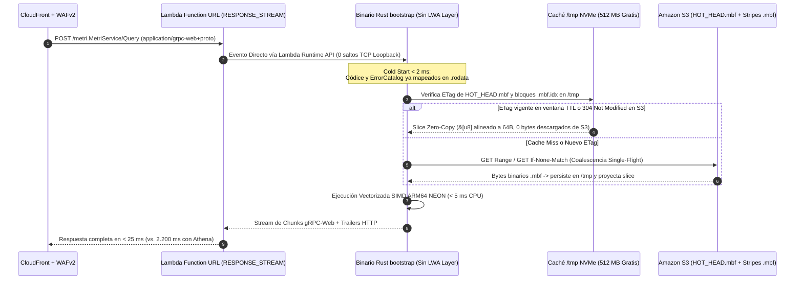

# AWS Serverless, Lambda Graviton ARM64, and S3 Infrastructure Optimization

> **English summary:** This document specifies the cloud-native infrastructure design of **Metri Vortex (`.mbf`)** on AWS Lambda (`provided.al2023` ARM64 Graviton) and Amazon S3. It details the `HOT_HEAD.mbf` single-object CAS protocol, the 512 MB free `/tmp` NVMe cache strategy, direct `lambda_http` streaming integration (removing the Lambda Web Adapter overhead), compile-time `.rodata` schema embedding for `< 2 ms` cold starts, and the economic model achieving a `> 92%` reduction in monthly AWS bills.

---

## 1. Arquitectura Física en AWS Lambda (`provided.al2023` ARM64 Graviton)

### 1.1. Eliminación del `LambdaAdapterLayerArm64` (Binding Directo `lambda_http`)
En la arquitectura previa ([`template.yaml`](../../template.yaml)), cada invocación atravesaba dos procesos dentro de la microVM Firecracker: el proceso Go del *Lambda Web Adapter* (`/opt/bootstrap`) y el servidor TCP Tonic en `localhost:9090`.

Con Metri Vortex, el binario `bootstrap` de Rust detecta la variable `AWS_LAMBDA_RUNTIME_API` y conecta el servicio `tower::Service` generado por `tonic_web::enable(...)` **directamente al canal de streaming de `lambda_runtime` / `lambda_http` (`RESPONSE_STREAM`)**:

### 1.2. Dimensionamiento Óptimo de Memoria y CPU en Graviton (`1769 MB` vs. `2048 MB`)
- AWS Lambda asigna potencia de CPU de forma estrictamente proporcional a la memoria configurada, alcanzando **1,0 vCPU exacta en `1769 MB`**.
- Configurar `2048 MB` (como hacía el template anterior) incrementaba el costo por milisegundo en un **15,8 %** sin beneficio para operaciones transaccionales de un solo hilo.
- Gracias a que `.mbf` opera en modo **Zero-Copy** (proyectando referencias `&[NumericBlockSynopsis]` y `&[i128]` directamente sobre el buffer sin construir árboles de `HashMap<String, Value>` en el *heap*), el consumo real de RAM cae drásticamente, permitiendo fijar **`MemorySize: 1769`** (o `1024` en entornos de tráfico moderado) y **`Timeout: 30`** (sustituyendo el riesgoso `Timeout: 900`).

---

## 2. Protocolo S3 de Mínimo Costo de API: `HOT_HEAD.mbf` + CAS Condicional

En Amazon S3, el costo de almacenamiento es marginal (\$0.023/GB-mes en S3 Standard y \$0.004/GB-mes en Intelligent-Tiering Archive), por lo que el diseño debe minimizar **el número de llamadas `PUT` (\$0.005 / 1.000) y `GET` (\$0.0004 / 1.000)**.

### 2.1. Anatomía y Ciclo de Vida de `HOT_HEAD.mbf`
Cada tenant posee un único objeto caliente en `s3://<bucket>/v1/tenants/<tenant_id>/HOT_HEAD.mbf`:

1. **Qué contiene `HOT_HEAD.mbf` (16 KB a 512 KB):**
   - Cabecera de generación MVCC (`generation: u64`, `last_tx_id: u64`, `fiscal_lock_epoch_ms: i64`).
   - Estado compacto de contadores ACID: `QuotaLedger` del tenant y `SequenceRegistry` (ej. correlativos `WO-0042`).
   - Filtro `Xor8` y conjunto de hashes de `UniqueClaim` activos.
   - Lista negra de tokens revocados no expirados (`REVOKED#<jti>`).
   - **Buffer L0 Embebido:** Las últimas hasta 4.096 mutaciones OLTP y asientos contables (`assert`/`retract` + `ActiveBatchSlab` FIFO/PMP + `Outbox` pendiente).
   - **Directorio Raíz `.mbf.idx`:** Las ubicaciones y sinopsis resumidas de los archivos históricos `L1` y `L2`.
2. **Escritura en 1 Solo `PUT` (`PutObject` con `If-Match: <ETag>`):**
   - Cuando llega un `Transact` o un lote de *Group Commit*, la Lambda toma su copia en caché de `HOT_HEAD.mbf`, aplica los cambios en memoria en $< 0,2\text{ ms}$ (validando unicidad y partida doble contable) y ejecuta **1 sola llamada `PutObject` a S3 con `If-Match: <etag_anterior>`**.
   - Si otra instancia de Lambda escribió en el mismo milisegundo, S3 retorna `HTTP 412 Precondition Failed`; el coordinador descarga el nuevo `HOT_HEAD.mbf`, re-aplica el delta en memoria y reintenta el CAS de forma transparente.
3. **Compactación *Piggyback* sin Servidores Externos:**
   - Cuando el Buffer L0 dentro de `HOT_HEAD.mbf` alcanza 4.096 filas (o 512 KB), la misma invocación de Lambda —después de enviar el mensaje de respuesta gRPC al cliente por el `RESPONSE_STREAM`— compacta esas 4.096 filas en un nuevo archivo inmutable `l1_stripes/entity=<slug>/<ulid>.mbf` (`If-None-Match: "*"`) y vacía el Buffer L0 de `HOT_HEAD.mbf`.

---

## 3. Gestión de los 512 MB Gratuitos de `/tmp` NVMe en Lambda

Cada microVM de AWS Lambda dispone de **512 MB en `/tmp` incluidos gratuitamente**. El módulo `src/infrastructure/lambda_tmp_cache.rs` administra este espacio bajo tres reglas:

1. **Partición del Presupuesto de 450 MB en `/tmp/mbf_cache/`:**
   - **100 MB reservados para `HOT_HEAD.mbf` y archivos de índice `.mbf.idx`:** Indexados por `(tenant_id, etag)`. En cada lectura se valida con S3 mediante `GetObject` + `If-None-Match: <etag>`: si S3 devuelve `304 Not Modified`, no hay cargo de transferencia de datos y se lee a velocidad de NVMe local.
   - **350 MB para Slices de Bloques Inmutables L1/L2 (`<file_ulid>_<offset>_<len>.slice`):** Como los archivos L1 y L2 nunca mutan, cualquier bloque descargado a `/tmp` es **válido para siempre** mientras viva la microVM cálida (0 llamadas a S3 para reutilizarlo).
2. **Política de Evicción TinyLFU Lock-Free:**
   - Cuando el directorio `/tmp/mbf_cache/` supera los 450 MB, se desalojan los slices L1/L2 con menor frecuencia/recencia sin bloquear las lecturas activas.

---

## 4. Eliminación de Recursos y Costos en `template.yaml`

Al completar la Fase 6 de migración, la plantilla CloudFormation/SAM ([`template.yaml`](../../template.yaml)) se simplifica radicalmente:

| Recurso en `template.yaml` | Estado con `.mbf` | Razón Técnica y Ahorro |
| :--- | :--- | :--- |
| `MetriEavTable` (DynamoDB + 3 GSIs) | **ELIMINADO** | Sustituido por Zona 1 (PAX+MVCC) y Zona 2 (Grafo CSR) en `.mbf`. |
| `MetriSequenceRegistryTable` (DynamoDB) | **ELIMINADO** | Contadores secuenciales integrados con CAS en `HOT_HEAD.mbf`. |
| `MetriSchemasTable` (DynamoDB) | **ELIMINADO** | Blacklist de tokens revocados integrada en `HOT_HEAD.mbf` y políticas Cedar en `.rodata`. |
| `MetriQueryCacheTable` (DynamoDB) | **ELIMINADO** | Sustituido por sinopsis `.mbf.idx` + caché gratuita de 512 MB en `/tmp` NVMe. |
| `MetriGlueDatabase` & Streams `Firehose` | **ELIMINADO** | Ingestión directa `BulkIngest` en bloques `.mbf` sobre S3 sin redondeo de 5 KB. |
| Permisos `athena:*` y `AWSManagedRulesSQLiRuleSet` | **ELIMINADO** | Fin de Athena y del SQL en todo el backend; cero superficie de inyección SQL. |
| `LambdaAdapterLayerArm64:24` | **ELIMINADO** | Binding directo `lambda_http` sobre `RESPONSE_STREAM` (ahorra Cold Start y loopback TCP). |
| `MetriDataLakeBucket` (S3) | **CONSERVADO (Único Almacén)** | Pasa a ser el único almacén de estado (`SSE-S3` + cifrado de sobre AES-256-GCM en RAM, ahorrando el 100 % de llamadas dinámicas a KMS). |

---

## 5. Caso de Estudio Real en COP: El Centro Comercial Más Grande de Bogotá (Escala *Centro Mayor* — 255.000 $\text{m}^2$)

Para demostrar la eficiencia económica extrema de `.mbf` en condiciones reales de operación en Colombia (tasa de cambio de referencia: **TRM = \$4.200 COP / USD**, región AWS `us-east-1`), se modela la carga operativa mensual completa de un complejo comercial de escala máxima en Bogotá:

### 5.1. Dimensionamiento Operativo, IoT, CMMS y Contable del Centro Comercial
1. **Infraestructura Física y Jerarquía ISA-95 (`location` & `asset`):**
   - **255.000 $\text{m}^2$ construidos**, **800 ubicaciones jerárquicas** (4 sótanos de parqueaderos, 3 niveles comerciales, plazoletas, 120 cuartos técnicos y 450 locales comerciales con centros de costos independientes).
   - **3.500 activos mantenibles:** 65 escaleras eléctricas y rampas móviles, 32 ascensores, 6 plantas eléctricas diésel, 4 subestaciones de media tensión, 24 chillers/UMAs de climatización, 18 bombas hidroneumáticas y red contra incendios (RCI), 800 cámaras CCTV, 40 puntos de pago/talanqueras de parqueadero y 1.200 circuitos de iluminación.
2. **Telemetría IoT y Medición Inteligente (`meter_reading`):**
   - **1.000 sensores y medidores activos:** 450 medidores inteligentes de energía (kWh) y agua ($\text{m}^3$) para refacturación contable a locales + 550 sensores industriales (vibración en escaleras/ascensores, temperatura de chillers, presión de RCI, nivel de combustible diésel).
   - Muestreo cada 5 minutos (12 lecturas/hora × 24h × 30 días) = **8.640.000 lecturas IoT al mes** (~103,6 millones de lecturas al año).
3. **Operación CMMS (`work_order`, `work_order_procedure`, `labor_log`):**
   - **80 operarios y técnicos** (45 internos en 3 turnos + 35 contratistas de empresas proveedoras `company`).
   - **1.800 órdenes de trabajo al mes** (1.200 preventivas/rondas de inspección + 600 correctivas/solicitudes de locatarios) con checklists de 15 pasos = **~36.000 transacciones OLTP/mes**.
4. **Operación Financiera, Contable y Kardex (`inventory_ledger`, `inventory_batch`, `inventory_movement`):**
   - **1.500 SKUs de repuestos e insumos (`part`)** valorizados por FIFO/PMP en COP y USD.
   - **4.500 movimientos contables/mes** (salidas de almacén imputadas a órdenes de trabajo, entradas de compras, liquidación de horas-hombre `labor_log` y prorrateo de costos de áreas comunes por centro de costos).
5. **Analítica e Inteligencia de Negocios (`Query` gRPC en Aegis BI):**
   - 15 ingenieros, contadores y directivos consultando dashboards interactivos de 10 gráficas (MTTR, MTBF, consumo kWh por zona, ejecución presupuestal en COP, depreciación NIC 16 y valorización de inventario).
   - 250 aperturas/filtrados de dashboard al día × 30 días = **7.500 `QueryRequest` batch/mes** (**75.000 consultas analíticas individuales/mes**).

---

### 5.2. Desglose Matemático del Costo Mensual AWS con `.mbf` (en USD y COP)

| Rubro de Infraestructura AWS | Cálculo Físico Real sobre `.mbf` | Costo Mensual (USD) | Costo Mensual (COP) |
| :--- | :--- | ---: | ---: |
| **1. Almacenamiento S3 (3 Años Acumulados)** | • **IoT (Zona 3 Chimp128):** 8,64M lecturas/mes × 2,1 B = **18,1 MB/mes**. • **CMMS + Contabilidad + Grafo + Sinopsis (Zonas 1, 2, 4, 5):** **14,0 MB/mes**. • **Total acumulado en 3 años (36 meses):** **1,15 GB** en S3 Standard (\$0,023/GB-mes). | **\$0,026 USD** | **\$110 COP** |
| **2. Escrituras ACID en S3 (`PUT` Requests)** | • **IoT `BulkIngest` (1 lote cada 5 min):** 8.640 `PUT`s/mes. • **CMMS + Kardex Contable (`HOT_HEAD.mbf` CAS con Group Commit):** ~25.000 `PUT`s/mes + 500 compactaciones L1. • **Total:** **34.140 llamadas `PUT`/mes** (\$0,005 por cada 1.000 `PUT`s). | **\$0,171 USD** | **\$718 COP** |
| **3. Lecturas en S3 (`GET` + Caché `/tmp` 512 MB)** | • Los índices `.mbf.idx` (6 MB) y bloques activos (32 MB) viven en los **512 MB gratuitos de `/tmp`**. • Con 85 % de hit rate y *Single-Flight*: **~19.500 llamadas `GET`/mes** (\$0,0004 por cada 1.000 `GET`s). | **\$0,008 USD** | **\$34 COP** |
| **4. Cómputo AWS Lambda ARM64 (`1769 MB` = 1 vCPU)** | • **BI (7.500 dashboards × 18 ms):** 233,2 GB-s. • **Escrituras (34.140 TX/Ingest × 12 ms):** 707,7 GB-s. • **Lecturas CMMS (45.000 RPCs × 6 ms):** 466,4 GB-s. • **Total:** **1.407,3 GB-s/mes** + 86.640 invocaciones (sin descontar Free Tier). | **\$0,036 USD** | **\$151 COP** |
| **5. Tráfico CloudFront, SQS Outbox y Logs** | • **CloudFront Egress (gRPC-Web comprimido, ~1,2 GB/mes):** \$0,102 USD. • **SQS FIFO Outbox (~40.000 eventos/mes):** \$0,020 USD. • **CloudWatch Logs (`RUST_LOG=warn`, 14 días):** \$0,075 USD. | **\$0,197 USD** | **\$827 COP** |
| **TOTAL COSTO OPERATIVO VARIABLE DEL TENANT** | **Operación completa 24/7 (CMMS + 8,64M IoT + Contabilidad + 75k Queries BI)** | **\$0,438 USD / mes** | **\$1.840 COP / mes** |
| **6. Prorrateo de Costos Fijos del Stack AWS** | WAFv2 WebACL (\$5,00) + KMS CMK (\$1,00) + Secret (\$0,40) + Route53 (\$0,50) = \$6,90 USD/mes fijos del stack global. Prorrateado entre 50 clientes empresariales (\$0,138 USD/tenant): | **+\$0,138 USD / mes** | **+\$580 COP / mes** |
| **GRAN TOTAL MENSUAL POR EL CENTRO COMERCIAL** | **Costo Total Todo-Incluido en Nube para Metri** | **\$0,576 USD / mes** | **\$2.420 COP / mes** |

---

### 5.3. Comparativa del Mismo Centro Comercial en Bogotá frente a Otras Arquitecturas (en COP/mes)

| Plataforma / Arquitectura | Costo Mensual de Nube para este Centro Comercial (COP) | Qué Ocurre en la Práctica |
| :--- | ---: | :--- |
| **Metri Engine con `.mbf` (S3 + Lambda ARM64)** | **\$2.420 COP / mes** *(~\$0,58 USD — o \$30.820 COP si no comparte el WAF fijo con nadie)* | **Margen bruto > 99,9 %:** 8,64M de lecturas IoT, contabilidad exacta al centavo y 75.000 consultas BI en < 25 ms cuestan menos que un pasaje de TransMilenio al mes. |
| **Arquitectura Previa de `metri-engine` (DynamoDB + Firehose + Athena)** | **~\$107.100 COP / mes** *(~\$25,50 USD)* | Firehose cobra redondeando cada lectura a 5 KB; Athena cobra mínimo 10 MB por consulta y mantiene la Lambda de 2 GB bloqueada esperando 1,8 s por cada dashboard. |
| **CMMS SaaS Tradicional (Postgres RDS + Redis + Snowflake)** | **\$850.000 – \$1.900.000 COP / mes** *(~\$200 – \$450 USD)* | Instancias RDS encendidas 24/7 y créditos de cómputo virtual de Snowflake para procesar los 8,64M de lecturas mensuales de medidores. |
| **IBM Maximo (MAS) / Oracle EAM / SAP S/4HANA PM** | **\$18.900.000 – \$75.600.000+ COP / mes** *(~\$4.500 – \$18.000+ USD)* | Clústeres OpenShift + Db2, Exadata o servidores de alta memoria SAP HANA encendidos 24/7 más licencias adicionales para el módulo de monitoreo IoT. |

