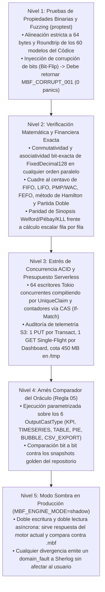

# Testing Strategy, Property-Based Verification, and Shadow Oracle Harness

> **English summary:** This document defines the testing and verification strategy for the **Metri Vortex (`.mbf`)** engine. In accordance with Rule 02 (*Safety Net First*) and Rule 05 (*Oracle Before Engine*), it specifies property-based tests (`proptest`), bit-corruption resilience, S3 CAS concurrency stress tests, penny-exact financial accounting verification, and the dual-execution Shadow Mode Oracle (`MBF_ENGINE_MODE=shadow`).

---

## 1. Los 5 Niveles de Verificación de `Metri Vortex (.mbf)`

Un motor de almacenamiento y analítica financiera propio exige un rigor de pruebas superior al de una aplicación convencional: **un fallo no siempre lanza un error; el peor fallo es devolver un número contable o estadístico ligeramente distinto en un dashboard**.



---

## 2. Especificación de Suites de Prueba Automatizadas

### 2.1. Suite de Integridad Binaria y Resistencia a Corrupción (`src/mbf/format/tests.rs`)
- **Invariante de Alineación en Tiempo de Ejecución y Compilación:**
  ```rust
  #[test]
  fn verify_64_byte_cache_line_alignment() {
      assert_eq!(std::mem::size_of::<MbfHeader>(), 64);
      assert_eq!(std::mem::align_of::<MbfHeader>(), 64);
      assert_eq!(std::mem::size_of::<MbfFooterTrailer>(), 64);
      assert_eq!(std::mem::align_of::<MbfFooterTrailer>(), 64);
      assert_eq!(std::mem::size_of::<NumericBlockSynopsis>(), 64);
      assert_eq!(std::mem::align_of::<NumericBlockSynopsis>(), 64);
      assert_eq!(std::mem::size_of::<FinancialBlockCheckpoint>(), 64);
      assert_eq!(std::mem::align_of::<FinancialBlockCheckpoint>(), 64);
  }
  ```
- **Property-Based Roundtrip (`proptest`) sobre los 60 Modelos del Códice:**
  - Genera entre 1 y 10.000 entidades sintéticas válidas para cada esquema de `config/models/*.json`, las serializa en un archivo `.mbf` en memoria, y verifica que `Pull` (Zona 1), las relaciones inversas `VAET` (Zona 2), las series `meter_reading` (Zona 3) y el libro mayor (Zona 4) devuelven exactamente los mismos valores.
- **Prueba de Inyección de Fallos (*Bit-Flip & Truncation Fuzzing*):**
  - Toma un buffer `.mbf` válido y:
    1. Lo trunca en 50 posiciones arbitrarias (incluyendo a mitad de `MbfHeader` y `MbfFooterTrailer`).
    2. Invierte 1 bit aleatorio en la zona de datos o en el directorio.
  - **Criterio de éxito:** El lector **jamás entra en `panic!`** (protegido por `#![deny(clippy::unwrap_used)]`) y devuelve siempre `Err(DomainError { code: ErrorCode::MbfCorrupt001, .. })`.

### 2.2. Suite de Exactitud Financiera y Contable (`src/mbf/zones/financial_ledger_tests.rs`)
1. **Asociatividad Paralela de `FixedDecimal128`:**
   - Crea un vector de 100.000 importes monetarios con centavos y fracciones (`0.01`, `0.02`, `19.99`, `-4.333333`), lo baraja en 20 permutaciones aleatorias y lo suma en bloques paralelos de distintos tamaños. Verifica que las 20 sumas coinciden bit a bit (donde `f64` diverge en las últimas cifras).
2. **Oráculo de Kardex Multi-Método (FIFO, LIFO, PMP/WAC y FEFO):**
   - Ejecuta una secuencia de 500 operaciones (`RECEIPT` a distintos precios y monedas, `CONSUMPTION` parciales que cruzan fronteras de 3 lotes, `RETURN`, `TRANSFER_OUT`/`TRANSFER_IN` y `ADJUSTMENT`).
   - Verifica que en cada instante $t_k$:
     - El saldo obtenido en $O(\log B)$ mediante `FinancialBlockCheckpoint` (`last_value`) es idéntico al calculado sumando desde el génesis.
     - El flujo obtenido en $O(1)$ mediante `FenwickPrefixSum128` (`prefix[b] - prefix[a - 1]`) es idéntico a la suma iterativa del sub-rango.
3. **Auditoría Criptográfica Merkle y Bloqueo Fiscal:**
   - Intenta modificar 1 centavo de un bloque histórico sin recalcular los bloques subsecuentes $\rightarrow$ debe fallar con `MBF_CORRUPT_001`.
   - Intenta insertar un `inventory_movement` con `timestamp <= fiscal_lock_epoch_ms` $\rightarrow$ debe fallar con `MBF_FISCAL_PERIOD_CLOSED_001`.

### 2.3. Suite de Concurrencia ACID (`If-Match` / `If-None-Match`) y Telemetría Serverless
- **Contención Extrema en `HOT_HEAD.mbf`:**
  - Lanza 64 tareas de Tokio concurrentes contra una instancia de `LocalFsObjectStore` (con latencia simulada de 2 ms) realizando:
    - Reclamaciones del mismo `email` único global (`UniqueClaim`).
    - Incrementos del correlativo `work_order_number` (`SequenceRegistry`).
    - Reservas y conciliaciones de tokens de IA (`QuotaService`).
  - **Criterio de éxito:** Exactamente 1 tarea gana el `UniqueClaim` (las 63 restantes reciben el error de conflicto de unicidad), los 64 números de orden generados son estrictamente consecutivos sin huecos ni duplicados (`WO-0001` .. `WO-0064`), y el saldo final de cuota es exacto.

---

## 3. El Arnés del Oráculo y el Modo Sombra (`Regla 05`)

Siguiendo la Regla 05 establecida en [`PLAN_COSTO_OLAP.md`](../architecture/PLAN_COSTO_OLAP.md#L67-L70):

1. **Política de Tolerancia Numérica Documentada:**
   - **Agregaciones Exactas y Contables (`COUNT`, `SUM` financiero, `MIN`, `MAX`, `running_balance`, `running_financial_value`):** Tolerancia **0 bits** (deben ser idénticas bit a bit).
   - **Agregaciones en Coma Flotante (`AVG`, `VARIANCE`, `STD_DEV`, `CORRELATION`, `LINEAR_REGRESSION`):** Tolerancia relativa $|\Delta| \le 10^{-11}$ respecto al cálculo de referencia en doble precisión.
   - **Percentiles Aproximados sobre KLL Sketch (`MEDIAN`, `PERCENTILE_90`, `PERCENTILE_95`, `PERCENTILE_99` en archivos L1/L2 > 4.096 filas):** Error de rango garantizado $\le 0,05\%$ (y 0 % cuando el conjunto filtrado cabe en un bloque y usa *nearest-rank* exacto).
2. **Ejecución en Modo Sombra (`MBF_ENGINE_MODE=shadow`):**
   - Durante la ventana de validación en producción, cada `Transact` y cada `Query` se ejecuta en el motor primario actual y, en paralelo no bloqueante (`tokio::spawn`), en el motor `.mbf`.
   - El comparador en memoria verifica el `QueryResponse` resultante; si detecta cualquier discrepancia fuera de la política de tolerancia, emite un evento estructurado `domain_fault` vía `Sherlog` con el AST IR exacto para su reproducción en tests unitarios.
