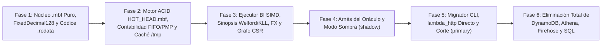

# Implementation Roadmap and Legacy OLTP/OLAP Engine Decommissioning

> **English summary:** This document outlines the 6-phase incremental implementation roadmap for **Metri Vortex (`.mbf`)**, the `mbf-migrator` backfill CLI tool, and the safe decommissioning protocol to permanently retire AWS DynamoDB (`src/eav/`), Kinesis Firehose, AWS Glue, Amazon Athena, and the `sea-query` SQL compiler (`src/aegis/sql/` and `LocalS3QueryEngine`).

---

## 1. Invariantes de Ejecución del Plan (Las 5 Reglas del Repositorio)

Todo commit de implementación de este plan está gobernado por las reglas de [`PLAN_REFACTORIZACION.md`](../architecture/PLAN_REFACTORIZACION.md#L83-L93) y [`PLAN_COSTO_OLAP.md`](../architecture/PLAN_COSTO_OLAP.md#L67-L70):

1. **Regla 01 — Separación:** Un commit añade módulos nuevos, mueve código o cambia el interruptor de enrutamiento, nunca mezcla refactors mecánicos con cambios semánticos.
2. **Regla 02 — Red primero:** Ningún módulo existente se reemplaza sin que la suite de tests del nuevo módulo `.mbf` esté en verde.
3. **Regla 03 — Verde continuo:** `cargo check --all-targets`, `cargo test --lib` y `python3 scripts/dev/check_result_pattern.py --strict` deben pasar al final de **cada commit**.
4. **Regla 04 — Golden justificado:** Los snapshots de contrato de `janus` y `aegis` deben mantenerse byte a byte idénticos.
5. **Regla 05 — Oráculo antes que corte:** El motor antiguo no se borra hasta que el motor `.mbf` haya pasado el arnés del Oráculo y el Modo Sombra con cero divergencias.

---

## 2. Las 6 Fases de Implementación y sus Puertas de Salida

### Fase 1 — Cimientos del Formato `.mbf`, `FixedDecimal128` y Pre-Compilación Códice (`build.rs`)
- **Alcance:**
  1. Añadir `bytemuck`, `roaring` y `crc32fast` en `Cargo.toml` y los códigos `MBF_*` en `error_catalog.toml` + `src/domain/errors.rs`.
  2. Definir los puertos `IByteRangeReader`, `IConditionalObjectWriter` e `IMbfBlockCache` en `src/domain/protocols.rs`.
  3. Implementar `src/codice/mbf_layout.rs` y la pre-compilación en `build.rs` para embeber los 60 modelos en `.rodata`.
  4. Implementar `src/mbf/format/*` y las 5 zonas en `src/mbf/zones/*` (incluyendo `FixedDecimal128`, redondeo bancario, método de Hamilton, `FenwickPrefixSum128`, `FinancialBlockCheckpoint`, `CsrGraphView`, `Chimp128` y `NumericBlockSynopsis`).
  5. Implementar `src/infrastructure/local_fs_object_store.rs`.
- **Puerta de Salida 1:**
  - [ ] `cargo test --lib mbf::` pasa al 100 % (incluyendo `proptest` de los 60 modelos y pruebas de corrupción de bits).
  - [ ] Cero bloques `unsafe` y cero `unwrap()` verificados con `make result-strict`.

### Fase 2 — Motor Transaccional ACID `HOT_HEAD.mbf`, Subsistema Contable y Adaptador S3
- **Alcance:**
  1. Implementar `src/infrastructure/s3_object_store.rs` (coalescencia de rangos HTTP/2, *Single-Flight*, revalidación `If-None-Match` $\rightarrow$ `304` y escrituras condicionales `If-Match`).
  2. Implementar `src/infrastructure/lambda_tmp_cache.rs` (presupuesto de 450 MB sobre los 512 MB gratuitos de `/tmp`).
  3. Implementar `src/mbf/tx/manifest_cas.rs` (`HOT_HEAD.mbf` Single-Object CAS, *Group Commit*, `UniqueClaim` Xor8, bloqueo de período fiscal y cadena Merkle SHA-256).
  4. Implementar `ActiveBatchSlab` (valorización en tiempo real FIFO, LIFO, PMP/WAC y FEFO) y `state_overlays.rs` (`QuotaCounter`, `SequenceRegistry`, `ISessionStore`).
  5. Implementar `src/mbf/tx/piggyback_compactor.rs` y `src/janus_router/unified_mbf_channel.rs`.
- **Puerta de Salida 2:**
  - [ ] Test de estrés con 64 escritores concurrentes pasa sin pérdida de actualizaciones ni colisiones de secuencia.
  - [ ] Test de contabilidad verifica que 1 consumo de repuesto actualiza lote, movimiento y libro mayor en 1 solo `PUT` a S3 cuadrando al centavo.

### Fase 3 — Motor de Ejecución BI Vectorizado SIMD (`src/aegis/mbf/`)
- **Alcance:**
  1. Implementar `src/aegis/mbf/planner.rs` (podado cuádruple por tiempo, Zone Maps, Xor8 Filters y resolución algebraica directa desde `.mbf.idx`).
  2. Implementar `src/aegis/mbf/stats_simd.rs` (las 14 funciones de `AggregationFunction` sobre Welford, Pébay, KLL e IRLS Logístico SIMD).
  3. Implementar `src/aegis/mbf/financial_analytics.rs` (resolución `last_value` en $O(\log B)$, conversión multi-divisa `EmbeddedFxMatrix`, cálculo de TCO/WIP de órdenes y depreciación NIC 16 cruzada con horómetros IoT).
  4. Registrar las nuevas funciones financieras en `src/aegis/formula/functions_registry.rs`.
- **Puerta de Salida 3:**
  - [ ] Benchmark local procesa 10 millones de filas sintéticas en `< 15 ms` y resuelve un balance de cierre `last_value` en `< 1 ms`.

### Fase 4 — Arnés del Oráculo e Integración en Modo Sombra (`MBF_ENGINE_MODE=shadow`)
- **Alcance:**
  1. Cablear `UnifiedMbfChannel` y `AegisMbfExecutor` en `src/grpc/server.rs` controlados por `MBF_ENGINE_MODE` (`legacy` | `shadow` | `primary`).
  2. Ejecutar el arnés comparador contra los snapshots golden de los 6 `OutputCastType` y la suite de conformidad de contratos (`tests/contract_conformance.rs`).
- **Puerta de Salida 4:**
  - [ ] 0 divergencias reportadas en toda la suite de tests unitarios, de integración y de contratos ejecutando en modo `shadow`.

### Fase 5 — Herramienta de Migración (`mbf-migrator`), Binding `lambda_http` y Corte a `primary`
- **Alcance:**
  1. Crear `src/bin/mbf-migrator.rs` para leer los datoms históricos de DynamoDB y los archivos Parquet de S3, compactándolos en archivos `.mbf` + `.mbf.idx` e inicializando el `HOT_HEAD.mbf` de cada tenant con su cadena Merkle y checkpoints contables verificados.
  2. Activar el despacho directo `lambda_http` sobre `RESPONSE_STREAM` en `src/main.rs` y `src/grpc/server.rs`.
  3. Cambiar el modo por defecto a `MBF_ENGINE_MODE=primary`.
- **Puerta de Salida 5:**
  - [ ] El 100 % de los endpoints gRPC (`Discovery`, `Explore`, `ListEntities`, `Query`, `Transact`, `CompositeTransact`, `BulkIngest`, `ReserveTokens`, `ReconcileTokens`, `MatchRoutingRulesBatch`) operan exclusivamente contra `.mbf` sin tocar DynamoDB ni Athena.

---

## 3. Fase 6 — Protocolo de Eliminación Definitiva del Motor OLTP/OLAP Antiguo

Una vez superada la ventana de estabilidad en modo `primary` con cero divergencias, se ejecuta la purga limpia del código e infraestructura heredada en commits atómicos separados (Regla 01):

### 3.1. Checklist de Eliminación de Código Fuente (`src/`)
1. **Purga del Compilador SQL y Motores OLAP Antiguos:**
   - Eliminar el directorio completo `src/aegis/sql/` (`compiler.rs`, `cte_compiler.rs`, `dialect.rs`, `metric.rs`, `security.rs`, `select.rs`, `virtual_table.rs`, `where_compiler.rs`).
   - Eliminar `src/infrastructure/athena.rs`.
   - Eliminar `src/infrastructure/local_s3_query_engine.rs` y el directorio `src/infrastructure/local_s3_query_engine/` (**1.555 líneas de parser y ejecutor SQL casero eliminadas**).
   - Eliminar `src/infrastructure/kinesis.rs`, `src/janus_router/olap_channel.rs` y `src/bin/firehose-seeder.rs`.
2. **Purga del Adaptador DynamoDB y Antiguo Ejecutor OLTP:**
   - Eliminar `src/infrastructure/dynamodb.rs` y `src/infrastructure/dynamodb_query_cache.rs`.
   - Eliminar `src/aegis/oltp/` (sustituido por `src/aegis/mbf/`).
   - Eliminar `src/janus_router/oltp_channel.rs` (sustituido por `src/janus_router/unified_mbf_channel.rs`).
   - Conservar de `src/eav/types/` únicamente las primitivas de dominio compartidas (`Datom`, `DatomValue`, `ValueType`) o reubicarlas limpiamente en `src/domain/datom.rs`.
3. **Purga de Dependencias Pesadas en `Cargo.toml`:**
   - Retirar `aws-sdk-dynamodb`, `aws-sdk-athena`, `aws-sdk-firehose`, `aws-sdk-glue` y `sea-query`.

### 3.2. Checklist de Simplificación de Infraestructura (`template.yaml` y `Makefile`)
1. En `template.yaml`:
   - Eliminar las 4 tablas DynamoDB (`MetriEavTable`, `MetriSequenceRegistryTable`, `MetriSchemasTable`, `MetriQueryCacheTable`) y sus políticas IAM asociadas.
   - Eliminar `MetriGlueDatabase`, `FirehoseDeliveryRole` y los permisos `athena:*`, `glue:*`, `firehose:*`.
   - Eliminar el Layer `LambdaAdapterLayerArm64:24` y la regla WAF `AWS-AWSManagedRulesSQLiRuleSet`.
   - Fijar `MemorySize: 1769`, `Timeout: 30` y `EphemeralStorage: Size: 512`.
2. En `Makefile` y `docker-compose.yml`:
   - Retirar el contenedor `dynamodb-local` y los targets `sync-iceberg`, `sync-firehose` y `sync-drift`. El desarrollo local levanta el binario `metri-engine` directamente sobre `LocalFsObjectStore` en menos de 1 segundo sin necesidad de Docker.
