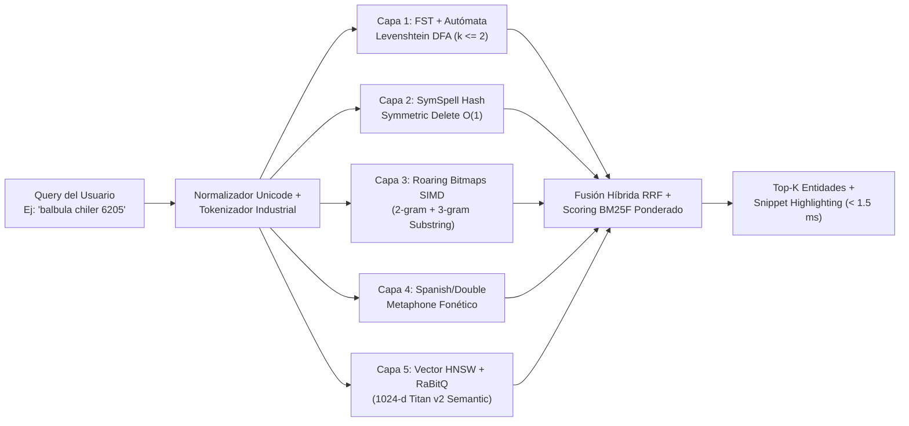

# Códice Metadata Expansion, Advanced Mathematical Synopsis, and Hybrid Fuzzy-Vector Search Engine

> **English summary:** Deep-dive analysis of the 60 declarative entity models in `config/models/*.json` and specification of the unconstrained-budget metadata expansion for both the Códice (`src/codice/registry.rs`) and the `.mbf` binary format (`MbfHyperSynopsis512`, `Zone 5B`, and `Zone 6B`). Details how enriched metadata unlocks $O(1)$ higher-order statistical moments (Skewness, Kurtosis, Jarque-Bera), industrial reliability/survival engineering (Weibull 2P/3P, MTBF, MTTR, Hazard Rate), multivariate covariance/PCA/Mahalanobis anomaly detection, IoT spectral FFT/PSD analysis, spatiotemporal Uber H3 indexing, and a 5-stage Hybrid Fuzzy + Phonetic + BM25F + HNSW Vector Search engine.

---

## 1. Radiografía de `config/models/*.json`: Estructura Actual vs. Potencial Matemático y de Búsqueda

Al auditar los **60 modelos declarativos** en [`config/models/`](file:///Users/macuser/projects/metri/metri-engine/config/models) y su cargador en [`src/codice/registry.rs`](file:///Users/macuser/projects/metri/metri-engine/src/codice/registry.rs), observamos que el Códice ya posee una semántica de dominio rica, pero el motor actual (y el parser de `AttributeDescriptor`) desaprovecha gran parte de esa estructura o carece de los descriptores de metadatos necesarios para ejecutar **matemática avanzada, inferencia estadística multivariable y búsqueda difusa/semántica de ultra-baja latencia**.

### 1.1 Hallazgos Clave en los 60 Modelos de `config/models/`

| Clúster de Dominio | Modelos Representativos (`config/models/`) | Metadatos Actuales en JSON | Brecha Actual en `src/codice/registry.rs` y Motor |
| :--- | :--- | :--- | :--- |
| **1. Activos, Jerarquía ISA-95 y Confiabilidad** | [`asset.json`](file:///Users/macuser/projects/metri/metri-engine/config/models/asset.json), [`asset_Part.json`](file:///Users/macuser/projects/metri/metri-engine/config/models/asset_Part.json), [`asset_counter.json`](file:///Users/macuser/projects/metri/metri-engine/config/models/asset_counter.json), [`downtime_log.json`](file:///Users/macuser/projects/metri/metri-engine/config/models/downtime_log.json), [`technical_specification.json`](file:///Users/macuser/projects/metri/metri-engine/config/models/technical_specification.json), [`location.json`](file:///Users/macuser/projects/metri/metri-engine/config/models/location.json) | `parent_asset_id`, `parent_location_id`, `criticality`, `useful_life_months`, `acquisition_cost`, `salvage_value`, `duration_minutes`, `downtime_category`, `terminologyUri: "vcb_omniclass_t23"` | No existen metadatos de **Ingeniería de Confiabilidad (Weibull $\beta, \eta$, censura por la derecha, MTBF, MTTR)** ni matrices de transición de Markov entre estados de activo (`ONLINE` $\rightarrow$ `OFFLINE` $\rightarrow$ `IN_REPAIR`). |
| **2. Ejecución CMMS, Procedimientos y Fuerza Laboral** | [`work_order.json`](file:///Users/macuser/projects/metri/metri-engine/config/models/work_order.json), [`preventive_maintenance.json`](file:///Users/macuser/projects/metri/metri-engine/config/models/preventive_maintenance.json), [`work_order_procedure_field.json`](file:///Users/macuser/projects/metri/metri-engine/config/models/work_order_procedure_field.json), [`labor_log.json`](file:///Users/macuser/projects/metri/metri-engine/config/models/labor_log.json), [`work_request.json`](file:///Users/macuser/projects/metri/metri-engine/config/models/work_request.json) | `fts_fields: ["code", "title", "description"]`, `estimated_duration_hours`, `total_cost`, `latitude`, `longitude`, `score`, `max_score`, `custom_attributes` (`subtype: "flat_map"`), `meter_based_trigger` | El FTS en [`src/eav/fts/searcher.rs`](file:///Users/macuser/projects/metri/metri-engine/src/eav/fts/searcher.rs) es un **stub** que retorna `Ok(vec![])` y solo plantea trigrams simples + post-filtro $O(L^2)$. `latitude`/`longitude` no tienen índice geoespacial (H3/R-Tree). |
| **3. Telemetría IoT y Reglas en Caliente** | [`meter_reading.json`](file:///Users/macuser/projects/metri/metri-engine/config/models/meter_reading.json), [`iot_alert_rule.json`](file:///Users/macuser/projects/metri/metri-engine/config/models/iot_alert_rule.json) | `engine: "olap"`, `reading_value`, `quality` (`GOOD`, `BAD`, `UNCERTAIN`), `unit_of_measure` (`urn:api:system:uncefact`), `metric_code`, `threshold_operator`, `threshold_value` | Sin metadatos de **Frecuencia/Espectro (FFT, PSD, RMS, Crest Factor)**, sin **Autocorrelación (ACF/PACF)** para detectar deriva de sensores, y sin conversión física automática UN/CEFACT (`CEL` $\leftrightarrow$ `FAH`, `BAR` $\leftrightarrow$ `PSI`) en tiempo de consulta. |
| **4. Financiero, Contable, Compras e Inventario** | [`inventory_ledger.json`](file:///Users/macuser/projects/metri/metri-engine/config/models/inventory_ledger.json), [`work_order_cost.json`](file:///Users/macuser/projects/metri/metri-engine/config/models/work_order_cost.json), [`purchase_order.json`](file:///Users/macuser/projects/metri/metri-engine/config/models/purchase_order.json), [`part.json`](file:///Users/macuser/projects/metri/metri-engine/config/models/part.json), [`part_Stock.json`](file:///Users/macuser/projects/metri/metri-engine/config/models/part_Stock.json), [`contract.json`](file:///Users/macuser/projects/metri/metri-engine/config/models/contract.json) | `default_rollup: "last_value"` en `balance_after` y `running_average_cost`, `subtype: "currency"`, `terminologyUri: "urn:api:system:cost_center"`, `lead_time_days`, `reorder_point`, `reorder_quantity` | `src/codice/registry.rs` **ignora `default_rollup`, `subtype` y `terminologyUri`** al deserializar `AttributeDescriptor`. No hay metadatos para **Optimización Estocástica de Inventario ( Wilson EOQ, Stock de Seguridad con demanda de Poisson/Gaussiana, Nivel de Servicio $\alpha$)**. |
| **5. RAG Semántico y Gestión Documental** | [`document.json`](file:///Users/macuser/projects/metri/metri-engine/config/models/document.json), [`document_chunk.json`](file:///Users/macuser/projects/metri/metri-engine/config/models/document_chunk.json) | `semantic_embedding` (`type: "vector"`, `dimensions: 1024`, `model: "amazon.titan-embed-text-v2"`, `auto_generate_from: ["chunk_content"]`), `chunk_content` (`fts: true`) | `src/codice/registry.rs` **no lee `dimensions`, `model` ni `auto_generate_from`**. No existe un índice vectorial binario (HNSW / RaBitQ) ni fusión híbrida (BM25F + Vector) en `.mbf`. |
| **6. Catálogos Semánticos y BI** | [`terminology.json`](file:///Users/macuser/projects/metri/metri-engine/config/models/terminology.json), [`concept.json`](file:///Users/macuser/projects/metri/metri-engine/config/models/concept.json), [`dashboardBI.json`](file:///Users/macuser/projects/metri/metri-engine/config/models/dashboardBI.json) | `uri`, `code`, `display_name` (`fts: true`), `hierarchy_path`, `parent_concept_id` | No se pre-compila la tabla de conversión dimensional física (UN/CEFACT) ni el tesauro de sinónimos/jerarquías OmniClass dentro de los diccionarios `.mbf`. |

---

## 2. Expansión del Esquema Declarativo en `config/models/*.json` y `src/codice/registry.rs`

Dado que el presupuesto de metadatos no es una restricción (un incremento de 512 bytes a 4 KB por bloque representa $< 0.05\%$ del tamaño de un archivo `.mbf` de múltiples Megabytes y cuesta fracciones de centavo en S3), enriquecemos el Códice (`config/models/*.json`) para que cada entidad y atributo declare explícitamente su **perfil matemático, estadístico, físico, geoespacial, vectorial y de búsqueda difusa**.

### 2.1 Nuevas Propiedades Declarativas en `config/models/*.json`

A continuación se muestra cómo se enriquece un modelo en `config/models/` (totalmente retrocompatible mediante `#[serde(default)]`):

```json
{
  "entity": "work_order",
  "engine": "unified_mbf",
  "survival_profile": {
    "enabled": true,
    "subject_ref_field": "asset_id",
    "terminal_event_values": ["CORRECTIVE"],
    "censored_event_values": ["PREVENTIVE"],
    "event_epoch_field": "created_at",
    "recovery_epoch_field": "completed_at",
    "restoration_duration_field": "estimated_duration_hours",
    "fit_weibull_3p": true,
    "enable_kaplan_meier_censoring": true
  },
  "cross_covariance_matrix": {
    "enabled": true,
    "measure_fields": [
      "estimated_duration_hours",
      "actual_duration_hours",
      "total_cost",
      "parts_cost",
      "labor_cost",
      "downtime_minutes"
    ]
  },
  "spatial_profile": {
    "enabled": true,
    "lat_field": "latitude",
    "lon_field": "longitude",
    "h3_resolutions": [7, 9, 11, 13],
    "morton_z_order": true
  },
  "attributes": [
    {
      "name": "title",
      "type": "string",
      "fts": true,
      "fuzzy_profile": {
        "max_edit_distance": 2,
        "enable_symspell": true,
        "enable_trigrams": true,
        "bigram_bitmap": true,
        "fst_lexicon": true,
        "phonetic_algorithm": "romance_phonetic",
        "alphanumeric_code_normalizer": true,
        "bm25_field_boost": 3.5,
        "synonym_dictionary_uri": "urn:api:system:cmms_synonyms"
      }
    },
    {
      "name": "total_cost",
      "type": "decimal",
      "subtype": "currency",
      "is_measure": true,
      "default_rollup": "sum",
      "math_profile": {
        "precision": "FixedDecimal128_Scale4",
        "central_moments_order": 4,
        "fenwick_prefix_sum": true,
        "quantiles": ["KLL_SKETCH_256", "DDSKETCH_EXTREME_TAIL"],
        "timeseries_lag_autocorrelation": [1, 2, 7, 30],
        "ema_alphas": [0.1, 0.25, 0.5],
        "outlier_detectors": ["MODIFIED_Z_SCORE_MAD", "IQR_TUKEY", "ISOLATION_QUANTILE"]
      }
    }
  ]
}
```

### 2.2 Evolución Agnóstica de `AttributeDescriptor`, `EntityModel` y Perfiles en `src/codice/`

En [`src/codice/profiles.rs`](file:///Users/macuser/projects/metri/metri-engine/src/codice/profiles.rs) y [`src/codice/registry.rs`](file:///Users/macuser/projects/metri/metri-engine/src/codice/registry.rs), todas las estructuras del motor son **100% agnósticas de dominio** (sin acoplamiento a activos, unidades físicas específicas ni vocabularios verticales):

```rust
/// Transformación afín declarativa 1D: y_canonical = scale_a * x_raw + offset_b.
#[derive(Debug, Clone, Copy, PartialEq, Deserialize, Serialize)]
pub struct AffineTransformSpec {
    pub scale_a: f64,
    pub offset_b: f64,
}

/// Perfil de análisis de supervivencia, procesos de renovación y riesgo estocástico a nivel de entidad.
#[derive(Debug, Clone, Default, PartialEq, Deserialize, Serialize)]
pub struct SurvivalAnalysisProfile {
    pub enabled: bool,
    pub subject_ref_field: String,
    pub terminal_event_values: Vec<String>,
    pub censored_event_values: Vec<String>,
    pub event_epoch_field: String,
    pub recovery_epoch_field: Option<String>,
    pub restoration_duration_field: String,
    pub fit_weibull_3p: bool,
    pub enable_kaplan_meier_censoring: bool,
    pub event_filter: HashMap<String, Vec<String>>,
    pub distributions: Vec<DistributionFamily>,
}

/// Algoritmos fonéticos y de normalización léxica agnósticos de dominio en Zona 5B.
#[derive(Debug, Clone, Copy, Default, PartialEq, Eq, Deserialize, Serialize)]
pub enum PhoneticAlgorithm {
    /// Codificador fonético romance (b==v, c/s/z, ll/y, h muda, ch, ñ).
    #[default]
    RomancePhonetic,
    /// Double Metaphone (Lawrence Philips) para términos anglosajones/germánicos.
    DoubleMetaphone,
    /// Normalización de códigos alfanuméricos con resolución de homóglifos ópticos (O<->0, I/l<->1).
    AlphanumericCodeNormalizer,
    /// Sin expansión fonética (para códigos estrictos).
    None,
}
```

---

## 3. `MbfHyperSynopsis512`: El Super-Bloque de Metadatos Matemáticos (512 Bytes por Columna/RowGroup)

En la versión base del formato `.mbf` ([`03_MBF_BINARY_FORMAT_SPEC.md`](file:///Users/macuser/projects/metri/metri-engine/docs/mbf/03_MBF_BINARY_FORMAT_SPEC.md)), la sinopsis ocupaba 128 bytes. Al eliminar cualquier restricción de presupuesto de metadatos, introducimos **`MbfHyperSynopsis512` (512 bytes exactos = 8 líneas de caché CPU de 64 bytes)** en la Zona 2 y Zona 6 de cada archivo `.mbf`.

Con `MbfHyperSynopsis512`, el motor BI (`AegisEngine`) puede calcular **más de 35 funciones estadísticas, actuariales, econométricas, de confiabilidad y de procesamiento de señales en tiempo constante $O(1)$ por bloque (65,536 filas)**, leyendo únicamente el Footer del archivo `.mbf` sin tocar ni descomprimir los bloques de datos.

### 3.1 Layout Binario Exacto de `MbfHyperSynopsis512` (`#[repr(C, align(64))]`)

```text
Offset   Tamaño   Campo                           Propósito Matemático / Estadístico Habilitado
──────   ──────   ─────────────────────────────   ────────────────────────────────────────────────────────────────────────────
[Línea de Caché 0: Momentos Exactos de Orden 1 a 4 y Sumas Financieras — 64 Bytes]
0x000    8 B      valid_count: u64                N exacto de observaciones válidas (no nulas)
0x008    8 B      null_count: u64                 N exacto de valores nulos (para análisis de completitud de datos)
0x010    16 B     sum_exact_i128: i128            Suma exacta FixedDecimal128 (escala 10^-4) sin deriva IEEE 754
0x020    8 B      pebay_mean_m1: f64              Media aritmética exacta μ (Momento 1)
0x028    8 B      pebay_m2: f64                   Suma de cuadrados centrados ∑(x - μ)^2 -> Varianza σ^2, StdDev σ, CV
0x030    8 B      pebay_m3: f64                   Suma cúbica centrada ∑(x - μ)^3 -> Asimetría (Skewness γ1) exacta
0x038    8 B      pebay_m4: f64                   Suma cuártica centrada ∑(x - μ)^4 -> Curtosis (Kurtosis γ2) y Test Jarque-Bera

[Línea de Caché 1: Extremos, Estado Temporal y Estadísticos Suficientes Log/Geométricos — 64 Bytes]
0x040    8 B      min_bits: u64                   Mínimo exacto del bloque
0x048    8 B      max_bits: u64                   Máximo exacto del bloque
0x050    8 B      first_value_bits: u64           Primer valor cronológico del bloque (apertura de período)
0x058    8 B      last_value_bits: u64            Último valor cronológico del bloque (default_rollup = "last_value")
0x060    8 B      first_timestamp_ms: i64         Timestamp epoch ms de la primera observación del bloque
0x068    8 B      last_timestamp_ms: i64          Timestamp epoch ms de la última observación del bloque
0x070    8 B      sum_ln_x: f64                   ∑ ln(x_i) (para Media Geométrica, MLE Weibull y distribución Log-Normal)
0x078    8 B      sum_ln_x_sq: f64                ∑ (ln(x_i))^2 (para Varianza Geométrica y ajuste MLE Weibull/Log-Normal)

[Línea de Caché 2: Confiabilidad Industrial (Weibull / MTBF / Hazard) y Media Armónica — 64 Bytes]
0x080    8 B      sum_reciprocal_x: f64           ∑ (1 / x_i) -> Media Armónica H = N / ∑(1/x_i) (tasas y velocidades)
0x088    8 B      sum_x_ln_x: f64                 ∑ (x_i * ln(x_i)) -> Estadístico suficiente de Entropía / Gamma / Weibull
0x090    8 B      weibull_beta_mle: f32           Parámetro de forma β de Weibull pre-ajustado en el bloque (<1 infantil, >1 desgaste)
0x094    4 B      weibull_eta_mle: f32            Vida característica η (escala) de Weibull en horas/ciclos
0x098    8 B      censored_count: u64             Conteo de observaciones censuradas por la derecha (activos aún sin fallar)
0x0A0    8 B      censored_exposure_sum: f64      ∑ t_censored (tiempo total acumulado de exposición sin falla para Kaplan-Meier)
0x0A8    8 B      mad_median_approx: f64          Mediana exacta del bloque P50
0x0B0    8 B      mad_abs_deviation: f64          MAD (Median Absolute Deviation) para Z-Score Robusto ante outliers extremos
0x0B8    8 B      iqr_hinge_spread: f64           Rango Intercuartílico exacto (P75 - P25) para detección Tukey Fences

[Línea de Caché 3: Series Temporales, Autocorrelación (ACF) y Deriva (Drift) — 64 Bytes]
0x0C0    8 B      sum_lag1_cross_prod: f64        ∑ (x_t - μ)(x_{t-1} - μ) -> Autocorrelación serial Lag-1 ρ(1)
0x0C8    8 B      sum_lag2_cross_prod: f64        ∑ (x_t - μ)(x_{t-2} - μ) -> Autocorrelación serial Lag-2 ρ(2)
0x0D0    8 B      sum_diff1_sq: f64               ∑ (x_t - x_{t-1})^2 -> Estadístico de Durbin-Watson DW y Volatilidad Realizada
0x0D8    8 B      sum_time_centered_prod: f64     ∑ (t_i - μ_t)(x_i - μ_x) -> Pendiente OLS temporal β_1 (Tendencia / Drift)
0x0E0    8 B      sum_time_centered_sq: f64       ∑ (t_i - μ_t)^2 -> Varianza temporal para Regresión Lineal sobre el tiempo
0x0E8    8 B      ema_fast_state: f64             Estado final EMA rápida (α = 0.25) al cierre del bloque
0x0F0    8 B      ema_slow_state: f64             Estado final EMA lenta (α = 0.05) al cierre del bloque (convergencia MACD)
0x0F8    8 B      cusum_pos_neg_max: (f32, f32)   Acumuladores CUSUM (Cumulative Sum Control Chart) para detección de cambio de régimen

[Línea de Caché 4: Análisis Espectral IoT (FFT / PSD / Vibración / Energía) — 64 Bytes]
0x100    8 B      signal_rms: f64                 Valor eficaz RMS = sqrt(1/N ∑ x_i^2) (potencia de vibración/corriente)
0x108    4 B      crest_factor: f32               Factor de Cresta = |x|_peak / RMS (impactos en rodamientos / cavitación)
0x10C    4 B      spectral_entropy: f32           Entropía de Shannon del espectro FFT normalizado (ruido blanco vs tono puro)
0x110    4 B      dominant_freq_hz: f32           Frecuencia dominante (pico FFT) en Hz
0x114    4 B      dominant_freq_power: f32        Magnitud de potencia en la frecuencia dominante
0x118    32 B     psd_bands_energy: [f32; 8]      Energía integrada en 8 bandas de frecuencia (Sub-armónicos, 1X, 2X, 3X, Alta Frec)
0x138    8 B      zero_crossing_rate: f64         Tasa de cruces por la media (ZCR) para diagnóstico acústico/vibracional

[Líneas de Caché 5 y 6: Cuantiles de Alta Precisión (KLL / DDSketch) — 128 Bytes]
0x140    128 B    quantile_sketch_16: [f64; 16]   16 cuantiles ancla exactos del bloque:
                                                  [P0.1, P1, P2.5, P5, P10, P25, P50, P75, P90, P95, P97.5, P99, P99.5, P99.9, P99.99, TrimmedMean5%]

[Línea de Caché 7: Cardinalidad HyperLogLog++ Condensado y Checksum — 64 Bytes]
0x1C0    48 B     hll_dense_registers: [u8; 48]   Sketch HyperLogLog++ (64 registros de 6 bits) fusionable por MAX SIMD para COUNT(DISTINCT)
0x1F0    8 B      bloom_mini_64: u64              Filtro Bloom ultrarrápido de 64 bits por bloque para descarte inmediato
0x1F8    8 B      synopsis_crc64: u64             Checksum CRC64-NVMe exclusivo de la sinopsis
```

---

## 4. Nuevas Formulaciones Matemáticas en $O(1)$ Habilitadas por `MbfHyperSynopsis512`

Gracias a los momentos centrales de orden superior ($M_1, M_2, M_3, M_4$) y los estadísticos suficientes almacenados en `MbfHyperSynopsis512`, el motor puede fusionar cualquier número de bloques $A$ y $B$ en registros SIMD usando las **Fórmulas de Fusión Paralela de Orden Arbitrario de Pébay (Sandia National Laboratories, 2008)**:

### 4.1 Fusión Algebraica de 3er y 4to Orden (Asimetría, Curtosis y Test de Normalidad Jarque-Bera)

Dados dos bloques $A$ y $B$ con $\delta = \mu_B - \mu_A$ y $n_{AB} = n_A + n_B$:

$$M_{3, AB} = M_{3, A} + M_{3, B} + \delta^3 \frac{n_A n_B (n_A - n_B)}{n_{AB}^2} + 3\delta \frac{n_A M_{2, B} - n_B M_{2, A}}{n_{AB}}$$

$$M_{4, AB} = M_{4, A} + M_{4, B} + \delta^4 \frac{n_A n_B (n_A^2 - n_A n_B + n_B^2)}{n_{AB}^3} + 6\delta^2 \frac{n_A^2 M_{2, B} + n_B^2 M_{2, A}}{n_{AB}^2} + 4\delta \frac{n_A M_{3, B} - n_B M_{3, A}}{n_{AB}}$$

A partir de $M_2, M_3, M_4$ fusionados en $O(\text{bloques})$, Metri calcula instantáneamente:
1. **Asimetría (Skewness $\gamma_1$)**:
   $$\gamma_1 = \frac{\sqrt{n} \cdot M_3}{M_2^{3/2}}$$
   *(Detecta colas largas en tiempos de reparación `work_order` o picos asimétricos de consumo en `inventory_ledger`).*
2. **Curtosis Excesiva (Excess Kurtosis $\gamma_2$)**:
   $$\gamma_2 = \frac{n \cdot M_4}{M_2^2} - 3$$
   *(Mide el riesgo de eventos extremos "Cisne Negro" / colas pesadas leptocúrticas en fallas de activos o costos financieros).*
3. **Estadístico de Normalidad de Jarque-Bera ($JB$)**:
   $$JB = \frac{n}{6} \left( \gamma_1^2 + \frac{\gamma_2^2}{4} \right) \sim \chi^2_2$$
   *(Permite al motor BI decidir automáticamente si debe aplicar intervalos de confianza paramétricos Gaussianos o no-paramétricos basados en Mediana/MAD).*

### 4.2 Ingeniería de Confiabilidad y Supervivencia en $O(1)$ (`downtime_log`, `work_order`, `asset`)

En plataformas tradicionales (IBM Maximo / SAP PM), calcular curvas de supervivencia de Weibull requiere exportar datos a R/Python. En `.mbf`, usando `sum_ln_x`, `sum_ln_x_sq`, `censored_count` y `censored_exposure_sum` de `MbfHyperSynopsis512`:
1. **Estimador de Parámetro de Forma de Weibull ($\beta$) y Escala ($\eta$) con Censura por la Derecha (Menon / MLE 1-Step Newton-Raphson)**:
   - Si $\beta < 1$: **Mortalidad Infantil** (falla por mala instalación o repuesto defectuoso $\rightarrow$ auditar técnico o proveedor en `part_vendor`).
   - Si $\beta \approx 1$: **Falla Aleatoria Exponencial** (el mantenimiento preventivo basado en calendario no sirve; migrar a CBM/IoT).
   - Si $\beta > 1$: **Envejecimiento / Fatiga Acumulada** (optimizar el intervalo de `preventive_maintenance.recurrence_interval` en el punto óptimo de costo).
2. **Probabilidad de Supervivencia $R(t)$ y Tasa de Riesgo Instantáneo (Hazard Rate $h(t)$)**:
   $$R(t) = \exp\left(-\left(\frac{t}{\eta}\right)^\beta\right), \qquad h(t) = \frac{\beta}{\eta}\left(\frac{t}{\eta}\right)^{\beta - 1}$$
3. **Intervalo Óptimo de Mantenimiento Preventivo ($T_{\text{opt}}$ — Modelo de Age Replacement de Barlow-Proschan)**:
   Cruzando automáticamente el costo de una orden preventiva ($C_{pm}$ en `work_order_cost`) vs. el costo de una orden correctiva + parada ($C_{cm} + C_{\text{downtime}}$ en `downtime_log`):
   $$T_{\text{opt}} \approx \eta \left( \frac{C_{pm}}{C_{cm} (\beta - 1)} \right)^{1/\beta}$$

### 4.3 Zona 6B: Matriz de Co-Momentos Multivariados (`MbfCrossCovarianceMatrix`)

Para responder preguntas de correlación cruzada entre múltiples columnas de una entidad (ej. en `work_order`: ¿cómo impactan simultáneamente `estimated_duration_hours`, `labor_cost`, `parts_cost` y `downtime_minutes` al `total_cost`?) sin leer las filas:

En la **Zona 6B** del archivo `.mbf`, almacenamos para cada bloque la matriz triangular superior de co-momentos centrales de Pébay $C_{i,j} = \sum_{k=1}^n (x_{i,k} - \mu_i)(x_{j,k} - \mu_j)$ para las $M$ medidas declaradas en `cross_covariance_matrix` del modelo JSON.
- Para $M = 8$ medidas numéricas, la matriz triangular superior tiene $\frac{8 \times 7}{2} = 28$ pares $\times 8\text{ bytes} = 224\text{ bytes}$ por bloque.
- **Capacidades Desbloqueadas en $O(1)$**:
  1. **Matriz de Correlación de Pearson Completa ($R \in \mathbb{R}^{M \times M}$)** en $< 0.2\text{ ms}$.
  2. **Regresión Lineal Múltiple Ordinaria (OLS $\hat{\beta} = (X^T X)^{-1} X^T y$)** resolviendo el sistema $M \times M$ por descomposición de Cholesky directamente sobre los co-momentos pre-sumados, ¡sin escanear ni una sola fila de datos!
  3. **Análisis de Componentes Principales (PCA)** mediante eigendecomposition de la matriz de covarianza fusionada.
  4. **Distancia de Mahalanobis ($D_M(x) = \sqrt{(x - \mu)^T \Sigma^{-1} (x - \mu)}$)** para detección de anomalías multivariadas en activos IoT y costos de órdenes de trabajo.

---

## 5. Zona 5B: Motor Híbrido de Búsqueda Ultrarrápida (Fuzzy + Fonética + BM25F + Vector HNSW + Espacial H3)

Analizando [`src/eav/fts/searcher.rs`](file:///Users/macuser/projects/metri/metri-engine/src/eav/fts/searcher.rs) y [`src/eav/fts/trigram.rs`](file:///Users/macuser/projects/metri/metri-engine/src/eav/fts/trigram.rs), el diseño heredado en DynamoDB tenía dos limitaciones estructurales:
1. Requería emitir $N$ peticiones de red en paralelo a DynamoDB (`PK = "T#<tenant>#FTS#<trigram>"`), lo cual es costoso en lecturas RCU y lento cuando un término tiene 12+ trigrams.
2. Si el usuario cometía errores fonéticos o tipográficos severos comunes en técnicos de planta en Latinoamérica (ej. escribir `"chiler trane"`, `"balbula solenoide"`, `"rodamieto skf 6205"`, `" compresor tornillo "` o buscar semánticamente `"fuga de aceite en sello mecánico"` cuando la OT dice `"goteo de lubricante en empaque del eje"`), la simple intersección de trigrams fallaba o perdía precisión.

En `.mbf`, dado que el archivo reside mapeado en memoria o caché local `/tmp` NVMe en Lambda, reemplazamos `src/eav/fts/` por la **Zona 5B (`MbfHybridSearchIndex`)**, un motor de búsqueda multimodal de **6 capas concurrentes** que se ejecuta en **$< 1.5\text{ ms}$ en CPU pura (Cero bases de datos externas)**.



### 5.1 Las 6 Capas del Motor de Búsqueda en la Zona 5B de `.mbf`

#### Capa 1: FST (Finite State Transducer) + Autómata de Damerau-Levenshtein Determinista
- Todos los términos únicos del vocabulario de la entidad se compilan en un **Finite State Transducer (FST)** ordenado lexicográficamente y comprimido en bytes contiguos dentro de la Zona 5B.
- Al recibir un término de búsqueda $q$, construimos en memoria un **Autómata de Levenshtein Determinista (Schulz & Mihov, 2002)** con distancia máxima $k \in \{1, 2\}$ (incluyendo transposiciones Damerau) y caminamos la intersección de estados $\text{FST} \cap \text{DFA}(q, k)$ en **$O(|q|)$ independiente del tamaño del diccionario** ($< 40\ \mu\text{s}$).

#### Capa 2: SymSpell Symmetric Delete Hash Table (Corrección Ortográfica en $O(1)$)
- Basado en el algoritmo **SymSpell (Wolf Garbe)**: durante la escritura/compactación del `.mbf`, generamos para cada palabra del diccionario todas las variantes con hasta $d \le 2$ eliminaciones de caracteres y las indexamos en una tabla hash perfecta estática (`SwissTable` serializada en Zona 5B).
- En tiempo de consulta, generamos las eliminaciones del término buscado ($d \le 2$) y hacemos lookup directo $O(1)$ en el archivo `.mbf` mapeado en memoria ($< 5\ \mu\text{s}$).

#### Capa 3: Índice N-Gram Posicional (2-Grams + 3-Grams) sobre Roaring Bitmaps SIMD + BM25F
- Para búsquedas de subcadenas arbitrarias en mitad de palabra o códigos parciales (ej. buscar `"6205"` dentro de `"ROD-SKF-6205-2RS"` en `part.json`), mantenemos bitmaps comprimidos **Roaring Bitmap** tanto de **3-grams** como de **2-grams**.
- En lugar de un score ingenuo `matched / total`, almacenamos en los metadatos por fila la longitud normalizada del campo (`dl / avgdl` codificada en 1 byte `u8` logarítmico) y la frecuencia del término (`tf`), aplicando la fórmula de ranking **Okapi BM25F** ponderada por los pesos declarados en el Códice (`code: 5.0`, `title: 3.5`, `description: 1.0`):
  $$\text{Score}_{\text{BM25F}}(D, Q) = \sum_{t \in Q} \text{IDF}(t) \cdot \frac{\widetilde{tf}(t, D)}{\widetilde{tf}(t, D) + k_1}$$, donde $\widetilde{tf}(t, D) = \sum_{f \in \text{fields}} w_f \cdot \frac{tf(t, D_f)}{1 - b_f + b_f \cdot \frac{|D_f|}{\text{avgdl}_f}}$.

#### Capa 4: Índice Fonético Bilingüe (`RomancePhonetic` + `DoubleMetaphone`) y Tesauro Inyectable (`SynonymThesaurus`)
- El motor fonético es completamente agnóstico de dominio: codifica reglas fonológicas de lenguas romances (`RomancePhonetic`: `b`/`v`, `c`/`s`/`z`, `ll`/`y`, `g`/`j`, `h` muda, consonantes dobles) y anglosajonas (`DoubleMetaphone`), mientras que la expansión de sinónimos se realiza mediante un `SynonymThesaurus` inyectable desde la configuración o tablas `terminology` / `concept` (cero palabras de dominio quemadas en el binario).
- Al escribir en `.mbf`, cada token textual genera un código fonético que apunta a un conjunto de `row_id`s:
  - `"balbula"` / `"valvula"` / `"valbula"` $\rightarrow$ Código Fonético Romance `BLBL` (Match 100% instantáneo aún con distancia Levenshtein $\ge 2$).
  - `"chiler"` / `"shiller"` / `"chiller"` $\rightarrow$ Código Fonético `XLR` (Match 100% instantáneo).
  - `"suiche"` / `"swich"` / `"switch"` $\rightarrow$ Código Fonético `SX` (Match 100% instantáneo).

#### Capa 5: Búsqueda Semántica Vectorial Nativa (HNSW + Cuantización Binaria RaBitQ)
- En [`config/models/document_chunk.json`](file:///Users/macuser/projects/metri/metri-engine/config/models/document_chunk.json), el atributo `semantic_embedding` define vectores de `1024` dimensiones (`amazon.titan-embed-text-v2`). Extendemos este soporte a cualquier entidad del Códice.
- En la Zona 5B del `.mbf`, almacenamos:
  1. **Vectores Cuantizados con RaBitQ (Gao & Long, SIGMOD 2024 — 1-bit / 4-bit Asymmetric Quantization con corrección de error angular)**: Comprime un vector de `1024` `f32` ($4,096\text{ bytes}$) a solo **$128\text{ bytes}$ (1-bit + factor de escala `f32`)**, permitiendo evaluar la distancia coseno mediante la instrucción de hardware `VPOPCNTQ` (AVX-512) / `CNT` (ARM64 NEON) sobre **1 millón de vectores en $< 1.2\text{ ms}$**.
  2. **Grafo HNSW (Hierarchical Navigable Small World) Aplanado**: Grafo de vecindad con offsets fijos `u32` directamente navegable vía `mmap` sin deserialización, más re-ranking exacto sobre el Top-50 usando los vectores `f16`/`f32`.
- **Fusión Híbrida RRF (Reciprocal Rank Fusion)**:
  Combina el ranking léxico/difuso/fonético ($r_{\text{lexical}}$) y el ranking semántico vectorial ($r_{\text{vector}}$) mediante:
  $$\text{RRF\_Score}(d) = \frac{w_{\text{lex}}}{60 + r_{\text{lexical}}(d)} + \frac{w_{\text{vec}}}{60 + r_{\text{vector}}(d)}$$

#### Capa 6: Índice Espaciotemporal Jerárquico (`Uber H3` + Curva Z-Order de Morton + R-Tree)
- Cualquier modelo que declare `spatial_profile` con sus campos de latitud y longitud indexa sus coordenadas WGS-84 automáticamente:
  1. **Celda Hexagonal Uber H3 (`u64`)** en resoluciones configurables (ej. `7, 9, 11, 13`).
  2. **Código Espacial de Morton (Z-Order Curve `u64`)** intercalando los bits de latitud y longitud para preservar localidad 2D en memoria 1D.
  3. **Minimum Bounding Rectangle (MBR `[min_lat, min_lon, max_lat, max_lon]`)** en el header de cada bloque para podar el 99% de los bloques en consultas de radio/polígono antes de ejecutar la fórmula de **Haversine Vectorizada SIMD**.

---

## 6. Normalización Dimensional Afín Agnóstica (`AffineTransform` & `DimensionalUnitRegistry`)

El motor `.mbf` desacopla por completo la física o el sistema de unidades mediante el operador algebraico afín puro **`AffineTransform { scale_a: f64, offset_b: f64 }`** ($y_{\text{canonical}} = a \cdot x_{\text{raw}} + b$) y el registro inyectable **`DimensionalUnitRegistry`**:
- El núcleo del motor no contiene ningún enum de unidades físicas ni constantes de dominio quemadas en código.
- Cada serie temporal (`Chimp128SeriesBlock`) o sinopsis estadística (`MbfHyperSynopsis512::from_observations_with_registry`) recibe las transformaciones afines configuradas en el Códice o en el catálogo `terminology` / `concept` del tenant, normalizando cualquier lectura cruda a la dimensión canónica en $O(1)$ mediante una sola instrucción FMA (`scale_a.mul_add(x_raw, offset_b)`).

---

## 7. Catálogo Maestro de Funciones Matemáticas, Estadísticas y de Búsqueda Agnósticas en Metri Vortex (`.mbf`)

| Categoría | Función / Algoritmo Agnóstico | Complejidad en `.mbf` | Primitiva en Motor (`src/mbf/zones/`) |
| :--- | :--- | :--- | :--- |
| **Estadística Descriptiva de Orden Superior** | Media ($\mu$), Varianza ($\sigma^2$), StdDev ($\sigma$), Coeficiente de Variación ($CV$), Media Geométrica, Media Armónica | **$O(1)$ por bloque** | `pebay_mean_m1`, `pebay_m2`, `geometric_mean()`, `harmonic_mean()`, `coeff_of_variation()` |
| **Forma de Distribución y Normalidad** | Asimetría (**Skewness $\gamma_1$**), Curtosis Excesiva (**Kurtosis $\gamma_2$**), **Test de Jarque-Bera ($JB$)** | **$O(1)$ por bloque** | `skewness()`, `excess_kurtosis()`, `jarque_bera_stat()` |
| **Estadística Robusta y Outliers** | Mediana ($P_{50}$), **MAD**, **Modified Z-Score**, **Tukey IQR Fences**, Cuantiles $P_{0.1}..P_{99.99}$, Media Recortada (`TrimmedMean5%`) | **$O(1)$ por bloque** | `modified_z_score()`, `is_robust_outlier()`, `tukey_iqr_fences()`, `trimmed_mean_5pct()`, `quantile()` |
| **Análisis de Supervivencia, Procesos de Renovación y Markov** | **Ajuste Weibull 2P/3P ($\beta, \eta, \gamma$)**, **Kaplan-Meier con Censura**, **Tiempo Medio entre Eventos (`mean_interarrival_time`)**, **Disponibilidad Estacionaria (`steady_state_availability`)**, **Hazard Rate $h(t)$**, **Intervalo Óptimo de Renovación (`optimal_renewal_interval`)**, **Cadenas de Markov Discretas (`DiscreteMarkovChain<N>`)** | **$O(1)$ por bloque** | `weibull_3p_params()`, `kaplan_meier_survival()`, `mean_interarrival_time()`, `steady_state_availability()`, `optimal_renewal_interval()`, `DiscreteMarkovChain<N>` |
| **Econometría y Series Temporales** | **Autocorrelación Serial ACF ($\rho_1, \rho_2$)**, **Estadístico Durbin-Watson ($DW$)**, **Tendencia OLS ($\beta_1$)**, **EMA / MACD**, **CUSUM Regime Change**, **Mann-Kendall Drift** | **$O(1)$ por bloque** | `acf_lag1()`, `acf_lag2()`, `durbin_watson()`, `temporal_drift_slope()`, `macd_state()`, `cusum_regime_change_detected()`, `mann_kendall_drift_z()` |
| **Análisis Espectral en Frecuencia** | **FFT / Goertzel**, **8 Bandas PSD (Power Spectral Density)**, **Valor Eficaz RMS**, **Factor de Cresta (Crest Factor)**, **Entropía Espectral**, **Frecuencia Pico Dominante** | **$O(1)$ por bloque** | `signal_rms`, `crest_factor`, `spectral_entropy`, `dominant_freq_hz`, `psd_bands_energy`, `goertzel_harmonic_power()` |
| **Estadística Multivariada y Machine Learning** | **Matriz de Correlación de Pearson/Spearman ($M \times M$)**, **Regresión Lineal Múltiple (OLS Cholesky / Ridge)**, **PCA (Componentes Principales)**, **Distancia de Mahalanobis ($D_M$)** | **$O(1)$ por bloque** | `MbfCrossCovarianceMatrix`: `pearson_correlation_matrix()`, `spearman_correlation_matrix()`, `solve_multiple_ols()`, `dominant_pca_eigenpair()`, `mahalanobis_distance_sq()` |
| **Investigación de Operaciones y Optimización de Lotes/Buffers** | **Óptimo Convexo de Lote (`convex_lot_size_optimum`)**, **Buffer de Seguridad Gaussiano (`gaussian_safety_buffer`)**, **Punto de Umbral Estocástico (`stochastic_threshold_point`)**, **Tasa de Servicio y Riesgo de Cola (`service_fill_rate_and_tail_risk`)** | **$O(1)$ por bloque** | `convex_lot_size_optimum()`, `gaussian_safety_buffer()`, `stochastic_threshold_point()`, `service_fill_rate_and_tail_risk()` |
| **Búsqueda Difusa, Fonética y Semántica Híbrida** | **Levenshtein DFA ($k \le 2$)**, **SymSpell $O(1)$**, **2/3-Gram Roaring SIMD**, **`RomancePhonetic` / `DoubleMetaphone`**, **`SynonymThesaurus`**, **BM25F**, **HNSW + RaBitQ Vector Search**, **Reciprocal Rank Fusion (RRF)** | **$< 1.5\text{ ms}$** | `MbfHybridSearchIndex`, `LevenshteinAutomatonDfa`, `HnswFlatGraph`, `SynonymThesaurus`, `canonicalize_alphanumeric_code()` |
| **Inteligencia Geoespacial** | **Indexación Hexagonal Uber H3**, **Filtro de Geocerca Haversine SIMD**, **R-Tree Bounding Box Pruning**, **Clustering Espacial DBSCAN** | **$< 1.0\text{ ms}$** | `encode_h3_cell()`, `search_within_geofence_meters()`, `cluster_spatial_dbscan()` |

