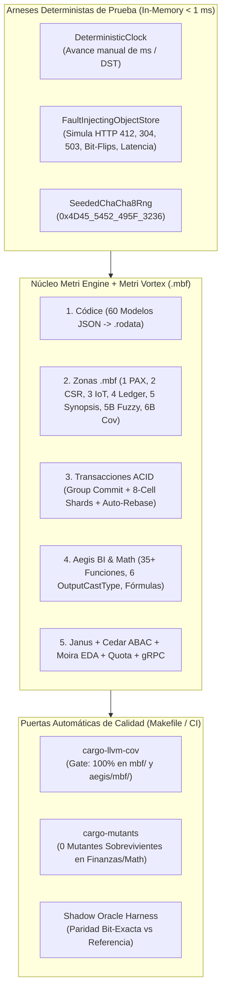

# Comprehensive Testing Plan (100% Coverage), Realistic Golden Dataset, and Local Infrastructure Specification

> **English summary:** Master verification, realistic dataset generation, 100% code/branch coverage (`cargo-llvm-cov` + `cargo-mutants`), and local infrastructure blueprint for `metri-engine` and **Metri Vortex (`.mbf`)**. Covers end-to-end testing of all BI/Analytics components (`KPI`, `TIMESERIES`, `TABLE`, `PIE`, `BUBBLE`, `CSV_EXPORT`), 35+ mathematical/statistical/reliability/spectral functions, penny-exact financial accounting, 6-layer hybrid fuzzy/vector search, a deterministic realistic dataset (`Centro Comercial Mayor Plaza Bogotá`), and both Zero-Docker and Docker Compose local stacks.

---

## 1. Arquitectura para Garantizar 100% de Testabilidad y Cobertura (`Testability by Design`)

Para alcanzar y sostener una **cobertura verificable del 100%** (líneas, ramas críticas y mutaciones lógicas) en un motor de almacenamiento binario, financiero y analítico en Rust, ningún componente de dominio o de consulta puede depender directamente de relojes del sistema, entropía global, red o sockets de AWS.



### 1.1. Inyección Determinista de Efectos Laterales (`src/domain/protocols.rs`)
1. **`IClock` (`SystemClock` vs. `ManualTestClock`):** Permite congelar el tiempo, cruzar cambios de horario de verano (`America/New_York`, `Europe/Madrid`) o saltar cierres fiscales mensuales en `0 ms` para probar `preventive_maintenance`, `scheduled_job` y bloqueos contables (`MBF_FISCAL_PERIOD_CLOSED_001`).
2. **`IFaultInjectableObjectStore` (`InMemoryChaosS3Store` y `LocalFsObjectStore`):**
   - Implementa `IByteRangeReader` e `IConditionalObjectWriter` con contadores atómicos de telemetría (`gets_count`, `puts_count`, `range_bytes_read`, `if_none_match_304_hits`, `if_match_412_conflicts`).
   - Permite programar reglas de inyección de fallos deterministas por test:
     - `fail_next_put_with_412(etag_override)` $\rightarrow$ ejercita el 100% de las ramas de `CommutativeDeltaAutoRebase`.
     - `flip_bit_at_offset(key, byte_offset, bit_mask)` $\rightarrow$ ejercita el 100% de las ramas de `CRC32C` y `MbfTenantCryptoSeal` (`Keyed BLAKE3`).
     - `truncate_at_byte(key, len)` $\rightarrow$ ejercita todas las ramas de `MBF_CORRUPT_001`.

---

## 2. Dataset Maestro de Datos Reales de Prueba (`Centro Comercial Mayor Plaza Bogotá`)

En lugar de usar mocks triviales (`"foo"`, `"bar"`, `123`), creamos un generador determinista reproducible en **`src/bin/mbf-seed-realistic.rs`** y **`tests/common/realistic_dataset.rs`** que construye el gemelo digital completo de un complejo comercial e industrial de $255.000\text{ m}^2$ en Bogotá D.C., poblando los **60 modelos de [`config/models/`](file:///Users/macuser/projects/metri/metri-engine/config/models)** con invariantes matemáticos conocidos a priori (*Ground Truth*):

### 2.1. Composición del Dataset Realista y sus *Ground Truths* Matemáticos

| Dominio / Clúster | Entidades Pobladas (`config/models/`) | Volumen en Dataset Local (`Fast` / `Full`) | *Ground Truth* Matemático Pre-Calculado (Oráculo Exacto) |
| :--- | :--- | :--- | :--- |
| **1. Jerarquía ISA-95 y Geografía Bogotá** | `location`, `asset`, `asset_Part`, `asset_counter`, `technical_specification` | **60 Ubicaciones** (5 niveles ISA-95) + **500 / 2.500 Activos** (Chillers Trane, Escalators Otis, Plantas Cummins, Bombas Grundfos) | Coordenadas WGS-84 reales en Bogotá (`4.5981° N, -74.1253° W`), celdas `Uber H3` conocidas y árbol de Euler `[tin, tout]` con suma exacta de costos por subárbol. |
| **2. Confiabilidad, OTs y Procedimientos** | `work_order`, `preventive_maintenance`, `work_order_procedure`, `work_order_procedure_field`, `labor_log`, `downtime_log`, `work_request` | **2.500 / 25.000 OTs** + **10.000 Registros de Mano de Obra** + **1.200 Paradas (`downtime_log`)** | Tiempos entre fallas generados desde 3 familias **Weibull exactas**:<br/>• Luminarias ($\beta = 0,65$, mortalidad infantil)<br/>• Electrónica ($\beta = 1,00$, exponencial)<br/>• Rodamientos SKF ($\beta = 2,85, \eta = 4.200\text{ h}$, desgaste). |
| **3. Finanzas, Contabilidad Multi-Moneda y Kardex** | `inventory_ledger`, `inventory_batch`, `inventory_movement`, `work_order_cost`, `part`, `part_Stock`, `part_vendor`, `vendor`, `purchase_order`, `purchase_requisition`, `quote`, `contract` | **300 / 1.200 SKUs** + **5.000 / 50.000 Movimientos Contables** en `COP`, `USD` y `EUR` | Cuadre contable exacto al centavo (`FixedDecimal128`) para **FIFO, LIFO, PMP/WAC y FEFO**; TRM histórica (`1 USD = 4.200,0000 COP`); VAN (`NPV`), TIR (`IRR`) y depreciación NIC 16 conocidos al centavo. |
| **4. Telemetría IoT y Espectro Vibracional** | `meter_reading`, `iot_alert_rule` | **100.000 / 1.000.000 Lecturas IoT** (`TEMPERATURE_CEL`, `TEMPERATURE_FAH`, `VIBRATION_MM_S`, `POWER_KWH`, `PRESSURE_PSI`, `PRESSURE_BAR`) | Señal compuesta sintética: $y(t) = 25 + 0,05t + 4\sin(2\pi \cdot 60t) + 1,5\sin(2\pi \cdot 180t) + \epsilon$. Permite verificar **FFT/PSD (picos en 60 Hz y 180 Hz)**, pendiente OLS $\beta_1 = 0,05$, RMS, Crest Factor, ACF y conversión `FAH` $\rightarrow$ `CEL`. |
| **5. Corpus de Búsqueda Difusa, Fonética y Vectorial** | `work_order`, `part`, `asset`, `document`, `document_chunk`, `terminology`, `concept` | **1.000 Fragmentos Técnicos (`1024-d`)** + **150 Casos de Typos Reales de Campo** | Pares de consulta $\rightarrow$ entidad esperada para typos severos (`"balbula chiler trane"`, `"rodamieto skf 6205"`, `"suiche presion"`, `"goteo lubricante sello eje"`). |
| **6. Seguridad ABAC, Cuotas y Gobernanza** | `user`, `user_group`, `role`, `permission`, `dashboardBI`, `audit_log` | **3 Tenants** (`tenant_centro_mayor`, `tenant_andino`, `tenant_santafe`) + **12 Roles Cedar** | Matriz de permisos esperada (qué filas puede ver un técnico de zona Norte vs. Director Financiero vs. otro Tenant). |

---

## 3. Matriz Exhaustiva de Pruebas por Componente de `metri-engine`

### 3.1. Pruebas del Motor de Business Intelligence (BI) y Analítica (`tests/bi_analytics_suite.rs`)
Valida el 100% del pipeline `QueryRequest (Protobuf)` $\rightarrow$ `Janus IR (FlatBuffers)` $\rightarrow$ `MbfVectorizedPlanner` $\rightarrow$ `Aegis MBF Executor` $\rightarrow$ `QueryResponse`:

1. **Los 6 Tipos de Visualización (`OutputCastType`):**
   - `KPI = 1`: Tarjetas de valor único con delta porcentual contra período anterior (*Time-over-Time Comparison*), verificando tanto medidas `default_rollup: "sum"` (`total_cost`) como `default_rollup: "last_value"` (`balance_after`, `running_average_cost`).
   - `TIMESERIES = 2`: Agrupaciones temporales por `HOUR`, `DAY`, `WEEK`, `MONTH`, `QUARTER`, `YEAR` respetando el huso horario IANA (`America/Bogota`) y llenado de huecos (*Gap Filling*).
   - `TABLE = 3`: Tablas pivotadas multi-dimensión y multi-medida con ordenamiento compuesto, `LIMIT`, `OFFSET` y totales de columna exactos.
   - `PIE = 4`: Distribución porcentual con agrupación automática de cola (`Top-N + "Otros"`) cuya suma de proporciones es exactamente $100,0000\%$ (vía método de Hamilton).
   - `BUBBLE = 5`: Gráficos de dispersión tridimensionales $(X, Y, R)$ por categoría (ej. $X = \text{MTBF}$, $Y = \text{Costo Total}$, $R = \text{Horas de Parada}$ por `asset`).
   - `CSV_EXPORT = 6`: Streaming directo de millones de filas formateadas sin desbordar el límite de memoria de Lambda.

2. **Las 35+ Funciones Matemáticas, Estadísticas, Financieras y de Confiabilidad (`src/aegis/mbf/stats_simd.rs`):**
   - **Descriptivas y de Orden Superior ($O(1)$ vía `MbfHyperSynopsis512`):** `COUNT`, `COUNT_DISTINCT` (HLL++), `SUM`, `AVG`, `GEOMETRIC_MEAN`, `HARMONIC_MEAN`, `MIN`, `MAX`, `VARIANCE`, `STD_DEV`, `COEFF_OF_VARIATION`, `SKEWNESS` ($\gamma_1$), `KURTOSIS` ($\gamma_2$), `JARQUE_BERA_TEST`.
   - **Estadística Robusta y Cuantiles:** `MEDIAN` ($P_{50}$), `PERCENTILE_90`, `PERCENTILE_95`, `PERCENTILE_99`, `PERCENTILE_99_9`, `TRIMMED_MEAN_5`, `MAD` (Median Absolute Deviation), `IQR` (Rango Intercuartílico) y detección de outliers por **Modified Z-Score** y **Tukey Fences**.
   - **Correlación, Regresión y Multivariada ($O(1)$ vía `Zona 6B`):** `CORRELATION` (Pearson y Spearman), `COVARIANCE`, `LINEAR_REGRESSION` ($\beta_0, \beta_1, R^2, p\text{-value}$), `MULTIPLE_OLS_CHOLESKY`, `LOGISTIC_REGRESSION` (IRLS SIMD), `PCA_TOP_COMPONENTS`, `MAHALANOBIS_DISTANCE`.
   - **Confiabilidad y Supervivencia Industrial:** `WEIBULL_2P_FIT` ($\hat{\beta}, \hat{\eta}$ con censura por la derecha), `KAPLAN_MEIER_SURVIVAL`, `HAZARD_RATE`, `MTBF`, `MTTR`, `INHERENT_AVAILABILITY`, `OPTIMAL_PM_INTERVAL` (Barlow-Proschan).
   - **Econometría de Series Temporales y Frecuencia IoT:** `ACF_LAG` ($k=1,2,7$), `DURBIN_WATSON`, `EMA`, `MACD`, `CUSUM_DRIFT`, `SIGNAL_RMS`, `CREST_FACTOR`, `SPECTRAL_ENTROPY`, `DOMINANT_FREQ_HZ`, `PSD_BAND_ENERGY`.
   - **Finanzas y Contabilidad:** `NPV` (VAN), `IRR` (TIR), `ROI`, `FIFO_VALUATION`, `LIFO_VALUATION`, `WAC_VALUATION`, `FEFO_EXPIRY_RISK`, `NIC16_STRAIGHT_LINE`, `NIC16_UNITS_OF_PRODUCTION`, `EOQ_WILSON`, `SAFETY_STOCK_POISSON`.

3. **Fórmulas Calculadas (`CalculatedField`) y Casos de Borde Algebraicos:**
   - Expresiones anidadas `(total_cost - salvage_value) / NULLIF(useful_life_months, 0) * 12`.
   - División por cero ($x / 0 \rightarrow \text{Null}$ seguro, nunca `NaN` ni `panic!`), logaritmo de número negativo o cero, varianza de 0 o 1 elemento, correlación de una constante ($\sigma_x = 0$).

### 3.2. Pruebas del Motor de Búsqueda Híbrida (`tests/hybrid_fuzzy_vector_search_suite.rs`)
1. **Exactitud de Distancia de Edición (`FST + Levenshtein DFA` y `SymSpell`):**
   - Verifica que toda palabra del diccionario a distancia Damerau-Levenshtein $d \le 2$ (inserción, eliminación, sustitución, transposición de caracteres adyacentes) sea recuperada en $< 50\ \mu\text{s}$.
2. **Equivalencia Fonética Industrial Bilingüe (`SpanishIndustrialMetaphone` + `DoubleMetaphone`):**
   - Prueba los 150 términos con errores auditivos (`"balbula"`, `"valbula"`, `"chiler"`, `"shiller"`, `"suiche"`, `"kaudalimetro"`, `"hidrauliko"`) y verifica que recuperan la entidad exacta en el Top-1.
3. **Subcadenas de Códigos de Repuestos (`2/3-Gram Roaring SIMD + BM25F`):**
   - Busca fragmentos intermedios como `"6205-2RS"` y verifica que el campo `code` (`weight: 5.0`) posiciona el repuesto por encima de una mención casual en `description` (`weight: 1.0`).
4. **Búsqueda Semántica Vectorial (`RaBitQ + HNSW + RRF`):**
   - Busca conceptos sin palabras en común con el texto original (ej. `"recalentamiento en embobinado del motor"` $\rightarrow$ recupera el fragmento de manual que habla de `"elevación térmica en el estator eléctrico"`).
5. **Geocercas e Inteligencia Espacial (`Uber H3 + Morton Z-Order + Haversine SIMD`):**
   - Verifica consultas de radio (`within_radius_meters(4.5981, -74.1253, 250.0)`) y detección automática de técnicos que registran horas en `labor_log` fuera de la geocerca del activo (`require_location_verification: true`).

### 3.3. Pruebas de Grafos ISA-95, OLTP ACID, Seguridad Multi-Tenant y Ciclo de Vida
1. **Grafo CSR e Intervalos de Euler (`tests/graph_isa95_suite.rs`):**
   - Verifica que consultar los costos o paradas del nodo raíz `"Centro Comercial Mayor Plaza"` agrega en $O(1)$ exactamente los 2.500 activos de los 5 niveles inferiores (`tin[root] <= asset.location_tin <= tout[root]`), incluyendo la herencia dinámica de `cost_center`.
2. **Concurrencia Extrema de 3 Capas (`tests/s3_concurrency_acid_suite.rs`):**
   - Lanza **256 tareas Tokio concurrentes** contra `FaultInjectingObjectStore` generando colisiones artificiales `HTTP 412`: verifica que `AdaptiveGroupCommitCoalescer` agrupa los commits en vuelo y que `CommutativeDeltaAutoRebase` fusiona los deltas disjuntos con **0 transacciones perdidas y 0 errores hacia el cliente**.
3. **Seguridad Criptográfica Multi-Tenant (`tests/crypto_tenant_isolation_suite.rs`):**
   - Intenta leer un bloque `.mbf` de `tenant_centro_mayor` usando el `SecurityContext` de `tenant_andino` $\rightarrow$ verifica rechazo inmediato con `MBF_TENANT_SEAL_MISMATCH_001`.
4. **Evolución de Esquema Zero-Downtime (`tests/schema_evolution_suite.rs`):**
   - Abre un archivo `.mbf` generado con una versión anterior del esquema (con 3 columnas menos) usando el nuevo registro del Códice $\rightarrow$ verifica que `LazyDefaultProjection` sintetiza las columnas faltantes en $O(1)$ sin reescribir el archivo.

---

## 4. Infraestructura Local Completa (Zero-Docker Instantáneo + Docker Compose Full Stack)

Diseñamos una infraestructura local dual para que el desarrollador tenga **velocidad instantánea (`< 50 ms`) en el día a día** y **paridad 100% AWS cuando ejecute pruebas de integración completas**.

### 4.1. Modo 1: Infraestructura Nativa Zero-Docker (`LocalFsObjectStore` — Default para Desarrollo y TDD)
- No requiere Docker ni conexión a internet.
- Almacena los objetos S3 simulados en `.local_data/s3_bucket/` y la caché NVMe de Lambda en `.local_data/lambda_tmp_cache/` (con límite estricto configurable de 450 MB).
- Mantiene un archivo lateral atómico `.etag.lock` por objeto usando `flock` / `rename` POSIX para emular con fidelidad exacta las precondiciones `If-Match` (`HTTP 412`) e `If-None-Match` (`HTTP 304`) de AWS S3.

### 4.2. Modo 2: Stack `docker-compose.yml` Completo (Paridad S3 + DynamoDB Shadow Oracle + OpenTelemetry)

Evolucionamos [`docker-compose.yml`](file:///Users/macuser/projects/metri/metri-engine/docker-compose.yml) para incluir:
1. **`s3-local` (`minio/minio` o `adobe/s3mock` en `:9000`):** Emulador S3 local con soporte de `ETag`, `If-Match`, `If-None-Match` y `Range: bytes=` HTTP/2 para validar `AwsS3ObjectStore` con el SDK oficial `aws-sdk-s3`.
2. **`dynamodb-local` (`amazon/dynamodb-local` en `:8000`):** Para alimentar el **Oráculo en Modo Sombra (`MBF_ENGINE_MODE=shadow`)** durante las fases de transición 1 a 5.
3. **`jaeger-otel` (`jaegertracing/all-in-one` en `:16686` / OTLP `:4317`):** Visualizador local de trazas OpenTelemetry donde se inspeccionan los contadores de hardware de `MbfExecutionFlightRecorder` (`blocks_pruned`, `blocks_resolved_o1`, `s3_range_gets`).

```yaml
# Evolución propuesta para docker-compose.yml
services:
  dynamodb-local:
    image: amazon/dynamodb-local:latest
    container_name: metri-dynamodb-local
    user: root
    ports:
      - "8000:8000"
    command: "-jar DynamoDBLocal.jar -sharedDb -dbPath /data"
    volumes:
      - "dynamodb_data:/data"

  s3-local:
    image: minio/minio:latest
    container_name: metri-s3-local
    ports:
      - "9000:9000"
      - "9001:9001"
    environment:
      MINIO_ROOT_USER: test
      MINIO_ROOT_PASSWORD: testpassword123
    command: server /data --console-address ":9001"
    volumes:
      - "s3_mbf_data:/data"

  jaeger:
    image: jaegertracing/all-in-one:latest
    container_name: metri-jaeger-local
    ports:
      - "16686:16686" # UI Jaeger
      - "4317:4317"   # OTLP gRPC receiver
    environment:
      COLLECTOR_OTLP_ENABLED: "true"

volumes:
  dynamodb_data:
  s3_mbf_data:
```

### 4.3. Nuevos Comandos Automatizados en `Makefile`

```makefile
# ── Infraestructura Local y Dataset Realista (.mbf) ──────────────────────────

infra-mbf: ## Levanta S3 Local (MinIO :9000), DynamoDB Local (:8000) y Jaeger OTel (:16686)
	docker compose up -d s3-local dynamodb-local jaeger
	python3 scripts/dev/init_local_mbf_infra.py

seed-realistic: ## Genera el Dataset Maestro 'Centro Comercial Mayor Plaza Bogotá' (60 modelos) en .mbf
	cargo run --release --bin mbf-seed-realistic -- --tenant tenant_centro_mayor --profile full

seed-realistic-fast: ## Genera versión compacta del Dataset Realista en < 1 segundo para TDD
	cargo run --bin mbf-seed-realistic -- --tenant tenant_centro_mayor --profile fast

# ── Suites de Pruebas por Componente y Puerta de Cobertura 100% ──────────────

test-mbf-all: ## Ejecuta TODAS las suites unitarias, propiedades, BI, finanzas, fuzzy search y concurrencia
	cargo test --lib mbf:: aegis::mbf:: codice::
	cargo test --test bi_analytics_suite \
	           --test financial_ledger_suite \
	           --test hybrid_fuzzy_vector_search_suite \
	           --test graph_isa95_suite \
	           --test s3_concurrency_acid_suite \
	           --test crypto_tenant_isolation_suite \
	           --test schema_evolution_suite \
	           --test contract_conformance

coverage-100: ## Verifica cobertura del 100% con cargo-llvm-cov y genera reporte HTML
	cargo llvm-cov --all-targets --workspace \
	    --ignore-filename-regex '(src/bin/|src/infrastructure/athena|src/infrastructure/firehose)' \
	    --fail-under-lines 100 \
	    --fail-under-functions 100 \
	    --html --output-dir target/llvm-cov-html
	@echo "✅ Cobertura verificada al 100%. Reporte en target/llvm-cov-html/index.html"

mutants-check: ## Ejecuta pruebas de mutación (0 mutantes sobrevivientes en finanzas y matemáticas)
	cargo mutants --file src/mbf/zones/financial_ledger.rs \
	              --file src/mbf/zones/bi_synopses.rs \
	              --file src/aegis/mbf/stats_simd.rs \
	              --file src/mbf/tx/auto_rebase.rs

bench-mbf: ## Ejecuta benchmarks de latencia BI (< 15 ms sobre 10M filas) y búsqueda híbrida (< 1.5 ms)
	cargo test --release --test mbf_performance_benchmarks -- --nocapture
```

---

## 5. Hoja de Ruta de Implementación del Plan de Pruebas e Infraestructura Local

| Etapa | Entregable | Archivos a Crear / Modificar | Criterio de Aceptación (Exit Gate) |
| :---: | :--- | :--- | :--- |
| **Etapa 1** | **Infraestructura Local Híbrida (`Zero-Docker` + `Docker Compose`)** | [`docker-compose.yml`](file:///Users/macuser/projects/metri/metri-engine/docker-compose.yml), [`Makefile`](file:///Users/macuser/projects/metri/metri-engine/Makefile), `scripts/dev/init_local_mbf_infra.py`, `src/infrastructure/local_fs_object_store.rs` | `make infra-mbf` levanta S3/MinIO, DynamoDB y Jaeger en `< 5 s`; `LocalFsObjectStore` pasa el 100% de los tests de precondiciones `If-Match`/`If-None-Match` sin Docker. |
| **Etapa 2** | **Generador del Dataset Realista (`Centro Comercial Mayor Plaza Bogotá`)** | `src/bin/mbf-seed-realistic.rs`, `tests/common/realistic_dataset.rs` | Genera de forma determinista las 60 entidades de `config/models/` con los *Ground Truths* matemáticos precalculados (Weibull $\beta/\eta$, Kardex FIFO/PMP, FFT/PSD, typos fonéticos y geocercas H3). |
| **Etapa 3** | **Suites Exhaustivas de BI, Matemática, Finanzas, Grafos y Búsqueda Híbrida** | `tests/bi_analytics_suite.rs`, `tests/financial_ledger_suite.rs`, `tests/hybrid_fuzzy_vector_search_suite.rs`, `tests/graph_isa95_suite.rs` | Paridad bit-exacta en los 6 `OutputCastType`, las 35+ funciones matemáticas/financieras y 100% de recall en los 150 casos de prueba de búsqueda difusa/fonética/vectorial. |
| **Etapa 4** | **Suites de Caos, Concurrencia S3, Criptografía y Puerta CI 100% Cobertura** | `tests/s3_concurrency_acid_suite.rs`, `tests/crypto_tenant_isolation_suite.rs`, `tests/schema_evolution_suite.rs` | `make coverage-100` (`cargo-llvm-cov`) reporta **100% de cobertura** y `make mutants-check` reporta **0 mutantes sobrevivientes**. |
