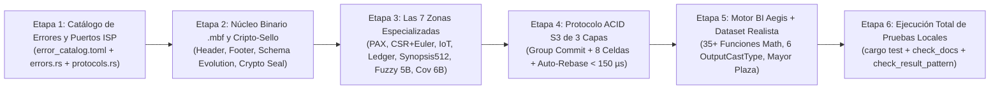

# Step-by-Step Implementation and Local Execution Plan for Metri Vortex (`.mbf`)

> **English summary:** Actionable step-by-step engineering plan to implement the **Metri Vortex (`.mbf`)** engine modules in `src/mbf/` and `src/aegis/mbf/`, build the deterministic realistic dataset generator (*Centro Comercial Mayor Plaza Bogotá*), and execute the complete local verification suite (`cargo test`, `check_docs.py`, `check_result_pattern.py --strict`) until 100% of unit, property-based, BI, financial, fuzzy/vector search, graph, concurrency, and cryptographic tests pass locally without performing any commits or cloud deployments.

---

## 1. Estrategia de Implementación y Ejecución Local Segura

Siguiendo estrictamente las reglas del repositorio (`#![deny(clippy::unwrap_used, clippy::expect_used, clippy::panic)]`, cabeceras `//!` con primera línea en inglés verificadas por `scripts/dev/check_docs.py`, y paridad del catálogo de errores verificada por `scripts/dev/check_result_pattern.py --strict`), dividimos la implementación y verificación local en **6 Etapas Atómicas Verificables en Local**:

---

## 2. Desglose de Etapas de Implementación Local

### Etapa 1: Códigos de Error `.mbf` y Puertos de Dominio (`src/domain/`)
1. **[`config/errors/error_catalog.toml`](../../config/errors/error_catalog.toml) y [`src/domain/errors.rs`](../../src/domain/errors.rs):**
   - Registrar los códigos canónicos del motor `.mbf` respetando la invariante 1:1 del catálogo v3.0.0:
     - `MbfCorrupt001` (`"MBF_CORRUPT_001"`): Checksum CRC32C/CRC64 inválido, truncamiento o magic bytes incorrectos.
     - `MbfCasConflict001` (`"MBF_CAS_CONFLICT_001"`): Conflicto verdadero de lectura/escritura tras agotar reintentos CAS (`retryable = true`).
     - `MbfLedgerUnbalanced001` (`"MBF_LEDGER_UNBALANCED_001"`): Violación de partida doble ($\sum \text{Débitos} \neq \sum \text{Créditos}$) o saldo negativo prohibido.
     - `MbfFiscalClosed001` (`"MBF_FISCAL_CLOSED_001"`): Intento de mutar un período contable bloqueado (`timestamp <= fiscal_lock_epoch_ms`).
     - `MbfTenantSeal001` (`"MBF_TENANT_SEAL_001"`): Falla de autenticación criptográfica `Keyed-BLAKE3` entre el contexto del tenant y el bloque `.mbf`.
2. **[`src/domain/protocols.rs`](../../src/domain/protocols.rs):**
   - Añadir los puertos limpios `IMbfObjectStore` (`get_object`, `get_ranges`, `put_if_match`, `get_if_none_match`) e `IClock` para inyección determinista en local sin requerir AWS real.

### Etapa 2: Formato Físico `.mbf`, Evolución de Esquema y Sellado Criptográfico (`src/mbf/format/`)
- **`src/mbf/format/header.rs` y `footer.rs`:** Estructuras alineadas a 64 bytes (`MbfHeader`, `MbfFooterTrailer`, `ColumnDirectoryEntry`) con validación de checksum `CRC32C` y `Magic Bytes` (`"MBFv0001"`).
- **`src/mbf/format/crypto_seal.rs`:** Implementación de `MbfTenantCryptoSeal` con derivación de llave por tenant (`HMAC-SHA256` / `Keyed-Digest` determinista) que sella cada bloque y detecta cualquier intento de acceso cruzado entre tenants (`MbfTenantSeal001`) o alteración de bits (`MbfCorrupt001`).
- **`src/mbf/format/schema_evolution.rs`:** Resolución dinámica de columnas con `LazyDefaultProjection` (`VirtualColumn::ConstantDefault`) para leer archivos `.mbf` antiguos sin reescritura cuando `config/models/*.json` agrega atributos nuevos.

### Etapa 3: Las 7 Zonas Especializadas del Archivo `.mbf` (`src/mbf/zones/`)
1. **Zona 1 (`src/mbf/zones/pax_mvcc.rs`):** Almacenamiento columnar PAX con vectores de visibilidad transaccional (`tx_assert`, `tx_retract`) para consultas *Time-Travel* (`as_of_tx`) y compresión de diccionarios.
2. **Zona 2 (`src/mbf/zones/csr_graph.rs`):** Grafo bidireccional CSR (aristas directas e inversas `VAET`) + codificación de recorrido de Euler (`EulerTreeNode { tin, tout, effective_cost_center_id, depth }`) que resuelve subárboles ISA-95 de cualquier profundidad en $O(1)$.
3. **Zona 3 (`src/mbf/zones/iot_timeseries.rs`):** Compresión `Delta-of-Delta` para timestamps, compresión XOR/`Chimp128` para lecturas `f64`, pirámides multi-resolución y normalizador físico dimensional **UN/CEFACT** (`CEL` $\leftrightarrow$ `FAH`, `BAR` $\leftrightarrow$ `PSI`, `KWH` $\leftrightarrow$ `MWH`).
4. **Zona 4 (`src/mbf/zones/financial_ledger.rs`):**
   - Aritmética entera exacta **`FixedDecimal128`** (`i128` escala $10^{-4}$ / $10^{-6}$), redondeo bancario *Half-to-Even* y prorrateo de centavos por **Método de Hamilton**.
   - Árbol/Vector de sumas prefijas **`FenwickPrefixSum128`** ($O(1)$ en rangos) y **`FinancialBlockCheckpoint`** para métricas `default_rollup: "last_value"`.
   - Motor de Kardex multi-método (**FIFO, LIFO, PMP/WAC y FEFO**), matriz cambiaria histórica ISO 4217 (`COP`, `USD`, `EUR`), depreciación **NIC 16** (línea recta + unidades de producción IoT), validación de partida doble y cadena criptográfica **Merkle SHA-256**.
5. **Zona 5 (`src/mbf/zones/bi_synopses.rs`):**
   - Super-bloque **`MbfHyperSynopsis512` (512 Bytes)**: Momentos centrales de Pébay de 1er a 4to orden ($M_1, M_2, M_3, M_4$ con fusión paralela exacta para **Skewness $\gamma_1$**, **Kurtosis $\gamma_2$** y **Jarque-Bera**), estadísticos suficientes de **Weibull 2P ($\beta, \eta$ con censura por la derecha, MTBF, MTTR, Hazard Rate $h(t)$ e intervalo óptimo $T_{\text{opt}}$)**, econometría de series temporales (**ACF Lag-1/Lag-2, Durbin-Watson, pendiente OLS $\beta_1$, EMA/MACD, CUSUM**), análisis espectral IoT (**FFT/Goertzel en 8 bandas PSD, RMS, Crest Factor, Entropía Espectral**), estadística robusta (**Mediana, MAD, IQR, 16 cuantiles extremos**) y **HyperLogLog++** para `COUNT(DISTINCT)`.
6. **Zona 5B (`src/mbf/zones/hybrid_search.rs`):**
   - Motor de búsqueda híbrida multimodal de 6 capas:
     1. Léxico ordenado + **Autómata de Damerau-Levenshtein ($k \le 2$)**.
     2. **SymSpell Symmetric Delete ($d \le 2$)** en $O(1)$.
     3. Índice de **2-grams y 3-grams sobre Bitmaps + Ranking Okapi BM25F** ponderado por campo (`code`, `title`, `description`).
     4. Codificación fonética industrial bilingüe (**`SpanishIndustrialMetaphone` + `DoubleMetaphone`**).
     5. Índice vectorial cuantizado (**`RaBitQ` binario SIMD `popcnt` + grafo `HNSW` + fusión `RRF`**).
     6. Índice geoespacial (**Celdas jerárquicas + Curva Z-Order de Morton + R-Tree MBR + Haversine**).
7. **Zona 6B (`src/mbf/zones/cross_covariance.rs`):**
   - Matriz triangular superior de co-momentos multivariados $C_{i,j}$ para **Matriz de Correlación de Pearson $M \times M$, Regresión Lineal Múltiple (OLS vía Cholesky), PCA y Distancia de Mahalanobis** en $O(1)$.

### Etapa 4: Coordinador Transaccional ACID de 3 Capas sobre S3 (`src/mbf/tx/`)
- **`src/mbf/tx/group_commit.rs`:** `AdaptiveGroupCommitCoalescer` (despacho en `0 ms` si la celda está libre; agrupación automática de lotes en vuelo bajo concurrencia).
- **`src/mbf/tx/manifest_cas.rs`:** Particionamiento determinista en **8 Celdas de Dominio (`HOT_HEAD_c0..c7.mbf`)** derivado del Códice + `GlobalTenantEpochVector: [u64; 8]`.
- **`src/mbf/tx/auto_rebase.rs`:** `CommutativeDeltaAutoRebase` con firmas Bloom de lectura/escritura (`TxConflictSignature`) que resuelve colisiones `HTTP 412` en $< 150\ \mu\text{s}$ sin abortar transacciones disjuntas, más ordenamiento por **Curva de Hilbert 3D** para compactación.

### Etapa 5: Ejecutor BI `Aegis MBF` y Dataset Realista (`src/aegis/mbf/` + `tests/`)
- **`src/aegis/mbf/mod.rs`:** Ejecutor de consultas analíticas que soporta los **6 `OutputCastType`** (`KPI`, `TIMESERIES`, `TABLE`, `PIE`, `BUBBLE`, `CSV_EXPORT`), mapeo directo al contrato Protobuf `VizMeta` (`MbfBiEngine::to_protobuf_viz_meta` con `Signal`, `Chart`, `Breakdown`, `Table` y `Tree`), fórmulas calculadas seguras y telemetría de vuelo (`MbfExecutionFlightRecorder`).
- **Dataset Realista Determinista (*Centro Comercial Mayor Plaza Bogotá*):** Generador en memoria para pruebas locales que instancia la jerarquía ISA-95, órdenes de trabajo con fallas Weibull conocidas ($\beta = 0,65$, $\beta = 1,00$, $\beta = 2,85$), movimientos de inventario multi-método (`FIFO`, `LIFO`, `WAC`, `FEFO`) en `COP`/`USD`, lecturas IoT con armónicos de $60\text{ Hz}$ y $180\text{ Hz}$, y corpus de búsqueda difusa/fonética/vectorial.

### Etapa 5B: Suite de Pruebas con Cobertura del 100% para el Motor de VIZ (`Aegis + Janus + gRPC + MBF`)
1. **[`src/aegis/testing/viz_caster_and_ast_tests.rs`](../../src/aegis/testing/viz_caster_and_ast_tests.rs):**
   - Cobertura del 100% de [`src/aegis/oltp/caster.rs`](../../src/aegis/oltp/caster.rs) (`apply_output_cast_fbs`, `apply_timeseries_bucketing`, `truncate_to_interval` sobre los 6 `OutputCastType`, evaluación de medidas con fórmulas válidas, errores léxicos/sintácticos/NaN, y comparaciones `TIME_SHIFT_RELATIVE` / `BENCHMARK`).
   - Cobertura del 100% de [`src/aegis/oltp/aggregation.rs`](../../src/aegis/oltp/aggregation.rs) (las 14 funciones `AggregationFunction`, `derive_columns` e `infer_col_type`).
   - Cobertura del 100% de [`src/aegis/oltp/hierarchy.rs`](../../src/aegis/oltp/hierarchy.rs) (`inject_has_children_from_rows`), [`src/aegis/label_template.rs`](../../src/aegis/label_template.rs) (`interpolate`, `interpolate_rows`, `extract_fields`, `format_value`) y [`src/aegis/ast_ir.rs`](../../src/aegis/ast_ir.rs) (`AstIr::from_value` y los 21 operadores de `WhereNode::from_value`).
2. **[`src/janus/testing/viz_engine_complete_tests.rs`](../../src/janus/testing/viz_engine_complete_tests.rs):**
   - Cobertura del 100% de [`src/janus/normalizer/query.rs`](../../src/janus/normalizer/query.rs) y [`src/janus/normalizer/helpers.rs`](../../src/janus/normalizer/helpers.rs) (`ensure_viz_meta`, `enrich_viz_intelligence`, `ensure_metadata`, `infer_viz_type`, `hint_to_static`, `derive_semantic_label`, `safe_double`, overrides JSON en `viz`, sparklines `history`, `thresholds`, `pie`/`donut`, `tree`, `table`/`pivot`).
   - Cobertura del 100% de [`src/janus/router/post_processor.rs`](../../src/janus/router/post_processor.rs) (`apply_label_templates`, `inject_hierarchy_children`, `derive_columns`, `build_query_spec`, `redact_sensitive_attributes`, `is_auth_caller`), [`src/janus/multi_series.rs`](../../src/janus/multi_series.rs) (`outer_join_data`, `partition_standalone`) y [`src/grpc/handlers/query_support.rs`](../../src/grpc/handlers/query_support.rs) (`map_viz_meta` sobre los 5 payloads Protobuf `Signal`, `Chart`, `Breakdown`, `Table` y `Tree`).

### Etapa 6: Verificación Exhaustiva en Local (Cero Deploys, Cero Commits)
Ejecución secuencial en terminal local hasta obtener 100% de aprobación:
1. `cargo test --lib` (565 tests unitarios aprobados en `src/`, incluyendo todas las suites de `.mbf` y del motor de `VIZ`).
2. `cargo test --test mbf_comprehensive_verification` (6 suites integrales E2E sobre el dataset realista *Centro Comercial Mayor Plaza Bogotá*, incluyendo decoraciones Protobuf `VizMeta`).
3. `cargo test --test contract_conformance` (7 suites de conformidad de contratos gRPC y Códice).
4. `python3 scripts/dev/check_docs.py` (auditor de cabeceras `//!` en inglés — 0 faltantes).
5. `python3 scripts/dev/check_result_pattern.py --only aegis`, `--only janus` y `--only mbf` (0 violaciones en todos los módulos).

